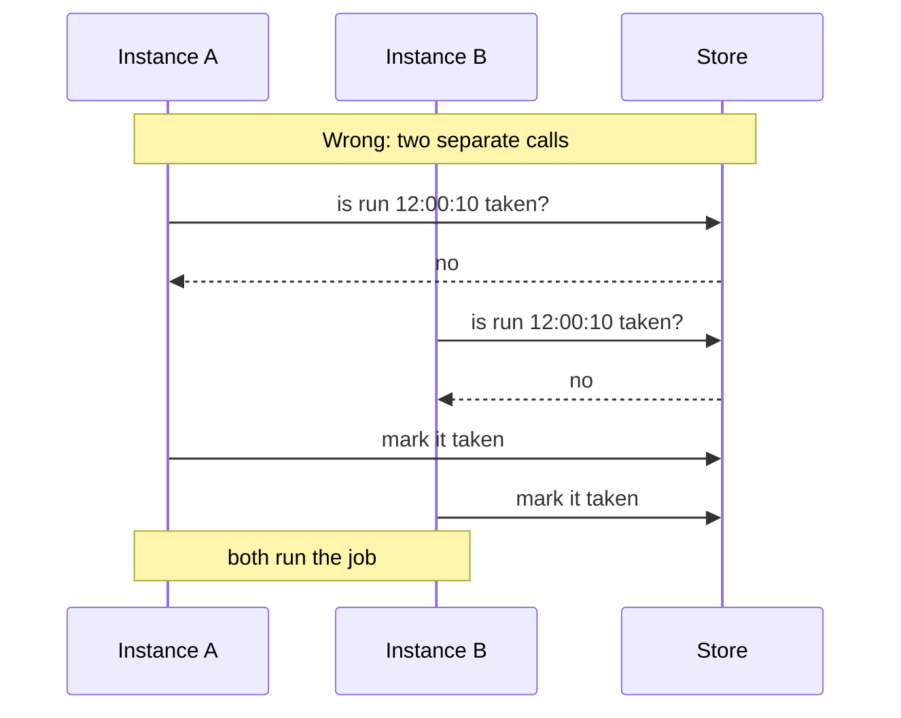

A backend is a class that implements the `Backend` interface. If your instances share a store that can do one atomic "write unless it exists", you can write one.

## The contract

One rule matters more than everything else:

> For one job and one slot, `claim()` returns `true` for **exactly one** instance.

The scheduler does the rest: it computes the slots, waits the jitter, calls `claim()`, runs the handler on the winner, and saves the result.

```ts
interface Backend {
  /** Shown as scheduler.backend.name, e.g. 'memory'. */
  readonly name: string;
  /** How long the store remembers a claimed run (ms). Infinity if forever. */
  readonly dedupeWindowMs: number;

  /** Connect and check the server. Called by start() and before reads. */
  init(): Promise<void>;
  /** One-time setup for a job: create its table, stream or queue. */
  prepareJob(job: string, historySize: number): Promise<void>;
  /** True for exactly one instance per slot. Must be safe to repeat with the same token. */
  claim(input: ClaimInput): Promise<boolean>;
  /** Record a runNow() run. Not deduplicated. */
  recordManualRun(input: ClaimInput): Promise<number | void>;
  /** Store how a run ended. */
  saveResult(job: string, result: StoredResult, historySize: number, historyTtlMs?: number): Promise<void>;
  /** Latest runs from all instances, newest first. */
  history(job: string, limit: number): Promise<RunRecord[]>;
  /** Close what the backend opened itself. */
  close(): Promise<void>;

  /** Optional: refuse a job this backend can't run safely. Throw to refuse. */
  checkJob?(job: JobLimits): void;
  /** Optional: called after a won claim, if claim() isn't already a history record. */
  recordClaim?(input: ClaimInput): Promise<void>;
  /** Optional: present on backends with leases. */
  readonly runs?: RunStore;
}
```

`ClaimInput` is what an instance sends:

| Field | Meaning |
| --- | --- |
| `job` | The job's name |
| `slot` | The scheduled time in ms: with `job`, the identity of the run |
| `token` | A random value unique to this attempt |
| `instanceId` | Who is asking |
| `historySize`, `historyTtlMs` | How much history to keep |

## A complete example

This backend keeps everything in memory. It only coordinates schedulers in the **same process**, which makes it useful for unit tests and for seeing the contract in the smallest form.

```ts
import type { Backend, ClaimInput, RunRecord, StoredResult } from 'anarchon';

export class MemoryBackend implements Backend {
  readonly name = 'memory';
  /** Claims are never forgotten here, so there is no limit on how late an instance may be. */
  readonly dedupeWindowMs = Infinity;

  private readonly claims = new Map<string, ClaimInput & { at: number; manual: boolean }>();
  private readonly results = new Map<string, StoredResult>();

  async init(): Promise<void> {}
  async prepareJob(): Promise<void> {}
  async close(): Promise<void> {}

  /** The one step that must be atomic. Here it is, because JavaScript runs it without interruption. */
  async claim(input: ClaimInput): Promise<boolean> {
    const key = `${input.job}|${input.slot}`;
    const existing = this.claims.get(key);
    if (existing) return existing.token === input.token; // the same claim sent again is still ours
    this.claims.set(key, { ...input, at: Date.now(), manual: false });
    return true;
  }

  async recordManualRun(input: ClaimInput): Promise<void> {
    this.claims.set(`${input.job}|${input.slot}|manual`, { ...input, at: Date.now(), manual: true });
  }

  async saveResult(job: string, result: StoredResult): Promise<void> {
    this.results.set(`${job}|${result.slot}|${result.by}`, result);
  }

  async history(job: string, limit: number): Promise<RunRecord[]> {
    return [...this.claims.values()]
      .filter((claim) => claim.job === job)
      .sort((a, b) => b.slot - a.slot)
      .slice(0, limit)
      .map((claim) => {
        const result = this.results.get(`${job}|${claim.slot}|${claim.instanceId}`);
        return {
          job,
          slot: claim.slot,
          scheduledAt: new Date(claim.slot),
          instanceId: claim.instanceId,
          manual: claim.manual,
          attempt: 1,
          status: result?.status ?? 'running',
          startedAt: new Date(result?.startedAt ?? claim.at),
          ...(result ? { finishedAt: new Date(result.finishedAt), durationMs: result.durationMs, error: result.error } : {}),
        };
      });
  }
}
```

Three schedulers sharing one instance of it run each slot once:

```ts
const backend = new MemoryBackend();
const instances = ['A', 'B', 'C'].map((instanceId) => new Scheduler({ backend, instanceId }));

for (const scheduler of instances) scheduler.every('tick', '1s', (ctx) => console.log(ctx.slot, ctx.instanceId));
await Promise.all(instances.map((s) => s.start()));
```

## The atomic step in a real store

In memory, `claim()` is atomic for free. In a shared store, the check and the write must be **one operation on the server**. Checking first and writing second, as two calls, is the classic mistake:



Use whatever your store offers to do it in one step:

| Store feature | Example |
| --- | --- |
| Insert with a unique key | `INSERT ... ON CONFLICT DO NOTHING`, then check whether a row was inserted |
| Conditional write | "put if absent", compare-and-set |
| A server-side script or transaction | Redis Lua, SQL transactions |
| De-duplicated publish | NATS message IDs, a bounded queue with rejection |

## Make `claim()` safe to repeat

Network clients retry. If a claim is sent, the connection drops, and the client sends it again, the second call must still answer `true` for the instance that already won. That is what the `token` is for: store it with the claim, and when a claim for a taken slot arrives, compare tokens.

## `dedupeWindowMs`

How long your store remembers a claimed run. If it remembers forever, return `Infinity`.

If it forgets after a while (a TTL, a bounded stream), return that time. The scheduler then refuses any job whose `jitterMs + maxLateMs` is not shorter, because an instance arriving later than the store's memory could run the job again.

## Adding leases

A backend that also provides `runs`, a `RunStore`, gets backups, overlap protection, catch-up and hand-over. It has five methods:

| Method | Must do, atomically |
| --- | --- |
| `claim(input)` | Decide between `won`, `running`, `done`, `overlap`, `none` and `late` from the run's stored state |
| `heartbeat(job, slot, token, leaseMs)` | Move the lease end forward **only if** the stored token matches |
| `finish(job, slot, token, status)` | Mark the run ended, only with the matching token |
| `release(job, slot, token)` | End a live lease now so a backup can take over (graceful stop) |
| `active(job)` | List unfinished runs and whether each lease is alive |

The rules are the same on every lease backend, and [Leases](../../internals/leases/) states them precisely. If your store speaks SQL, you don't have to write them: `PostgresBackend` and `SqliteBackend` accept an adapter with two functions, and implement the leases on top of it.

```ts
import { SqliteBackend } from 'anarchon';

// Any client with all() and transaction() works with the SQL backends
const backend = new SqliteBackend({
  database: {
    all: (sql, params) => myDriver.query(sql, params),
    transaction: (fn) => myDriver.transaction((tx) => fn({ all: (sql, params) => tx.query(sql, params) })),
  },
});
```

## Testing a backend

Whatever the store, test the contract directly:

1. **The race.** Send the same claim from several clients at once, many times. Exactly one must win each time.
2. **Repeat safety.** The winning claim sent again, with the same token, still answers `true`. A different token answers `false`.
3. **History.** A claim plus a saved result comes back from `history()` as one record with the right instance and status.

anarchon's own suite runs these against every built-in backend.

## Next

- [Claim algorithms](../../internals/claim-algorithms/): how the built-in backends do it
- [Leases](../../internals/leases/)
