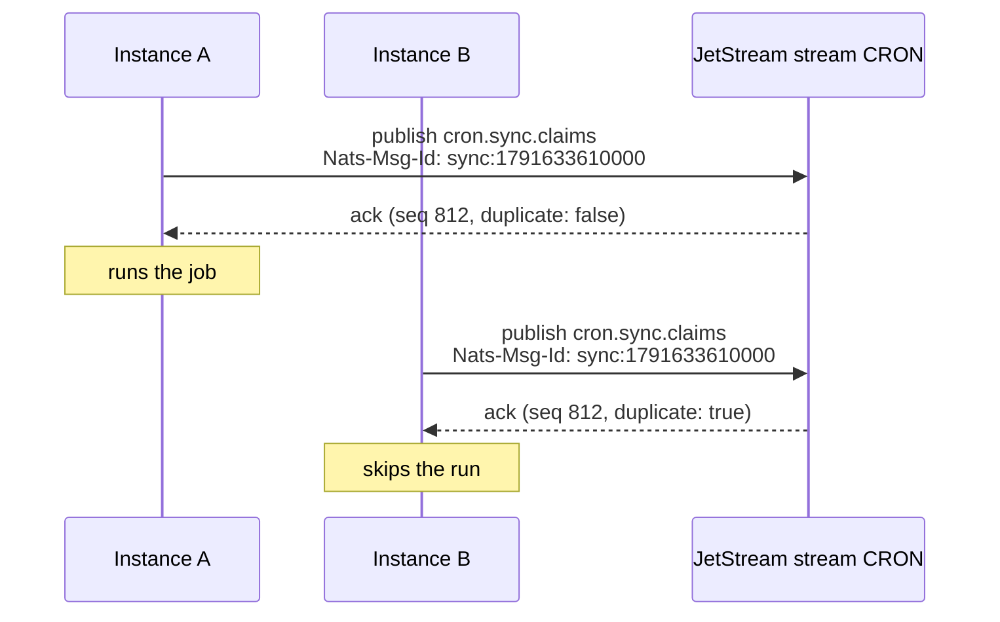
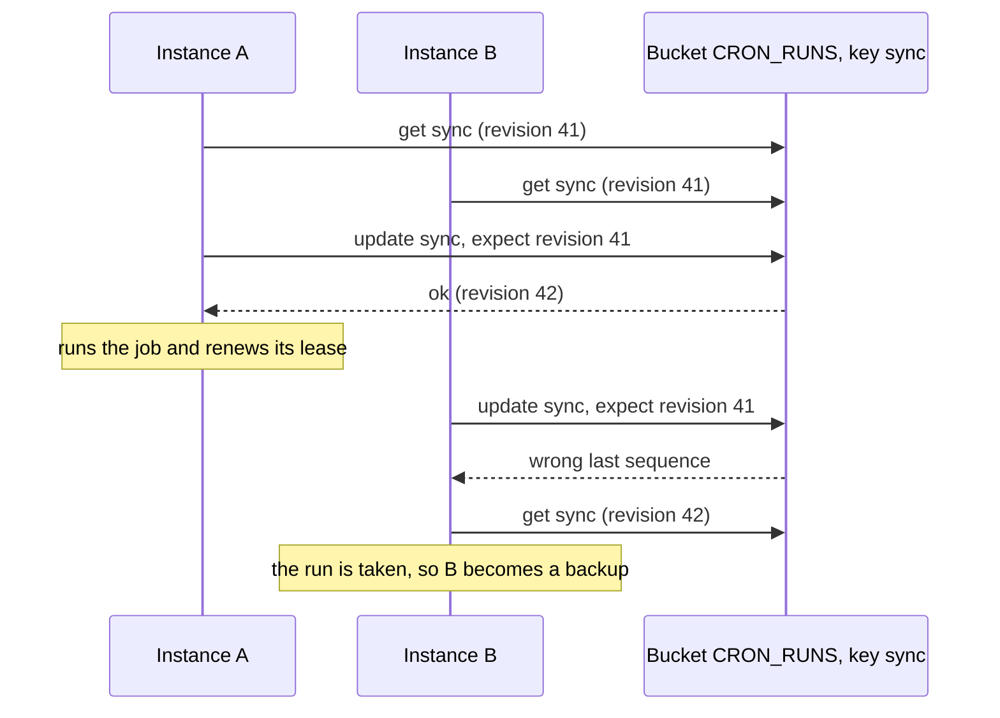

`NatsBackend` makes sure one instance runs each scheduled time, using NATS JetStream. It has two strategies:

| Strategy | What you get | Needs |
| --- | --- | --- |
| `msg-id` (default) | One winner per run | JetStream |
| `lease` | One winner per run, plus backup runners, no overlapping runs, catch-up, retries and hand-over on `stop()` | JetStream on nats-server 2.10 or newer, and the `@nats-io/kv` package |

```ts
import { NatsBackend, Scheduler } from 'anarchon';

const servers = 'nats://nats.internal:4222';
new Scheduler({ backend: new NatsBackend({ servers }) });                    // msg-id
new Scheduler({ backend: new NatsBackend({ servers, strategy: 'lease' }) }); // lease
```

JetStream must be enabled on the server (`nats-server -js`). For `lease`, install the key-value client too: `pnpm add @nats-io/kv`.

:::caution[`msg-id` is claim only]
The de-duplication `msg-id` uses decides who is first, but it holds no lease that a backup could check. So with it there are **no backup runners, no overlap protection, no catch-up and no hand-over**. If the instance running a job dies, that run is lost. For those features use the `lease` strategy, or Redis, PostgreSQL or SQLite. See [Brokers and leases](../brokers-and-leases/).
:::

Every instance of a service must use the same strategy. The two keep their claims in different places, so an instance on one doesn't see the claims of an instance on the other.

## Options

| Option | Default | Meaning |
| --- | --- | --- |
| `strategy` | `'msg-id'` | `'msg-id'` or `'lease'` |
| `servers` | `'nats://localhost:4222'` | One URL or a list |
| `connection` | | Your own connection from `@nats-io/transport-node`. You keep ownership |
| `stream` | `'CRON'` | JetStream stream name |
| `prefix` | `'cron.'` | Subject prefix |
| `duplicateWindowMs` | `300000` (5 min) | How long JetStream remembers a claimed run. With `lease`, only drops a history record the client sends twice |
| `historySize` | `1000` | About how many runs to keep per job, at least |
| `replicas` | `1` for a new stream | Stream replicas in a NATS cluster; with `lease`, also the replicas of a new bucket |

```ts
import { connect } from '@nats-io/transport-node';

const connection = await connect({ servers: ['nats://n1:4222', 'nats://n2:4222', 'nats://n3:4222'] });
new NatsBackend({ connection, stream: 'BILLING_CRON', prefix: 'billing.cron.', replicas: 3 });
```

:::note
All jobs share one stream, so it keeps one history size for all of them: the largest of the backend's `historySize` and every job's. A job that asks for more raises it when the job is added.
:::

## How one instance wins with `msg-id`

The feature used is JetStream's **message de-duplication**. A publisher can attach a message ID; within the stream's duplicate window, JetStream stores only the first message with a given ID.



1. Every instance publishes its claim to `<prefix><job>.claims` with the header `Nats-Msg-Id: <job>:<slot>`. The ID is the same on every instance, because the slot is.
2. The stream stores the first message with that ID. For every later one it answers `duplicate: true` and stores nothing.
3. An instance won if its acknowledgement is not a duplicate. The stream (its leader, in a cluster) orders the publishes, so exactly one is first.

If an acknowledgement says "duplicate", the instance reads the stored message and compares tokens. That way a claim that the client itself retried is still recognized as its own.

## How one instance wins with `lease`

The `lease` strategy keeps each job's runs in a JetStream **key-value bucket**, `<stream>_RUNS` (`CRON_RUNS` by default), under one key per job. Every key has a revision, and a write can say "only if the key is still at revision N": JetStream refuses it when anyone wrote in between. Every decision about a run is one such write:

1. Read the job's key, its revision, and the server's clock.
2. Decide by the [lease rules](../../internals/leases/): no state for the run starts attempt 1 with a lease; a live lease answers `running`; a lease that ran out gives the caller the next attempt; a finished run answers `done`. A new run is refused while an older run of the job has a live lease (`overlap: 'skip'`).
3. Write the new state at the revision read. If another instance wrote first, JetStream refuses the write, and the instance reads and decides again.



Heartbeats, hand-over on `stop()` and finishing are the same read and write on the job's key, and change the run only while it carries the caller's token: after a takeover, nothing the old runner sends changes the run.

**The server's clock.** Leases run on the NATS server's clock, not on an instance's. Each decision reads it from the bucket's stream info (`ts`, which nats-server 2.10 and newer report), and anarchon refuses an older server on `start()`.

**What the bucket keeps.** One value per key, no older revisions. A job's value holds its unfinished runs, and finished runs young enough that a late claim could still ask about them; older ones are dropped on the next claim. That is about 120 bytes per run: a job that runs every second keeps about 300 runs (some 35 kB) with the default `catchUpMs` of 5 minutes, and rewrites them on every claim and heartbeat. History stays in the stream, as with `msg-id`.

[`examples/nats-leases.ts`](https://github.com/aristoteliss/anarchon/blob/main/examples/nats-leases.ts) shows it with three processes: a hand-over on `SIGTERM`, a takeover after `kill -9`, and catch-up after every process was down. The other examples run on it with `BACKEND=nats`.

**What it costs.** Each decision is a read and a conditional write: a heartbeat takes two round trips to the server, and a claim that wins three (the last one records it in history). A write that loses to another instance's costs one more read and write.

## The stream

anarchon creates the stream on `start()` if it doesn't exist, covering the subjects `<prefix>>`. If a stream with that name already exists with other settings, anarchon updates the duplicate window and per-subject limit and adds its subjects. With `lease`, it also creates the bucket `<stream>_RUNS` if it doesn't exist; an existing bucket keeps its settings.

| Where | Holds |
| --- | --- |
| Subject `<prefix><job>.claims` | One message per claimed run (`lease`: per attempt), and per manual run |
| Subject `<prefix><job>.results` | One message per finished run (`lease`: per attempt) |
| Bucket `<stream>_RUNS`, key `<job>` | `lease` only: the state of the job's runs |
| Bucket `<stream>_RUNS`, key `meta.format` | `lease` only: the store format, so an older anarchon refuses data it can't read |

## Limits to know

- **`msg-id`: `jitterMs + maxLateMs` must be shorter than `duplicateWindowMs`.** Outside the window JetStream no longer recognizes a repeat, and a very late instance could run the job again. anarchon checks this when you add a job. The defaults (2 s + 60 s against 5 min) are fine. `lease` has no such limit: the bucket remembers a run while a late claim could still ask about it.
- **Job names** may only contain letters, digits, `_` and `-`, because they become subjects and keys.
- **`lease`: the stream name** may only contain letters, digits, `_` and `-`, because it names the bucket.
- **Replicas.** In a NATS cluster set `replicas: 3` so the stream, and its memory of claimed runs, survives the loss of a server. When `replicas` is set, an existing stream is updated to it; when it isn't, an existing stream keeps the replicas it has. With `lease`, a new bucket gets the same number of replicas; an existing bucket keeps its own.

## History

`history()` reads the job's claims and results from the stream and joins them. `lastRun()` and `runNow()` work as on other backends. With `msg-id`, a run whose runner died keeps the status `running`; with `lease`, it reads `interrupted` once its lease ran out, as on the other lease backends. History is trimmed by count only, so `historyTtlMs` is refused.

## Next

- [Leases](../../internals/leases/)
- [Claim algorithms](../../internals/claim-algorithms/#nats)
- [Brokers and leases](../brokers-and-leases/)
- [Backends overview](../overview/)
