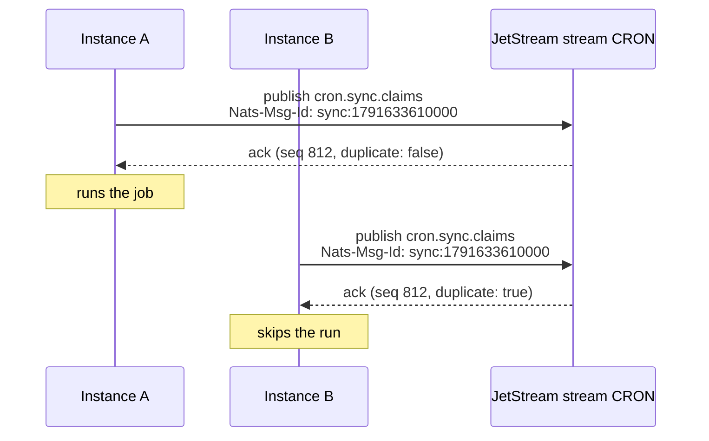

`NatsBackend` makes sure one instance runs each scheduled time, using NATS JetStream.

```ts
import { NatsBackend, Scheduler } from 'anarchon';

const scheduler = new Scheduler({
  backend: new NatsBackend({ servers: 'nats://nats.internal:4222' }),
});
```

JetStream must be enabled on the server (`nats-server -js`).

:::caution[Claim only]
The de-duplication this backend uses decides who is first, but it holds no lease that a backup could check. So with this backend there are **no backup runners, no overlap protection, no catch-up and no hand-over**. If the instance running a job dies, that run is lost. For those features use Redis, PostgreSQL or SQLite. See [Brokers and leases](../brokers-and-leases/).
:::

## Options

| Option | Default | Meaning |
| --- | --- | --- |
| `servers` | `'nats://localhost:4222'` | One URL or a list |
| `connection` | | Your own connection from `@nats-io/transport-node`. You keep ownership |
| `stream` | `'CRON'` | JetStream stream name |
| `prefix` | `'cron.'` | Subject prefix |
| `duplicateWindowMs` | `300000` (5 min) | How long JetStream remembers a claimed run |
| `historySize` | `1000` | About how many runs to keep per job, at least |
| `replicas` | `1` | Stream replicas in a NATS cluster |

```ts
import { connect } from '@nats-io/transport-node';

const connection = await connect({ servers: ['nats://n1:4222', 'nats://n2:4222', 'nats://n3:4222'] });
new NatsBackend({ connection, stream: 'BILLING_CRON', prefix: 'billing.cron.', replicas: 3 });
```

:::note
All jobs share one stream, so it keeps one history size for all of them: the largest of the backend's `historySize` and every job's. A job that asks for more raises it when the job is added.
:::

## How one instance wins

The feature used is JetStream's **message de-duplication**. A publisher can attach a message ID; within the stream's duplicate window, JetStream stores only the first message with a given ID.



1. Every instance publishes its claim to `<prefix><job>.claims` with the header `Nats-Msg-Id: <job>:<slot>`. The ID is the same on every instance, because the slot is.
2. The stream stores the first message with that ID. For every later one it answers `duplicate: true` and stores nothing.
3. An instance won if its acknowledgement is not a duplicate. The stream (its leader, in a cluster) orders the publishes, so exactly one is first.

If an acknowledgement says "duplicate", the instance reads the stored message and compares tokens. That way a claim that the client itself retried is still recognized as its own.

## The stream

anarchon creates the stream on `start()` if it doesn't exist, covering the subjects `<prefix>>`. If a stream with that name already exists with other settings, anarchon updates the duplicate window and per-subject limit and adds its subjects.

| Subject | Holds |
| --- | --- |
| `<prefix><job>.claims` | One message per claimed run, and per manual run |
| `<prefix><job>.results` | One message per finished run |

## Limits to know

- **`jitterMs + maxLateMs` must be shorter than `duplicateWindowMs`.** Outside the window JetStream no longer recognizes a repeat, and a very late instance could run the job again. anarchon checks this when you add a job. The defaults (2 s + 60 s against 5 min) are fine.
- **Job names** may only contain letters, digits, `_` and `-`, because they become subjects.
- **Replicas.** In a NATS cluster set `replicas: 3` so the stream, and its memory of claimed runs, survives the loss of a server.

## History

`history()` reads the job's claims and results from the stream and joins them. `lastRun()` and `runNow()` work as on other backends. A run whose runner died keeps the status `running`. History is trimmed by count only, so `historyTtlMs` is refused.

## Next

- [Claim algorithms](../../internals/claim-algorithms/#nats)
- [Backends overview](../overview/)
