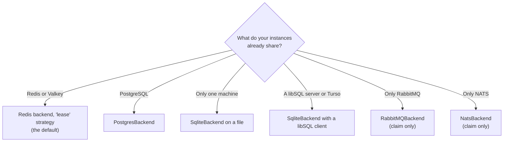
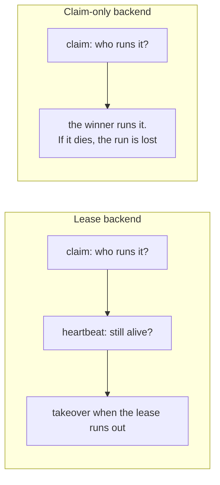

A **backend** is the adapter between anarchon and the store your instances share. Every backend makes sure one instance wins each run. Some can also hold a lease, which is what enables backups, overlap protection and catch-up.

## Choosing



Use what you already run. If you have both Redis and PostgreSQL, Redis has the lower latency per claim; PostgreSQL keeps the job history next to your data.

## What each backend gives you

| | Redis / Valkey | PostgreSQL | SQLite | RabbitMQ | NATS |
| --- | --- | --- | --- | --- | --- |
| One winner per run | yes | yes | yes | yes | yes |
| Backups take over a dead runner | yes ¹ | yes | yes | no | no |
| No overlapping runs | yes ¹ | yes | yes | no | no |
| Catch-up after downtime | yes ¹ | yes | yes | no | no |
| Hand-over on `stop()` | yes ¹ | yes | yes | no | no |
| History | yes | yes | yes | yes | yes |
| Several machines | yes | yes | only with a libSQL server | yes | yes |
| Needs | Redis 5+ or Valkey | PostgreSQL 9.5+ | SQLite 3.35+ | RabbitMQ 3.9+ | JetStream |

¹ With the `lease` strategy, which is the default. The `stream-id`, `idmp` and `script` strategies are claim-only.

## Lease backends and claim-only backends

The split comes from what the store can express.

A **lease backend** stores, for each run, who is running it and until when. Other instances can read that and act on it. Redis (with a Lua script), PostgreSQL and SQLite (with a transaction) can all do "read the run, decide, write" as one atomic step.

A **claim-only backend** can answer exactly one question atomically: "was I first?" RabbitMQ and NATS are message brokers, and the feature each backend uses can tell a publisher it was first, but leaves no record that a backup could check later and atomically replace. [Brokers and leases](../brokers-and-leases/) explains why, and what could change it.



Use a claim-only backend when losing the occasional run to a crash is acceptable and you don't want another piece of infrastructure.

## How each one picks the winner

Each store has a different primitive that lets exactly one writer succeed. The details, with diagrams, are in [Claim algorithms](../../internals/claim-algorithms/).

| Backend | The atomic step |
| --- | --- |
| Redis `lease` | A Lua script that reads the run's state and writes the claim |
| Redis `stream-id` | `XADD` with the run time as the entry ID; Redis refuses an ID that isn't greater than the last |
| Redis `idmp` | `XADD ... IDMP`; Redis keeps the first entry for an idempotency key |
| Redis `script` | A Lua script that appends the run only if it isn't in the stream |
| PostgreSQL | One transaction on the run's row, serialized per job |
| SQLite | One `BEGIN IMMEDIATE` transaction; SQLite has one writer at a time |
| RabbitMQ | A queue that holds one message and rejects the rest, with publisher confirms |
| NATS | JetStream de-duplication by message ID |

## Using a backend

Every backend is created and passed in as `backend`:

```ts
import { NatsBackend, PostgresBackend, RabbitMQBackend, RedisBackend, Scheduler, SqliteBackend } from 'anarchon';

new Scheduler({ backend: new RedisBackend({ redis: 'redis://localhost:6379' }) });
new Scheduler({ backend: new PostgresBackend({ connection: process.env.DATABASE_URL }) });
new Scheduler({ backend: new SqliteBackend({ database: './jobs.db' }) });
new Scheduler({ backend: new RabbitMQBackend({ url: 'amqp://localhost' }) });
new Scheduler({ backend: new NatsBackend({ servers: 'nats://localhost:4222' }) });
```

`scheduler.backend.name` tells you which one is in use: `'redis:lease'`, `'postgres'`, `'sqlite'`, `'rabbitmq'` or `'nats'`.

## Your own connections

Every backend accepts a client your app already has. anarchon never closes a client it didn't open, so `stop()` leaves yours usable.

```ts
const pool = new Pool({ connectionString: process.env.DATABASE_URL });
const scheduler = new Scheduler({ backend: new PostgresBackend({ connection: pool }) });

await scheduler.stop();
await pool.query('SELECT 1'); // still works
```

## Sharing a store between services

Two services on the same Redis or database must not see each other's jobs. Give each its own namespace:

| Backend | Option | Default |
| --- | --- | --- |
| Redis / Valkey | `prefix` | `'cron:'` |
| PostgreSQL / SQLite | `table` | `'anarchon_runs'` |
| RabbitMQ | `prefix` | `'cron.'` |
| NATS | `prefix` and `stream` | `'cron.'`, `'CRON'` |

Instances of the **same** service must use the same value. See [Several services on one store](../../recipes/several-services/).

## Next

Pick your store: [Redis and Valkey](../redis/), [PostgreSQL](../postgres/), [SQLite and libSQL](../sqlite/), [RabbitMQ](../rabbitmq/), [NATS](../nats/), or [write your own](../custom/).
