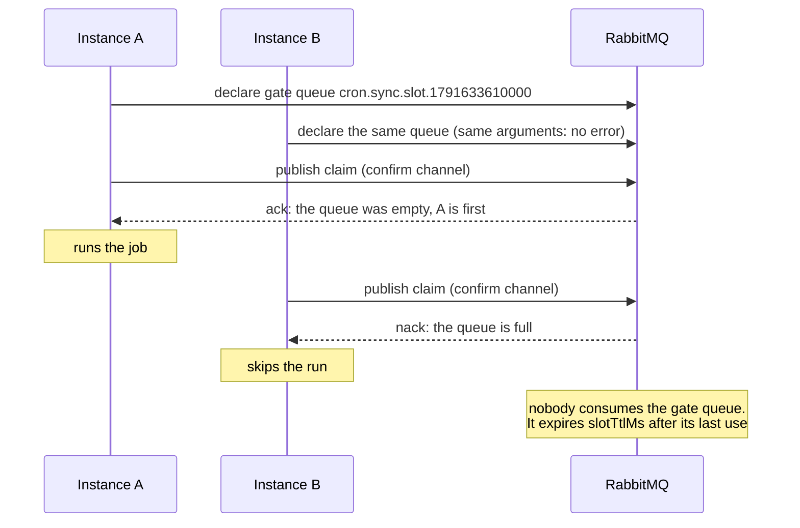

`RabbitMQBackend` makes sure one instance runs each scheduled time, using a RabbitMQ you already have. It needs RabbitMQ 3.9 or newer.

```ts
import { RabbitMQBackend, Scheduler } from 'anarchon';

const scheduler = new Scheduler({
  backend: new RabbitMQBackend({ url: 'amqp://rabbit.internal' }),
});
```

:::caution[Claim only]
The bounded queue this backend uses decides who is first, but it holds no lease that a backup could check. So with this backend there are **no backup runners, no overlap protection, no catch-up and no hand-over**. If the instance running a job dies, that run is lost. For those features use Redis, PostgreSQL or SQLite. See [Brokers and leases](../brokers-and-leases/).
:::

## Options

| Option | Default | Meaning |
| --- | --- | --- |
| `url` | `'amqp://localhost'` | AMQP URL |
| `connection` | | Your own `amqplib` connection. You keep ownership |
| `prefix` | `'cron.'` | Prefix of every queue name |
| `slotTtlMs` | `300000` (5 min) | How long RabbitMQ remembers that a run was taken |

```ts
import amqplib from 'amqplib';

const connection = await amqplib.connect(process.env.AMQP_URL);
new RabbitMQBackend({ connection, prefix: 'billing.cron.', slotTtlMs: 15 * 60_000 });
```

## How one instance wins

The feature used is a **queue that holds one message and rejects the rest**, together with **publisher confirms**.

Each run gets its own small "gate" queue, named `<prefix><job>.slot.<slot>`, declared with:

| Argument | Value | Effect |
| --- | --- | --- |
| `x-max-length` | `1` | The queue holds one message |
| `x-overflow` | `reject-publish` | A publish to a full queue is refused, not dropped silently |
| `x-expires` | `slotTtlMs` | The queue deletes itself after being unused that long |



1. Every instance declares the gate queue. Declaring a queue that exists, with the same arguments, is allowed, so this is safe to repeat.
2. Every instance publishes one message to it on a channel in confirm mode.
3. The broker **acks** the publish that filled the queue and **nacks** every later one. The broker orders the publishes, so exactly one instance gets the ack.
4. Nobody consumes the message. The run stays "taken" until the queue expires.

### If the answer is lost

If the connection drops after the publish and before the confirm arrives, the instance can't know whether it won. It treats the run as **not won** and skips it, rather than risk running it twice. In that rare case the run doesn't happen at all.

## Limits to know

- **`jitterMs + maxLateMs` must be shorter than `slotTtlMs`.** After the gate queue expires, RabbitMQ no longer knows the run was taken, and a very late instance could run it again. anarchon checks this when you add a job and throws if the settings are unsafe. With the defaults (2 s + 60 s against 5 min) you are fine.
- **Job names** may only contain letters, digits, `_` and `-`, because they become queue names.
- **One queue per run.** A job that runs every second creates a queue every second, each living `slotTtlMs`. With the default that is about 300 small queues per such job at any moment. For very frequent jobs prefer Redis.

## History

History is kept in a **stream queue** per job, `<prefix><job>.history`, sized from the job's `historySize`. This is why RabbitMQ 3.9 is needed: streams arrived in that version.

`history()`, `lastRun()` and `runNow()` work as on other backends. A run whose runner died keeps the status `running`, since nothing can tell it stopped.

## Next

- [Claim algorithms](../../internals/claim-algorithms/#rabbitmq)
- [Backends overview](../overview/)
