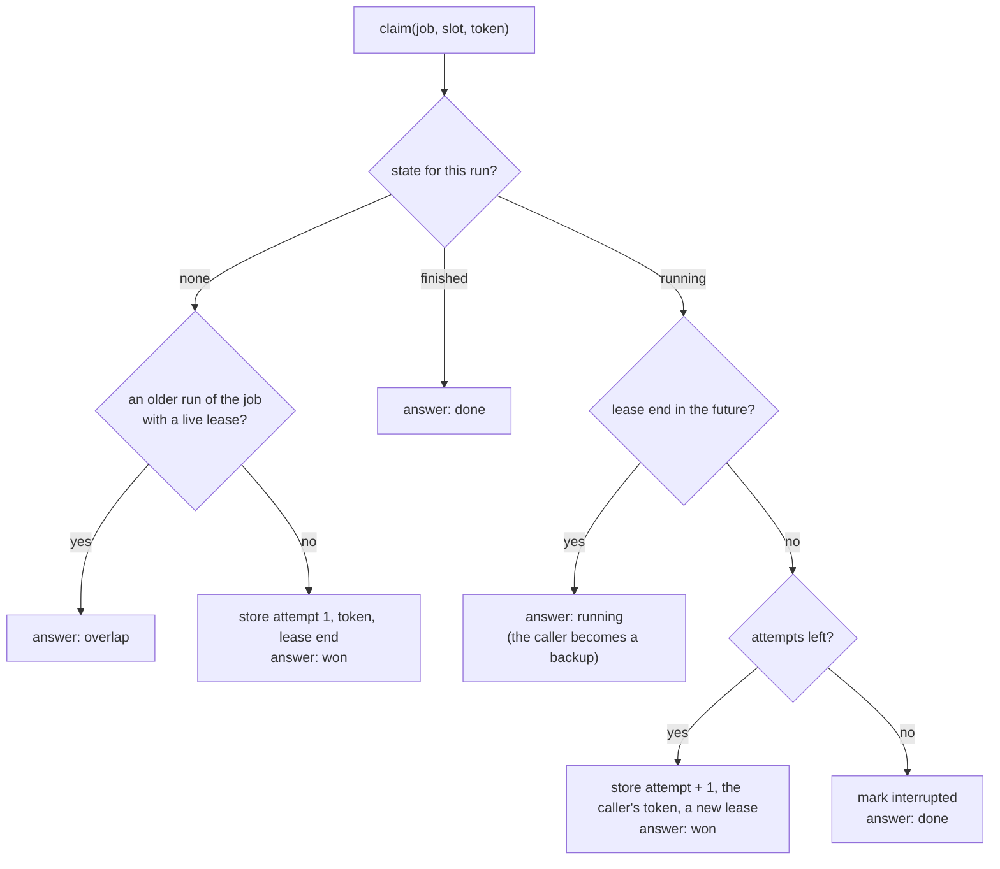

Redis is the default backend. `RedisBackend` works with Redis 5 or newer, and `ValkeyBackend` with Valkey.

```ts
import { RedisBackend, Scheduler, ValkeyBackend } from 'anarchon';

new Scheduler({ backend: new RedisBackend({ redis: 'redis://localhost:6379' }) });
new Scheduler({ backend: new RedisBackend({ redis: 'redis://cache.internal:6379' }) });
new Scheduler({ backend: new ValkeyBackend({ valkey: { host: 'localhost', port: 6390 } }) });
```

`ValkeyBackend` is a `RedisBackend` that accepts only the strategies Valkey supports, so `strategy: 'idmp'` is a type error instead of an error from `start()`. Its connection option is `valkey` instead of `redis`, and it has no `idmp` settings. Everything else on this page applies to both.

## Connecting

`redis` accepts a URL, an options object, or a client.

```ts
new Scheduler({ backend: new RedisBackend({ redis: process.env.REDIS_URL }) }); // rediss:// for TLS; user, password and database go in the URL
new Scheduler({ backend: new RedisBackend({ redis: { host: 'cache', port: 6379, password: process.env.REDIS_PASSWORD, db: 1 } }) });
```

When you pass a URL or options, anarchon opens the connection with `redis` (node-redis) and closes it on `stop()`.

### Your own client

```ts
import { Redis } from 'ioredis';

const redis = new Redis(process.env.REDIS_URL);
const scheduler = new Scheduler({ backend: new RedisBackend({ redis }) }); // stop() leaves it open
```

These clients are recognized: **ioredis**, **iovalkey**, **node-redis** (`redis`) and **Valkey GLIDE**. Anything else works if it has a `send(command, args)` method that returns the reply.

## Options

Options of `new RedisBackend()`. `new ValkeyBackend()` takes the same ones, with `valkey` in place of `redis` and no `'idmp'` strategy:

| Option | Default | Meaning |
| --- | --- | --- |
| `redis` | `localhost:6379` | Connection or client |
| `strategy` | `'lease'` | How one winner is picked: a name, or `{ name, ...settings }` (below) |
| `prefix` | `'cron:'` | Prefix of every key |

A strategy's settings go inside it, so an option that one strategy doesn't use can't be set by mistake: `{ name: 'lease', windowMs: 1 }` is a type error, and an error when the backend is created.

```ts
import { RedisBackend, Scheduler } from 'anarchon';

const backend = new RedisBackend({
  redis: process.env.REDIS_URL,
  strategy: { name: 'script', windowMs: 10 * 60_000 },
  prefix: 'billing:cron:',
});
new Scheduler({ backend });
```

Only `lease` gives the scheduler leases. With the other strategies, the lease options (`overlap`, `maxAttempts` and `catchUpMs` on jobs, `leaseMs` and `heartbeatMs` on the scheduler) aren't offered by the types and are refused if set: see [Brokers and leases](../brokers-and-leases/).

## Strategies

A strategy is the command that lets exactly one instance win. Redis executes commands and Lua scripts one at a time, so any single command or script that both checks "is this run taken?" and takes it is atomic.

| Strategy | Leases | Works on | Remembers a run for |
| --- | --- | --- | --- |
| `lease` (default) | **yes** | Redis 5+, Valkey | as long as a late claim could ask for it |
| `stream-id` | no | Redis 5+, Valkey | forever |
| `idmp` | no | Redis 8.6+ only | `strategy.durationSec` (5 min) |
| `script` | no | Redis 5+, Valkey | `strategy.windowMs` (5 min) |

**Use `lease` unless you have a reason not to.** It is the only strategy with backups, overlap protection, retries and catch-up. The others only decide who runs each time; they are kept for minimal setups and for comparison.

### `lease`

One Lua script reads the run's state and decides:



While the job runs, the winner sends a heartbeat that pushes the lease end forward, and at the end it marks the run finished. Both only work with the token of the current attempt.

[Leases](../../internals/leases/) covers the whole mechanism.

### `stream-id`

Each instance adds an entry to the job's stream with the run time as the entry ID. Redis refuses an ID that is not greater than the stream's last one, so only the first `XADD` succeeds.

```
A: XADD cron:sync:runs 1791633610000-0 slot ... token a1  ->  "1791633610000-0"    A runs it
B: XADD cron:sync:runs 1791633610000-0 slot ... token b7  ->  ERR The ID specified in XADD is equal
                                                              or smaller than the target stream top item
```

It is the simplest strategy and remembers runs forever, because IDs only grow.

### `idmp`

Redis 8.6 added idempotent `XADD`. Redis keeps the first entry for an idempotency key and answers repeats with that entry's ID.

```
A: XADD cron:sync:runs IDMP sync 1791633610000 * slot ... token a1  ->  "1791633610012-0"  (stored)
B: XADD cron:sync:runs IDMP sync 1791633610000 * slot ... token b7  ->  "1791633610012-0"  (A's entry)
```

Each instance then reads that entry and compares tokens. With `ValkeyBackend`, `strategy: 'idmp'` doesn't compile. With `RedisBackend` on Valkey or an older Redis, `start()` fails with a message that points to the other strategies.

| Setting of `{ name: 'idmp' }` | Default | Meaning |
| --- | --- | --- |
| `durationSec` | `300` | How long Redis remembers a run's ID (1 to 86400) |
| `maxSize` | `1000` | How many run IDs Redis keeps per job (1 to 10000) |

```ts
new RedisBackend({ strategy: { name: 'idmp', durationSec: 900, maxSize: 5_000 } });
```

### `script`

The same behavior as `idmp` for servers that don't have it. A Lua script scans the stream's recent entries for this run time and appends the claim only if it is absent.

| Setting of `{ name: 'script' }` | Default | Meaning |
| --- | --- | --- |
| `windowMs` | `300000` | How long a claimed run is remembered. Must be longer than a job's `jitterMs + maxLateMs` |

```ts
new ValkeyBackend({ strategy: { name: 'script', windowMs: 10 * 60_000 } });
```

## Keys

With the **`lease`** strategy, each job has five keys. They share one hash tag (the part in braces), so Redis Cluster keeps them on the same node and the scripts can touch all of them:

| Key | Type | Holds |
| --- | --- | --- |
| `{cron:<job>}:state` | hash | Per run: attempt, token, status, runner, lease end |
| `{cron:<job>}:active` | set | Runs not finished yet |
| `{cron:<job>}:slots` | sorted set | Every run in the state, to trim the oldest |
| `{cron:<job>}:runs` | stream | One entry per attempt (history) |
| `{cron:<job>}:results` | sorted set | One result per attempt (history) |

With the **claim-only** strategies there are three:

| Key | Type | Holds |
| --- | --- | --- |
| `cron:<job>:runs` | stream | One entry per claimed run |
| `cron:<job>:manual` | stream | One entry per `runNow()` run |
| `cron:<job>:results` | sorted set | One result per run |

`cron:` is the `prefix`. Every strategy also writes one key, `cron:format`: the store format, so a newer anarchon's data is never misread. A backend refuses to start when it finds a format newer than it reads (`ANARCHON_STORE_FORMAT`).

## The server's clock

Lease ends are computed with Redis's own `TIME`, inside the script. Instances never compare their clocks with each other, so a clock difference between two instances can't make a live lease look expired.

## Redis Cluster and Sentinel

- **Cluster**: with the `lease` strategy all keys of one job share a hash tag, so every script touches one node. Pass a cluster client you created yourself (an ioredis `Cluster` or a GLIDE cluster client). anarchon's own tests run against single servers.
- **Sentinel and replicas**: point anarchon at the primary. Claims are writes.

:::caution[Failover]
Redis replication is asynchronous. If the primary fails right after acknowledging a claim and before replicating it, the promoted replica doesn't know the run was claimed, and another instance may claim it again. This is rare and applies to anything stored in Redis. Keep jobs [safe to run twice](../../guides/writing-handlers/#make-jobs-safe-to-run-twice).
:::

## Memory

History is trimmed to about `historySize` runs per job (default 1000), and to `historyTtlMs` if you set it. A run's state is never trimmed while it is still in progress, or while a late claim could still ask for it.

## Next

- [Leases](../../internals/leases/)
- [Claim algorithms](../../internals/claim-algorithms/)
