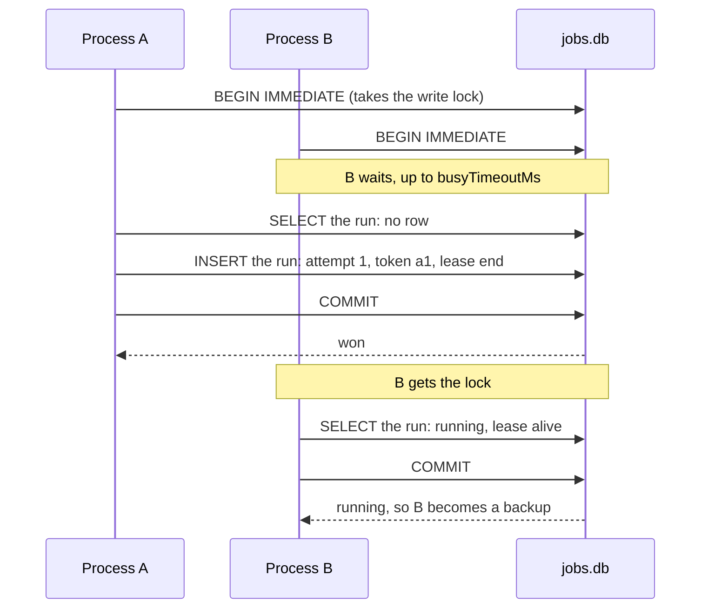

`SqliteBackend` gives you the full feature set (backups, no overlapping runs, catch-up, hand-over) with no server to run. It needs SQLite 3.35 or newer.

```ts
import { Scheduler, SqliteBackend } from 'anarchon';

const scheduler = new Scheduler({
  backend: new SqliteBackend({ database: '/var/lib/myapp/jobs.db' }),
});
```

## When it fits

A SQLite file coordinates the processes that open **that same file**.

| Setup | Works? |
| --- | --- |
| Several processes on one machine (PM2, Node cluster, several containers sharing a volume) | Yes |
| Development and tests | Yes, with nothing to install |
| Several machines, each with its own disk | **No**: each machine would have its own file and run every job |
| Several machines on a network file system (NFS) | **No**: SQLite's file locks are not reliable there |
| Several machines with a libSQL server or Turso | Yes, see [below](#several-machines-a-libsql-server) |

## Drivers

`database` accepts a file path or a database object you already have.

| You pass | Driver | Notes |
| --- | --- | --- |
| A file path | `node:sqlite` (built into Node 22.13+; 22.5 to 22.12 with `--experimental-sqlite`), or `better-sqlite3` if that is missing | anarchon opens and closes it |
| A `DatabaseSync` | `node:sqlite` | Yours; not closed on `stop()` |
| A `Database` | `better-sqlite3` | Yours; not closed on `stop()` |
| A client from `createClient()` | `@libsql/client` | A local file or a remote server |
| `{ all, transaction }` | Anything else | Your own adapter |

```ts
// A path: the default is './anarchon.db'
new SqliteBackend({ database: './jobs.db' });

// better-sqlite3
import Database from 'better-sqlite3';
new SqliteBackend({ database: new Database('./jobs.db') });

// node:sqlite
import { DatabaseSync } from 'node:sqlite';
new SqliteBackend({ database: new DatabaseSync('./jobs.db') });
```

## Options

| Option | Default | Meaning |
| --- | --- | --- |
| `database` | `'./anarchon.db'` | A file path, or your own database or client |
| `table` | `'anarchon_runs'` | Table name |
| `busyTimeoutMs` | `5000` | How long a write waits for another process's write before failing |

When anarchon opens the file itself, it switches it to WAL mode, so readers don't block the writer. If you pass your own database, switch it yourself:

```ts
const db = new Database('./jobs.db');
db.pragma('journal_mode = WAL');
new SqliteBackend({ database: db });
```

`busy_timeout` is set from `busyTimeoutMs` in both cases.

## Tables

Created on `start()`:

| Table | One row per | Holds |
| --- | --- | --- |
| `<table>` | run | attempt, token, status, runner, lease end |
| `<table>_attempts` | attempt | who, why, when, how it ended (the history) |
| `<table>_meta` | setting | the store format, so a newer anarchon's data is never misread |

## How one instance wins

SQLite allows **one writer at a time** for the whole database. A claim is a `BEGIN IMMEDIATE` transaction, which takes that write lock at the start:



Two claims can't interleave, so the second always sees what the first wrote.

A backup checking on a live run only reads; it takes the write lock only when the lease has run out. Heartbeats and "finished" are single statements.

## Several machines: a libSQL server

[libSQL](https://github.com/tursodatabase/libsql) is a fork of SQLite that can run as a server (`sqld`), and [Turso](https://turso.tech) hosts it. Pass a remote client and every machine shares one database:

```ts
import { createClient } from '@libsql/client';
import { Scheduler, SqliteBackend } from 'anarchon';

const client = createClient({
  url: process.env.LIBSQL_URL,           // libsql://... or http://...
  authToken: process.env.LIBSQL_AUTH_TOKEN,
});

const scheduler = new Scheduler({ backend: new SqliteBackend({ database: client }) });
```

Things to know about a remote libSQL server:

- It is still SQLite: **one writer at a time for the whole database**, across every table. Heavy write traffic from the rest of your app on the same database slows claims down.
- Transactions run over HTTP. If a process dies in the middle of a claim transaction, the server keeps that transaction's write lock until it gives up on it, a few seconds later. During that time other writers wait. anarchon keeps transactions rare (only claims that can win), so this window is small, but it exists.
- Keep `leaseMs` well above the slowest claim under load. With many instances, every write waits its turn on the one server: a lease of a few seconds can run out while a healthy runner's heartbeat waits, and a backup then takes the run over. The default, 30 seconds, leaves ample room.
- Each claim is several network round trips, so it is slower than Redis or PostgreSQL.

For several machines, PostgreSQL or Redis is the sturdier choice if you have either.

## One process, several schedulers

SQLite drivers block the thread while they wait for a lock. anarchon therefore runs every SQLite statement in a process through one queue, so two schedulers in the same process (for example in tests) can't deadlock each other. You don't need to do anything for this.

## Backups and the file

The job state is ordinary data in the file. Copy it with SQLite's backup tools rather than a plain file copy while processes are writing. In WAL mode there are two extra files next to the database (`-wal` and `-shm`); they belong to it.

## Next

- [Claim algorithms](../../internals/claim-algorithms/#sqlite)
- [Testing and debugging](../../recipes/testing-and-debugging/): SQLite is handy in tests
