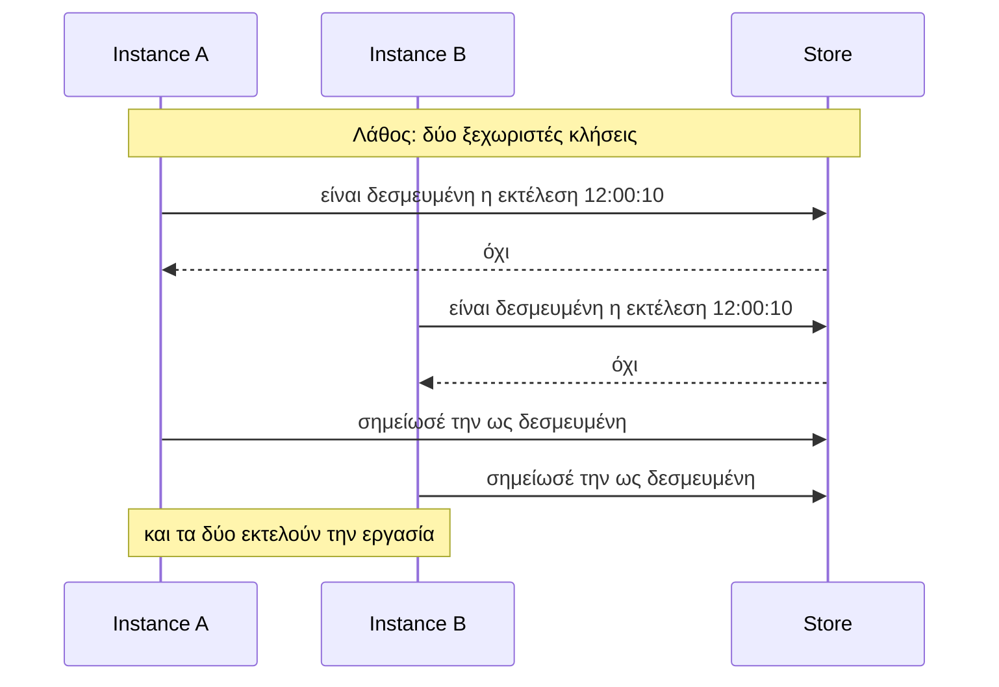

Ένα backend είναι μια κλάση που υλοποιεί το interface `Backend`. Αν τα instances σας μοιράζονται ένα store που μπορεί να πραγματοποιήσει μία ατομική λειτουργία «εγγραφή εκτός αν υπάρχει ήδη», μπορείτε να γράψετε ένα δικό σας.

## Το συμβόλαιο (The contract)

Ένας κανόνας έχει μεγαλύτερη σημασία από οτιδήποτε άλλο:

> Για μία εργασία και ένα slot, η μέθοδος `claim()` επιστρέφει `true` για **ακριβώς ένα** instance.

Ο scheduler αναλαμβάνει τα υπόλοιπα: υπολογίζει τα slots, περιμένει το jitter, καλεί το `claim()`, εκτελεί τον handler στον νικητή και αποθηκεύει το αποτέλεσμα.

```ts
interface Backend {
  /** Εμφανίζεται ως scheduler.backend.name, π.χ. 'memory'. */
  readonly name: string;
  /** Για πόσο χρόνο το store απομνημονεύει μια δεσμευμένη εκτέλεση (ms). Infinity αν είναι για πάντα. */
  readonly dedupeWindowMs: number;

  /** Σύνδεση και έλεγχος του server. Καλείται από το start() και πριν από αναγνώσεις. */
  init(): Promise<void>;
  /** Ρύθμιση μίας φοράς για μια εργασία: δημιουργία του πίνακα, του stream ή της ουράς της. */
  prepareJob(job: string, historySize: number): Promise<void>;
  /** True για ακριβώς ένα instance ανά slot. Πρέπει να είναι ασφαλές να επαναληφθεί με το ίδιο token. */
  claim(input: ClaimInput): Promise<boolean>;
  /** Καταγραφή εκτέλεσης από runNow(). Χωρίς deduplication. */
  recordManualRun(input: ClaimInput): Promise<number | void>;
  /** Αποθήκευση του πώς ολοκληρώθηκε μια εκτέλεση. */
  saveResult(job: string, result: StoredResult, historySize: number, historyTtlMs?: number): Promise<void>;
  /** Πρόσφατες εκτελέσεις από όλα τα instances, οι νεότερες πρώτα. */
  history(job: string, limit: number): Promise<RunRecord[]>;
  /** Κλείσιμο όσων άνοιξε το ίδιο το backend. */
  close(): Promise<void>;

  /** Προαιρετικό: απόρριψη εργασίας που αυτό το backend δεν μπορεί να εκτελέσει με ασφάλεια. Πετάξτε σφάλμα (throw) για απόρριψη. */
  checkJob?(job: JobLimits): void;
  /** Προαιρετικό: καλείται μετά από ένα κερδισμένο claim, αν το claim() δεν αποτελεί ήδη εγγραφή ιστορικού. */
  recordClaim?(input: ClaimInput): Promise<void>;
  /** Προαιρετικό: παρόν σε backends με μισθώσεις (leases). */
  readonly runs?: RunStore;
}
```

Το `ClaimInput` είναι αυτό που στέλνει ένα instance:

| Πεδίο | Σημασία |
| --- | --- |
| `job` | Το όνομα της εργασίας |
| `slot` | Ο προγραμματισμένος χρόνος σε ms: μαζί με το `job`, η ταυτότητα της εκτέλεσης |
| `token` | Μια τυχαία τιμή μοναδική για αυτή την προσπάθεια |
| `instanceId` | Ποιος υποβάλλει το αίτημα |
| `historySize`, `historyTtlMs` | Πόσο ιστορικό να διατηρείται |

## Ένα πλήρες παράδειγμα

Αυτό το backend διατηρεί τα πάντα στη μνήμη. Συντονίζει schedulers μόνο στην **ίδια διεργασία**, γεγονός που το καθιστά χρήσιμο για unit tests και για την κατανόηση του συμβολαίου στην πιο απλή του μορφή.

```ts
import type { Backend, ClaimInput, RunRecord, StoredResult } from 'anarchon';

export class MemoryBackend implements Backend {
  readonly name = 'memory';
  /** Τα claims δεν ξεχνιούνται ποτέ εδώ, επομένως δεν υπάρχει όριο στο πόσο καθυστερημένο μπορεί να είναι ένα instance. */
  readonly dedupeWindowMs = Infinity;

  private readonly claims = new Map<string, ClaimInput & { at: number; manual: boolean }>();
  private readonly results = new Map<string, StoredResult>();

  async init(): Promise<void> {}
  async prepareJob(): Promise<void> {}
  async close(): Promise<void> {}

  /** Το μοναδικό βήμα που πρέπει να είναι ατομικό. Εδώ είναι, επειδή η JavaScript το εκτελεί χωρίς διακοπή (single-threaded event loop). */
  async claim(input: ClaimInput): Promise<boolean> {
    const key = `${input.job}|${input.slot}`;
    const existing = this.claims.get(key);
    if (existing) return existing.token === input.token; // το ίδιο claim που στάλθηκε ξανά εξακολουθεί να είναι δικό μας
    this.claims.set(key, { ...input, at: Date.now(), manual: false });
    return true;
  }

  async recordManualRun(input: ClaimInput): Promise<void> {
    this.claims.set(`${input.job}|${input.slot}|manual`, { ...input, at: Date.now(), manual: true });
  }

  async saveResult(job: string, result: StoredResult): Promise<void> {
    this.results.set(`${job}|${result.slot}|${result.by}`, result);
  }

  async history(job: string, limit: number): Promise<RunRecord[]> {
    return [...this.claims.values()]
      .filter((claim) => claim.job === job)
      .sort((a, b) => b.slot - a.slot)
      .slice(0, limit)
      .map((claim) => {
        const result = this.results.get(`${job}|${claim.slot}|${claim.instanceId}`);
        return {
          job,
          slot: claim.slot,
          scheduledAt: new Date(claim.slot),
          instanceId: claim.instanceId,
          manual: claim.manual,
          attempt: 1,
          status: result?.status ?? 'running',
          startedAt: new Date(result?.startedAt ?? claim.at),
          ...(result ? { finishedAt: new Date(result.finishedAt), durationMs: result.durationMs, error: result.error } : {}),
        };
      });
  }
}
```

Τρεις schedulers που μοιράζονται ένα instance του εκτελούν κάθε slot μία φορά:

```ts
const backend = new MemoryBackend();
const instances = ['A', 'B', 'C'].map((instanceId) => new Scheduler({ backend, instanceId }));

for (const scheduler of instances) scheduler.every('tick', '1s', (ctx) => console.log(ctx.slot, ctx.instanceId));
await Promise.all(instances.map((s) => s.start()));
```

## Το ατομικό βήμα σε ένα πραγματικό store

Στη μνήμη, το `claim()` είναι ατομικό εκ των πραγμάτων. Σε ένα κοινόχρηστο store, ο έλεγχος και η εγγραφή πρέπει να είναι **μία ενιαία λειτουργία στον server**. Ο έλεγχος πρώτα και η εγγραφή μετά, ως δύο ξεχωριστές κλήσεις, είναι το κλασικό σφάλμα:



Χρησιμοποιήστε ό,τι προσφέρει το store σας για να το κάνετε σε ένα βήμα:

| Δυνατότητα του store | Παράδειγμα |
| --- | --- |
| Εισαγωγή με μοναδικό κλειδί (unique key) | `INSERT ... ON CONFLICT DO NOTHING`, και έπειτα έλεγχος αν εισήχθη γραμμή |
| Εγγραφή υπό συνθήκη (conditional write) | «put if absent», compare-and-set |
| Script στον server ή transaction | Redis Lua scripts, SQL transactions |
| Δημοσίευση με αποδιπλασιασμό (de-duplicated publish) | NATS message IDs, περιορισμένη ουρά με απόρριψη (rejection) |

## Κάντε το `claim()` ασφαλές για επανάληψη

Οι clients δικτύου κάνουν επαναπροσπάθειες (retries). Αν σταλεί ένα claim, η σύνδεση πέσει, και ο client το στείλει ξανά, η δεύτερη κλήση πρέπει να απαντήσει και πάλι `true` για το instance που έχει ήδη κερδίσει. Για αυτό υπάρχει το `token`: αποθηκεύστε το μαζί με το claim, και όταν φτάσει ένα claim για ένα ήδη δεσμευμένο slot, συγκρίνετε τα tokens.

## `dedupeWindowMs`

Για πόσο χρόνο το store σας απομνημονεύει μια δεσμευμένη εκτέλεση. Αν την απομνημονεύει για πάντα, επιστρέψτε `Infinity`.

Αν την ξεχνά μετά από κάποιο διάστημα (ένα TTL, ένα bounded stream), επιστρέψτε εκείνο το χρονικό διάστημα. Ο scheduler στη συνέχεια απορρίπτει οποιαδήποτε εργασία της οποίας το `jitterMs + maxLateMs` δεν είναι μικρότερο, επειδή ένα instance που θα έφτανε αργότερα από τη μνήμη του store θα μπορούσε να εκτελέσει ξανά την εργασία.

## Προσθήκη μισθώσεων (leases)

Ένα backend που παρέχει επίσης το `runs`, ένα `RunStore`, αποκτά εφεδρικούς (backups), προστασία επικάλυψης (overlap protection), ανάκτηση (catch-up) και παράδοση (hand-over). Διαθέτει πέντε μεθόδους:

| Μέθοδος | Τι πρέπει να κάνει, ατομικά |
| --- | --- |
| `claim(input)` | Να αποφασίσει μεταξύ των `won`, `running`, `done`, `overlap`, `none` και `late` βάσει της αποθηκευμένης κατάστασης της εκτέλεσης |
| `heartbeat(job, slot, token, leaseMs)` | Να παρατείνει τη λήξη της μίσθωσης **μόνο αν** το αποθηκευμένο token ταιριάζει |
| `finish(job, slot, token, status)` | Να σημειώσει την εκτέλεση ως ολοκληρωμένη, μόνο με το αντίστοιχο token |
| `release(job, slot, token)` | Να τερματίσει μια ενεργή μίσθωση άμεσα ώστε να αναλάβει ένας εφεδρικός (ομαλός τερματισμός) |
| `active(job)` | Να απαριθμήσει τις μη ολοκληρωμένες εκτελέσεις και αν κάθε μίσθωση είναι ενεργή |

Οι κανόνες είναι οι ίδιοι σε κάθε lease backend, και το [Μισθώσεις](../../internals/leases/) τους περιγράφει με ακρίβεια. Αν το store σας υποστηρίζει SQL, δεν χρειάζεται να τους γράψετε από την αρχή: τα `PostgresBackend` και `SqliteBackend` δέχονται έναν adapter με δύο συναρτήσεις, και υλοποιούν τις μισθώσεις πάνω σε αυτόν.

```ts
import { SqliteBackend } from 'anarchon';

// Οποιοσδήποτε client με all() και transaction() λειτουργεί με τα SQL backends
const backend = new SqliteBackend({
  database: {
    all: (sql, params) => myDriver.query(sql, params),
    transaction: (fn) => myDriver.transaction((tx) => fn({ all: (sql, params) => tx.query(sql, params) })),
  },
});
```

## Δοκιμή ενός backend

Ανεξάρτητα από το store, ελέγξτε το συμβόλαιο απευθείας:

1. **Ο αγώνας δρόμου (The race).** Στείλτε το ίδιο claim από πολλαπλούς clients ταυτόχρονα, πολλές φορές. Ακριβώς ένας πρέπει να κερδίζει κάθε φορά.
2. **Ασφάλεια επανάληψης (Repeat safety).** Το νικητήριο claim όταν αποσταλεί ξανά, με το ίδιο token, απαντά και πάλι `true`. Ένα διαφορετικό token απαντά `false`.
3. **Ιστορικό.** Ένα claim συν ένα αποθηκευμένο αποτέλεσμα επιστρέφεται από το `history()` ως μία εγγραφή με το σωστό instance και status.

Η σουίτα δοκιμών του ίδιου του anarchon εκτελεί αυτούς τους ελέγχους σε κάθε ενσωματωμένο backend.

## Επόμενα βήματα

- [Αλγόριθμοι claim](../../internals/claim-algorithms/): πώς το κάνουν τα ενσωματωμένα backends
- [Μισθώσεις](../../internals/leases/)
