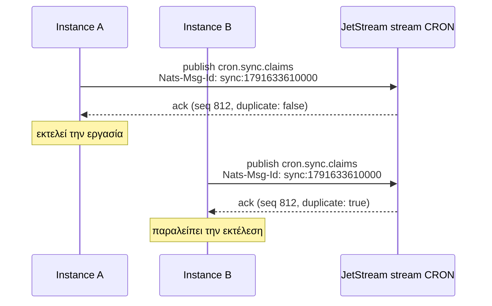

Το `NatsBackend` διασφαλίζει ότι ένα instance εκτελεί σε κάθε προγραμματισμένο χρόνο, χρησιμοποιώντας το NATS JetStream.

```ts
import { NatsBackend, Scheduler } from 'anarchon';

const scheduler = new Scheduler({
  backend: new NatsBackend({ servers: 'nats://nats.internal:4222' }),
});
```

Το JetStream πρέπει να είναι ενεργοποιημένο στον server (`nats-server -js`).

:::caution[Μόνο claim]
Το de-duplication που χρησιμοποιεί αυτό το backend αποφασίζει ποιος είναι πρώτος, αλλά δεν διατηρεί μια μίσθωση (lease) την οποία θα μπορούσε να ελέγξει ένας εφεδρικός (backup). Επομένως, με αυτό το backend **δεν υπάρχουν εφεδρικοί runners, προστασία επικάλυψης (overlap), ανάκτηση (catch-up) και παράδοση (hand-over)**. Αν το instance που εκτελεί μια εργασία καταρρεύσει, εκείνη η εκτέλεση χάνεται. Για αυτές τις δυνατότητες χρησιμοποιήστε Redis, PostgreSQL ή SQLite. Δείτε [Brokers και μισθώσεις](../brokers-and-leases/).
:::

## Επιλογές

| Επιλογή | Προεπιλογή | Σημασία |
| --- | --- | --- |
| `servers` | `'nats://localhost:4222'` | Ένα URL ή μια λίστα |
| `connection` | | Η δική σας σύνδεση από το `@nats-io/transport-node`. Διατηρείτε την κυριότητά της |
| `stream` | `'CRON'` | Όνομα JetStream stream |
| `prefix` | `'cron.'` | Πρόθεμα subject |
| `duplicateWindowMs` | `300000` (5 λεπτά) | Για πόσο χρόνο το JetStream απομνημονεύει μια δεσμευμένη εκτέλεση |
| `historySize` | `1000` | Μηνύματα που διατηρούνται ανά subject, δηλαδή περίπου πόσες εκτελέσεις ανά εργασία |
| `replicas` | `1` | Αντίγραφα (replicas) του stream σε NATS cluster |

```ts
import { connect } from '@nats-io/transport-node';

const connection = await connect({ servers: ['nats://n1:4222', 'nats://n2:4222', 'nats://n3:4222'] });
new NatsBackend({ connection, stream: 'BILLING_CRON', prefix: 'billing.cron.', replicas: 3 });
```

:::note
Η παράμετρος `historySize` εδώ ορίζεται στο backend και εφαρμόζεται σε ολόκληρο το stream. Η επιλογή `historySize` ανά εργασία δεν την αλλάζει.
:::

## Πώς κερδίζει ένα instance

Ο μηχανισμός που χρησιμοποιείται είναι ο **αποδιπλασιασμός μηνυμάτων (message de-duplication)** του JetStream. Ένας publisher μπορεί να επισυνάψει ένα message ID· εντός του duplicate window του stream, το JetStream αποθηκεύει μόνο το πρώτο μήνυμα με το συγκεκριμένο ID.



1. Κάθε instance δημοσιεύει το claim του στο `<prefix><job>.claims` με το header `Nats-Msg-Id: <job>:<slot>`. Το ID είναι το ίδιο σε κάθε instance, επειδή το slot είναι το ίδιο.
2. Το stream αποθηκεύει το πρώτο μήνυμα με εκείνο το ID. Για κάθε μεταγενέστερο απαντά με `duplicate: true` και δεν αποθηκεύει τίποτα.
3. Ένα instance κερδίζει αν η επιβεβαίωσή (ack) του δεν είναι duplicate. Το stream (ο leader του, σε ένα cluster) διατάσσει τις δημοσιεύσεις, οπότε ακριβώς ένα είναι πρώτο.

Αν μια επιβεβαίωση αναφέρει «duplicate», το instance διαβάζει το αποθηκευμένο μήνυμα και συγκρίνει τα tokens. Με αυτόν τον τρόπο, ένα claim που επανεπιχείρησε ο ίδιος ο client εξακολουθεί να αναγνωρίζεται ως δικό του.

## Το stream

Το anarchon δημιουργεί το stream κατά το `start()` εφόσον δεν υπάρχει, καλύπτοντας τα subjects `<prefix>>`. Αν υπάρχει ήδη stream με αυτό το όνομα αλλά άλλες ρυθμίσεις, το anarchon ενημερώνει το duplicate window και το όριο ανά subject, και προσθέτει τα σχετικά subjects.

| Subject | Περιεχόμενο |
| --- | --- |
| `<prefix><job>.claims` | Ένα μήνυμα ανά διεκδικηθείσα εκτέλεση, και ανά χειροκίνητη εκτέλεση |
| `<prefix><job>.results` | Ένα μήνυμα ανά ολοκληρωμένη εκτέλεση |

## Περιορισμοί που πρέπει να γνωρίζετε

- **Το `jitterMs + maxLateMs` πρέπει να είναι μικρότερο από το `duplicateWindowMs`.** Εκτός του παραθύρου αυτού, το JetStream δεν αναγνωρίζει πλέον την επανάληψη, και ένα instance με πολύ μεγάλη καθυστέρηση θα μπορούσε να εκτελέσει ξανά την εργασία. Το anarchon το ελέγχει αυτό κατά την προσθήκη μιας εργασίας. Οι προεπιλογές (2 s + 60 s έναντι 5 min) είναι ασφαλείς.
- **Τα ονόματα των εργασιών (job names)** μπορούν να περιέχουν μόνο γράμματα, ψηφία, `_` και `-`, επειδή γίνονται subjects.
- **Αντίγραφα (replicas).** Σε ένα NATS cluster ορίστε `replicas: 3` ώστε το stream και η μνήμη του για τις δεσμευμένες εκτελέσεις να επιβιώνουν από την απώλεια ενός server.

## Ιστορικό

Η μέθοδος `history()` διαβάζει τα claims και τα αποτελέσματα της εργασίας από το stream και τα συνδυάζει. Οι μέθοδοι `lastRun()` και `runNow()` λειτουργούν όπως και στα υπόλοιπα backends. Μια εκτέλεση της οποίας ο runner κατέρρευσε διατηρεί την κατάσταση `running`.

## Επόμενα βήματα

- [Αλγόριθμοι claim](../../internals/claim-algorithms/#nats)
- [Επισκόπηση backends](../overview/)
