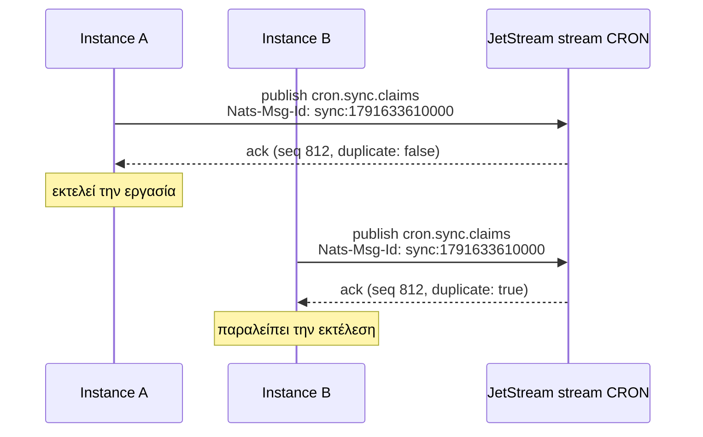
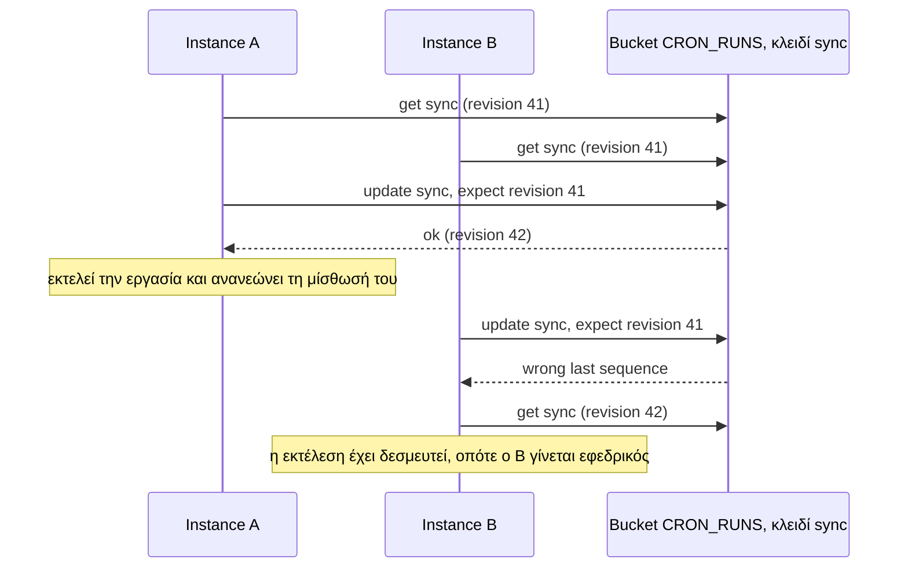

Το `NatsBackend` διασφαλίζει ότι ένα instance εκτελεί σε κάθε προγραμματισμένο χρόνο, χρησιμοποιώντας το NATS JetStream. Έχει δύο στρατηγικές:

| Στρατηγική | Τι παίρνετε | Απαιτεί |
| --- | --- | --- |
| `msg-id` (προεπιλογή) | Έναν νικητή ανά εκτέλεση | JetStream |
| `lease` | Έναν νικητή ανά εκτέλεση, και επιπλέον εφεδρικούς runners, καμία επικάλυψη εκτελέσεων, ανάκτηση (catch-up), επαναλήψεις και παράδοση κατά το `stop()` | JetStream σε nats-server 2.10 ή νεότερο, και το πακέτο `@nats-io/kv` |

```ts
import { NatsBackend, Scheduler } from 'anarchon';

const servers = 'nats://nats.internal:4222';
new Scheduler({ backend: new NatsBackend({ servers }) });                    // msg-id
new Scheduler({ backend: new NatsBackend({ servers, strategy: 'lease' }) }); // lease
```

Το JetStream πρέπει να είναι ενεργοποιημένο στον server (`nats-server -js`). Για το `lease`, εγκαταστήστε και τον client του key-value: `pnpm add @nats-io/kv`.

:::caution[Το `msg-id` είναι μόνο claim]
Το de-duplication που χρησιμοποιεί το `msg-id` αποφασίζει ποιος είναι πρώτος, αλλά δεν διατηρεί μια μίσθωση (lease) την οποία θα μπορούσε να ελέγξει ένας εφεδρικός (backup). Επομένως, με αυτό **δεν υπάρχουν εφεδρικοί runners, προστασία επικάλυψης (overlap), ανάκτηση (catch-up) και παράδοση (hand-over)**. Αν το instance που εκτελεί μια εργασία καταρρεύσει, εκείνη η εκτέλεση χάνεται. Για αυτές τις δυνατότητες χρησιμοποιήστε τη στρατηγική `lease`, ή Redis, PostgreSQL ή SQLite. Δείτε [Brokers και μισθώσεις](../brokers-and-leases/).
:::

Κάθε instance μιας υπηρεσίας πρέπει να χρησιμοποιεί την ίδια στρατηγική. Οι δύο κρατούν τα claims τους σε διαφορετικά σημεία, οπότε ένα instance με τη μία δεν βλέπει τα claims ενός instance με την άλλη.

## Επιλογές

| Επιλογή | Προεπιλογή | Σημασία |
| --- | --- | --- |
| `strategy` | `'msg-id'` | `'msg-id'` ή `'lease'` |
| `servers` | `'nats://localhost:4222'` | Ένα URL ή μια λίστα |
| `connection` | | Η δική σας σύνδεση από το `@nats-io/transport-node`. Διατηρείτε την κυριότητά της |
| `stream` | `'CRON'` | Όνομα JetStream stream |
| `prefix` | `'cron.'` | Πρόθεμα subject |
| `duplicateWindowMs` | `300000` (5 λεπτά) | Για πόσο χρόνο το JetStream απομνημονεύει μια δεσμευμένη εκτέλεση. Με το `lease`, απλώς απορρίπτει μια εγγραφή ιστορικού που ο client στέλνει δύο φορές |
| `historySize` | `1000` | Περίπου πόσες εκτελέσεις διατηρούνται ανά εργασία, τουλάχιστον |
| `replicas` | `1` για νέο stream | Αντίγραφα (replicas) του stream σε NATS cluster· με το `lease`, και τα αντίγραφα ενός νέου bucket |

```ts
import { connect } from '@nats-io/transport-node';

const connection = await connect({ servers: ['nats://n1:4222', 'nats://n2:4222', 'nats://n3:4222'] });
new NatsBackend({ connection, stream: 'BILLING_CRON', prefix: 'billing.cron.', replicas: 3 });
```

:::note
Όλες οι εργασίες μοιράζονται ένα stream, οπότε αυτό κρατά ένα μέγεθος ιστορικού για όλες: το μεγαλύτερο ανάμεσα στο `historySize` του backend και σε εκείνο κάθε εργασίας. Μια εργασία που ζητά περισσότερα το αυξάνει όταν προστίθεται.
:::

## Πώς κερδίζει ένα instance με `msg-id`

Ο μηχανισμός που χρησιμοποιείται είναι ο **αποδιπλασιασμός μηνυμάτων (message de-duplication)** του JetStream. Ένας publisher μπορεί να επισυνάψει ένα message ID· εντός του duplicate window του stream, το JetStream αποθηκεύει μόνο το πρώτο μήνυμα με το συγκεκριμένο ID.



1. Κάθε instance δημοσιεύει το claim του στο `<prefix><job>.claims` με το header `Nats-Msg-Id: <job>:<slot>`. Το ID είναι το ίδιο σε κάθε instance, επειδή το slot είναι το ίδιο.
2. Το stream αποθηκεύει το πρώτο μήνυμα με εκείνο το ID. Για κάθε μεταγενέστερο απαντά με `duplicate: true` και δεν αποθηκεύει τίποτα.
3. Ένα instance κερδίζει αν η επιβεβαίωσή (ack) του δεν είναι duplicate. Το stream (ο leader του, σε ένα cluster) διατάσσει τις δημοσιεύσεις, οπότε ακριβώς ένα είναι πρώτο.

Αν μια επιβεβαίωση αναφέρει «duplicate», το instance διαβάζει το αποθηκευμένο μήνυμα και συγκρίνει τα tokens. Με αυτόν τον τρόπο, ένα claim που επανεπιχείρησε ο ίδιος ο client εξακολουθεί να αναγνωρίζεται ως δικό του.

## Πώς κερδίζει ένα instance με `lease`

Η στρατηγική `lease` κρατά τις εκτελέσεις κάθε εργασίας σε ένα **key-value bucket** του JetStream, το `<stream>_RUNS` (`CRON_RUNS` από προεπιλογή), κάτω από ένα κλειδί ανά εργασία. Κάθε κλειδί έχει μια αναθεώρηση (revision), και μια εγγραφή μπορεί να ορίζει «μόνο αν το κλειδί είναι ακόμη στην αναθεώρηση N»: το JetStream την απορρίπτει αν κάποιος έγραψε στο μεταξύ. Κάθε απόφαση για μια εκτέλεση είναι μία τέτοια εγγραφή:

1. Διαβάζει το κλειδί της εργασίας, την αναθεώρησή του και το ρολόι του server.
2. Αποφασίζει με τους [κανόνες μίσθωσης](../../internals/leases/): αν δεν υπάρχει κατάσταση για την εκτέλεση, ξεκινά η προσπάθεια 1 με μίσθωση· μια ζωντανή μίσθωση απαντά `running`· μια μίσθωση που έληξε δίνει στον καλούντα την επόμενη προσπάθεια· μια ολοκληρωμένη εκτέλεση απαντά `done`. Μια νέα εκτέλεση απορρίπτεται όσο μια παλαιότερη εκτέλεση της εργασίας έχει ζωντανή μίσθωση (`overlap: 'skip'`).
3. Γράφει τη νέα κατάσταση στην αναθεώρηση που διάβασε. Αν ένα άλλο instance έγραψε πρώτο, το JetStream απορρίπτει την εγγραφή, και το instance διαβάζει και αποφασίζει ξανά.



Τα heartbeats, η παράδοση κατά το `stop()` και η ολοκλήρωση είναι η ίδια ανάγνωση και εγγραφή στο κλειδί της εργασίας, και αλλάζουν την εκτέλεση μόνο όσο αυτή φέρει το token του καλούντα: μετά από μια ανάληψη (takeover), τίποτα από όσα στέλνει ο παλιός runner δεν αλλάζει την εκτέλεση.

**Το ρολόι του server.** Οι μισθώσεις μετρούν με το ρολόι του NATS server, όχι ενός instance. Κάθε απόφαση το διαβάζει από τις πληροφορίες του stream του bucket (`ts`, που αναφέρουν οι nats-server 2.10 και νεότεροι), και το anarchon απορρίπτει έναν παλαιότερο server κατά το `start()`.

**Τι κρατά το bucket.** Μία τιμή ανά κλειδί, χωρίς παλαιότερες αναθεωρήσεις. Η τιμή μιας εργασίας περιέχει τις ημιτελείς εκτελέσεις της, και τις ολοκληρωμένες που είναι αρκετά πρόσφατες ώστε ένα καθυστερημένο claim να μπορεί ακόμη να ρωτήσει γι' αυτές· οι παλαιότερες αφαιρούνται στο επόμενο claim. Αυτό είναι περίπου 120 bytes ανά εκτέλεση: μια εργασία που εκτελείται κάθε δευτερόλεπτο κρατά περίπου 300 εκτελέσεις (γύρω στα 35 kB) με το προεπιλεγμένο `catchUpMs` των 5 λεπτών, και τις ξαναγράφει σε κάθε claim και heartbeat. Το ιστορικό μένει στο stream, όπως και με το `msg-id`.

Το [`examples/nats-leases.ts`](https://github.com/aristoteliss/anarchon/blob/main/examples/nats-leases.ts) το δείχνει με τρεις διεργασίες: παράδοση στο `SIGTERM`, ανάληψη μετά από `kill -9`, και ανάκτηση (catch-up) αφού όλες οι διεργασίες ήταν εκτός λειτουργίας. Τα υπόλοιπα παραδείγματα τρέχουν σε αυτό με `BACKEND=nats`.

**Τι κοστίζει.** Κάθε απόφαση είναι μια ανάγνωση και μια εγγραφή υπό συνθήκη: ένα heartbeat χρειάζεται δύο αποστολές μετ' επιστροφής (round trips) προς τον server, και ένα claim που κερδίζει τρεις (η τελευταία το καταγράφει στο ιστορικό). Μια εγγραφή που χάνει από την εγγραφή ενός άλλου instance κοστίζει μία ακόμη ανάγνωση και εγγραφή.

## Το stream

Το anarchon δημιουργεί το stream κατά το `start()` εφόσον δεν υπάρχει, καλύπτοντας τα subjects `<prefix>>`. Αν υπάρχει ήδη stream με αυτό το όνομα αλλά άλλες ρυθμίσεις, το anarchon ενημερώνει το duplicate window και το όριο ανά subject, και προσθέτει τα σχετικά subjects. Με το `lease`, δημιουργεί επίσης το bucket `<stream>_RUNS` εφόσον δεν υπάρχει· ένα υπάρχον bucket κρατά τις ρυθμίσεις του.

| Πού | Περιεχόμενο |
| --- | --- |
| Subject `<prefix><job>.claims` | Ένα μήνυμα ανά διεκδικηθείσα εκτέλεση (`lease`: ανά προσπάθεια), και ανά χειροκίνητη εκτέλεση |
| Subject `<prefix><job>.results` | Ένα μήνυμα ανά ολοκληρωμένη εκτέλεση (`lease`: ανά προσπάθεια) |
| Bucket `<stream>_RUNS`, κλειδί `<job>` | Μόνο `lease`: η κατάσταση των εκτελέσεων της εργασίας |
| Bucket `<stream>_RUNS`, κλειδί `meta.format` | Μόνο `lease`: η μορφή αποθήκευσης (store format), ώστε μια παλαιότερη έκδοση του anarchon να απορρίπτει δεδομένα που δεν μπορεί να διαβάσει |

## Περιορισμοί που πρέπει να γνωρίζετε

- **`msg-id`: Το `jitterMs + maxLateMs` πρέπει να είναι μικρότερο από το `duplicateWindowMs`.** Εκτός του παραθύρου αυτού, το JetStream δεν αναγνωρίζει πλέον την επανάληψη, και ένα instance με πολύ μεγάλη καθυστέρηση θα μπορούσε να εκτελέσει ξανά την εργασία. Το anarchon το ελέγχει αυτό κατά την προσθήκη μιας εργασίας. Οι προεπιλογές (2 s + 60 s έναντι 5 min) είναι ασφαλείς. Το `lease` δεν έχει τέτοιο όριο: το bucket θυμάται μια εκτέλεση όσο ένα καθυστερημένο claim μπορεί ακόμη να ρωτήσει γι' αυτήν.
- **Τα ονόματα των εργασιών (job names)** μπορούν να περιέχουν μόνο γράμματα, ψηφία, `_` και `-`, επειδή γίνονται subjects και κλειδιά.
- **`lease`: το όνομα του stream** μπορεί να περιέχει μόνο γράμματα, ψηφία, `_` και `-`, επειδή δίνει όνομα στο bucket.
- **Αντίγραφα (replicas).** Σε ένα NATS cluster ορίστε `replicas: 3` ώστε το stream και η μνήμη του για τις δεσμευμένες εκτελέσεις να επιβιώνουν από την απώλεια ενός server. Όταν ορίζεται το `replicas`, ένα υπάρχον stream ενημερώνεται σε αυτό· όταν δεν ορίζεται, ένα υπάρχον stream κρατά τα replicas που έχει. Με το `lease`, ένα νέο bucket παίρνει τον ίδιο αριθμό αντιγράφων· ένα υπάρχον bucket κρατά τα δικά του.

## Ιστορικό

Η μέθοδος `history()` διαβάζει τα claims και τα αποτελέσματα της εργασίας από το stream και τα συνδυάζει. Οι μέθοδοι `lastRun()` και `runNow()` λειτουργούν όπως και στα υπόλοιπα backends. Με το `msg-id`, μια εκτέλεση της οποίας ο runner κατέρρευσε διατηρεί την κατάσταση `running`· με το `lease`, εμφανίζεται ως `interrupted` μόλις λήξει η μίσθωσή της, όπως και στα άλλα backends μίσθωσης. Το ιστορικό περικόπτεται μόνο βάσει πλήθους, οπότε το `historyTtlMs` απορρίπτεται.

## Επόμενα βήματα

- [Μισθώσεις](../../internals/leases/)
- [Αλγόριθμοι claim](../../internals/claim-algorithms/#nats)
- [Brokers και μισθώσεις](../brokers-and-leases/)
- [Επισκόπηση backends](../overview/)
