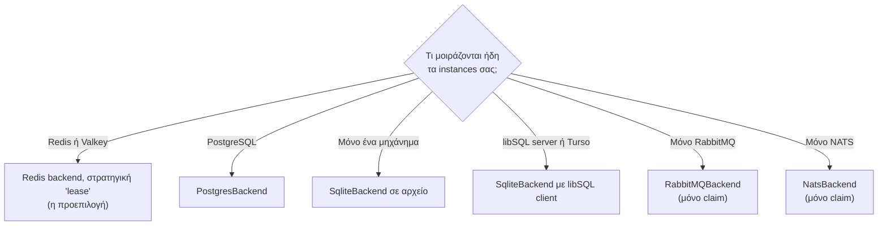
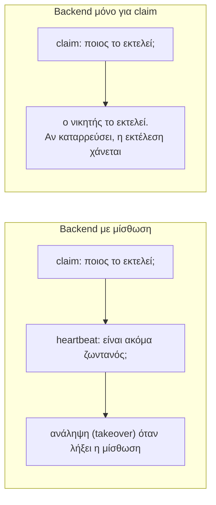

Ένα **backend** είναι ο προσαρμογέας (adapter) μεταξύ του anarchon και του store που μοιράζονται τα instances σας. Κάθε backend διασφαλίζει ότι ένα instance κερδίζει κάθε εκτέλεση. Ορισμένα μπορούν επίσης να διατηρούν μίσθωση (lease), η οποία καθιστά εφικτά τους εφεδρικούς (backups), την προστασία επικάλυψης (overlap protection) και την ανάκτηση (catch-up).

## Επιλογή



Χρησιμοποιήστε ό,τι εκτελείτε ήδη. Αν διαθέτετε τόσο Redis όσο και PostgreSQL, το Redis έχει χαμηλότερη καθυστέρηση (latency) ανά claim· η PostgreSQL διατηρεί το ιστορικό των εργασιών δίπλα στα δεδομένα σας.

## Τι σας προσφέρει κάθε backend

| | Redis / Valkey | PostgreSQL | SQLite | RabbitMQ | NATS |
| --- | --- | --- | --- | --- | --- |
| Ένας νικητής ανά εκτέλεση | ναι | ναι | ναι | ναι | ναι |
| Οι εφεδρικοί αναλαμβάνουν έναν ανενεργό runner | ναι ¹ | ναι | ναι | όχι | όχι |
| Χωρίς αλληλεπικαλυπτόμενες εκτελέσεις | ναι ¹ | ναι | ναι | όχι | όχι |
| Ανάκτηση μετά από downtime | ναι ¹ | ναι | ναι | όχι | όχι |
| Παράδοση (hand-over) στο `stop()` | ναι ¹ | ναι | ναι | όχι | όχι |
| Ιστορικό | ναι | ναι | ναι | ναι | ναι |
| Πολλαπλά μηχανήματα | ναι | ναι | μόνο με libSQL server | ναι | ναι |
| Απαιτήσεις | Redis 5+ ή Valkey | PostgreSQL 9.5+ | SQLite 3.35+ | RabbitMQ 3.9+ | JetStream |

¹ Με τη στρατηγική `lease`, η οποία είναι η προεπιλεγμένη. Οι στρατηγικές `stream-id`, `idmp` και `script` λειτουργούν μόνο για claim.

## Backends με μίσθωση και backends μόνο για claim

Ο διαχωρισμός προκύπτει από το τι μπορεί να εκφράσει το store.

Ένα **backend με μίσθωση (lease backend)** αποθηκεύει, για κάθε εκτέλεση, ποιος την εκτελεί και μέχρι πότε. Άλλα instances μπορούν να διαβάσουν αυτή την πληροφορία και να ενεργήσουν αναλόγως. Το Redis (με Lua script), η PostgreSQL και το SQLite (με transaction) μπορούν όλα να εκτελέσουν το «ανάγνωση της εκτέλεσης, απόφαση, εγγραφή» ως ένα ατομικό βήμα.

Ένα **backend μόνο για claim (claim-only backend)** μπορεί να απαντήσει ατομικά σε ακριβώς ένα ερώτημα: «ήμουν πρώτος;». Το RabbitMQ και το NATS είναι message brokers. Η δυνατότητα που χρησιμοποιεί κάθε backend μπορεί να ενημερώσει έναν publisher ότι ήταν πρώτος, αλλά δεν αφήνει μια εγγραφή την οποία θα μπορούσε να ελέγξει αργότερα ένας εφεδρικός και να την αντικαταστήσει ατομικά. Η σελίδα [Brokers και μισθώσεις](../brokers-and-leases/) εξηγεί τον λόγο, και τι θα μπορούσε να το αλλάξει.



Χρησιμοποιήστε ένα backend μόνο για claim όταν η περιστασιακή απώλεια μιας εκτέλεσης λόγω κατάρρευσης είναι αποδεκτή και δεν επιθυμείτε πρόσθετη υποδομή.

## Πώς το καθένα επιλέγει τον νικητή

Κάθε store διαθέτει έναν διαφορετικό μηχανισμό (primitive) που επιτρέπει σε ακριβώς έναν writer να επιτύχει. Οι λεπτομέρειες, με διαγράμματα, βρίσκονται στους [Αλγόριθμους claim](../../internals/claim-algorithms/).

| Backend | Το ατομικό βήμα |
| --- | --- |
| Redis `lease` | Lua script που διαβάζει την κατάσταση της εκτέλεσης και καταγράφει το claim |
| Redis `stream-id` | `XADD` με τον χρόνο εκτέλεσης ως entry ID· το Redis απορρίπτει ID που δεν είναι μεγαλύτερο από το προηγούμενο |
| Redis `idmp` | `XADD ... IDMP`· το Redis διατηρεί την πρώτη εγγραφή για ένα κλειδί idempotency |
| Redis `script` | Lua script που προσθέτει την εκτέλεση μόνο αν δεν υπάρχει ήδη στο stream |
| PostgreSQL | Ένα transaction στη γραμμή της εκτέλεσης, σειριοποιημένο ανά εργασία |
| SQLite | Ένα transaction `BEGIN IMMEDIATE`· το SQLite επιτρέπει έναν writer τη φορά |
| RabbitMQ | Ουρά που διατηρεί ένα μήνυμα και απορρίπτει τα υπόλοιπα, με publisher confirms |
| NATS | Αποδιπλασιασμός (de-duplication) JetStream βάσει του message ID |

## Χρήση ενός backend

Το Redis και το Valkey διαθέτουν συντομεύσεις στον scheduler. Κάθε άλλο backend δημιουργείται και περνιέται ως όρισμα:

```ts
import { NatsBackend, PostgresBackend, RabbitMQBackend, Scheduler, SqliteBackend } from 'anarchon';

new Scheduler({ redis: 'redis://localhost:6379' });
new Scheduler({ backend: new PostgresBackend({ connection: process.env.DATABASE_URL }) });
new Scheduler({ backend: new SqliteBackend({ database: './jobs.db' }) });
new Scheduler({ backend: new RabbitMQBackend({ url: 'amqp://localhost' }) });
new Scheduler({ backend: new NatsBackend({ servers: 'nats://localhost:4222' }) });
```

Η ιδιότητα `scheduler.backend.name` σας δείχνει ποιο χρησιμοποιείται: `'redis:lease'`, `'postgres'`, `'sqlite'`, `'rabbitmq'` ή `'nats'`.

## Οι δικές σας συνδέσεις

Κάθε backend δέχεται έναν client που διαθέτει ήδη η εφαρμογή σας. Το anarchon δεν κλείνει ποτέ client που δεν άνοιξε το ίδιο, επομένως η μέθοδος `stop()` αφήνει τον δικό σας διαθέσιμο για χρήση.

```ts
const pool = new Pool({ connectionString: process.env.DATABASE_URL });
const scheduler = new Scheduler({ backend: new PostgresBackend({ connection: pool }) });

await scheduler.stop();
await pool.query('SELECT 1'); // εξακολουθεί να λειτουργεί
```

## Κοινή χρήση ενός store μεταξύ υπηρεσιών

Δύο υπηρεσίες στο ίδιο Redis ή βάση δεδομένων δεν πρέπει να βλέπουν τις εργασίες η μία της άλλης. Δώστε στην καθεμία το δικό της namespace:

| Backend | Επιλογή | Προεπιλογή |
| --- | --- | --- |
| Redis / Valkey | `prefix` | `'cron:'` |
| PostgreSQL / SQLite | `table` | `'anarchon_runs'` |
| RabbitMQ | `prefix` | `'cron.'` |
| NATS | `prefix` και `stream` | `'cron.'`, `'CRON'` |

Τα instances της **ίδιας** υπηρεσίας πρέπει να χρησιμοποιούν την ίδια τιμή. Δείτε [Πολλαπλές υπηρεσίες σε ένα store](../../recipes/several-services/).

## Επόμενα βήματα

Επιλέξτε το store σας: [Redis και Valkey](../redis/), [PostgreSQL](../postgres/), [SQLite και libSQL](../sqlite/), [RabbitMQ](../rabbitmq/), [NATS](../nats/), ή [δημιουργήστε το δικό σας](../custom/).
