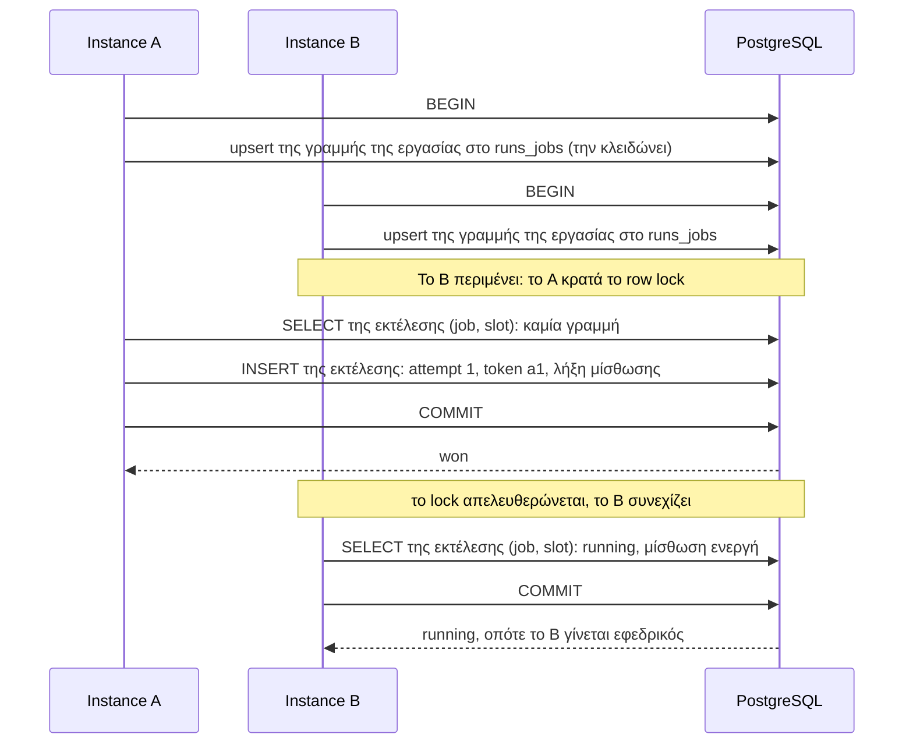

Το `PostgresBackend` σας προσφέρει όλα όσα παρέχει η στρατηγική `lease` του Redis: έναν νικητή ανά εκτέλεση, εφεδρικούς (backups), προστασία από αλληλεπικαλυπτόμενες εκτελέσεις, ανάκτηση (catch-up) και παράδοση (hand-over) κατά την κλήση του `stop()`. Απαιτεί PostgreSQL 9.5 ή νεότερο.

```ts
import { PostgresBackend, Scheduler } from 'anarchon';

const scheduler = new Scheduler({
  backend: new PostgresBackend({ connection: process.env.DATABASE_URL }),
});
```

## Σύνδεση

Η παράμετρος `connection` δέχεται ένα connection string ή έναν client που ήδη διαθέτετε.

```ts
// Connection string. Το anarchon ανοίγει ένα μικρό pool με το `pg` και το κλείνει στο stop().
new PostgresBackend({ connection: process.env.DATABASE_URL }); // postgres://· χρήστης και κωδικός μπαίνουν στο URL

// Τίποτα: postgres://localhost:5432/postgres, με τις μεταβλητές περιβάλλοντος PG* να συμπληρώνουν τα κενά
new PostgresBackend();
```

### Το δικό σας pool ή client

```ts
import { Pool } from 'pg';

const pool = new Pool({ connectionString: process.env.DATABASE_URL });
new PostgresBackend({ connection: pool }); // το stop() δεν τερματίζει το pool
```

| Τι περνάτε | Βιβλιοθήκη |
| --- | --- |
| Ένα `Pool` | `pg` (node-postgres) |
| Έναν συνδεδεμένο `Client` | `pg` |
| Ένα instance `sql` | `postgres` (postgres.js) |
| `{ all, transaction }` | Οτιδήποτε άλλο: ο δικός σας adapter |

```ts
import postgres from 'postgres';

const sql = postgres(process.env.DATABASE_URL);
new PostgresBackend({ connection: sql });
```

Ένα pool είναι η καλύτερη επιλογή σε μια υπηρεσία. Ένας μεμονωμένος `Client` μπορεί να εκτελεί μόνο μία εντολή τη φορά, οπότε το anarchon τοποθετεί τις δικές του εντολές σε ουρά αναμονής πάνω σε αυτόν.

## Επιλογές

| Επιλογή | Προεπιλογή | Σημασία |
| --- | --- | --- |
| `connection` | `postgres://localhost:5432/postgres` | Connection string, ή ο δικός σας client |
| `table` | `'anarchon_runs'` | Όνομα πίνακα. Μπορεί να περιλαμβάνει schema: `'jobs.cron_runs'` |

## Πίνακες

Δημιουργούνται κατά το `start()` εφόσον δεν υπάρχουν ήδη. Δεν υπάρχει πρόβλημα αν εκκινήσουν δύο instances ταυτόχρονα.

| Πίνακας | Μία γραμμή ανά | Περιεχόμενο |
| --- | --- | --- |
| `<table>` | εκτέλεση (run) | attempt, token, status, runner, λήξη μίσθωσης |
| `<table>_attempts` | προσπάθεια (attempt) | ποιος, γιατί, πότε διεκδικήθηκε, πώς ολοκληρώθηκε (ιστορικό) |
| `<table>_jobs` | εργασία (job) | η γραμμή που εξασφαλίζει ότι τα claims μιας εργασίας εκτελούνται διαδοχικά |
| `<table>_meta` | ρύθμιση | η μορφή του store, ώστε τα δεδομένα ενός νεότερου anarchon να μη διαβάζονται ποτέ λάθος |

Αν ο χρήστης βάσης δεδομένων της εφαρμογής σας δεν έχει δικαιώματα δημιουργίας πινάκων, δημιουργήστε τους μία φορά με έναν προνομιούχο χρήστη εκτελώντας το `start()` σε ένα βήμα migration, και στη συνέχεια εκχωρήστε δικαιώματα `SELECT, INSERT, UPDATE, DELETE` στους τέσσερις πίνακες.

Για να τους διατηρήσετε εκτός του κύριου schema σας:

```ts
new PostgresBackend({ connection: pool, table: 'jobs.cron_runs' }); // το schema πρέπει να υπάρχει ήδη
```

## Πώς κερδίζει ένα instance

Μια εκτέλεση είναι μια γραμμή με πρωτεύον κλειδί `(job, slot)`. Ένα claim είναι ένα σύντομο transaction:



Η πρώτη εντολή κάθε claim γράφει τη γραμμή της εργασίας στον πίνακα `<table>_jobs`. Η PostgreSQL κλειδώνει αυτή τη γραμμή μέχρι να γίνει commit το transaction, επομένως τα claims μιας εργασίας εκτελούνται διαδοχικά, το ένα μετά το άλλο. Το δεύτερο instance διαβάζει την εκτέλεση μόνο αφού έχει γίνει commit από το πρώτο, οπότε βλέπει πάντα τη γραμμή του νικητή.

Τα claims **διαφορετικών** εργασιών δεν περιμένουν το ένα το άλλο.

## Αναγνώσεις και εγγραφές

- Ένα **claim που μπορεί να κερδίσει** είναι ένα transaction (λίγες εντολές SQL).
- Ένα **heartbeat**, μια παράδοση (hand-over) και η ένδειξη ολοκλήρωσης («finished») είναι μεμονωμένες εντολές `UPDATE ... WHERE token = ?`.
- Ένας **εφεδρικός που ελέγχει μια ενεργή εκτέλεση** είναι ένα απλό `SELECT`. Ανοίγει transaction μόνο όταν η μίσθωση έχει λήξει.

Με τρία instances και την προεπιλεγμένη ρύθμιση heartbeat 5 δευτερολέπτων, μια ενεργή εργασία κοστίζει περίπου ένα μικρό `UPDATE` κάθε 5 δευτερόλεπτα και ένα `SELECT` ανά εφεδρικό κάθε 5 έως 10 δευτερόλεπτα.

## Το ρολόι της βάσης δεδομένων

Οι χρόνοι λήξης των μισθώσεων υπολογίζονται με το ρολόι της βάσης δεδομένων (`clock_timestamp()`), όχι με τα ρολόγια των instances. Μια διαφορά ώρας μεταξύ δύο instances δεν μπορεί να κάνει μια ενεργή μίσθωση να φαίνεται ληγμένη.

## Διαχειριστές συνδέσεων (Connection poolers)

Κάθε claim είναι ένα μεμονωμένο transaction, και το anarchon δεν διατηρεί κατάσταση συνεδρίας (session state) μεταξύ των εντολών: καθόλου advisory locks, καθόλου `LISTEN`, καθόλου session variables. Αυτό ακριβώς απαιτούν οι poolers σε λειτουργία **transaction-mode** όπως το PgBouncer. Οι δοκιμές του ίδιου του anarchon εκτελούνται σε απευθείας σύνδεση, επομένως δοκιμάστε το στη δική σας υποδομή πριν βασιστείτε σε αυτό.

## Ιστορικό

Το ιστορικό βρίσκεται στον πίνακα `<table>_attempts`, περικομμένο σε περίπου `historySize` προσπάθειες ανά εργασία και βάσει του `historyTtlMs` αν το έχετε ορίσει. Επειδή είναι ένας συνηθισμένος πίνακας, μπορείτε να κάνετε queries μόνοι σας:

```sql
SELECT job, slot, attempt, instance_id, reason, claimed_at
FROM anarchon_runs_attempts
WHERE job = 'sync'
ORDER BY slot DESC, attempt DESC
LIMIT 20;
```

Αντιμετωπίστε τη δομή του πίνακα ως εσωτερική: μπορεί να αλλάξει μεταξύ εκδόσεων. Η μέθοδος `scheduler.history()` είναι ο σταθερός τρόπος ανάγνωσής του.

## Επόμενα βήματα

- [Αλγόριθμοι claim](../../internals/claim-algorithms/#postgresql)
- [Μισθώσεις](../../internals/leases/)
