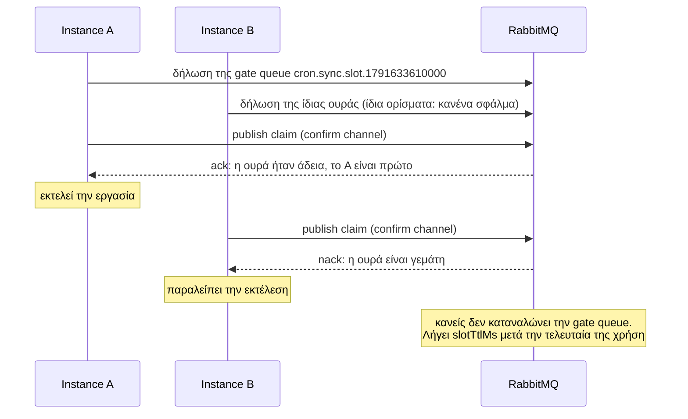

Το `RabbitMQBackend` διασφαλίζει ότι ένα instance εκτελεί σε κάθε προγραμματισμένο χρόνο, χρησιμοποιώντας ένα RabbitMQ που ήδη διαθέτετε. Απαιτεί RabbitMQ 3.9 ή νεότερο.

```ts
import { RabbitMQBackend, Scheduler } from 'anarchon';

const scheduler = new Scheduler({
  backend: new RabbitMQBackend({ url: 'amqp://rabbit.internal' }),
});
```

:::caution[Μόνο claim]
Η περιορισμένη ουρά που χρησιμοποιεί αυτό το backend αποφασίζει ποιος είναι πρώτος, αλλά δεν διατηρεί μια μίσθωση (lease) την οποία θα μπορούσε να ελέγξει ένας εφεδρικός (backup). Επομένως, με αυτό το backend **δεν υπάρχουν εφεδρικοί runners, προστασία επικάλυψης (overlap), ανάκτηση (catch-up) και παράδοση (hand-over)**. Αν το instance που εκτελεί μια εργασία καταρρεύσει, εκείνη η εκτέλεση χάνεται. Για αυτές τις δυνατότητες χρησιμοποιήστε Redis, PostgreSQL ή SQLite. Δείτε [Brokers και μισθώσεις](../brokers-and-leases/).
:::

## Επιλογές

| Επιλογή | Προεπιλογή | Σημασία |
| --- | --- | --- |
| `url` | `'amqp://localhost'` | Το URL σύνδεσης AMQP |
| `connection` | | Η δική σας σύνδεση `amqplib`. Διατηρείτε την κυριότητά της |
| `prefix` | `'cron.'` | Πρόθεμα για κάθε όνομα ουράς |
| `slotTtlMs` | `300000` (5 λεπτά) | Για πόσο χρόνο το RabbitMQ απομνημονεύει ότι μια εκτέλεση δεσμεύτηκε |

```ts
import amqplib from 'amqplib';

const connection = await amqplib.connect(process.env.AMQP_URL);
new RabbitMQBackend({ connection, prefix: 'billing.cron.', slotTtlMs: 15 * 60_000 });
```

## Πώς κερδίζει ένα instance

Ο μηχανισμός που χρησιμοποιείται είναι μια **ουρά που δέχεται ένα μόνο μήνυμα και απορρίπτει τα υπόλοιπα**, σε συνδυασμό με **publisher confirms**.

Κάθε εκτέλεση λαμβάνει τη δική της μικρή ουρά-πύλη («gate» queue), με όνομα `<prefix><job>.slot.<slot>`, η οποία δηλώνεται με:

| Όρισμα | Τιμή | Αποτέλεσμα |
| --- | --- | --- |
| `x-max-length` | `1` | Η ουρά χωράει ένα μήνυμα |
| `x-overflow` | `reject-publish` | Μια δημοσίευση σε γεμάτη ουρά απορρίπτεται, δεν απορρίπτεται σιωπηρά |
| `x-expires` | `slotTtlMs` | Η ουρά διαγράφεται αυτόματα μετά από αυτό το διάστημα αδράνειας |



1. Κάθε instance δηλώνει την gate queue. Η δήλωση μιας ουράς που υπάρχει ήδη, με τα ίδια ορίσματα, επιτρέπεται, επομένως αυτό είναι ασφαλές να επαναλαμβάνεται.
2. Κάθε instance δημοσιεύει ένα μήνυμα σε αυτήν σε ένα κανάλι σε λειτουργία confirm (confirm mode).
3. Ο broker στέλνει **ack** στη δημοσίευση που γέμισε την ουρά και **nack** σε κάθε μεταγενέστερη. Ο broker διατάσσει τις δημοσιεύσεις, οπότε ακριβώς ένα instance λαμβάνει το ack.
4. Κανείς δεν καταναλώνει (consume) το μήνυμα. Η εκτέλεση παραμένει «δεσμευμένη» μέχρι να λήξει η ουρά.

### Αν χαθεί η απάντηση

Αν η σύνδεση διακοπεί μετά τη δημοσίευση και πριν φτάσει το confirm, το instance δεν μπορεί να γνωρίζει αν κέρδισε. Αντιμετωπίζει την εκτέλεση ως **μη κερδισμένη** και την παραλείπει, αντί να ρισκάρει να την εκτελέσει δύο φορές. Σε αυτή τη σπάνια περίπτωση η εκτέλεση δεν πραγματοποιείται καθόλου.

## Περιορισμοί που πρέπει να γνωρίζετε

- **Το `jitterMs + maxLateMs` πρέπει να είναι μικρότερο από το `slotTtlMs`.** Αφού λήξει η gate queue, το RabbitMQ δεν γνωρίζει πλέον ότι η εκτέλεση είχε δεσμευτεί, και ένα instance με πολύ μεγάλη καθυστέρηση θα μπορούσε να την εκτελέσει ξανά. Το anarchon το ελέγχει αυτό κατά την προσθήκη μιας εργασίας και πετάει εξαίρεση αν οι ρυθμίσεις δεν είναι ασφαλείς. Με τις προεπιλογές (2 s + 60 s έναντι 5 min) είστε καλυμμένοι.
- **Τα ονόματα των εργασιών (job names)** μπορούν να περιέχουν μόνο γράμματα, ψηφία, `_` και `-`, επειδή γίνονται ονόματα ουρών.
- **Μία ουρά ανά εκτέλεση.** Μια εργασία που εκτελείται κάθε δευτερόλεπτο δημιουργεί μια ουρά κάθε δευτερόλεπτο, καθεμία από τις οποίες ζει για `slotTtlMs`. Με την προεπιλογή αυτό σημαίνει περίπου 300 μικρές ουρές ανά τέτοια εργασία ανά πάσα στιγμή. Για πολύ συχνές εργασίες προτιμήστε Redis.
- **Μια ουρά κρατά τις παραμέτρους με τις οποίες δημιουργήθηκε.** Instances με διαφορετικό `slotTtlMs` ή `historySize` χρησιμοποιούν τις υπάρχουσες ουρές όπως είναι, οπότε ένα νέο `slotTtlMs` ισχύει για τις gate queues των επόμενων εκτελέσεων. Η ουρά ιστορικού κρατά το αρχικό της μέγεθος: για να το αλλάξετε, διαγράψτε την `<prefix><job>.history`, κάτι που διαγράφει και το ιστορικό της εργασίας.

## Ιστορικό

Το ιστορικό διατηρείται σε μια **ουρά stream (stream queue)** ανά εργασία, `<prefix><job>.history`, με μέγεθος βάσει του `historySize` της εργασίας. Αυτός είναι ο λόγος που απαιτείται το RabbitMQ 3.9: τα streams εισήχθησαν σε εκείνη την έκδοση.

Οι μέθοδοι `history()`, `lastRun()` και `runNow()` λειτουργούν όπως και στα υπόλοιπα backends. Μια εκτέλεση της οποίας ο runner κατέρρευσε διατηρεί την κατάσταση `running`, καθώς τίποτα δεν μπορεί να γνωρίζει ότι σταμάτησε.

## Επόμενα βήματα

- [Αλγόριθμοι claim](../../internals/claim-algorithms/#rabbitmq)
- [Επισκόπηση backends](../overview/)
