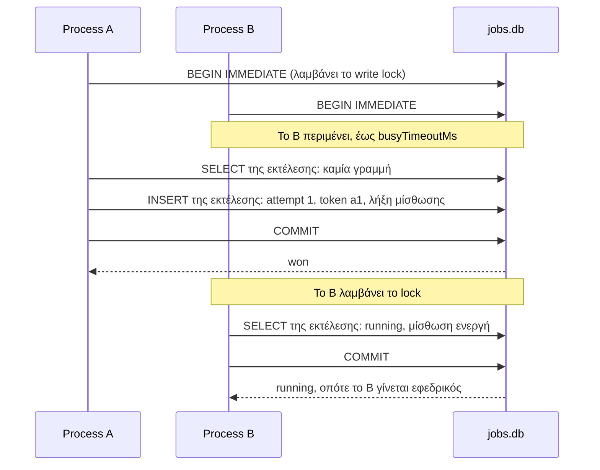

Το `SqliteBackend` σας προσφέρει το πλήρες σύνολο δυνατοτήτων (εφεδρικούς, προστασία από αλληλεπικαλυπτόμενες εκτελέσεις, ανάκτηση, παράδοση) χωρίς να χρειάζεται να εκτελείται κάποιος server. Απαιτεί SQLite 3.35 ή νεότερο.

```ts
import { Scheduler, SqliteBackend } from 'anarchon';

const scheduler = new Scheduler({
  backend: new SqliteBackend({ database: '/var/lib/myapp/jobs.db' }),
});
```

## Πότε είναι κατάλληλο

Ένα αρχείο SQLite συντονίζει τις διεργασίες που ανοίγουν **το ίδιο ακριβώς αρχείο**.

| Διάταξη | Λειτουργεί; |
| --- | --- |
| Πολλαπλές διεργασίες σε ένα μηχάνημα (PM2, Node cluster, πολλαπλά containers που μοιράζονται ένα volume) | Ναι |
| Ανάπτυξη και δοκιμές (tests) | Ναι, χωρίς να χρειάζεται εγκατάσταση τίποτα |
| Πολλαπλά μηχανήματα, καθένα με τον δικό του δίσκο | **Όχι**: κάθε μηχάνημα θα έχει το δικό του αρχείο και θα εκτελεί κάθε εργασία |
| Πολλαπλά μηχανήματα σε δικτυακό σύστημα αρχείων (NFS) | **Όχι**: τα file locks του SQLite δεν είναι αξιόπιστα εκεί |
| Πολλαπλά μηχανήματα με libSQL server ή Turso | Ναι, δείτε [παρακάτω](#πολλαπλά-μηχανήματα-ένας-libsql-server) |

## Οδηγοί βάσης δεδομένων (Drivers)

Η παράμετρος `database` δέχεται μια διαδρομή αρχείου (file path) ή ένα αντικείμενο database που ήδη διαθέτετε.

| Τι περνάτε | Driver | Σημειώσεις |
| --- | --- | --- |
| Μια διαδρομή αρχείου | `node:sqlite` (ενσωματωμένο στο Node 22.5+), ή `better-sqlite3` αν αυτό απουσιάζει | Το anarchon το ανοίγει και το κλείνει |
| Ένα `DatabaseSync` | `node:sqlite` | Δικό σας· δεν κλείνει στο `stop()` |
| Ένα `Database` | `better-sqlite3` | Δικό σας· δεν κλείνει στο `stop()` |
| Έναν client από το `createClient()` | `@libsql/client` | Τοπικό αρχείο ή απομακρυσμένος server |
| `{ all, transaction }` | Οτιδήποτε άλλο | Ο δικός σας adapter |

```ts
// Διαδρομή: η προεπιλογή είναι './anarchon.db'
new SqliteBackend({ database: './jobs.db' });

// better-sqlite3
import Database from 'better-sqlite3';
new SqliteBackend({ database: new Database('./jobs.db') });

// node:sqlite
import { DatabaseSync } from 'node:sqlite';
new SqliteBackend({ database: new DatabaseSync('./jobs.db') });
```

## Επιλογές

| Επιλογή | Προεπιλογή | Σημασία |
| --- | --- | --- |
| `database` | `'./anarchon.db'` | Διαδρομή αρχείου, ή δικό σας database ή client |
| `table` | `'anarchon_runs'` | Όνομα πίνακα |
| `busyTimeoutMs` | `5000` | Πόσο χρόνο περιμένει μια εγγραφή για την εγγραφή μιας άλλης διεργασίας πριν αποτύχει |

Όταν το anarchon ανοίγει το αρχείο μόνο του, το μεταβαίνει σε λειτουργία WAL (Write-Ahead Logging), ώστε οι αναγνώστες (readers) να μην μπλοκάρουν τον συγγραφέα (writer). Αν περνάτε τη δική σας database, ενεργοποιήστε το μόνοι σας:

```ts
const db = new Database('./jobs.db');
db.pragma('journal_mode = WAL');
new SqliteBackend({ database: db });
```

Το `busy_timeout` ορίζεται από το `busyTimeoutMs` και στις δύο περιπτώσεις.

## Πίνακες

Δημιουργούνται κατά το `start()`:

| Πίνακας | Μία γραμμή ανά | Περιεχόμενο |
| --- | --- | --- |
| `<table>` | εκτέλεση (run) | attempt, token, status, runner, λήξη μίσθωσης |
| `<table>_attempts` | προσπάθεια (attempt) | ποιος, γιατί, πότε, πώς ολοκληρώθηκε (ιστορικό) |

## Πώς κερδίζει ένα instance

Το SQLite επιτρέπει **έναν writer τη φορά** για ολόκληρη τη βάση δεδομένων. Ένα claim είναι ένα transaction `BEGIN IMMEDIATE`, το οποίο αποκτά αυτό το write lock στην αρχή:



Δύο claims δεν μπορούν να διαπλακούν, επομένως το δεύτερο βλέπει πάντα αυτό που έγραψε το πρώτο.

Ένας εφεδρικός που ελέγχει μια ενεργή εκτέλεση εκτελεί μόνο ανάγνωση· αποκτά το write lock μόνο όταν η μίσθωση έχει λήξει. Τα heartbeats και η ολοκλήρωση («finished») είναι μεμονωμένες εντολές.

## Πολλαπλά μηχανήματα: ένας libSQL server

Το [libSQL](https://github.com/tursodatabase/libsql) είναι ένα fork του SQLite που μπορεί να εκτελεστεί ως server (`sqld`), και το [Turso](https://turso.tech) το παρέχει ως υπηρεσία. Περάστε έναν απομακρυσμένο client και κάθε μηχάνημα μοιράζεται μία κοινή βάση δεδομένων:

```ts
import { createClient } from '@libsql/client';
import { Scheduler, SqliteBackend } from 'anarchon';

const client = createClient({
  url: process.env.LIBSQL_URL,           // libsql://... ή http://...
  authToken: process.env.LIBSQL_AUTH_TOKEN,
});

const scheduler = new Scheduler({ backend: new SqliteBackend({ database: client }) });
```

Σημεία που πρέπει να γνωρίζετε για έναν απομακρυσμένο libSQL server:

- Εξακολουθεί να είναι SQLite: **ένας writer τη φορά για ολόκληρη τη βάση δεδομένων**, σε όλους τους πίνακες. Έντονη κίνηση εγγραφών από την υπόλοιπη εφαρμογή σας στην ίδια βάση επιβραδύνει τα claims.
- Τα transactions εκτελούνται μέσω HTTP. Αν μια διεργασία καταρρεύσει στη μέση ενός claim transaction, ο server διατηρεί το write lock εκείνου του transaction μέχρι να το εγκαταλείψει, λίγα δευτερόλεπτα αργότερα. Κατά τη διάρκεια αυτή, άλλοι writers περιμένουν. Το anarchon διατηρεί τα transactions σπάνια (μόνο claims που μπορούν να κερδίσουν), οπότε αυτό το παράθυρο είναι μικρό, αλλά υπαρκτό.
- Κάθε claim απαιτεί πολλαπλά network round trips, επομένως είναι πιο αργό από το Redis ή την PostgreSQL.

Για πολλαπλά μηχανήματα, η PostgreSQL ή το Redis αποτελούν πιο στιβαρή επιλογή εφόσον διαθέτετε κάποιο από τα δύο.

## Μία διεργασία, πολλαπλοί schedulers

Οι drivers του SQLite μπλοκάρουν το thread ενώ περιμένουν για κάποιο lock. Για τον λόγο αυτό, το anarchon εκτελεί κάθε εντολή SQLite σε μια διεργασία μέσω μίας ενιαίας ουράς, ώστε δύο schedulers στην ίδια διεργασία (για παράδειγμα σε δοκιμές/tests) να μην μπορούν να οδηγηθούν σε αδιέξοδο (deadlock) μεταξύ τους. Δεν χρειάζεται να κάνετε τίποτα για αυτό.

## Αντίγραφα ασφαλείας και το αρχείο

Η κατάσταση των εργασιών είναι συνηθισμένα δεδομένα μέσα στο αρχείο. Αντιγράψτε το με τα εργαλεία backup του SQLite αντί για απλή αντιγραφή αρχείου όσο διεργασίες γράφουν σε αυτό. Σε λειτουργία WAL υπάρχουν δύο επιπλέον αρχεία δίπλα στη βάση δεδομένων (`-wal` και `-shm`)· ανήκουν σε αυτήν.

## Επόμενα βήματα

- [Αλγόριθμοι claim](../../internals/claim-algorithms/#sqlite)
- [Δοκιμές και αποσφαλμάτωση](../../recipes/testing-and-debugging/): το SQLite είναι βολικό στις δοκιμές
