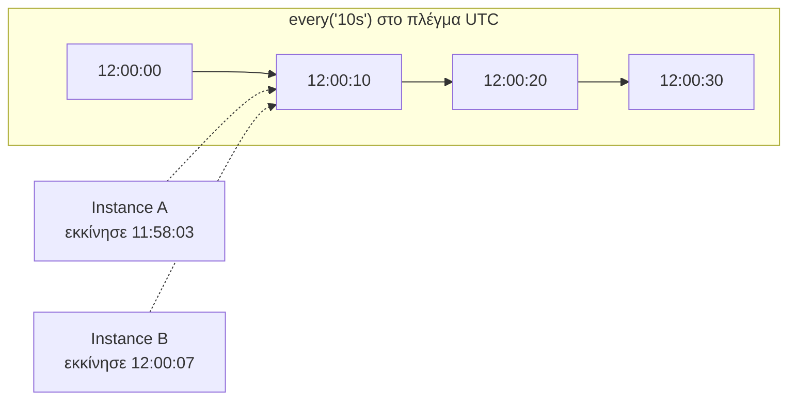
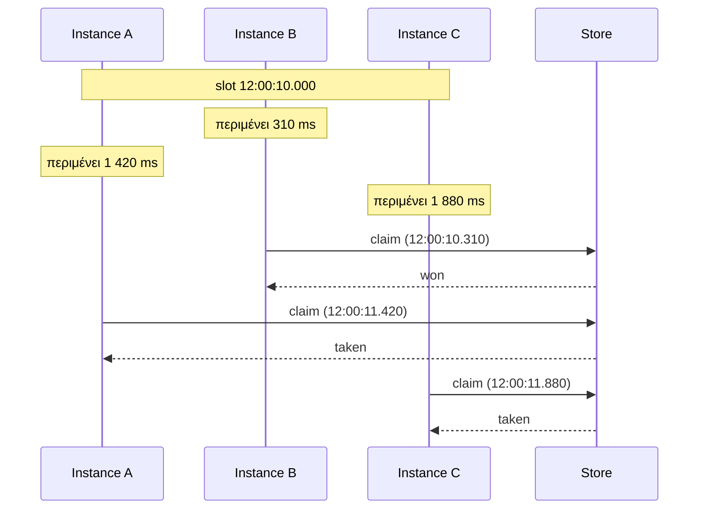
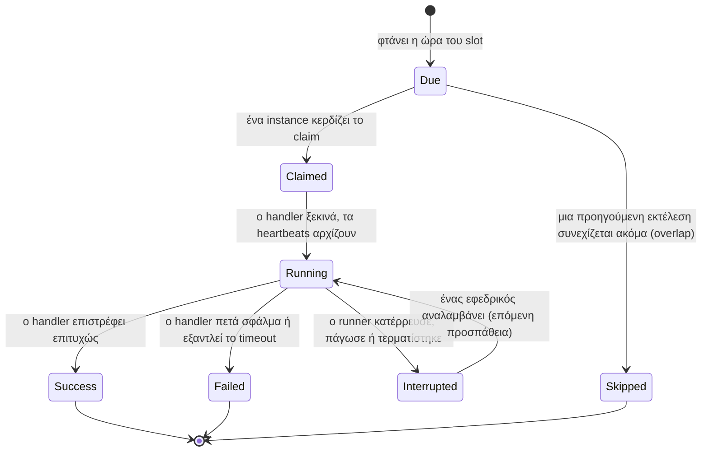

Το υπόλοιπο της τεκμηρίωσης χρησιμοποιεί ένα μικρό λεξιλόγιο όρων. Κάθε όρος ορίζεται εδώ μία φορά.

## Instance (Στιγμιότυπο διεργασίας)

Ένα εκτελούμενο αντίγραφο της υπηρεσίας σας: μία διεργασία (process). Κάθε instance δημιουργεί τον δικό του `Scheduler` με τις ίδιες εργασίες. Το καθένα διαθέτει ένα `instanceId`, από προεπιλογή `hostname:pid`, το οποίο εμφανίζεται στο ιστορικό ώστε να μπορείτε να δείτε ποιος εκτέλεσε τι.

## Job (Εργασία)

Μια επώνυμη εργασία με ένα χρονοδιάγραμμα (schedule) και έναν handler:

```ts
scheduler.every('sync', '10s', async (ctx) => { /* ο handler */ });
//               name   schedule
```

Το **name** (όνομα) ταυτοποιεί την εργασία στο store, επομένως πρέπει να είναι το ίδιο σε κάθε instance και δεν θα πρέπει να αλλάζει μεταξύ των deploys.

## Slot (Χρονοθυρίδα εκτέλεσης)

Ένας προγραμματισμένος χρόνος μιας εργασίας, ως χιλιοστά του δευτερολέπτου (milliseconds) από το 1970 (Unix epoch). «Η εκτέλεση 12:00:10 του *sync*» αντιστοιχεί στο slot `1791633610000`.

Το slot είναι η καρδιά του σχεδιασμού. Κάθε instance υπολογίζει τα ίδια slots από το ίδιο χρονοδιάγραμμα, χωρίς επικοινωνία μεταξύ τους:

- Το `every('10s')` χρησιμοποιεί ένα πλέγμα (grid) υπολογισμένο από τις 1970-01-01 UTC, επομένως τα slots είναι :00, :10, :20 ανεξάρτητα από την ώρα που ξεκίνησε κάθε instance.
- Το `cron('0 8 * * *')` χρησιμοποιεί την έκφραση cron στη ζώνη ώρας (time zone) της.

Επειδή το slot είναι ο ίδιος αριθμός παντού, το ζεύγος `(job name, slot)` προσδιορίζει μία συγκεκριμένη εκτέλεση σε ολόκληρο το cluster. Για αυτό το ζεύγος ανταγωνίζονται τα instances.



## Run και attempt (Εκτέλεση και προσπάθεια)

Ένα **run** είναι ένα slot μιας εργασίας. Συνήθως ένα run εκτελείται μία φορά. Αν το instance που το εκτελεί τερματιστεί απροσδόκητα, ένα άλλο instance το ξεκινά ξανά: αυτό αποτελεί μια δεύτερη **προσπάθεια (attempt)** του ίδιου run. Το `ctx.attempt` είναι 1 για την πρώτη προσπάθεια, και 2 ή περισσότερο μετά από μια ανάληψη (takeover).

## Claim (Διεκδίκηση)

Το αίτημα που στέλνει ένα instance στο store όταν φτάσει η ώρα ενός slot: «κατάγραψε ότι εκτελώ αυτή την εκτέλεση, εκτός αν είναι ήδη δεσμευμένη». Το store απαντά σε ένα ατομικό βήμα, έτσι ώστε ακριβώς ένα instance να κερδίζει.

## Jitter (Τυχαία καθυστέρηση)

Μια τυχαία καθυστέρηση, μεταξύ 0 και `jitterMs`, την οποία περιμένει κάθε instance πριν επιχειρήσει claim. Χωρίς αυτό, το instance με το ταχύτερο ρολόι θα κέρδιζε κάθε φορά. Με αυτό, διαφορετικό instance τείνει να κερδίζει κάθε εκτέλεση, ώστε το φορτίο να κατανέμεται.



## Backend (Σύστημα αποθήκευσης)

Ο προσαρμογέας (adapter) μεταξύ του anarchon και ενός store. Τα `RedisBackend`, `PostgresBackend`, `SqliteBackend`, `RabbitMQBackend` και `NatsBackend` είναι ενσωματωμένα. Όλα τους εγγυώνται έναν νικητή ανά εκτέλεση. Ορισμένα υποστηρίζουν επίσης μισθώσεις (leases).

## Lease (Μίσθωση)

Μια υπόσχεση με χρόνο λήξης, αποθηκευμένη μαζί με την εκτέλεση: «το instance B εκτελεί αυτό το run, και είναι ζωντανό έως τις 12:00:40». Όσο η εργασία εκτελείται, ο runner μεταθέτει αυτόν τον χρόνο αργότερα κάθε `heartbeatMs`. Αυτό είναι το **heartbeat** (παλμός).

Αν ο runner καταρρεύσει, τα heartbeats σταματούν, η μίσθωση λήγει, και η εκτέλεση καθίσταται διαθέσιμη για την επόμενη προσπάθεια.

Μια μίσθωση δεν είναι lock. Κανείς δεν περιμένει σε ουρά για αυτήν και κανείς δεν υποχρεούται να την απελευθερώσει. Απαντά μόνο σε ένα ερώτημα: είναι ο runner ακόμα ζωντανός;

## Backup (Εφεδρικός)

Ένα instance που έχασε το claim για μια εκτέλεση. Ελέγχει τη μίσθωση της εκτέλεσης κάθε 1 έως 2 heartbeats. Αν η μίσθωση λήξει πριν ολοκληρωθεί η εκτέλεση, ο εφεδρικός διεκδικεί την επόμενη προσπάθεια. Αυτό ονομάζεται **ανάληψη (takeover)**.

## Token (Διακριτικό ασφαλείας)

Μια τυχαία τιμή που δημιουργείται για κάθε προσπάθεια. Το store απομνημονεύει το token της τρέχουσας προσπάθειας, και τα heartbeats καθώς και η ένδειξη ολοκλήρωσης («finished») γίνονται δεκτά μόνο με αυτό το token. Αν ένας εφεδρικός έχει αναλάβει την εκτέλεση (takeover), το token του παλιού runner δεν ταιριάζει πλέον, οπότε τίποτα από όσα στέλνει δεν επηρεάζει την εκτέλεση. Αυτό ονομάζεται **fencing** (περίφραξη/απομόνωση).

## Συνδυάζοντας τα πάντα



## Backends με υποστήριξη μίσθωσης και backends μόνο για claim

Δεν μπορεί κάθε store να διατηρεί μια μίσθωση την οποία μπορούν να ελέγχουν οι άλλοι.

| | Backends με μίσθωση (Lease) | Backends μόνο για claim |
| --- | --- | --- |
| Ποια | Redis και Valkey (στρατηγική `lease`), PostgreSQL, SQLite, NATS (στρατηγική `lease`) | Στρατηγικές Redis `stream-id`, `idmp` και `script`, RabbitMQ, NATS (`msg-id`, η προεπιλογή) |
| Ένας νικητής ανά εκτέλεση | Ναι | Ναι |
| Εφεδρικοί (backups) και ανάληψη (takeover) | Ναι | Όχι |
| Χωρίς αλληλεπικαλυπτόμενες εκτελέσεις (overlap) | Ναι | Όχι |
| Ανάκτηση μετά από downtime (catch-up) | Ναι | Όχι |
| Παράδοση (hand-over) στο `stop()` | Ναι | Όχι |

Οι οδηγοί επισημαίνουν τις λειτουργίες που απαιτούν backend με υποστήριξη μίσθωσης.

## Επόμενα βήματα

- [Ορισμός εργασιών](../../guides/defining-jobs/)
- [Αρχιτεκτονική](../../internals/architecture/), αν θέλετε να δείτε πρώτα τα εσωτερικά στοιχεία λειτουργίας
