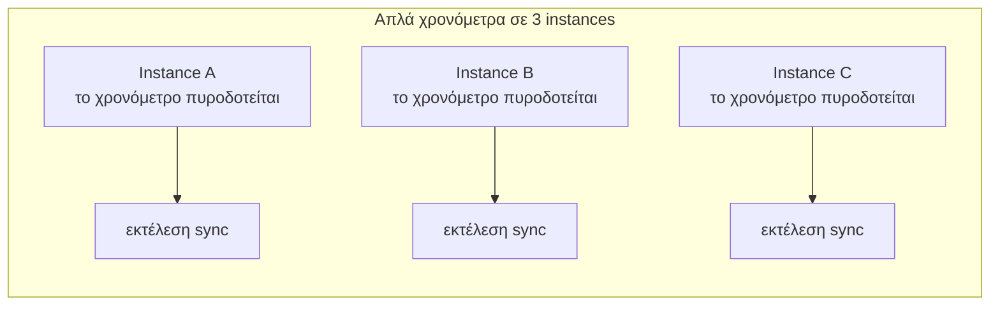
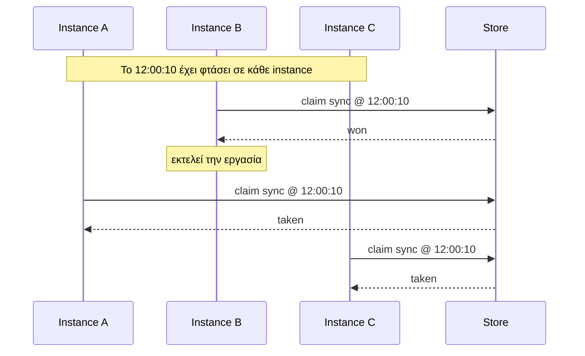

Το anarchon εκτελεί προγραμματισμένες εργασίες σε μια υπηρεσία που διαθέτει περισσότερα από ένα instances, και επιλέγει **ένα** instance για να εκτελέσει κάθε προγραμματισμένο χρόνο.

Αυτή η σελίδα εξηγεί το πρόβλημα από την αρχή. Αν γνωρίζετε ήδη γιατί το cron σε ένα cluster είναι δύσκολο, μεταβείτε στη [Γρήγορη εκκίνηση](../quick-start/).

## Το πρόβλημα

Μια προγραμματισμένη εργασία είναι κώδικας που εκτελείται σε καθορισμένους χρόνους: «αποστολή της σύνοψης στις 08:00», «συγχρονισμός πελατών κάθε 10 δευτερόλεπτα».

Σε μια μοναδική διεργασία (single process) αυτό είναι εύκολο. Ορίζετε ένα χρονόμετρο (timer), και όταν πυροδοτηθεί, εκτελείτε τον κώδικα:

```ts
setInterval(syncCustomers, 10_000);
```

Οι πραγματικές υπηρεσίες σπάνια τρέχουν ως μία μόνο διεργασία. Εκτελείτε πολλαπλά αντίγραφα, που ονομάζονται *instances*, ώστε η υπηρεσία να επιβιώνει από καταρρεύσεις και να διαχειρίζεται περισσότερη κίνηση. Κάθε instance τρέχει τον ίδιο κώδικα, επομένως κάθε instance ορίζει το ίδιο χρονόμετρο:



Τώρα η εργασία εκτελείται τρεις φορές. Για μια ανανέωση της cache αυτό είναι σπάταλο. Για «χρέωση του πελάτη» ή «αποστολή email» πρόκειται για σφάλμα (bug).

## Οι συνηθισμένες λύσεις και το κόστος τους

| Προσέγγιση | Τι πάει στραβά |
| --- | --- |
| Εκτέλεση της εργασίας μόνο σε ένα ειδικό instance | Όταν αυτό το instance είναι εκτός λειτουργίας, η εργασία δεν εκτελείται. Τα deploys απαιτούν ειδικό χειρισμό. |
| Εκλογή leader | Χρειάζεστε διαδικασία εκλογής, και πρέπει να διαχειριστείτε την περίπτωση όπου δύο instances θεωρούν και τα δύο ότι είναι ο leader. |
| Λήψη lock πριν από κάθε εκτέλεση | Ένα lock πρέπει να απελευθερωθεί. Αν ο κάτοχος καταρρεύσει, το lock παραμένει μέχρι να λήξει (timeout)· αν λήξει πολύ νωρίς, θα εκτελεστούν δύο instances ταυτόχρονα. |
| Τοποθέτηση εργασιών σε μια ουρά | Κάτι πρέπει και πάλι να εισάγει κάθε εκτέλεση στην ουρά ακριβώς μία φορά, πράγμα που αποτελεί το ίδιο ακριβώς πρόβλημα. |

## Πώς το επιτυγχάνει το anarchon

Το anarchon δεν εκλέγει leader. Βασίζεται σε ένα γεγονός: όλα τα instances σας μοιράζονται ήδη μια βάση δεδομένων ή έναν message broker, και αυτό το store μπορεί να κάνει ένα μικρό πράγμα *ατομικά* (atomically), δηλαδή ως ένα ενιαίο βήμα που δεν μπορεί να διαπλακεί με τη λειτουργία κανενός άλλου.

Τρεις ιδέες το κάνουν να λειτουργεί:

1. **Κάθε instance υπολογίζει τους ίδιους χρόνους εκτέλεσης.** «Κάθε 10 δευτερόλεπτα» σημαίνει :00, :10, :20 σε ένα σταθερό πλέγμα (grid), ίδιο σε κάθε μηχάνημα. Ένας χρόνος εκτέλεσης ονομάζεται **slot**.
2. **Κάθε instance προσπαθεί να διεκδικήσει (claim) το slot.** Όταν φτάσει η ώρα ενός slot, κάθε instance ρωτά το store: «κατάγραψε ότι εκτελώ την εκτέλεση 12:00:10 του *sync*, εκτός αν το έχει ήδη κάνει κάποιος άλλος».
3. **Το store επιτρέπει σε ακριβώς ένα να κερδίσει.** Επειδή ο έλεγχος και η εγγραφή αποτελούν ένα ατομικό βήμα, μόνο το πρώτο instance λαμβάνει «ναι». Τα υπόλοιπα λαμβάνουν «έχει ήδη δεσμευτεί» και δεν κάνουν τίποτα.



Κάθε instance περιμένει μια μικρή τυχαία καθυστέρηση (jitter) πριν διεκδικήσει, έτσι ώστε να τείνει να κερδίζει διαφορετικό instance κάθε φορά και το φορτίο να κατανέμεται.

## Τι συμβαίνει όταν κάτι πάει στραβά

Η απόφαση για το ποιος εκτελεί είναι το εύκολο μισό. Το δυσκολότερο μισό είναι τι συμβαίνει μετά:

- Ο νικητής **καταρρέει** στη μέση της εργασίας. Ποιος την ολοκληρώνει;
- Ο νικητής **παγώνει** για ένα λεπτό (μια μεγάλη παύση garbage collection, μια εικονική μηχανή που κόλλησε).
- Κάνετε **deploy**, και το instance που εκτελεί την εργασία λαμβάνει εντολή τερματισμού.
- Η εργασία διαρκεί **περισσότερο από το μεσοδιάστημά της**, οπότε η επόμενη εκτέλεση πρέπει να ξεκινήσει πριν τελειώσει η τρέχουσα.
- **Όλα τα instances είναι εκτός λειτουργίας** όταν φτάνει η ώρα μιας εκτέλεσης.

Σε Redis, Valkey, PostgreSQL, SQLite και NATS (με `strategy: 'lease'`), το anarchon χειρίζεται αυτές τις περιπτώσεις με μια **μίσθωση (lease)**. Ο νικητής ενημερώνει συνεχώς το store ότι «είμαι ακόμα ζωντανός» κάθε λίγα δευτερόλεπτα. Τα υπόλοιπα instances γίνονται οι *εφεδρικοί (backups)* παρατηρητές του και παρακολουθούν αυτή τη μίσθωση. Αν σταματήσει να ανανεώνεται, ένας εφεδρικός αναλαμβάνει την εκτέλεση (takeover).

| Κατάσταση | Τι κάνει το anarchon |
| --- | --- |
| Η εργασία διαρκεί περισσότερο από το μεσοδιάστημά της | Οι εκτελέσεις που μεσολαβούν παραλείπονται· εκτελείται μία κάθε φορά |
| Ο νικητής τερματίζεται βίαια στη μέση της εκτέλεσης | Ένας εφεδρικός αναλαμβάνει την εκτέλεση περίπου μία μίσθωση αργότερα, ως 2η προσπάθεια |
| Ο νικητής παγώνει για διάστημα μεγαλύτερο από τη μίσθωση | Ένας εφεδρικός αναλαμβάνει· όταν ξεπαγώσει, ο αρχικός ενημερώνεται ότι έχασε την εκτέλεση |
| Ο νικητής τερματίζεται ομαλά | Παραδίδει (hand-over) αμέσως την εκτέλεση· ένας εφεδρικός την ξεκινά ξανά |
| Όλα τα instances κάνουν επανεκκίνηση στη μέση της εκτέλεσης | Μετά την επανεκκίνηση, ένα instance την επανεκτελεί |
| Όλα τα instances είναι εκτός λειτουργίας όταν φτάνει η ώρα μιας εκτέλεσης | Το πρώτο instance που θα εκκινήσει την εκτελεί (ανάκτηση / catch-up), αν έπρεπε να τρέξει πρόσφατα |

Μια ανάληψη (takeover) ξεκινά τον handler από την αρχή, ως νέα προσπάθεια· δεν συνεχίζει από το σημείο όπου σταμάτησε ο προηγούμενος runner. Το RabbitMQ, και το NATS με την προεπιλεγμένη στρατηγική, δεν έχουν μίσθωση: επιλέγουν μόνο τον νικητή, και μια εκτέλεση της οποίας ο runner κατέρρευσε χάνεται.

Το [Σενάρια αστοχίας](../../internals/failure-scenarios/) αναλύει καθένα από αυτά με διάγραμμα.

## Τι χρειάζεστε

- **Node.js 20 ή νεότερο.**
- **Ένα κοινόχρηστο store** στο οποίο έχουν πρόσβαση όλα τα instances: Redis, Valkey, PostgreSQL, SQLite (στο ίδιο μηχάνημα), ή έναν libSQL server. Το NATS λειτουργεί επίσης, με όλες τις εγγυήσεις στη στρατηγική `lease`· το RabbitMQ λειτουργεί με λιγότερες εγγυήσεις (δείτε [Backends](../../backends/overview/)).

## Τι δεν είναι το anarchon

- **Δεν είναι ουρά εργασιών (job queue).** Δεν διανέμει πολλές μονάδες εργασίας σε workers. Αποφασίζει ποιο instance εκτελεί μια εργασία σε κάθε προγραμματισμένο χρόνο.
- **Δεν είναι exactly-once (ακριβώς μία φορά).** Μια εκτέλεση της οποίας ο runner κατέρρευσε ξεκινά ξανά από έναν εφεδρικό, επομένως μια εργασία μπορεί να εκτελεστεί περισσότερες από μία φορές για το ίδιο slot. Γράψτε τις εργασίες έτσι ώστε η εκτέλεσή τους δύο φορές να είναι ακίνδυνη (idempotent). Ο οδηγός [Συγγραφή handlers](../../guides/writing-handlers/) δείχνει πώς.

## Επόμενα βήματα

- [Εγκατάσταση](../installation/)
- [Γρήγορη εκκίνηση](../quick-start/)
- [Βασικές έννοιες](../core-concepts/): οι λίγες λέξεις-κλειδιά που χρησιμοποιούνται στο υπόλοιπο της τεκμηρίωσης
- [Επιλέγοντας το anarchon](../choosing-anarchon/): πότε ταιριάζει καλύτερα μια ουρά, το node-cron ή ένα Kubernetes CronJob
