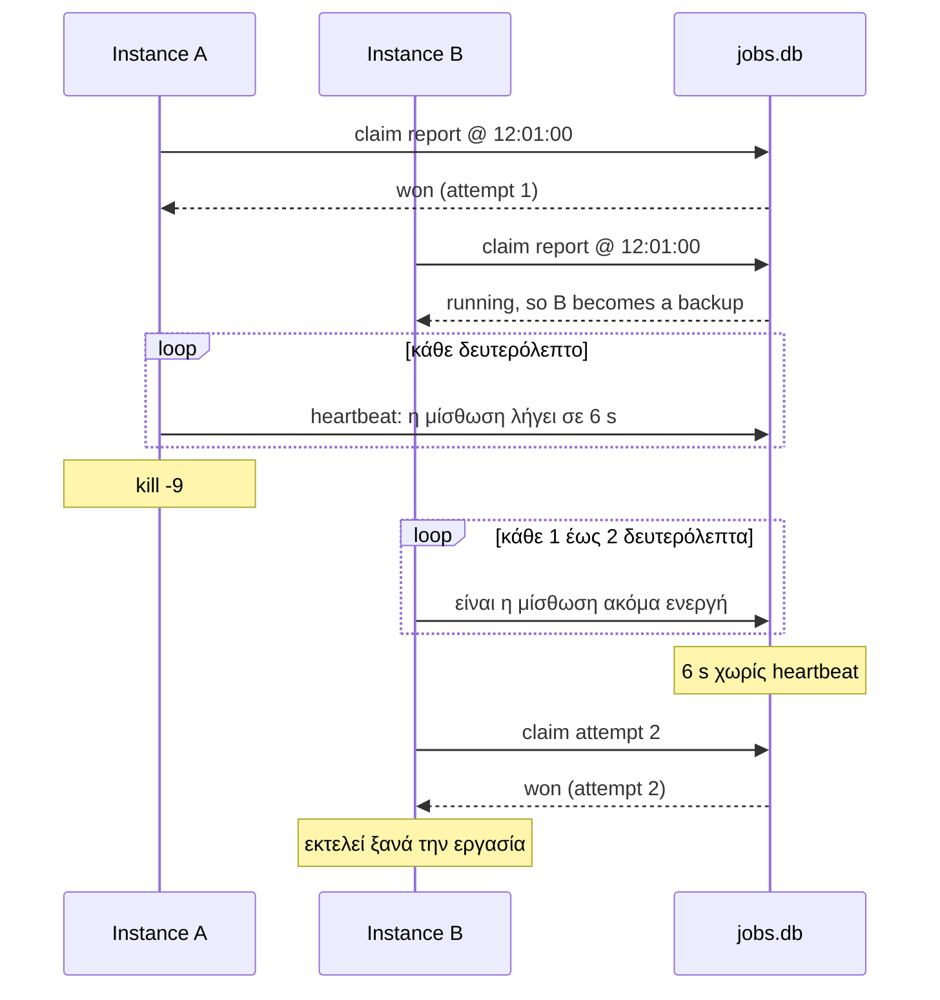

Σε αυτόν τον οδηγό θα γράψετε έναν μικρό scheduler, θα τον εκτελέσετε ως τρία instances και θα παρακολουθήσετε ένα instance να κερδίζει κάθε εκτέλεση. Στη συνέχεια, θα σταματήσετε και θα τερματίσετε βίαια το instance που εκτελεί μια εργασία, και θα δείτε ένα άλλο να ξεκινά ξανά αυτή την εκτέλεση.

Χρησιμοποιεί ένα αρχείο SQLite ως το κοινόχρηστο store, επομένως δεν χρειάζεται να εγκαταστήσετε τίποτα εκτός από το Node 22.13 ή νεότερο, που έχει ενσωματωμένη την SQLite. Τα τρία instances συντονίζονται επειδή ανοίγουν το ίδιο αρχείο στο ίδιο μηχάνημα. Για instances σε περισσότερα μηχανήματα, [μεταβείτε σε Redis ή PostgreSQL](#μετάβαση-σε-πραγματικό-store).

## 1. Δημιουργία του project

```sh
mkdir cron-demo && cd cron-demo
npm init -y
npm install anarchon
npm install --save-dev tsx
```

Το npm περιλαμβάνεται στο Node. Με pnpm ή yarn, χρησιμοποιήστε `pnpm add` ή `yarn add` αντί για `npm install`.

:::note[Παλαιότερες εκδόσεις Node]
Σε Node 22.5 έως 22.12, εκκινήστε κάθε instance με `NODE_OPTIONS=--experimental-sqlite npx tsx app.ts`. Για Node 20, δείτε την καρτέλα SQLite στην [Εγκατάσταση](../installation/).
:::

## 2. Συγγραφή του scheduler

Δημιουργήστε το `app.ts`:

```ts
import { Scheduler, SqliteBackend } from 'anarchon';

const sleep = (ms: number) => new Promise((resolve) => setTimeout(resolve, ms));

async function main() {
  const scheduler = new Scheduler({
    // Όλα τα instances πρέπει να δείχνουν στο ίδιο store. Εδώ: ένα αρχείο.
    backend: new SqliteBackend({ database: './jobs.db' }),
    // Σύντομη μίσθωση, ώστε η ανάληψη (takeover) να παρατηρείται γρήγορα. Η προεπιλογή είναι 30 s.
    leaseMs: 6_000,
    heartbeatMs: 1_000,
    log: true,
  });

  // Μια γρήγορη εργασία, κάθε 10 δευτερόλεπτα
  scheduler.every('sync', '10s', async () => {
    await sleep(200);
  });

  // Μια αργή εργασία: 20 δευτερόλεπτα δουλειάς, κάθε 30 δευτερόλεπτα
  scheduler.every('report', '30s', async (ctx) => {
    for (let second = 0; second < 20; second++) {
      ctx.signal.throwIfAborted(); // καθαρός τερματισμός όταν ζητηθεί
      await sleep(1_000);
    }
  });

  await scheduler.start();
  console.log(`started as ${scheduler.instanceId}`);

  // Καθαρός τερματισμός με Ctrl+C
  process.on('SIGINT', async () => {
    await scheduler.stop();
    process.exit(0);
  });
}

main();
```

## 3. Εκτέλεση τριών instances

Ανοίξτε τρία τερματικά **στον φάκελο του project** και εκτελέστε την ίδια εντολή στο καθένα. Ο φάκελος έχει σημασία: το `./jobs.db` είναι σχετική διαδρομή, και τα instances βλέπουν το ένα το άλλο μόνο όταν ανοίγουν το ίδιο αρχείο.

```sh
npx tsx app.ts
```

Κάθε τερματικό εκτυπώνει το δικό του όνομα, περίπου όπως `started as my-laptop:41822`. Ο αριθμός μετά την άνω και κάτω τελεία είναι το αναγνωριστικό της διεργασίας (process ID)· θα το χρειαστείτε στο βήμα 5. Το Node εκτυπώνει επίσης `ExperimentalWarning: SQLite is an experimental feature`, κάτι που είναι αναμενόμενο.

Παρακολουθήστε την έξοδο. Κάθε 10 δευτερόλεπτα, ακριβώς **ένα** τερματικό εκτυπώνει ότι ξεκίνησε το `sync`, και τα άλλα δύο εκτυπώνουν ότι το παρέλειψαν:

```
[anarchon] sync @ 2026-10-10T12:00:10.000Z: started on my-laptop:41822 (attempt 1, scheduled)
[anarchon] sync @ 2026-10-10T12:00:10.000Z: finished in 203 ms
```

```
[anarchon] sync @ 2026-10-10T12:00:10.000Z: skipped (taken)
```

Το ποιο τερματικό κερδίζει αλλάζει από εκτέλεση σε εκτέλεση. Αυτό είναι το αποτέλεσμα της τυχαίας καθυστέρησης (jitter).

:::note
Αμέσως μετά την εκκίνηση ενός instance ενδέχεται να δείτε εκτελέσεις με ένδειξη `catch-up` αντί για `scheduled`, καθώς και μια εκτέλεση του `report` με ένδειξη `skipped (overlap)`. Κατά την εκκίνηση, το anarchon εκτελεί την πιο πρόσφατη εκτέλεση αν δεν την έχει εκτελέσει ήδη κάποιος άλλος, ενώ μια νέα εκτέλεση του `report` παραλείπεται εφόσον η προηγούμενη βρίσκεται ακόμα σε εξέλιξη. Και τα δύο εξηγούνται στις [Μισθώσεις](../../internals/leases/).
:::

## 4. Ομαλός τερματισμός του runner

Περιμένετε μέχρι ένα τερματικό να εκτυπώσει ότι ξεκίνησε το `report`, και στη συνέχεια πατήστε **Ctrl+C** σε αυτό το τερματικό.

Μέσα σε ένα ή δύο δευτερόλεπτα, ένα άλλο τερματικό εκτυπώνει:

```
[anarchon] report @ 2026-10-10T12:00:30.000Z: started on my-laptop:41907 (attempt 2, takeover)
```

Το τερματικό που σταμάτησε εκτυπώνει ότι παραχώρησε την εκτέλεση:

```
[anarchon] report @ 2026-10-10T12:00:30.000Z: interrupted after 5005 ms, handed over to another instance
```

Το instance που τερματίστηκε *παρέδωσε την εκτέλεση (hand-over)*. Αυτό ακριβώς συμβαίνει σε κάθε rolling deploy. Και οι δύο γραμμές αναφέρουν την ίδια εκτέλεση (`12:00:30`), και η δεύτερη είναι η προσπάθεια 2 (attempt 2): η εργασία ξεκινά από την αρχή στο νέο instance· δεν συνεχίζει από το σημείο όπου σταμάτησε το πρώτο.

## 5. Βίαιος τερματισμός του runner

Εκκινήστε ξανά το instance που είχε σταματήσει. Περιμένετε να ξεκινήσει το `report` κάπου, και στη συνέχεια τερματίστε βίαια αυτή τη διεργασία από ένα τέταρτο τερματικό. Σε Linux και macOS:

```sh
kill -9 <pid>   # ο αριθμός μετά την άνω και κάτω τελεία στο όνομα του instance
```

Αυτή τη φορά δεν παραδίδεται τίποτα: η διεργασία απλώς εξαφανίστηκε. Περίπου 6 δευτερόλεπτα αργότερα (η μίσθωση που ορίσατε), ένας εφεδρικός (backup) παρατηρεί ότι η μίσθωση δεν ανανεώθηκε και αναλαμβάνει την εκτέλεση (takeover):

```
[anarchon] report @ 2026-10-10T12:01:00.000Z: started on my-laptop:41822 (attempt 2, takeover)
```

Ελέγξτε ότι η γραμμή της ανάληψης έχει την ίδια ώρα με την εκτέλεση που τερματίσατε και αναφέρει `attempt 2`. Μια γραμμή με μεταγενέστερη ώρα και `attempt 1` είναι η επόμενη προγραμματισμένη εκτέλεση, όχι ανάληψη. Η καθυστέρηση είναι η μίσθωση: με το προεπιλεγμένο `leaseMs` των 30 δευτερολέπτων, η ανάληψη έρχεται περίπου 30 δευτερόλεπτα μετά την κατάρρευση.

Η εργασία εκτελέστηκε δύο φορές για αυτό το slot, μία εν μέρει και μία πλήρως. Γι' αυτό [οι handlers πρέπει να είναι ασφαλείς αν εκτελεστούν δύο φορές](../../guides/writing-handlers/).

## Τι μόλις συνέβη



## Μετάβαση σε πραγματικό store

Εγκαταστήστε τον driver του store σας και βεβαιωθείτε ότι ο server εκτελείται στο URL που δίνετε:

```sh
npm install redis   # Redis ή Valkey
npm install pg      # PostgreSQL
```

Στη συνέχεια αλλάξτε μία γραμμή. Όλα τα υπόλοιπα παραμένουν ίδια.

```ts
// Redis ή Valkey
const scheduler = new Scheduler({ redis: 'redis://localhost:6379' });

// PostgreSQL
import { PostgresBackend } from 'anarchon';
const scheduler = new Scheduler({
  backend: new PostgresBackend({ connection: process.env.DATABASE_URL }),
});
```

## Επόμενα βήματα

- [Βασικές έννοιες](../core-concepts/): ορισμός των slot, claim, jitter και lease
- [Ορισμός εργασιών](../../guides/defining-jobs/): εκφράσεις cron, χρονικά διαστήματα και μεμονωμένες εργασίες
- [Decorators](../../guides/decorators/): δηλώστε τις ίδιες εργασίες πάνω στις μεθόδους μιας κλάσης
- [Συγγραφή handlers](../../guides/writing-handlers/): τι περιέχει το `ctx` και γιατί έχει σημασία το `ctx.signal`
