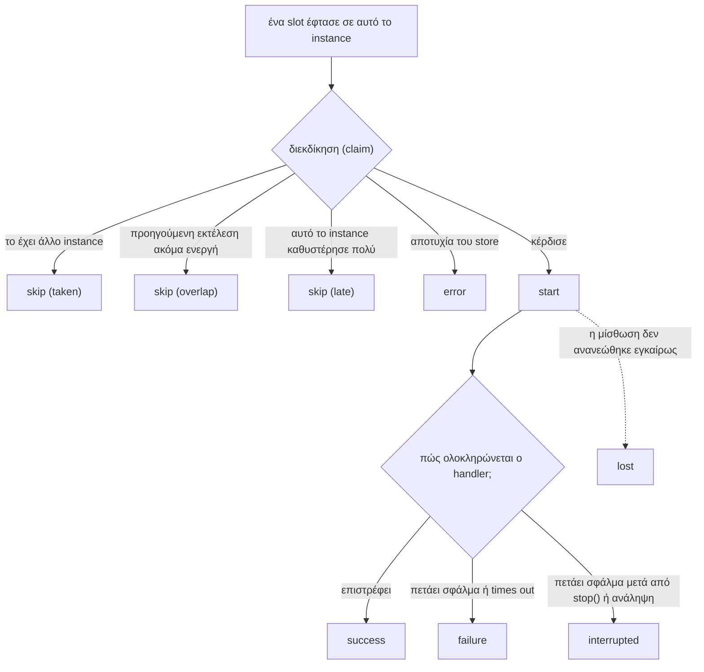

Ο scheduler σας ενημερώνει για το τι συμβαίνει σε **αυτό το instance** μέσω events. Για μια συνολική εικόνα σε όλα τα instances, χρησιμοποιήστε το [ιστορικό](../history/).

```ts
scheduler.on('failure', (run) => {
  console.error(`${run.job} failed on ${run.instanceId}: ${run.error}`);
});
```

Οι μέθοδοι `on()`, `once()` και `off()` λειτουργούν όπως στο `EventEmitter` του Node.js και είναι πλήρως typed: ο τύπος του payload προκύπτει από το όνομα του event.

## Τα events

| Event | Πότε | Payload |
| --- | --- | --- |
| `start` | Αυτό το instance κέρδισε μια εκτέλεση και πρόκειται να καλέσει τον handler | job, slot, attempt, reason |
| `success` | Ο handler επέστρεψε | [εγγραφή εκτέλεσης](../history/#η-εγγραφή-εκτέλεσης) |
| `failure` | Ο handler πέταξε σφάλμα ή πέρασε το `timeoutMs` | εγγραφή εκτέλεσης + `cause` |
| `interrupted` | Το `stop()` ή μια ανάληψη ακύρωσε το `ctx.signal`, και ο handler στη συνέχεια πέταξε σφάλμα | εγγραφή εκτέλεσης + `cause`, `handedOver` |
| `skip` | Μια εκτέλεση αναμενόταν και αυτό το instance δεν την εκτέλεσε | job, slot, `reason` |
| `lost` | Ένα εφεδρικό instance ανέλαβε μια εκτέλεση που αυτό το instance εκτελούσε | job, slot, attempt |
| `error` | Πρόβλημα στο backend ή στη διαμόρφωση | `error`, και τα job και slot εφόσον είναι γνωστά |



### Το `skip` είναι φυσιολογικό

Με τρία instances, κάθε εκτέλεση παράγει ένα event `start` και δύο events `skip` με αιτία `'taken'`. Αυτό δείχνει ότι το σύστημα λειτουργεί σωστά. Οι πιθανές αιτίες:

| Αιτία | Σημασία |
| --- | --- |
| `'taken'` | Κάποιο άλλο instance κέρδισε αυτή την εκτέλεση |
| `'overlap'` | Η προηγούμενη εκτέλεση αυτής της εργασίας βρίσκεται ακόμη σε εξέλιξη (`overlap: 'skip'`) |
| `'late'` | Αυτό το instance έφτασε στην εκτέλεση με καθυστέρηση μεγαλύτερη από `maxLateMs` μετά την ώρα της. Το `lateMs` αναφέρει πόσο καθυστέρησε |

### `failure` και `cause`

Το `run.error` είναι το μήνυμα ως κείμενο, το ίδιο string που αποθηκεύεται στο ιστορικό. Το `run.cause` είναι η τιμή που πέταξε στην πραγματικότητα ο handler, ώστε να μπορείτε να την εξετάσετε:

```ts
scheduler.on('failure', (run) => {
  if (run.cause instanceof RateLimitError) return; // αναμενόμενο, αγνόησέ το
  pager.notify(`${run.job} @ ${run.scheduledAt.toISOString()} failed: ${run.error}`);
});
```

### Το `interrupted` δεν είναι αποτυχία

Μια εκτέλεση που διακόπηκε από ένα deploy ή έγινε ανάληψή της από άλλο instance δεν απέτυχε. Αναφέρεται ξεχωριστά ώστε οι ειδοποιήσεις σας (alerts) να μην ενεργοποιούνται άσκοπα κατά τη διάρκεια των deploys.

```ts
scheduler.on('interrupted', (run) => {
  logger.info(`${run.job} stopped mid-run, handed over: ${run.handedOver}`);
});
```

### `lost`

Αυτό το instance εκτελούσε μια εργασία και διαπίστωσε, κατά τη διάρκεια ενός heartbeat, ότι ένα εφεδρικό instance είχε αναλάβει την εκτέλεση. Αυτό συμβαίνει όταν το instance δεν μπόρεσε να ανανεώσει τη μίσθωσή του για διάστημα μεγαλύτερο από `leaseMs`: είχε παγώσει ή είχε αποκοπεί από το store. Το `ctx.signal` του ακυρώνεται την ίδια στιγμή.

Ένα event `lost` που και που μετά από μια παρατεταμένη παύση είναι αναμενόμενο. Συχνά events `lost` σημαίνουν ότι το `leaseMs` είναι υπερβολικά μικρό για το περιβάλλον σας.

### `error`

Προβλήματα που δεν αφορούν την αποτυχία μιας εργασίας: το store δεν είναι προσβάσιμο, μια διεκδίκηση (claim) δεν μπόρεσε να σταλεί, ένα αποτέλεσμα δεν μπόρεσε να αποθηκευτεί.

```ts
scheduler.on('error', (e) => {
  logger.error({ err: e.error, job: e.job }, 'scheduler backend problem');
});
```

Αν κανείς δεν ακούει το event `error`, αυτά καταγράφονται στον logger. Δεν προκαλούν ποτέ κατάρρευση της διεργασίας.

## Μετρικές

Τα events αντιστοιχίζονται άμεσα σε μετρικές:

```ts
scheduler.on('start', (e) => metrics.increment('cron.start', { job: e.job }));
scheduler.on('success', (run) => metrics.timing('cron.duration', run.durationMs, { job: run.job }));
scheduler.on('failure', (run) => metrics.increment('cron.failure', { job: run.job }));
scheduler.on('skip', (e) => {
  if (e.reason !== 'taken') metrics.increment('cron.skip', { job: e.job, reason: e.reason });
});
scheduler.on('lost', (e) => metrics.increment('cron.lost', { job: e.job }));
```

Θυμηθείτε ότι αυτά καταμετρούν ό,τι συνέβη σε ένα μόνο instance. Αθροίστε τα σε όλα τα instances για να έχετε τη συνολική εικόνα της υπηρεσίας.

## Οι listeners δεν μπορούν να διακόψουν μια εκτέλεση

Αν ένας listener πετάξει εξαίρεση, αυτή εντοπίζεται και καταγράφεται. Δεν επηρεάζει την εκτέλεση ούτε τους υπόλοιπους listeners.

## Ενσωματωμένη καταγραφή

Η επιλογή `log: true` καταγράφει μία γραμμή για καθένα από τα παραπάνω events, χωρίς να χρειάζεται πρόσθετος κώδικας:

```ts
new Scheduler({ redis, log: true });
```

```
[anarchon] sync @ 2026-10-10T12:00:10.000Z: started on api-2 (attempt 1, scheduled)
[anarchon] sync @ 2026-10-10T12:00:10.000Z: finished in 203 ms
[anarchon] sync @ 2026-10-10T12:00:20.000Z: skipped (taken)
[anarchon] report @ 2026-10-10T12:00:00.000Z: failed after 1204 ms: Error: upstream returned 503
[anarchon] report @ 2026-10-10T12:30:00.000Z: interrupted after 8012 ms, handed over to another instance
[anarchon] export @ 2026-10-10T12:00:00.000Z: attempt 1 was taken over by a backup
```

Οι αποτυχίες και οι χαμένες εκτελέσεις καταγράφονται στο `logger.warn`· τα υπόλοιπα πηγαίνουν στο `logger.info`.

### Ο δικός σας logger

Οποιοδήποτε αντικείμενο με μεθόδους `warn` και `error` είναι κατάλληλο. Η μέθοδος `info` είναι προαιρετική.

```ts
import pino from 'pino';
new Scheduler({ redis, log: true, logger: pino() });
```

```ts
new Scheduler({
  redis,
  logger: {
    info: (message) => myLog('info', message),
    warn: (message) => myLog('warn', message),
    error: (message) => myLog('error', message),
  },
});
```

Με `log: false` (η προεπιλογή), ο logger εξακολουθεί να χρησιμοποιείται για events `error` που δεν έχουν κανέναν listener.

## Επόμενα βήματα

- [Ιστορικό](../history/): η εικόνα σε όλα τα instances
- [Αναφορά events](../../reference/events/): κάθε πεδίο payload
