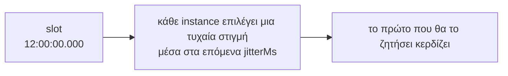

Το τελευταίο όρισμα των `every()`, `cron()` και `at()` είναι ένα αντικείμενο επιλογών (options object). Κάθε επιλογή έχει μια προεπιλεγμένη τιμή, επομένως ορίζετε μόνο ό,τι χρειάζεστε.

```ts
scheduler.every('report', '35m', buildReport, {
  timeoutMs: 20 * 60_000,
  maxAttempts: 2,
});
```

## Σύνοψη

| Επιλογή | Προεπιλογή | Απαιτεί lease backend | Τι ελέγχει |
| --- | --- | --- | --- |
| [`jitterMs`](#jitterms) | του scheduler (2000), μειωμένο για μικρά διαστήματα | όχι | Την τυχαία καθυστέρηση πριν από τη διεκδίκηση (claim) |
| [`maxLateMs`](#maxlatems) | του scheduler (60000) | όχι | Πόσο αργά επιτρέπεται σε ένα instance να ξεκινήσει μια εκτέλεση |
| [`timeoutMs`](#timeoutms) | κανένα | όχι | Τον μέγιστο χρόνο που μπορεί να διαρκέσει μια εκτέλεση |
| [`overlap`](#overlap) | `'skip'` | ναι | Αν μια εκτέλεση μπορεί να ξεκινήσει ενώ η προηγούμενη βρίσκεται σε εξέλιξη |
| [`maxAttempts`](#maxattempts) | `3` | ναι | Πόσες φορές μπορεί να ξεκινήσει μια εκτέλεση όταν καταρρέουν οι runners |
| [`catchUpMs`](#catchupms) | `300000` (5 λεπτά) | ναι | Πόσο παλιά μπορεί να είναι μια χαμένη εκτέλεση και παρ' όλα αυτά να εκτελεστεί κατά την εκκίνηση |
| [`historySize`](#historysize-και-historyttlms) | του scheduler (1000) | όχι | Πόσες εκτελέσεις διατηρούνται στο ιστορικό |
| [`historyTtlMs`](#historysize-και-historyttlms) | του scheduler (κανένα) | όχι | Για πόσο χρονικό διάστημα διατηρούνται |
| `offsetMs` | `0` | όχι | Μόνο για `every()`: [μετατοπίζει το πλέγμα](../defining-jobs/#μετατόπιση-του-πλέγματος-offsetms) |
| `timezone` | του scheduler | όχι | Μόνο για `cron()`: [τη ζώνη ώρας](../defining-jobs/#ζώνες-ώρας) |

«Του scheduler» σημαίνει την επιλογή με το ίδιο όνομα στο `new Scheduler()`. Δείτε τις [Επιλογές scheduler](../scheduler-options/).

## `jitterMs`

Κάθε instance περιμένει ένα τυχαίο χρονικό διάστημα μεταξύ 0 και `jitterMs` μετά το slot προτού διεκδικήσει (claim) την εκτέλεση.



- **Μεγαλύτερο** jitter κατανέμει το φορτίο πιο ομοιόμορφα και καθιστά την ώρα έναρξης λιγότερο ακριβή.
- **`0`** σημαίνει καθόλου κατανομή: όλα τα instances κάνουν claim την ίδια ακριβώς στιγμή, και αυτό με το ταχύτερο ρολόι και σύνδεση συνήθως κερδίζει.

Πρέπει να είναι μικρότερο από το μισό του χρόνου μεταξύ των εκτελέσεων. Αν δεν το ορίσετε, η προεπιλογή είναι το `jitterMs` του scheduler (2 δευτερόλεπτα), ή το ένα τέταρτο του μεσοδιαστήματος όταν αυτό είναι μικρότερο. Έτσι, μια εργασία που εκτελείται κάθε δευτερόλεπτο παίρνει 250 ms.

```ts
scheduler.every('tick', '1s', tick);                       // jitter 250 ms, αυτόματα
scheduler.cron('nightly', '0 2 * * *', run, { jitterMs: 30_000 }); // ξεκινά μεταξύ 02:00:00 και 02:00:30
scheduler.every('precise', '1m', run, { jitterMs: 0 });    // ξεκινά ακριβώς στην ώρα του, πάντα από το ταχύτερο instance
```

## `maxLateMs`

Όταν ένα instance φτάσει σε μια εκτέλεση με καθυστέρηση μεγαλύτερη από `maxLateMs` μετά το slot της, την παραλείπει και εκπέμπει ένα event `skip` με αιτία `'late'`.

Αυτό σας προστατεύει από παρωχημένες εκτελέσεις (stale runs). Μια διεργασία μπορεί να παγώσει για λεπτά: ένας φορητός υπολογιστής σε αναστολή λειτουργίας, μια παρατεταμένη παύση garbage collection, μια εικονική μηχανή που έχει κολλήσει. Όταν ξυπνήσει, τα timers της ενεργοποιούνται για εκτελέσεις που έπρεπε να είχαν γίνει πολύ νωρίτερα. Χωρίς αυτό το όριο, θα τις ξεκινούσε.

```ts
// Μια εκτέλεση που δεν μπορεί να ξεκινήσει εντός 10 δευτερολέπτων από την ώρα της δεν αξίζει να ξεκινήσει
scheduler.every('quote-refresh', '30s', refresh, { maxLateMs: 10_000 });
```

Πρέπει να είναι μεγαλύτερο από το `jitterMs`.

## `timeoutMs`

Μετά από αυτόν τον αριθμό χιλιοστών του δευτερολέπτου, το `ctx.signal` ακυρώνεται (aborts) και η εκτέλεση καταγράφεται ως **αποτυχημένη**, με το σφάλμα `TimeoutError: Timed out after N ms`.

```ts
scheduler.every('export', '5m', exportAll, { timeoutMs: 4 * 60_000 });
```

:::caution
Το timeout δεν τερματίζει βίαια τον handler σας. Η JavaScript δεν μπορεί να διακόψει μια συνάρτηση που εκτελείται από έξω. Ο handler πρέπει να παρακολουθεί το `ctx.signal`, διαφορετικά συνεχίζει να εκτελείται στο παρασκήνιο αφού η εκτέλεση έχει ήδη καταγραφεί ως αποτυχημένη. Δείτε τη [Συγγραφή handlers](../writing-handlers/#διακοπή-όταν-ζητηθεί).
:::

Ορίστε ένα timeout σε κάθε εργασία που μπορεί να «κολλήσει». Με `overlap: 'skip'`, μια κολλημένη εκτέλεση συνεχίζει να ανανεώνει τη μίσθωσή (lease) της και μπλοκάρει κάθε μεταγενέστερη εκτέλεση αυτής της εργασίας.

## `overlap`

*Απαιτεί backend μίσθωσης.*

Τι συμβαίνει όταν μια εκτέλεση πρέπει να ξεκινήσει ενώ η προηγούμενη εκτέλεση της ίδιας εργασίας βρίσκεται ακόμη σε εξέλιξη:

- **`'skip'`** (προεπιλογή): η νέα εκτέλεση παραλείπεται, με ένα event `skip` με αιτία `'overlap'`.
- **`'allow'`**: εκτελούνται και οι δύο.

```
Μια εργασία διάρκειας 7 δευτ. κάθε 3 δευτ., με overlap 'skip'

χρόνος :00  :03  :06  :09  :12  :15  :18
εκτέλεση [======= 7 s =======]
            skip skip
                           [======= 7 s =======]
                                skip skip
```

Οι εκτελέσεις που παραλείπονται δεν μπαίνουν σε ουρά. Η εκτέλεση στο :03 δεν πραγματοποιείται ποτέ. Η επόμενη εκτέλεση που θα ξεκινήσει είναι η πρώτη που είναι προγραμματισμένη μετά τη λήξη της τρέχουσας εκτέλεσης.

```ts
// Ανεξάρτητη εργασία ανά εκτέλεση: επιτρέψτε την αλληλεπικάλυψή τους
scheduler.every('sample-metrics', '5s', sample, { overlap: 'allow' });
```

## `maxAttempts`

*Απαιτεί backend μίσθωσης.*

Πόσες φορές μπορεί να **ξεκινήσει** μία εκτέλεση όταν ο runner της πεθάνει (καταρρεύσει), συμπεριλαμβανομένης της πρώτης προσπάθειας. Η προεπιλογή είναι 3.

- Μια εκτέλεση επαναλαμβάνεται μόνο όταν ο runner της σταμάτησε να ανανεώνει τη μίσθωση: κατέρρευσε, πάγωσε ή έχασε τη σύνδεση δικτύου.
- Μια εκτέλεση που **αποτυγχάνει** (ο handler πετάει exception) **δεν** επαναλαμβάνεται. Οι επαναλήψεις προορίζονται για νεκρούς runners, όχι για σφάλματα. Αν θέλετε να κάνετε retry σε σφάλματα, υλοποιήστε το μέσα στον handler.
- Μια παράδοση (hand-over) κατά το `stop()` δεν προσμετράται στο όριο.

```ts
scheduler.cron('charge-cards', '0 6 * * *', charge, { maxAttempts: 1 }); // δεν ξεκινά ποτέ δεύτερη φορά
```

Όταν το όριο εξαντληθεί, η εκτέλεση επισημαίνεται ως `interrupted` και εγκαταλείπεται.

## `catchUpMs`

*Απαιτεί backend μίσθωσης.*

Κατά το `start()`, ένα instance ελέγχει το πιο πρόσφατο slot κάθε εργασίας. Αν κανείς δεν το εκτέλεσε και η προγραμματισμένη ώρα του ήταν πριν από λιγότερο από `catchUpMs`, το instance το εκτελεί τώρα, με `ctx.reason === 'catch-up'`.

Αυτό καλύπτει μια εκτέλεση που έπρεπε να τρέξει ενώ όλα τα instances ήταν εκτός λειτουργίας, για παράδειγμα κατά τη διάρκεια μιας πλήρους επανεκκίνησης.

```ts
scheduler.cron('daily-report', '0 6 * * *', report, { catchUpMs: 6 * 60 * 60_000 }); // έως και 6 ώρες καθυστέρηση
scheduler.every('refresh-cache', '5s', refresh, { catchUpMs: 0 });                    // ποτέ ανάκτηση
```

Μόνο η **πιο πρόσφατη** εκτέλεση ανακτάται, όχι κάθε εκτέλεση που χάθηκε.

## `historySize` και `historyTtlMs`

Το `historySize` αφορά το πόσες εκτελέσεις διατηρούνται ανά εργασία, ενώ το `historyTtlMs` απορρίπτει επιπλέον εγγραφές παλαιότερες από μια συγκεκριμένη διάρκεια.

```ts
scheduler.every('heartbeat', '5s', ping, { historySize: 100 });
scheduler.cron('audit', '0 * * * *', audit, { historyTtlMs: 30 * 24 * 60 * 60_000 }); // 30 ημέρες
```

Στα backends μίσθωσης ένα μικρό `historySize` είναι πάντα ασφαλές: μια εκτέλεση δεν ξεχνιέται ποτέ όσο ένα καθυστερημένο claim θα μπορούσε ακόμα να τη ζητήσει. Στα backends μόνο διεκδίκησης (claim-only backends), η μνήμη του store για τις διεκδικημένες εκτελέσεις πρέπει επίσης να καλύπτει τα καθυστερημένα instances. Το anarchon το ελέγχει αυτό όταν προσθέτετε την εργασία και αποτυγχάνει με σφάλμα (throws) αν οι ρυθμίσεις δεν είναι ασφαλείς. Δείτε το [Χρονισμός και ρολόγια](../../internals/timing-and-clocks/).

## Συνήθεις συνδυασμοί

```ts
// Μια βαριά νυχτερινή εργασία: το πολύ 2 ώρες, ξεκινά το πολύ δύο φορές, ποτέ δύο ταυτόχρονα
scheduler.cron('rebuild-index', '0 2 * * *', rebuild, {
  timeoutMs: 2 * 60 * 60_000,
  maxAttempts: 2,
});

// Μια ελαφριά, συχνή εργασία όπου μια χαμένη εκτέλεση δεν έχει σημασία
scheduler.every('refresh-cache', '5s', refresh, { catchUpMs: 0, historySize: 50 });

// Μια εργασία που δεν πρέπει να ξεκινήσει δύο φορές για το ίδιο slot
scheduler.cron('send-invoices', '0 9 1 * *', send, { maxAttempts: 1, catchUpMs: 12 * 60 * 60_000 });
```

## Επόμενα βήματα

- [Επιλογές scheduler](../scheduler-options/)
- [Συγγραφή handlers](../writing-handlers/)
