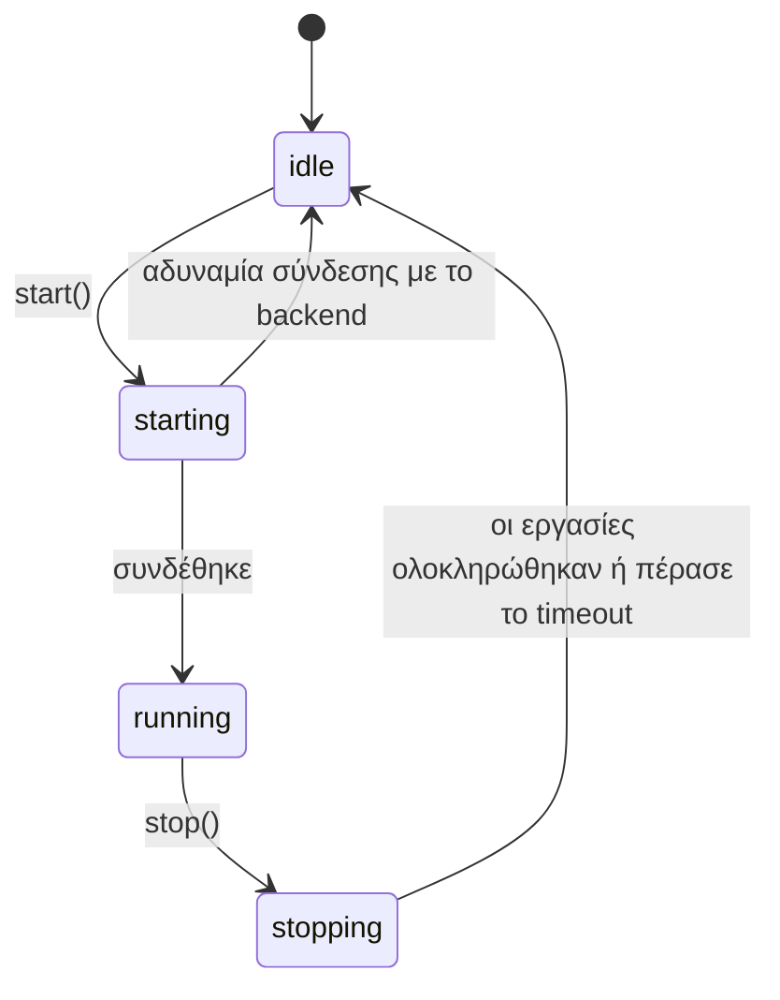
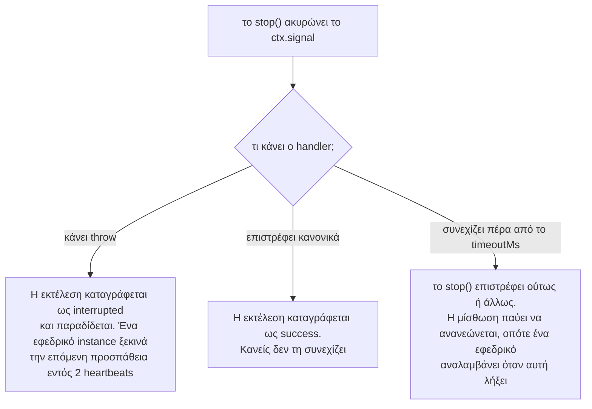

Ένας scheduler βρίσκεται σε μία από τέσσερις καταστάσεις.



Τίποτα δεν συνδέεται και τίποτα δεν εκτελείται μέχρι να κληθεί το `start()`.

## `start()`

```ts
await scheduler.start();
```

Με τη σειρά, το `start()`:

1. **Συνδέεται** στο backend και ελέγχει ότι η έκδοση του διακομιστή είναι επαρκώς πρόσφατη.
2. **Προετοιμάζει κάθε εργασία**: δημιουργεί ό,τι χρειάζεται το backend (πίνακες, streams, ουρές).
3. **Ρυθμίζει ένα timer** για το επόμενο slot κάθε εργασίας.
4. Σε ένα backend μίσθωσης, **ανακτά** ό,τι έμεινε πίσω:
   - μια εκτέλεση της οποίας ο runner πέθανε αναλαμβάνεται (takeover)·
   - μια εκτέλεση που είναι ενεργή σε άλλο instance αποκτά αυτό το instance ως εφεδρικό (backup)·
   - η πιο πρόσφατη εκτέλεση ανακτάται (catch-up), αν κανείς δεν την εκτέλεσε και η προγραμματισμένη ώρα της ήταν πριν από λιγότερο από `catchUpMs`.

Αν η σύνδεση με το backend δεν είναι εφικτή, το `start()` απορρίπτεται (rejects) και ο scheduler παραμένει σε κατάσταση idle. Διαχειριστείτε το κατά την εκκίνηση της εφαρμογής:

```ts
try {
  await scheduler.start();
} catch (error) {
  console.error('scheduler could not start', error);
  process.exit(1);
}
```

Η κλήση του `start()` ενώ εκτελείται ήδη δεν κάνει τίποτα. Οι εργασίες μπορούν να προστεθούν πριν ή μετά από αυτό.

## `stop()`

```ts
await scheduler.stop();                    // περιμένει έως και 30 δευτ. για τις εκτελούμενες εργασίες
await scheduler.stop({ timeoutMs: 10_000 });
```

Με τη σειρά, το `stop()`:

1. **Σταματά τον προγραμματισμό.** Καμία νέα εκτέλεση δεν ξεκινά σε αυτό το instance.
2. **Ακυρώνει το `ctx.signal`** κάθε εργασίας που εκτελείται εδώ.
3. **Περιμένει** να ολοκληρωθούν αυτές οι εργασίες, καθώς και οι διεκδικήσεις που βρίσκονται σε εξέλιξη, έως το `timeoutMs` (προεπιλογή 30 δευτερόλεπτα). Μια εκτέλεση της οποίας η διεκδίκηση κερδίζεται αφού κληθεί το `stop()` δεν ξεκινά· καταγράφεται ως `'interrupted'`.
4. **Κλείνει τη σύνδεση**, εφόσον την άνοιξε το anarchon. Ένας client που περάσατε εσείς παραμένει ανοιχτός.

Αφού ολοκληρωθεί το `stop()`, το anarchon δεν στέλνει τίποτα άλλο στο store. Μπορείτε να καλέσετε ξανά το `start()` αργότερα. Τα `history()` και `lastRun()` λειτουργούν ακόμα: μετά το `stop()`, κάθε ανάγνωση ανοίγει τη σύνδεση για τον εαυτό της και την κλείνει όταν τελειώσει, ώστε η διεργασία να μπορεί να τερματίσει.

### Τι συμβαίνει σε μια εργασία που εκτελούνταν

Εξαρτάται από το τι κάνει ο handler μόλις ακυρωθεί το signal του.



Η παράδοση (hand-over) απαιτεί backend μίσθωσης. Στα backends μόνο διεκδίκησης, μια διακοπείσα εκτέλεση απλώς καταγράφεται ως `interrupted`.

Μια παράδοση δεν προσμετράται στο `maxAttempts`, επομένως τα rolling deploys δεν μπορούν να εξαντλήσουν τις διαθέσιμες επαναλήψεις μιας εκτέλεσης.

## Ομαλός τερματισμός

Καλέστε το `stop()` όταν ζητηθεί ο τερματισμός της διεργασίας. Οι orchestrators στέλνουν `SIGTERM`· το Ctrl+C στέλνει `SIGINT`.

```ts
async function shutdown() {
  await scheduler.stop({ timeoutMs: 20_000 });
  process.exit(0);
}
process.on('SIGTERM', shutdown);
process.on('SIGINT', shutdown);
```

Διατηρήστε το timeout διακοπής **μικρότερο** από τον χρόνο που επιτρέπει η πλατφόρμα σας πριν τερματίσει βίαια τη διεργασία. Στο Kubernetes αυτό είναι το `terminationGracePeriodSeconds`, 30 δευτερόλεπτα από προεπιλογή. Αν η διεργασία τερματιστεί βίαια ενώ το `stop()` περιμένει ακόμα, μια εκτελούμενη εργασία δεν παραδίδεται· ένα εφεδρικό instance την αναλαμβάνει μόνο αφού λήξει η μίσθωση.

Σε έναν διακομιστή HTTP, σταματήστε πρώτα να δέχεστε νέα αιτήματα, και μετά σταματήστε τον scheduler:

```ts
process.on('SIGTERM', async () => {
  server.close();
  await scheduler.stop({ timeoutMs: 20_000 });
  process.exit(0);
});
```

Το άρθρο [Rolling deploys στο Kubernetes](../../recipes/kubernetes/) καλύπτει αυτή τη διαδικασία από την αρχή ως το τέλος.

## `runNow()`

```ts
const run = await scheduler.runNow('sync');
console.log(run.status, run.durationMs);
```

Εκτελεί μια εργασία αμέσως σε αυτό το instance, ανεξάρτητα από το πρόγραμμά της, και επιλύεται με την [εγγραφή εκτέλεσης](../history/#η-εγγραφή-εκτέλεσης) όταν ο handler ολοκληρωθεί. Εάν κληθεί το `stop()` πριν ξεκινήσει ο handler, επιλύεται με κατάσταση `'interrupted'` και η εργασία δεν εκτελείται.

Μια χειροκίνητη εκτέλεση διαφέρει από μια προγραμματισμένη:

| | Προγραμματισμένη εκτέλεση | `runNow()` |
| --- | --- | --- |
| Αποφυγή διπλότυπων μεταξύ instances | Ναι | Όχι: η κλήση της σε δύο instances την εκτελεί δύο φορές |
| Μπλοκάρεται από εκτέλεση σε εξέλιξη | Ναι, με `overlap: 'skip'` | Όχι |
| Επανάληψη από εφεδρικό instance αν ο runner καταρρεύσει | Ναι | Όχι |
| Στο ιστορικό | Ναι | Ναι, με `manual: true` |
| `ctx.reason` | `'scheduled'` | `'manual'` |

Παράγει σφάλμα (throws) αν η εργασία δεν έχει καταχωριστεί σε αυτό το instance, ή αν ο scheduler δεν έχει εκκινήσει.

Μια τυπική χρήση είναι σε ένα admin endpoint:

```ts
app.post('/jobs/:name/run', async (req, res) => {
  const run = await scheduler.runNow(req.params.name);
  res.json({ status: run.status, ms: run.durationMs, error: run.error });
});
```

## `remove()`

```ts
scheduler.remove('sync'); // true αν η εργασία υπήρχε
```

Σταματά τον προγραμματισμό μιας εργασίας σε αυτό το instance. Τα υπόλοιπα instances συνεχίζουν να την εκτελούν, το ιστορικό της διατηρείται, και μια εκτέλεση που βρίσκεται ήδη σε εξέλιξη εδώ ολοκληρώνεται κανονικά. Δείτε την [Προσθήκη και αφαίρεση εργασιών](../defining-jobs/#προσθήκη-και-αφαίρεση-εργασιών-κατά-τον-χρόνο-εκτέλεσης).

## Ο πλήρης κύκλος ζωής μιας υπηρεσίας

```ts
import { RedisBackend, Scheduler } from 'anarchon';

const scheduler = new Scheduler({ backend: new RedisBackend({ redis: process.env.REDIS_URL }), log: true });

scheduler
  .every('sync', '10s', (ctx) => syncCustomers({ signal: ctx.signal }))
  .cron('digest', '0 8 * * 1-5', () => sendDigest(), { timezone: 'Europe/Athens' });

scheduler.on('failure', (run) => console.error(`${run.job} failed: ${run.error}`));

async function main() {
  await scheduler.start();

  const shutdown = async () => {
    await scheduler.stop({ timeoutMs: 20_000 });
    process.exit(0);
  };
  process.on('SIGTERM', shutdown);
  process.on('SIGINT', shutdown);
}

main().catch((error) => {
  console.error(error);
  process.exit(1);
});
```

## Επόμενα βήματα

- [Events και καταγραφή](../events-and-logging/)
- [Ιστορικό](../history/)
