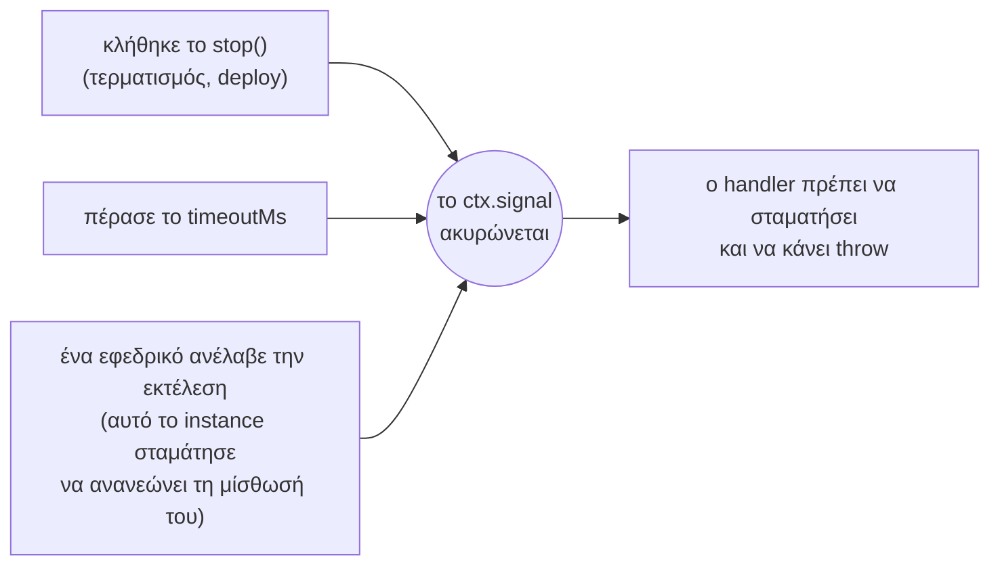

Ο handler είναι η συνάρτηση που εκτελεί μια εργασία. Μπορεί να είναι σύγχρονος (sync) ή ασύγχρονος (async).

```ts
scheduler.every('sync', '10s', async (ctx) => {
  await syncCustomers();
});
```

Ο τρόπος με τον οποίο ολοκληρώνεται ο handler καθορίζει πώς καταγράφεται η εκτέλεση:

| Ο handler | Η εκτέλεση καταγράφεται ως |
| --- | --- |
| Επιστρέφει (οποιαδήποτε τιμή) | `success` |
| Πετάει σφάλμα (throws) | `failed`, με το μήνυμα σφάλματος |
| Υπερβαίνει το `timeoutMs` | `failed`, με `TimeoutError` |
| Πετάει σφάλμα αφού το `stop()` ή μια ανάληψη ακύρωσε το `ctx.signal` | `interrupted` (όχι αποτυχία) |

## Το context: `ctx`

Κάθε handler δέχεται ένα όρισμα.

| Πεδίο | Τύπος | Σημασία |
| --- | --- | --- |
| `name` | `string` | Το όνομα της εργασίας |
| `slot` | `number` | Η προγραμματισμένη ώρα σε ms από το 1970. Η ίδια σε κάθε instance και σε κάθε προσπάθεια |
| `scheduledAt` | `Date` | Το `slot` ως Date. Η ώρα που αναμενόταν η εκτέλεση, όχι πότε ξεκίνησε |
| `instanceId` | `string` | Το instance που την εκτελεί (εσείς) |
| `attempt` | `number` | `1` για την πρώτη προσπάθεια· `2` ή περισσότερο όταν ένα εφεδρικό instance ανέλαβε την εκτέλεση |
| `reason` | `string` | Γιατί ξεκίνησε αυτή η εκτέλεση: `'scheduled'`, `'manual'`, `'catch-up'` ή `'takeover'` |
| `manual` | `boolean` | `true` όταν ξεκίνησε με `runNow()` |
| `signal` | `AbortSignal` | Ακυρώνεται όταν η εκτέλεση πρέπει να σταματήσει |
| `data` | ό,τι δώσατε | Τα δεδομένα που δώσατε ως `data` στον scheduler, στην εργασία ή στο `runNow()`. Δείτε [Δεδομένα εκτέλεσης](../run-data/) |

## Διακοπή όταν ζητηθεί

Το `ctx.signal` ακυρώνεται (aborts) σε τρεις περιπτώσεις:



Το anarchon δεν μπορεί να διακόψει τη συνάρτησή σας από έξω· η JavaScript δεν παρέχει τέτοιο τρόπο. Το signal είναι ένα αίτημα διακοπής και ο handler πρέπει να το σεβαστεί.

### Μέσα σε βρόχο

Ελέγχετε ανάμεσα σε επιμέρους μονάδες εργασίας. Η μέθοδος `throwIfAborted()` παράγει σφάλμα (throws) αν το signal έχει ακυρωθεί, και δεν κάνει τίποτα σε αντίθετη περίπτωση:

```ts
scheduler.every('export', '10m', async (ctx) => {
  for (const batch of await loadBatches()) {
    ctx.signal.throwIfAborted();
    await exportBatch(batch);
  }
});
```

### Μεταβίβαση του signal

Πολλά APIs δέχονται ένα signal και διακόπτονται μόνα τους:

```ts
scheduler.every('fetch-rates', '1m', async (ctx) => {
  const response = await fetch('https://rates.example.com/latest', { signal: ctx.signal });
  await saveRates(await response.json());
});
```

### Αναμονή

Το `node:timers/promises` δέχεται επίσης signal:

```ts
import { setTimeout as delay } from 'node:timers/promises';

await delay(5_000, undefined, { signal: ctx.signal }); // απορρίπτεται (rejects) μόλις ακυρωθεί το signal
```

### Γιατί throw και όχι απλό return;

Σε ένα backend μίσθωσης η διαφορά είναι ουσιαστική:

- Αν ο handler **πετάξει σφάλμα (throws)** αφού το `stop()` ακύρωσε το signal, η εκτέλεση καταγράφεται ως `interrupted` και **παραδίδεται σε ένα άλλο instance**, το οποίο την ξεκινά ξανά ως την επόμενη προσπάθεια.
- Αν ο handler **επιστρέψει (returns)**, η εκτέλεση θεωρείται **ολοκληρωμένη**. Κανείς δεν τη συνεχίζει.

Επομένως: κάντε throw όταν η εργασία δεν έχει ολοκληρωθεί, και return όταν έχει τελειώσει.

```ts
scheduler.every('reindex', '1h', async (ctx) => {
  for (const page of pages) {
    if (ctx.signal.aborted) {
      await saveProgress(page);      // προαιρετικά: σημειώστε την πρόοδο για την επόμενη προσπάθεια
      ctx.signal.throwIfAborted();   // στη συνέχεια παραδώστε την εκτέλεση
    }
    await indexPage(page);
  }
});
```

## Κάντε τις εργασίες ασφαλείς για διπλή εκτέλεση

Το anarchon εγγυάται έναν νικητή ανά **προσπάθεια**, όχι μία και μοναδική εκτέλεση ανά εργασία. Μια εκτέλεση μπορεί να τρέξει περισσότερες από μία φορές:

- Ο runner καταρρέει στη μέση. Ένα εφεδρικό instance ξεκινά την εκτέλεση ξανά από την αρχή.
- Ο runner παγώνει για διάστημα μεγαλύτερο από τη μίσθωσή του. Ένα εφεδρικό instance αναλαμβάνει την εκτέλεση, και όταν το παγωμένο instance ξυπνήσει, εκτελείται για λίγο προτού αντιληφθεί ότι έχασε την εκτέλεση.

Η λύση είναι να γράφετε εργασίες που είναι **idempotent** (αυτοδύναμες): η εκτέλεσή τους δύο φορές έχει το ίδιο αποτέλεσμα με την εκτέλεσή τους μία φορά. Το `ctx.slot` είναι το εργαλείο γι' αυτό, επειδή είναι ο ίδιος ακριβώς αριθμός σε κάθε προσπάθεια της ίδιας εκτέλεσης.

### Χρήση του slot ως κλειδί

```ts
scheduler.cron('monthly-invoices', '0 6 1 * *', async (ctx) => {
  for (const customer of await customers()) {
    // Το μοναδικό κλειδί (customer, period) καθιστά μια δεύτερη προσπάθεια no-op
    await db.query(
      `INSERT INTO invoices (customer_id, period, amount) VALUES ($1, $2, $3)
       ON CONFLICT (customer_id, period) DO NOTHING`,
      [customer.id, ctx.slot, await amountFor(customer)],
    );
  }
});
```

### Χρήση του slot ως κλειδί idempotency για άλλες υπηρεσίες

```ts
scheduler.every('payouts', '1h', async (ctx) => {
  await paymentProvider.createPayout(
    { amount, destination },
    { idempotencyKey: `payout-${ctx.slot}` },
  );
});
```

### Εργασία σε χρονικό παράθυρο, όχι στο «τώρα»

Μια ανάληψη (takeover) μπορεί να ξεκινήσει λεπτά μετά το slot. Αν η εργασία ρωτήσει «τι συνέβη την τελευταία ώρα» χρησιμοποιώντας την τρέχουσα ώρα, μια καθυστερημένη προσπάθεια θα καλύψει διαφορετική ώρα. Χρησιμοποιήστε το slot:

```ts
scheduler.every('hourly-rollup', '1h', async (ctx) => {
  const to = ctx.slot;
  const from = to - 60 * 60_000;
  await rollUp({ from, to }); // το ίδιο παράθυρο σε κάθε προσπάθεια
});
```

Ένα παράθυρο δεμένο σε ένα slot γίνεται μόνο εάν εκτελεστεί αυτό το slot, και μια εκτέλεση μπορεί να παραλειφθεί (δείτε [Εγγυήσεις και όρια](../../reference/guarantees/)). Εάν κάθε ώρα πρέπει να συγκεντρωθεί, κάθε εκτέλεση ας κάνει και τις προηγούμενες ώρες που λείπουν ακόμη:

```ts
scheduler.every('hourly-rollup', '1h', async (ctx) => {
  for (const hour of await hoursNotRolledUp({ before: ctx.slot })) {
    ctx.signal.throwIfAborted();
    await rollUp({ from: hour, to: hour + 60 * 60_000 });
  }
});
```

### Απόρριψη εγγραφών από παλαιότερη προσπάθεια

Μια idempotent εγγραφή κάνει μια δεύτερη προσπάθεια αβλαβή όταν οι προσπάθειες τρέχουν η μία μετά την άλλη. Όταν επικαλύπτονται (ένας παγωμένος runner ξυπνά και γράφει πριν μάθει ότι ένα backup ανέλαβε), η παλαιότερη προσπάθεια μπορεί να αντικαταστήσει ό,τι έγραψε η νεότερη. Σε ένα backend μίσθωσης, κάθε προσπάθεια μιας εκτέλεσης έχει μεγαλύτερο `ctx.attempt` από την προηγούμενη, οπότε τα `ctx.slot` και `ctx.attempt` μαζί λειτουργούν ως fencing token: αποθηκεύστε την προσπάθεια μαζί με τη γραμμή, και αφήστε μια εγγραφή να εφαρμοστεί μόνο αν η προσπάθειά της δεν είναι παλαιότερη.

```ts
scheduler.every('daily-totals', '1d', async (ctx) => {
  const total = await computeTotal(ctx.slot);
  await db.query(
    `INSERT INTO daily_totals (day, total, attempt) VALUES ($1, $2, $3)
     ON CONFLICT (day) DO UPDATE SET total = EXCLUDED.total, attempt = EXCLUDED.attempt
     WHERE daily_totals.attempt <= EXCLUDED.attempt`,
    [ctx.slot, total, ctx.attempt],
  );
});
```

Το ίδιο ζεύγος πηγαίνει σε μια άλλη υπηρεσία ως έκδοση: απορρίψτε ένα αίτημα του οποίου το `(slot, attempt)` είναι μικρότερο από κάποιο που έχει ήδη εμφανιστεί. Σε ένα backend μόνο διεκδίκησης, το `ctx.attempt` είναι πάντα 1 και κανείς δεν αναλαμβάνει μια εκτέλεση, οπότε δεν υπάρχει τίποτα να προστατευτεί με fencing.

## Αναγνώριση επανάληψης

Τα `ctx.attempt` και `ctx.reason` σας ενημερώνουν ότι μια προηγούμενη προσπάθεια ξεκίνησε και δεν ολοκληρώθηκε:

```ts
scheduler.every('import', '30m', async (ctx) => {
  if (ctx.attempt > 1) {
    logger.warn(`import ${ctx.scheduledAt.toISOString()}: attempt ${ctx.attempt} after a ${ctx.reason}`);
    await cleanUpPartialImport(ctx.slot);
  }
  await runImport(ctx.slot);
});
```

## Σφάλματα

Ένας handler που πετάει σφάλμα (throws) καταγράφεται ως `failed`. Το anarchon **δεν** επαναλαμβάνει τις αποτυχημένες εκτελέσεις: η επόμενη εκτέλεση θα είναι το επόμενο προγραμματισμένο slot.

Αν θέλετε επαναλήψεις (retries) για σφάλματα, υλοποιήστε τις μέσα στον handler:

```ts
scheduler.every('sync', '1m', async (ctx) => {
  for (let tries = 1; ; tries++) {
    try {
      return await syncCustomers({ signal: ctx.signal });
    } catch (error) {
      if (tries === 3 || ctx.signal.aborted) throw error;
      await delay(1_000 * tries, undefined, { signal: ctx.signal });
    }
  }
});
```

Για να ειδοποιείστε για αποτυχίες, ακούστε το [event `failure`](../events-and-logging/).

## Μακροχρόνιες εργασίες

Μια εργασία μπορεί να διαρκέσει περισσότερο από το μεσοδιάστημά της. Με την προεπιλογή `overlap: 'skip'`, οι εκτελέσεις που συμπίπτουν εν τω μεταξύ παραλείπονται, οπότε εκτελείται μία μόνο κάθε φορά. Για μακροχρόνιες εργασίες:

- Ορίστε `timeoutMs`, ώστε μια κολλημένη εκτέλεση να μην μπορεί να μπλοκάρει την εργασία επ' αόριστον.
- Ελέγχετε συχνά το `ctx.signal`, ώστε οι τερματισμοί να είναι γρήγοροι.
- Διατηρήστε την εργασία idempotent, επειδή μια μακροχρόνια εργασία είναι πιο πιθανό να διακοπεί.

Το άρθρο [Μακροχρόνιες εργασίες](../../recipes/long-running-jobs/) περιέχει ένα πλήρες παράδειγμα με checkpoints.

## Επόμενα βήματα

- [Κύκλος ζωής](../lifecycle/): start, stop και ομαλός τερματισμός
- [Events και καταγραφή](../events-and-logging/)
