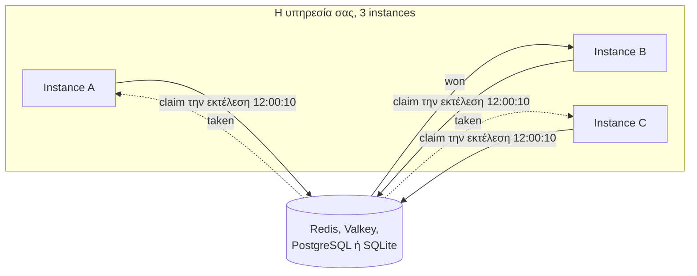

import { Card, CardGrid, LinkCard } from '@astrojs/starlight/components';

[](https://www.npmjs.com/package/anarchon)
[](https://www.npmjs.com/package/anarchon)
[](https://www.npmjs.com/package/anarchon)
[](https://github.com/aristoteliss/anarchon#license-and-commercial-use)

```ts
import { Scheduler } from 'anarchon';

const scheduler = new Scheduler(); // Redis στο localhost:6379

scheduler
  .every('sync', '10s', async (ctx) => { /* ... */ })
  .cron('digest', '0 8 * * 1-5', async (ctx) => { /* ... */ }, { timezone: 'Europe/Athens' });

await scheduler.start();
```

Τρέξτε αυτόν τον κώδικα σε τρία instances, και το "sync" θα εξακολουθεί να εκτελείται μία φορά κάθε 10 δευτερόλεπτα, όχι τρεις φορές.



<CardGrid>
  <Card title="Χωρίς leader, χωρίς lock" icon="random">
    Δεν εκλέγεται τίποτα και δεν διακρατείται κανένα lock. Μία ατομική κλήση στο store αποφασίζει ποιος εκτελεί κάθε φορά, και μια τυχαία καθυστέρηση (jitter) κατανέμει το φορτίο μεταξύ των instances.
  </Card>
  <Card title="Επιβιώνει από καταρρεύσεις" icon="warning">
    Ο νικητής ανανεώνει μια μίσθωση (lease) όσο εκτελείται η εργασία. Αν καταρρεύσει ή παγώσει, ένα άλλο instance αναλαμβάνει την εκτέλεση και την ολοκληρώνει.
  </Card>
  <Card title="Χωρίς αλληλεπικαλυπτόμενες εκτελέσεις" icon="seti:clock">
    Μια εργασία που διαρκεί περισσότερο από το μεσοδιάστημά της δεν συσσωρεύεται: η επόμενη εκτέλεση παραλείπεται έως ότου ολοκληρωθεί η τρέχουσα.
  </Card>
  <Card title="Ανάκτηση μετά από downtime" icon="rocket">
    Μια εκτέλεση που έπρεπε να τρέξει ενώ όλα τα instances ήταν εκτός λειτουργίας, εκτελείται αυτόματα μόλις επανέλθει το πρώτο instance.
  </Card>
</CardGrid>

## Πού να πάτε στη συνέχεια

<CardGrid>
  <LinkCard title="Εισαγωγή" description="Το πρόβλημα με απλά λόγια και πώς το επιλύει το anarchon." href="getting-started/introduction/" />
  <LinkCard title="Γρήγορη εκκίνηση" description="Ένας λειτουργικός scheduler σε πέντε λεπτά, χωρίς ανάγκη εγκατάστασης server." href="getting-started/quick-start/" />
  <LinkCard title="Οδηγοί" description="Κάθε επιλογή, μέθοδος και βήμα του κύκλου ζωής, με παραδείγματα." href="guides/defining-jobs/" />
  <LinkCard title="Πώς λειτουργεί" description="Οι αλγόριθμοι claim και lease, βήμα προς βήμα, με διαγράμματα." href="internals/architecture/" />
  <LinkCard title="Backends" description="Redis, Valkey, PostgreSQL, SQLite, RabbitMQ και NATS." href="backends/overview/" />
  <LinkCard title="Συνταγές" description="Express, NestJS, workers, Kubernetes, μακροχρόνιες εργασίες." href="recipes/express/" />
</CardGrid>

