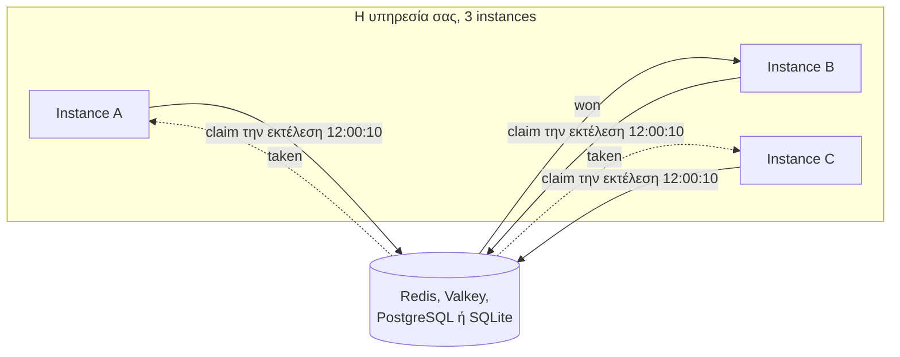

import { Card, CardGrid, LinkCard } from '@astrojs/starlight/components';

[](https://www.npmjs.com/package/anarchon)
[](https://www.npmjs.com/package/anarchon)
[](https://www.npmjs.com/package/anarchon)
[](https://github.com/aristoteliss/anarchon#license-and-commercial-use)

```ts
import { RedisBackend, Scheduler } from 'anarchon';

const scheduler = new Scheduler({ backend: new RedisBackend({ redis: 'redis://localhost:6379' }) });

scheduler
  .every('sync', '10s', async (ctx) => { /* ... */ })
  .cron('digest', '0 8 * * 1-5', async (ctx) => { /* ... */ }, { timezone: 'Europe/Athens' });

await scheduler.start();
```

Τρέξτε αυτόν τον κώδικα σε τρία instances, και ένα instance εκτελεί το "sync" κάθε 10 δευτερόλεπτα, όχι και τα τρία.



<CardGrid>
  <Card title="Χωρίς εκλογή leader" icon="random">
    Δεν εκλέγεται τίποτα. Μία ατομική κλήση στο store αποφασίζει ποιος εκτελεί κάθε φορά, και μια τυχαία καθυστέρηση (jitter) κατανέμει το φορτίο μεταξύ των instances.
  </Card>
  <Card title="Ανάκαμψη όταν αποτύχει ο runner" icon="warning">
    Σε Redis, Valkey, PostgreSQL και SQLite ο νικητής ανανεώνει μια μίσθωση (lease) όσο εκτελείται η εργασία. Αν καταρρεύσει ή παγώσει, ένα άλλο instance ξεκινά την εκτέλεση από την αρχή ως νέα προσπάθεια, επομένως οι handlers πρέπει να αντέχουν επαναλήψεις. Το ίδιο κάνει και το NATS με τη στρατηγική `lease`. Το RabbitMQ, και το NATS από προεπιλογή, επιλέγουν μόνο τον νικητή.
  </Card>
  <Card title="Οι μακριές εργασίες δεν συσσωρεύονται" icon="seti:clock">
    Στα lease backends, η επόμενη εκτέλεση μιας εργασίας παραλείπεται όσο η τρέχουσα κρατά ενεργή μίσθωση. Ένας παγωμένος runner μπορεί να επικαλυφθεί για λίγο με το instance που τον αντικατέστησε.
  </Card>
  <Card title="Ανάκτηση μετά από downtime" icon="rocket">
    Στα lease backends, η πιο πρόσφατη εκτέλεση που έπρεπε να τρέξει ενώ όλα τα instances ήταν εκτός λειτουργίας εκτελείται μόλις επανέλθει το πρώτο, αν έπρεπε να τρέξει εντός του `catchUpMs` (5 λεπτά από προεπιλογή). Οι παλαιότερες εκτελέσεις δεν επαναλαμβάνονται.
  </Card>
</CardGrid>

Το anarchon δεν εγγυάται exactly-once παρενέργειες. Η σελίδα [Εγγυήσεις και όρια](reference/guarantees/) αναφέρει τι ισχύει σε κάθε backend.

## Πού να πάτε στη συνέχεια

<CardGrid>
  <LinkCard title="Εισαγωγή" description="Το πρόβλημα με απλά λόγια και πώς το επιλύει το anarchon." href="getting-started/introduction/" />
  <LinkCard title="Γρήγορη εκκίνηση" description="Ένας λειτουργικός scheduler σε πέντε λεπτά, χωρίς ανάγκη εγκατάστασης server." href="getting-started/quick-start/" />
  <LinkCard title="Οδηγοί" description="Κάθε επιλογή, μέθοδος και βήμα του κύκλου ζωής, με παραδείγματα." href="guides/defining-jobs/" />
  <LinkCard title="Decorators" description="Δηλώστε εργασίες με τα @Every, @Cron και @At πάνω στις μεθόδους μιας κλάσης." href="guides/decorators/" />
  <LinkCard title="Πώς λειτουργεί" description="Οι αλγόριθμοι claim και lease, βήμα προς βήμα, με διαγράμματα." href="internals/architecture/" />
  <LinkCard title="Backends" description="Redis, Valkey, PostgreSQL, SQLite, RabbitMQ και NATS." href="backends/overview/" />
  <LinkCard title="Συνταγές" description="Express, NestJS, workers, Kubernetes, μακροχρόνιες εργασίες." href="recipes/express/" />
</CardGrid>

