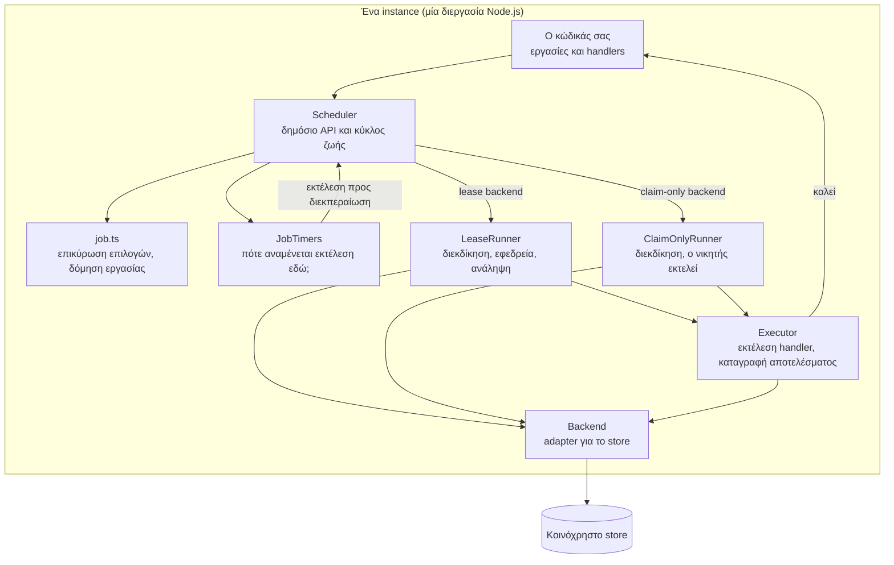
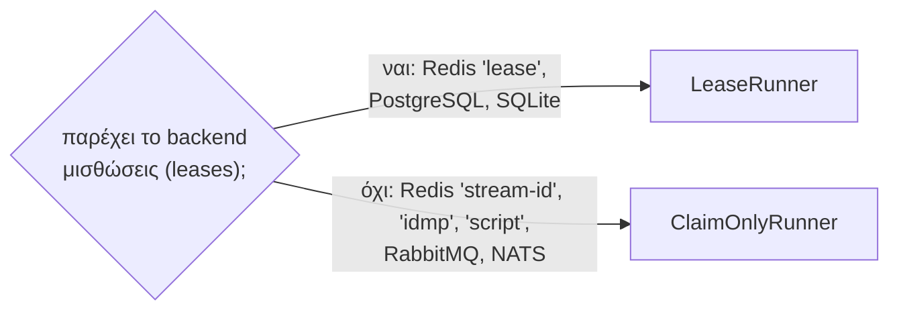

Αυτή η ενότητα εξηγεί πώς λειτουργεί εσωτερικά το anarchon. Δεν τη χρειάζεστε για να χρησιμοποιήσετε τη βιβλιοθήκη, αλλά βοηθά όταν ρυθμίζετε τους χρόνους (timings), κάνετε αποσφαλμάτωση σε μια απρόσμενη εκτέλεση ή γράφετε ένα backend.

## Ο σχεδιασμός σε μία παράγραφο

Κάθε instance υπολογίζει τους ίδιους χρόνους εκτέλεσης από το ίδιο πρόγραμμα (schedule). Όταν φτάνει ένας χρόνος εκτέλεσης, κάθε instance περιμένει μια τυχαία στιγμή (jitter) και στη συνέχεια ζητά από το κοινόχρηστο store να καταγράψει ότι εκτελεί αυτήν την εκτέλεση. Το store το κάνει αυτό ως ένα ατομικό βήμα, επομένως ακριβώς σε ένα instance επιστρέφεται η απάντηση «won». Με ένα lease backend, ο νικητής διατηρεί στη συνέχεια μια μίσθωση (lease) ενεργή όσο εκτελείται η εργασία, και τα υπόλοιπα instances παρακολουθούν αυτή τη μίσθωση, ώστε ένα από αυτά να μπορέσει να αναλάβει την εκτέλεση (takeover) αν σταματήσει να ανανεώνεται.

Δεν υπάρχει leader και δεν υπάρχει εκλογή. Μια μίσθωση (lease) δεν είναι lock που ο κάτοχός του πρέπει να απελευθερώσει: καταγράφει μόνο ότι ο runner είναι ακόμα ζωντανός. Κανένα instance δεν γνωρίζει για οποιοδήποτε άλλο instance· επικοινωνούν μόνο με το store.

## Τα μέρη

| Μέρος | Αρχείο | Αρμοδιότητα |
| --- | --- | --- |
| `Scheduler` | `src/scheduler/scheduler.ts` | Το δημόσιο API (`every`, `cron`, `start`, `stop`, `history`...) και ο κύκλος ζωής. Διαχειρίζεται την κατάσταση και αναθέτει τις εργασίες |
| Δόμηση εργασιών | `src/scheduler/job.ts` | Ελέγχει το όνομα και τις επιλογές της εργασίας ως προς το schedule και το backend, και εφαρμόζει τις προεπιλογές |
| Προγράμματα (Schedules) | `src/schedule.ts` | Μετατρέπει το «τώρα» στον επόμενο και προηγούμενο χρόνο εκτέλεσης για εργασίες interval, cron και εφάπαξ (one-off) |
| `JobTimers` | `src/scheduler/timers.ts` | Ορίζει το χρονόμετρο για την επόμενη εκτέλεση κάθε εργασίας, μαζί με το jitter |
| `LeaseRunner` | `src/scheduler/lease-runner.ts` | Για lease backends: διεκδικεί μια εκτέλεση, παρακολουθεί εκτελέσεις σε άλλα instances, αναλαμβάνει (takeover), ανακτά (catch-up), παραδίδει (hand-over) |
| `ClaimOnlyRunner` | `src/scheduler/claim-only-runner.ts` | Για claim-only backends: μία διεκδίκηση (claim), και ο νικητής εκτελεί |
| `Executor` | `src/scheduler/executor.ts` | Καλεί τον handler σας, εφαρμόζει το χρονικό όριο (timeout), αποφασίζει πώς ολοκληρώθηκε η εκτέλεση, αποθηκεύει το αποτέλεσμα και εκπέμπει συμβάντα (events) |
| Backends | `src/backends/` | Ένας adapter ανά store. Κάθε adapter υλοποιεί την ατομική διεκδίκηση αξιοποιώντας τις δυνατότητες του αντίστοιχου store |

Τα μέρη δεν παρεμβαίνουν εσωτερικά το ένα στο άλλο. Μοιράζονται ένα μικρό interface (`SchedulerCore`): αν ο scheduler εκτελείται, το σήμα διακοπής (stop signal), τον τρόπο εκπομπής συμβάντων και τον τρόπο καταγραφής εργασιών για τις οποίες πρέπει να περιμένει το `stop()`.

## Δύο είδη runner

Ο scheduler επιλέγει έναν runner μία φορά, κατά τη δημιουργία του, με βάση το backend:

Και οι δύο καταλήγουν να παραδίδουν την εκτέλεση στον ίδιο `Executor`. Αυτό που διαφέρει είναι όλα όσα συμβαίνουν γύρω από αυτόν:

| | `ClaimOnlyRunner` | `LeaseRunner` |
| --- | --- | --- |
| Διεκδίκηση (Claim) | `backend.claim()`: true ή false | `runs.claim()`: `won`, `running`, `overlap`, `done`, `none` ή `late` |
| Σε περίπτωση ήττας | Εκπέμπει `skip`, ολοκληρώνεται | Γίνεται εφεδρικός (backup): ελέγχει την εκτέλεση κάθε 1 έως 2 καρδιακούς παλμούς (heartbeats) |
| Κατά την εκτέλεση | Τίποτα | Ανανεώνει τη μίσθωση κάθε `heartbeatMs` |
| Κατά το `start()` | Τίποτα | Ανακτά νεκρές εκτελέσεις και ανακτά μια χαμένη εκτέλεση (catch-up) |
| Κατά το `stop()` | Καταγράφει την εκτέλεση ως διακοπείσα | Παραδίδει (hand-over) την εκτέλεση σε ένα backup |

## Τι αποθηκεύεται, και πού

Τίποτα δεν διατηρείται στη μνήμη που να το χρειάζεται κάποιο άλλο instance. Ό,τι έχει σημασία βρίσκεται στο store:

| Δεδομένα | Σκοπός | Καταγράφεται από |
| --- | --- | --- |
| Η διεκδίκηση μιας εκτέλεσης | Αποφασίζει ποιος την εκτελεί | Τον νικητή, κατά την ατομική διεκδίκηση |
| Η λήξη της μίσθωσης και το token | Δηλώνει ότι ο runner είναι ζωντανός, και αποκλείει παλιούς runners (fencing token) | Τα heartbeats του runner (lease backends) |
| Το αποτέλεσμα μιας προσπάθειας | Κατάσταση, χρόνοι, σφάλμα | Τον runner, όταν ολοκληρώνεται ο handler |
| Το ιστορικό | Μία εγγραφή ανά προσπάθεια | Διεκδικήσεις και αποτελέσματα μαζί |

Στη μνήμη, ένα instance διατηρεί μόνο τη δική του οπτική: τις εργασίες του και το επόμενο χρονόμετρό τους, τις εκτελέσεις που εκτελεί αυτή τη στιγμή, και τις εκτελέσεις που παρακολουθεί ως backup. Αν η διεργασία τερματιστεί, τίποτα από αυτά δεν χρειάζεται για την ανάκαμψη.

## Τι το καθιστά leaderless

Τρεις ιδιότητες μαζί εξαλείφουν την ανάγκη συντονισμού μεταξύ των instances:

1. **Ντετερμινιστικοί χρόνοι εκτέλεσης.** Το `(job, slot)` υπολογίζεται, δεν αποτελεί αντικείμενο διαπραγμάτευσης. Δύο instances που δεν έχουν επικοινωνήσει ποτέ μεταξύ τους συμφωνούν σε αυτό.
2. **Μία ατομική διεκδίκηση.** Το store είναι ο μόνος διαιτητής, και διαιτητεύει μία διεκδίκηση τη φορά.
3. **Stateless instances.** Ένα instance που επανεκκινείται επανυπολογίζει τα πάντα από το πρόγραμμά του και το store.

Ένα instance μπορεί να συνδεθεί ή να αποχωρήσει ανά πάσα στιγμή. Ένα νέο instance αρχίζει να διεκδικεί στο επόμενο slot του· ένα instance που αποχωρεί απλώς σταματά να ζητά εκτελέσεις.

## Τι να διαβάσετε στη συνέχεια

| Για να κατανοήσετε | Διαβάστε |
| --- | --- |
| Την πορεία μιας εκτέλεσης, από το χρονόμετρο έως το ιστορικό | [Κύκλος ζωής εκτέλεσης](../run-lifecycle/) |
| Πώς κάθε store επιτρέπει σε ακριβώς ένα instance να κερδίσει | [Αλγόριθμοι διεκδίκησης](../claim-algorithms/) |
| Heartbeats, backups, ανάληψη και fencing | [Μισθώσεις (Leases)](../leases/) |
| Τι συμβαίνει σε crash, πάγωμα, deploy | [Σενάρια αστοχίας](../failure-scenarios/) |
| Jitter, καθυστέρηση και διαφορές ρολογιών | [Χρονισμός και ρολόγια](../timing-and-clocks/) |
