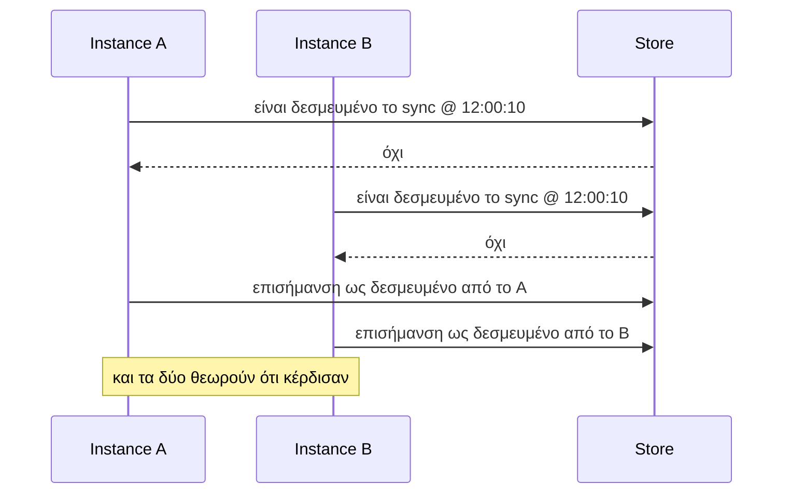
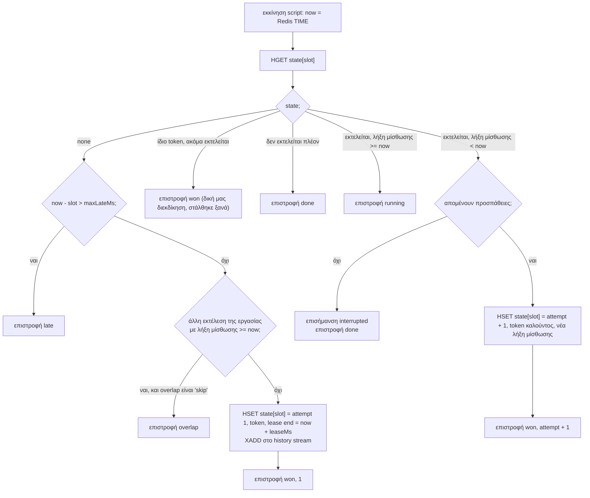
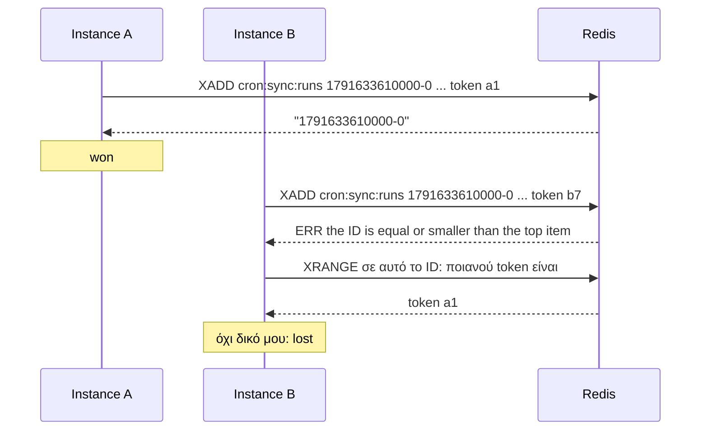
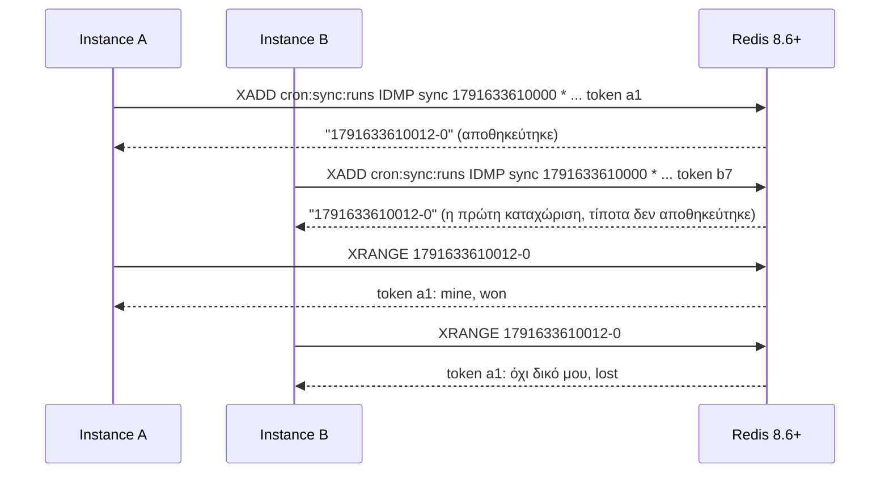
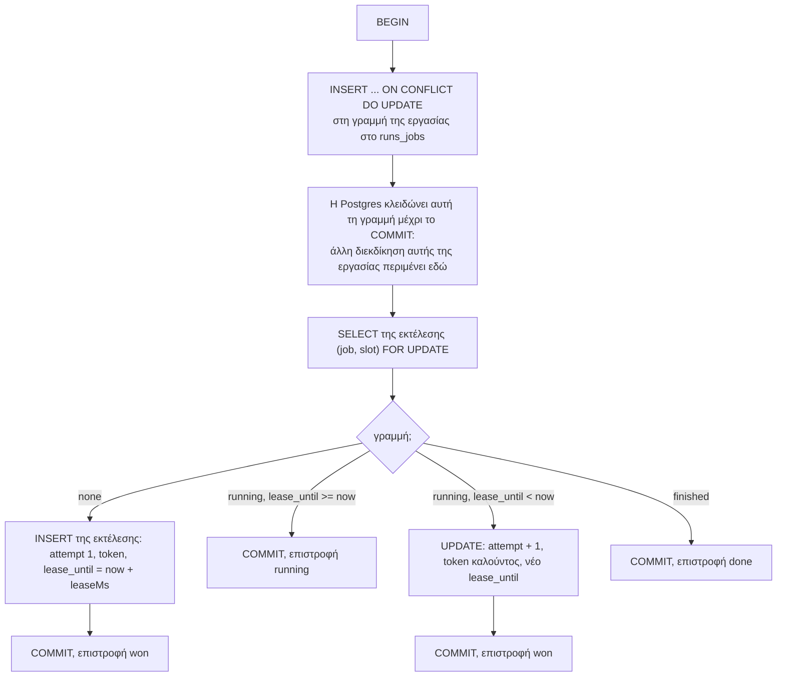
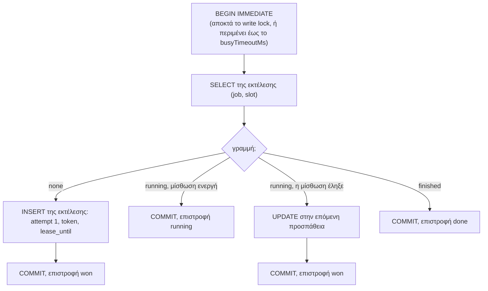
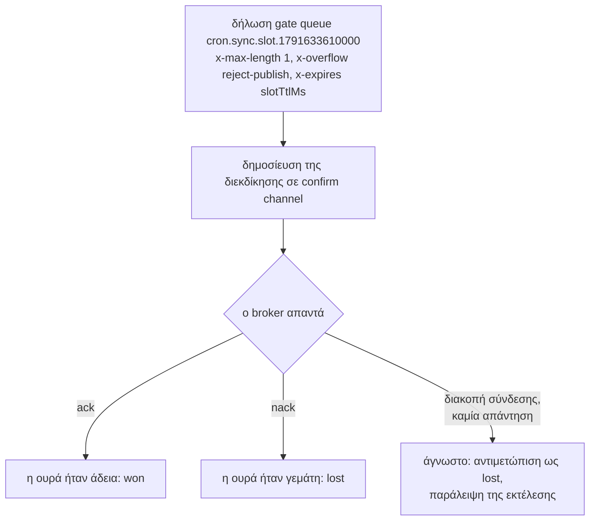
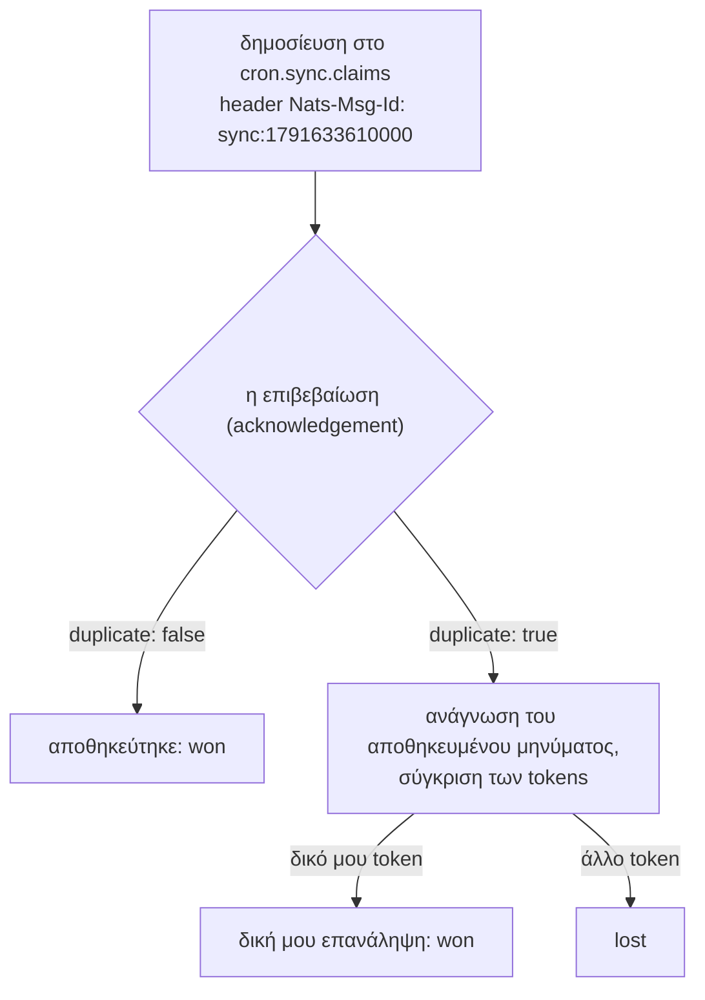

Όλα όσα εγγυάται το anarchon βασίζονται σε μία λειτουργία: τη **διεκδίκηση (claim)**. Για μια δεδομένη εργασία και slot, ακριβώς σε ένα instance πρέπει να επιστραφεί η ένδειξη ότι κέρδισε.

Αυτή η σελίδα δείχνει πώς κάθε backend επιτυγχάνει αυτό το αποτέλεσμα από το αντίστοιχο store.

## Γιατί πρέπει να είναι ατομική

Ας υποθέσουμε ότι μια διεκδίκηση αποτελούνταν από δύο βήματα: ανάγνωση για το αν η εκτέλεση έχει δεσμευτεί, και στη συνέχεια εγγραφή ότι δεσμεύτηκε.

Ανάμεσα στην ανάγνωση του A και την εγγραφή του A, το B διάβασε το ίδιο «όχι». Πρόκειται για μια *συνθήκη ανταγωνισμού (race condition)*, και καμία προσοχή στην πλευρά του client δεν μπορεί να τη διορθώσει. Ο έλεγχος και η εγγραφή πρέπει να συμβούν **μέσα στο store, ως ένα αδιαίρετο βήμα**. Κάθε backend χρησιμοποιεί μια διαφορετική δυνατότητα του store του για να το επιτύχει αυτό.

## Το token

Κάθε διεκδίκηση φέρει ένα τυχαίο **token**, νέο για κάθε προσπάθεια. Το store διατηρεί το token εκείνου που κέρδισε. Έχει δύο χρήσεις:

- **Αναγνώριση της δικής σας διεκδίκησης.** Αν ένας client στείλει μια διεκδίκηση, χάσει τη σύνδεση και τη στείλει ξανά, το δεύτερο αντίγραφο βρίσκει την εκτέλεση ήδη δεσμευμένη, από τον ίδιο. Η σύγκριση των tokens δείχνει «αυτός ήμουν εγώ», επομένως εξακολουθεί να εκτελεί την εργασία, μία φορά.
- **Fencing token**, στα lease backends: μετά από μια ανάληψη (takeover) το token του παλιού runner δεν ταιριάζει πλέον, οπότε δεν μπορεί πια να τροποποιήσει την εκτέλεση. Δείτε [Μισθώσεις (Leases)](../leases/#προστασία-απομόνωσης-fencing).

## Redis: `lease`

**Δυνατότητα του store:** Το Redis εκτελεί ένα Lua script από την αρχή μέχρι το τέλος πριν κάνει οτιδήποτε άλλο.

Η διεκδίκηση είναι ένα script. Διαβάζει την καταχώριση της εκτέλεσης σε ένα hash και αποφασίζει:

Επειδή τίποτα άλλο δεν εκτελείται όσο τρέχει το script, δύο instances δεν μπορούν να δουν και τα δύο «none» ή και τα δύο «η μίσθωση έληξε». Το πρώτο script που εκτελείται γράφει την κατάσταση· το δεύτερο τη διαβάζει.

Σημειώστε ότι το script χρησιμοποιεί **το ίδιο το ρολόι του Redis** (`TIME`). Τα instances δεν συγκρίνουν ποτέ ρολόγια μεταξύ τους.

## Redis: `stream-id`

**Δυνατότητα του store:** ένα stream entry ID πρέπει να είναι μεγαλύτερο από το τελευταίο ID του stream.

Κάθε instance προσπαθεί να προσθέσει μια καταχώριση της οποίας το ID *είναι* το slot. Το Redis δέχεται την πρώτη και απορρίπτει τις υπόλοιπες. Σε περίπτωση απόρριψης, το instance διαβάζει την καταχώριση και συγκρίνει τα tokens, για την περίπτωση που η απόρριψη αφορούσε δική του εντολή που στάλθηκε ξανά.

Μία εντολή, χωρίς script. Το stream λειτουργεί παράλληλα και ως ιστορικό.

## Redis: `idmp`

**Δυνατότητα του store:** idempotent `XADD` (Redis 8.6+). Το Redis διατηρεί την πρώτη καταχώριση για ένα κλειδί idempotency και απαντά σε επαναλήψεις με το ID εκείνης της καταχώρισης.

Όλα τα instances χρησιμοποιούν το όνομα της εργασίας ως producer ID, επομένως για αυτή την εργασία λειτουργούν ως ένας ενιαίος λογικός παραγωγός που στέλνει το ίδιο μήνυμα. Το Redis θυμάται ένα κλειδί για διάστημα `strategy.durationSec`.

## Redis: `script`

**Δυνατότητα του store:** ένα ατομικό Lua script, όπως και στο `lease`.

Το script σαρώνει τις καταχωρίσεις του stream του τελευταίου `strategy.windowMs` για αυτό το slot. Αν βρει κάποια, επιστρέφει το token εκείνης της καταχώρισης. Διαφορετικά, προσαρτά τη διεκδίκηση και επιστρέφει το token του καλούντος. Ο καλών κέρδισε αν το token που επιστρέφεται είναι το δικό του.

Συμπεριφέρεται όπως το `idmp` σε διακομιστές που δεν το διαθέτουν (Valkey, Redis πριν το 8.6).

## PostgreSQL

**Δυνατότητα του store:** μια συναλλαγή (transaction), με κλείδωμα γραμμής (row lock) που αναγκάζει τις διεκδικήσεις της ίδιας εργασίας να εκτελούνται διαδοχικά.

Μια εκτέλεση είναι μια γραμμή με πρωτεύον κλειδί `(job, slot)`.

Η πρώτη εντολή κάθε διεκδίκησης γράφει στη γραμμή της εργασίας στον πίνακα `<table>_jobs`. Η PostgreSQL διακρατεί ένα κλείδωμα σε αυτή τη γραμμή μέχρι να γίνει commit η συναλλαγή, οπότε μια δεύτερη διεκδίκηση της ίδιας εργασίας μπλοκάρεται στην πρώτη της εντολή μέχρι να ολοκληρωθεί η πρώτη διεκδίκηση. Στη συνέχεια διαβάζει την εκτέλεση και βλέπει ό,τι έγραψε η πρώτη.

Γιατί να υπάρχει ξεχωριστή γραμμή κλειδώματος, αντί να γίνει απλώς insert της εκτέλεσης και διαχείριση του conflict; Επειδή η διεκδίκηση πρέπει επίσης να εξετάσει **άλλες** εκτελέσεις της εργασίας (για τον κανόνα αλληλεπικάλυψης - overlap), και αυτή η απόφαση πρέπει επίσης να είναι συνεπής. Η σειριοποίηση ανά εργασία καθιστά ολόκληρη την απόφαση ένα ενιαίο βήμα.

Το `now` είναι το ρολόι της βάσης δεδομένων, το οποίο διαβάζεται μέσα στη συναλλαγή.

## SQLite

**Δυνατότητα του store:** ένας writer τη φορά για ολόκληρη τη βάση δεδομένων, και `BEGIN IMMEDIATE`.

Τα βήματα είναι τα ίδια με την PostgreSQL. Αυτό που διαφέρει είναι η σειριοποίηση: η SQLite επιτρέπει μόνο μία write συναλλαγή τη φορά, και η εντολή `BEGIN IMMEDIATE` αποκτά αυτό το κλείδωμα κατά την έναρξη αντί για την πρώτη εγγραφή. Έτσι, η δεύτερη διεκδίκηση περιμένει στο `BEGIN` και δεν μπορεί να διαβάσει παρωχημένα δεδομένα.

## Η ανάγνωση πριν από τη συναλλαγή

Στην PostgreSQL και τη SQLite, ο **έλεγχος ενός backup** σε μια εκτέλεση περνά πρώτα από μια συντόμευση: ένα μοναδικό `SELECT` της εκτέλεσης. Αν η εκτέλεση έχει ολοκληρωθεί, ή η μίσθωσή της είναι ακόμα ενεργή, η απάντηση είναι γνωστή και δεν ανοίγει καμία συναλλαγή. Μόνο όταν η μίσθωση έχει λήξει, το backup ανοίγει την παραπάνω συναλλαγή, η οποία ελέγχει ξανά υπό το κλείδωμα.

Αυτό αποτρέπει τα backups από το να αποκτούν το write lock σε κάθε heartbeat μόνο και μόνο για να διαπιστώσουν ότι είναι «ακόμα ενεργή».

## RabbitMQ

**Δυνατότητα του store:** μια ουρά με μέγιστο μήκος ένα που απορρίπτει περαιτέρω δημοσιεύσεις, μαζί με publisher confirms.

Ο broker διαχειρίζεται τις δημοσιεύσεις σε μία ουρά με τη σειρά. Η πρώτη γεμίζει την ουρά και επιβεβαιώνεται (ack)· κάθε άλλη απορρίπτεται (nack). Κανείς δεν καταναλώνει το μήνυμα, επομένως η ουρά παραμένει γεμάτη μέχρι να λήξει.

Η ουρά αποτελεί τη μνήμη της εκτέλεσης. Η διάρκειά της, `slotTtlMs`, καθορίζει για πόσο διάστημα το RabbitMQ γνωρίζει ότι η εκτέλεση έχει δεσμευτεί.

## NATS

**Δυνατότητα του store:** απαλοιφή διπλοτύπων (de-duplication) στο JetStream βάσει μηνύματος ID.

Κάθε instance δημοσιεύει με το ίδιο message ID, επειδή το ID κατασκευάζεται από την εργασία και το slot. Το stream αποθηκεύει το πρώτο και επισημαίνει τα υπόλοιπα ως διπλότυπα, εντός του παραθύρου διπλοτύπων (duplicate window).

## Συγκριτικός πίνακας

| Backend | Ατομικό βήμα | Ποιος ταξινομεί τις διεκδικήσεις | Διατήρηση εκτέλεσης στη μνήμη για |
| --- | --- | --- | --- |
| Redis `lease` | Lua script | Το μοναδικό νήμα εντολών του Redis | όσο μια καθυστερημένη διεκδίκηση μπορεί να ρωτήσει |
| Redis `stream-id` | `XADD` με ρητό ID | Redis | για πάντα |
| Redis `idmp` | `XADD ... IDMP` | Redis | `strategy.durationSec` |
| Redis `script` | Lua script | Redis | `strategy.windowMs` |
| PostgreSQL | Συναλλαγή + κλείδωμα γραμμής ανά εργασία | Το κλείδωμα γραμμής | όσο μια καθυστερημένη διεκδίκηση μπορεί να ρωτήσει |
| SQLite | Συναλλαγή `BEGIN IMMEDIATE` | Το write lock της βάσης δεδομένων | όσο μια καθυστερημένη διεκδίκηση μπορεί να ρωτήσει |
| RabbitMQ | Δημοσίευση σε ουρά πλήρη-ή-άδεια | Η ουρά | `slotTtlMs` |
| NATS | Δημοσίευση με απαλοιφή διπλοτύπων | Ο stream leader | `duplicateWindowMs` |

Η «Διατήρηση εκτέλεσης στη μνήμη για» έχει σημασία λόγω των καθυστερημένων instances. Το [Χρονισμός και ρολόγια](../timing-and-clocks/#για-πόσο-διάστημα-πρέπει-να-θυμάται-το-store) εξηγεί το γιατί.

## Στη συνέχεια

- [Μισθώσεις (Leases)](../leases/): τι κάνουν τα lease backends μετά τη διεκδίκηση
- [Συγγραφή δικού σας backend](../../backends/custom/)
