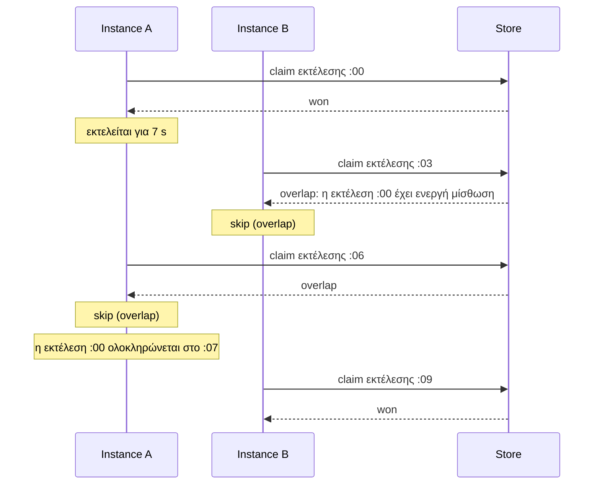
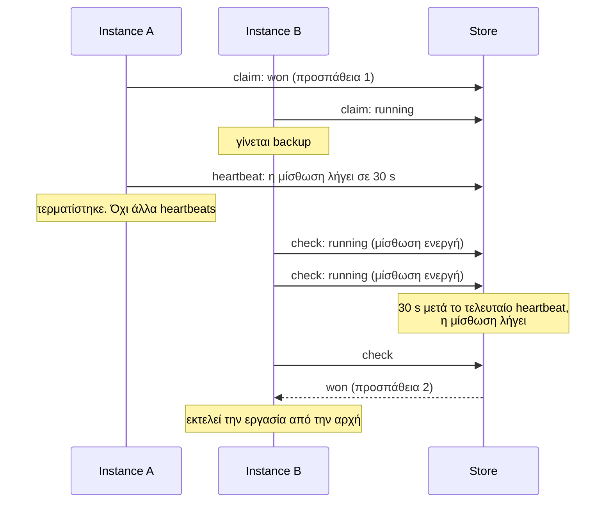
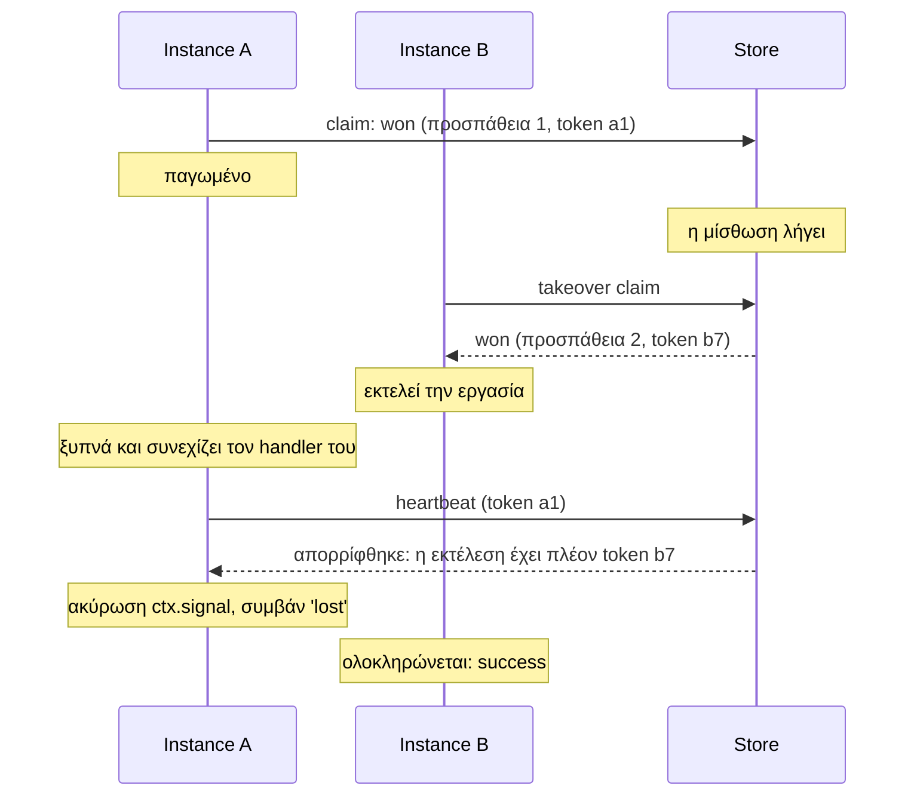
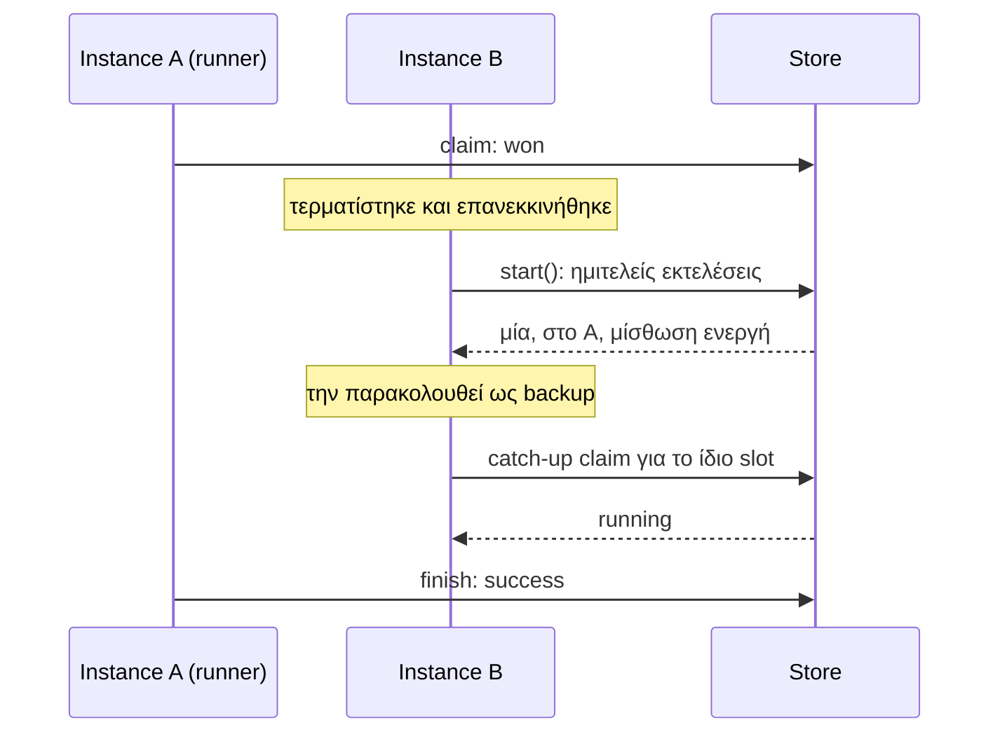
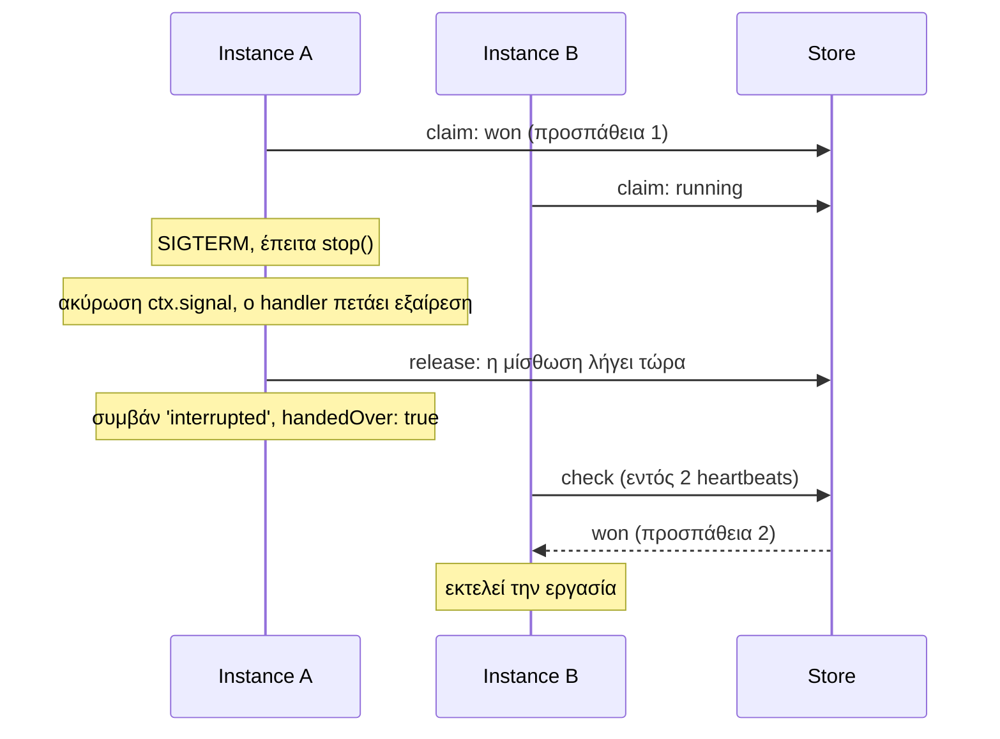
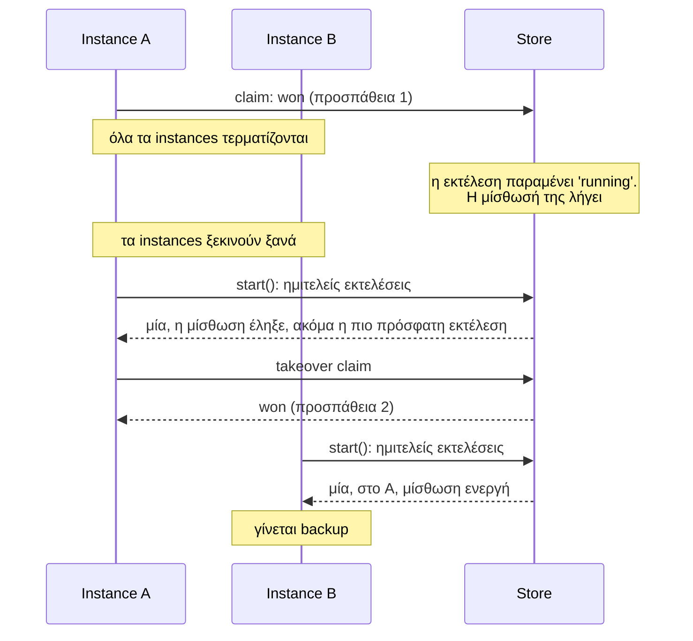
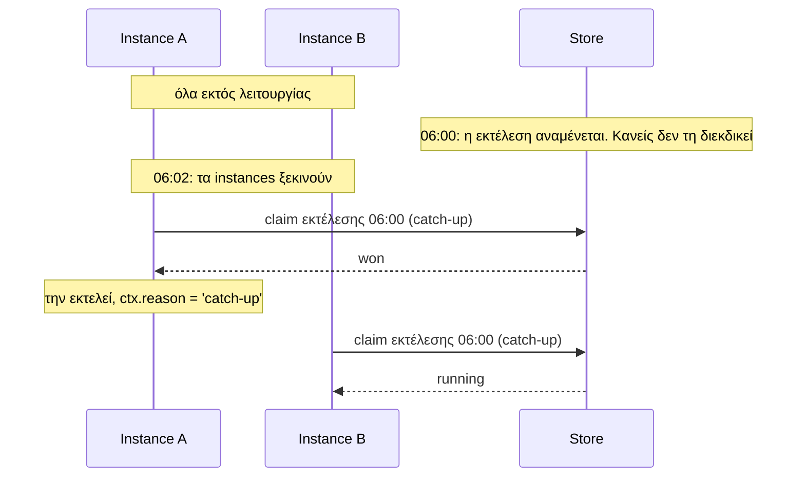

Αυτές είναι οι καταστάσεις που αντιμετωπίζει ένας scheduler σε ένα πραγματικό cluster. Κάθε περίπτωση παρακάτω δείχνει τι συμβαίνει με ένα lease backend, καθώς και τι συμβαίνει με ένα claim-only backend για σύγκριση.

Δεν αποτελούν νοητικά πειράματα. Το repository περιλαμβάνει ένα test για καθεμία, το οποίο εκτελείται με πραγματικές διεργασίες που τερματίζονται βίαια (`kill -9`), παγώνουν (`SIGSTOP`), σταματούν ομαλά (`SIGTERM`) και επανεκκινούνται, σε Redis, PostgreSQL και SQLite. Μπορείτε να τα παρακολουθήσετε συγκριτικά με:

```sh
pnpm scenarios
```

## Σύνοψη

| Τι συμβαίνει | Backend μόνο με διεκδίκηση (Claim-only) | Backend με μίσθωση (Lease) |
| --- | --- | --- |
| [Μια εργασία διαρκεί περισσότερο από το μεσοδιάστημά της](#1-μια-εργασία-διαρκεί-περισσότερο-από-το-μεσοδιάστημά-της) | Πολλά αντίγραφα εκτελούνται ταυτόχρονα | Ένα τη φορά· οι ενδιάμεσες εκτελέσεις παραλείπονται |
| [Ο runner τερματίζεται βίαια κατά την εκτέλεση](#2-ο-runner-τερματίζεται-βίαια-κατά-την-εκτέλεση) | Η εκτέλεση χάνεται· το ιστορικό δείχνει `running` για πάντα | Ένα backup την ολοκληρώνει ως προσπάθεια 2 |
| [Ο runner παγώνει για διάστημα μεγαλύτερο από τη μίσθωσή του](#3-ο-runner-παγώνει) | Χωρίς backup· η εκτέλεση αναμένει | Ένα backup αναλαμβάνει· το παγωμένο instance ειδοποιείται όταν ξυπνήσει |
| [Άλλο instance επανεκκινείται κατά την εκτέλεση](#4-άλλο-instance-επανεκκινείται-κατά-την-εκτέλεση) | Κανένα πρόβλημα: εκτελείται μία φορά | Κανένα πρόβλημα: εκτελείται μία φορά, και το επανεκκινημένο instance γίνεται backup |
| [Ο runner σταματά ομαλά](#5-ο-runner-σταματά-ομαλά) | Η εκτέλεση χάνεται· το ιστορικό δείχνει `interrupted` | Παραδίδεται αμέσως· ένα backup την ολοκληρώνει |
| [Όλα τα instances επανεκκινούνται κατά την εκτέλεση](#6-όλα-τα-instances-επανεκκινούνται-κατά-την-εκτέλεση) | Η εκτέλεση χάνεται | Ένα instance την επανεκτελεί μετά την επανεκκίνηση |
| [Όλα τα instances είναι εκτός λειτουργίας όταν αναμένεται εκτέλεση](#7-όλα-τα-instances-είναι-εκτός-λειτουργίας-όταν-αναμένεται-εκτέλεση) | Η εκτέλεση δεν πραγματοποιείται ποτέ | Ανακτάται (catch-up) κατά την εκκίνηση, αν αναμενόταν πρόσφατα |

Τα παραδείγματα χρησιμοποιούν τρία instances, τα A, B και C, με `leaseMs` 30 s και `heartbeatMs` 5 s.

## 1. Μια εργασία διαρκεί περισσότερο από το μεσοδιάστημά της

Μια εργασία που διαρκεί 7 δευτερόλεπτα, προγραμματισμένη κάθε 3 δευτερόλεπτα.



**Lease backend:** μία εκτέλεση τη φορά. Οι εκτελέσεις στο :03 και :06 παραλείπονται, δεν μπαίνουν σε ουρά.

**Claim-only backend:** κάθε slot διεκδικείται ανεξάρτητα, επομένως οι εκτελέσεις :00, :03 και :06 βρίσκονται όλες σε εξέλιξη στο :06. Τρία αντίγραφα ταυτόχρονα.

Ορίστε `overlap: 'allow'` αν επιθυμείτε αυτή τη συμπεριφορά σε ένα lease backend.

## 2. Ο runner τερματίζεται βίαια κατά την εκτέλεση

Η διεργασία που εκτελεί την εργασία τερματίζεται απροειδοποίητα: `kill -9`, out-of-memory kill, διακοπή τροφοδοσίας του host.



**Lease backend:** ένα backup αναλαμβάνει περίπου μία μίσθωση μετά την κατάρρευση, το πολύ `leaseMs + 2 × heartbeatMs`. Το ιστορικό εμφανίζει την προσπάθεια 1 ως `interrupted` και την προσπάθεια 2 ως `success`.

**Claim-only backend:** κανείς δεν γνωρίζει ότι ο runner πέθανε. Η εκτέλεση δεν ολοκληρώνεται ποτέ και η εγγραφή ιστορικού της παραμένει `running`.

Το backup ξεκινά την εργασία **από την αρχή**. Το anarchon δεν γνωρίζει πόσο είχε προχωρήσει η πρώτη προσπάθεια. Δείτε [Χρονοβόρες εργασίες](../../recipes/long-running-jobs/) για διαχείριση checkpoints.

## 3. Ο runner παγώνει

Η διεργασία δεν έχει πεθάνει. Σταματά να σημειώνει πρόοδο για διάστημα μεγαλύτερο από τη μίσθωσή της: μια πολύ μεγάλη παύση garbage collection, μια εικονική μηχανή που τέθηκε σε παύση ή υποφέρει από έλλειψη πόρων, ένα laptop που μπαίνει σε αναστολή λειτουργίας (sleep).



**Lease backend:** ένα backup αναλαμβάνει την εκτέλεση. Όταν το παγωμένο instance ξυπνήσει, το επόμενο heartbeat του απορρίπτεται, το `ctx.signal` του ακυρώνεται και εκπέμπει `lost`. Ένα instance που συνεχίζει να τρέχει αλλά δεν φτάνει το store δεν περιμένει απάντηση: μόλις κανένα heartbeat δεν έχει επιβεβαιωθεί για `leaseMs`, ακυρώνει το `ctx.signal` και εκπέμπει `lost`, ως τη στιγμή που ένα backup μπορεί να αναλάβει την εκτέλεση.

**Claim-only backend:** κανένα backup. Η εκτέλεση απλώς συνεχίζεται όταν το instance ξυπνήσει.

:::caution
Ανάμεσα στην αφύπνιση και στο επόμενο heartbeat του, ο handler του παγωμένου instance εκτελείται παράλληλα με εκείνον του backup, για διάστημα έως ενός μεσοδιαστήματος heartbeat. Η εγγραφή του store προστατεύεται από το token· τα δικά σας side effects προστατεύονται μόνο εφόσον ο handler ελέγχει το `ctx.signal` και είναι idempotent.
:::

## 4. Άλλο instance επανεκκινείται κατά την εκτέλεση

Ένα instance που **δεν** εκτελεί την εργασία τερματίζεται και ξεκινά ξανά ενώ η εργασία εκτελείται αλλού.



**Και τα δύο είδη backend:** η εκτέλεση πραγματοποιείται μία φορά. Κατά την εκκίνηση, το επανεκκινημένο instance ζητά το πιο πρόσφατο slot, το βρίσκει δεσμευμένο, και δεν το εκτελεί. Σε ένα lease backend γίνεται επίσης ξανά backup.

## 5. Ο runner σταματά ομαλά

Ένα rolling deploy στέλνει `SIGTERM` στο instance που εκτελεί την εργασία, και ο κώδικας τερματισμού σας καλεί `scheduler.stop()`.



**Lease backend:** η εκτέλεση παραδίδεται χωρίς αναμονή της μίσθωσης. Ένα backup ξεκινά την προσπάθεια 2 εντός δύο heartbeats. Αυτό δεν προσμετράται στο `maxAttempts`.

**Claim-only backend:** η εκτέλεση καταγράφεται ως `interrupted` και κανείς δεν τη συνεχίζει.

Η παράδοση (hand-over) απαιτεί από τον handler να **πετάξει εξαίρεση (throw)** όταν ακυρωθεί το signal του. Ένας handler που αγνοεί το signal συνεχίζει να εκτελείται μέχρι το stop timeout· στη συνέχεια το instance σταματά την ανανέωση και ένα backup αναλαμβάνει αφού λήξει η μίσθωση. Δείτε [Κύκλος ζωής](../../guides/lifecycle/#τι-συμβαίνει-σε-μια-εργασία-που-εκτελούνταν).

## 6. Όλα τα instances επανεκκινούνται κατά την εκτέλεση

Όλα τα instances τερματίζονται ταυτόχρονα ενώ μια εργασία εκτελείται, και στη συνέχεια ξεκινούν ξανά. Κανείς δεν απομένει για να λειτουργήσει ως backup.



**Lease backend:** η κατάσταση βρίσκεται στο store, όχι στα instances. Όποιο ξεκινήσει πρώτο βρίσκει την ημιτελή εκτέλεση και την αναλαμβάνει, υπό την προϋπόθεση ότι δεν αναμένεται νεότερο slot.

Αν τα instances επανέλθουν πριν λήξει η παλιά μίσθωση, τη βλέπουν ως ενεργή, την παρακολουθούν και αναλαμβάνουν όταν λήξει.

**Claim-only backend:** η εκτέλεση χάνεται.

## 7. Όλα τα instances είναι εκτός λειτουργίας όταν αναμένεται εκτέλεση

Ο χρόνος μιας εκτέλεσης παρέρχεται ενώ κανένα instance δεν εκτελείται: μια πλήρης διακοπή (outage), ένα deploy που σταματά τα πάντα πρώτα.



**Lease backend:** κατά την εκκίνηση, ένα instance εκτελεί το πιο πρόσφατο slot αν κανείς δεν το διεκδίκησε και αναμενόταν πριν από λιγότερο από `catchUpMs` (προεπιλογή 5 λεπτά). Μόνο το πιο πρόσφατο: μία ώρα downtime ανακτά μία εκτέλεση, όχι εξήντα.

**Claim-only backend:** η εκτέλεση δεν πραγματοποιείται ποτέ.

## Τι παραμένει δική σας ευθύνη

Το anarchon διασφαλίζει ότι μια εκτέλεση θα **ξεκινήσει** ξανά όταν ο runner της έχει χαθεί. Δύο πράγματα παραμένουν ευθύνη του handler:

1. **Η διπλή εκτέλεση να είναι ακίνδυνη.** Οι προσπάθειες 1 και 2 μπορεί να έχουν πραγματοποιήσει και οι δύο μέρος της εργασίας.
2. **Η διακοπή όταν ζητηθεί.** Ένας handler που αγνοεί το `ctx.signal` μετατρέπει μια καθαρή παράδοση (hand-over) σε αναμονή για τη λήξη της μίσθωσης.

Ο οδηγός [Συγγραφή handlers](../../guides/writing-handlers/) καλύπτει και τα δύο.

## Στη συνέχεια

- [Μισθώσεις (Leases)](../leases/): οι κανόνες πίσω από αυτά τα σενάρια
- [Χρονισμός και ρολόγια](../timing-and-clocks/)
