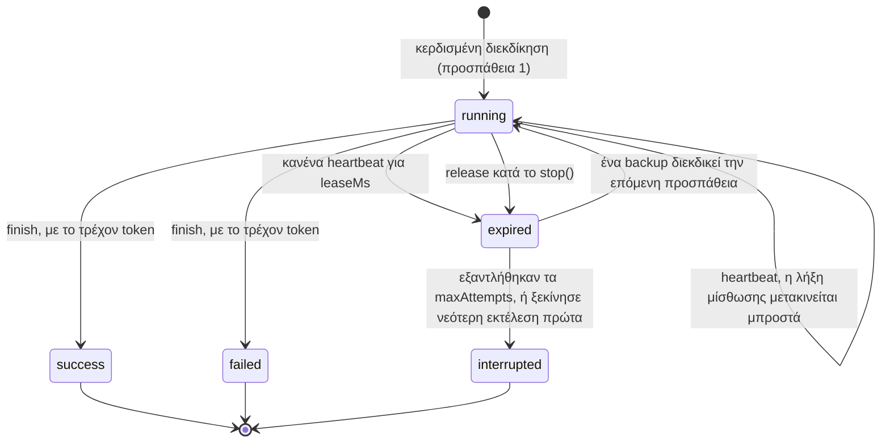
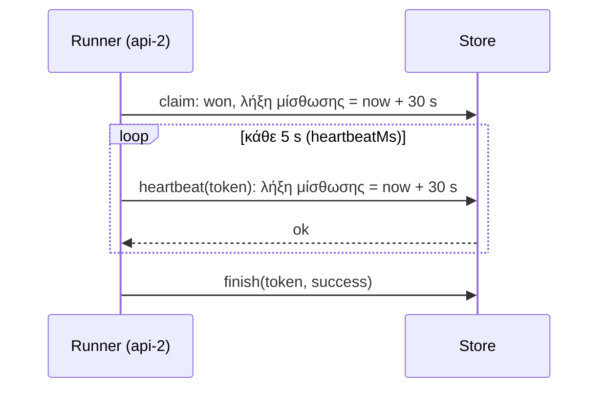
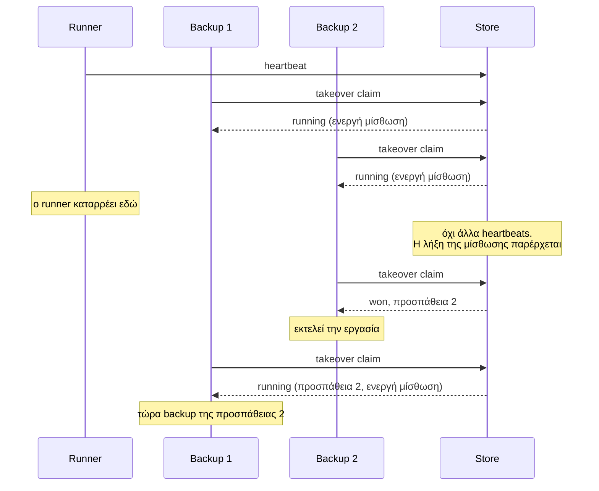
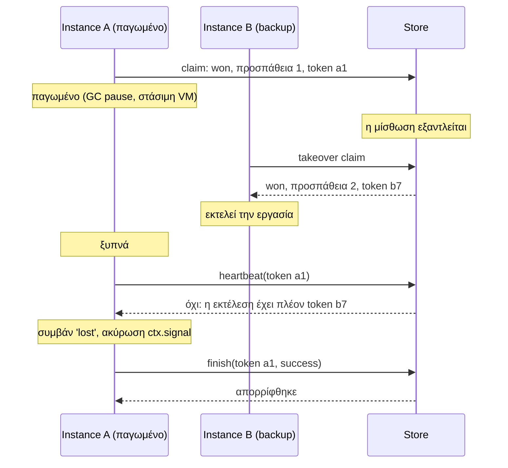
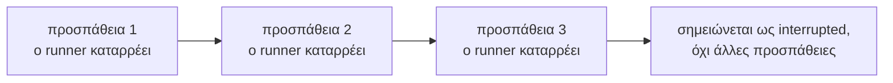
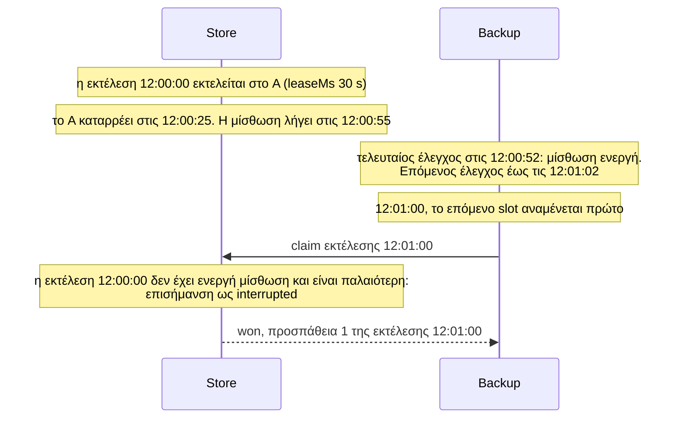
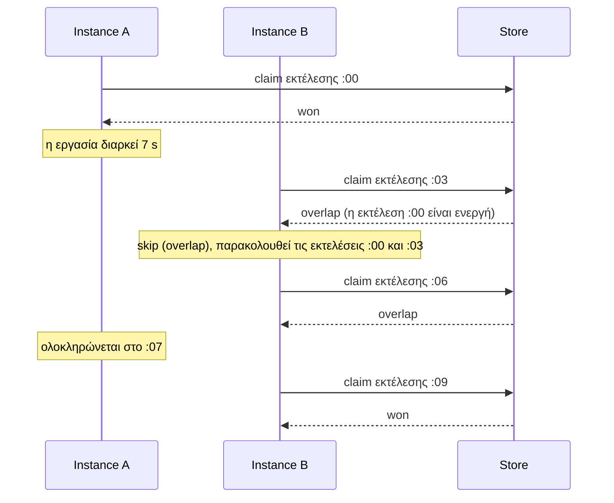
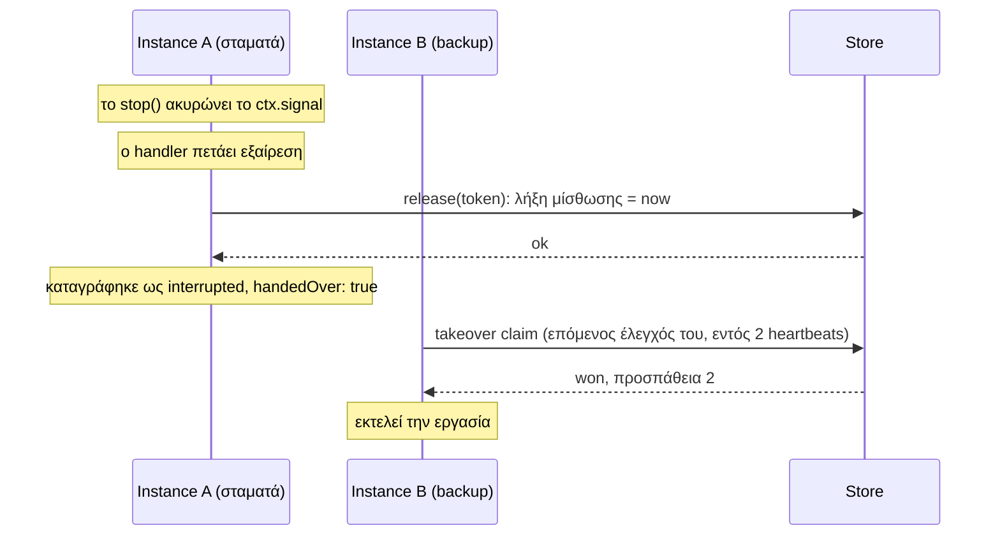
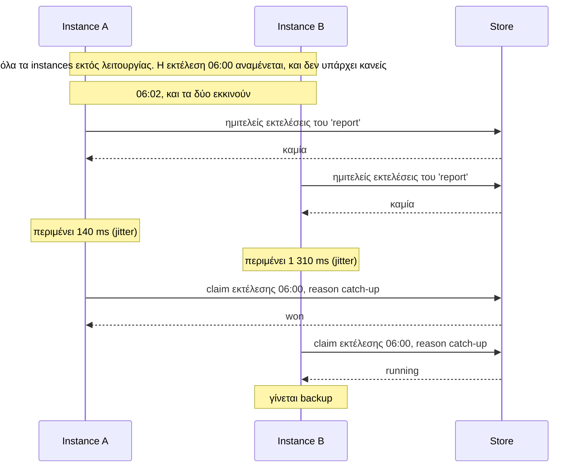

Μια διεκδίκηση αποφασίζει ποιος **ξεκινά** μια εκτέλεση. Μια μίσθωση (lease) είναι ο τρόπος με τον οποίο το cluster αντιλαμβάνεται ότι ο runner **σταμάτησε**.

Αυτή η σελίδα ισχύει για τα lease backends: Redis και Valkey με τη στρατηγική `lease`, PostgreSQL και SQLite. Οι κανόνες είναι οι ίδιοι και στα τρία.

## Τι είναι μια μίσθωση

Όταν ένα instance κερδίζει μια εκτέλεση, το store καταγράφει μαζί με την εκτέλεση:

| Πεδίο | Παράδειγμα | Σημασία |
| --- | --- | --- |
| attempt | `1` | Ποια προσπάθεια είναι αυτή |
| token | `a1f3...` | Η τυχαία τιμή αυτής της προσπάθειας |
| runner | `api-2` | Ποιος την εκτελεί |
| status | `running` | `running`, `success`, `failed` ή `interrupted` |
| lease end | `12:00:40.310` | Μέχρι πότε ο runner είναι γνωστό ότι είναι ζωντανός |

Η **λήξη της μίσθωσης (lease end)** είναι ένας χρόνος στο ρολόι του store. Όσο η εργασία εκτελείται, ο runner τη μετακινεί προς τα εμπρός κάθε `heartbeatMs`. Αν ο runner σταματήσει, η λήξη της μίσθωσης παραμένει εκεί που ήταν, και μόλις το ρολόι του store την ξεπεράσει, η εκτέλεση είναι διαθέσιμη για την επόμενη προσπάθεια.

Μια μίσθωση δεν είναι lock:

- Κανείς δεν περιμένει για αυτήν.
- Κανείς δεν χρειάζεται να την αποδεσμεύσει για να προχωρήσουν οι άλλοι· λήγει από μόνη της.
- Δεν εμποδίζει τίποτα. Απλώς καταγράφει ότι ο runner ήταν ζωντανός πρόσφατα.

## Οι καταστάσεις μιας εκτέλεσης



Η ένδειξη «Expired» δεν αποθηκεύεται ως κατάσταση (status). Είναι αυτό που *είναι* μια εκτέλεση όταν η κατάστασή της λέει `running` και η λήξη της μίσθωσής της βρίσκεται στο παρελθόν.

## Περιοδική ανανέωση (Heartbeats)



Ένα heartbeat είναι μία μικρή εγγραφή: «αν η εκτέλεση έχει ακόμα το token μου, όρισε τη λήξη της μίσθωσης σε now + `leaseMs`». Με τις προεπιλογές, η μίσθωση είναι 30 δευτερόλεπτα και ανανεώνεται κάθε 5, επομένως ένας runner μπορεί να χάσει αρκετά διαδοχικά heartbeats πριν εξαντληθεί η μίσθωση.

Το `heartbeatMs` πρέπει να είναι μικρότερο από το μισό του `leaseMs`. Η προεπιλογή είναι 5 δευτερόλεπτα, ή `leaseMs / 6` όταν αυτό είναι μικρότερο.

## Εφεδρικά instances (Backups)

Κάθε instance που ζήτησε μια εκτέλεση και έλαβε την απάντηση `running` γίνεται εφεδρικό (backup) γι' αυτήν. Ένα backup ορίζει ένα χρονόμετρο και ελέγχει ξανά την εκτέλεση μετά από έναν τυχαίο χρόνο μεταξύ ενός και δύο heartbeats, και συνεχίζει να το κάνει μέχρι να ολοκληρωθεί η εκτέλεση.



Αρκετά backups μπορεί να αντιληφθούν τη ληγμένη μίσθωση. Στέλνουν όλα μια διεκδίκηση ανάληψης (takeover claim), και καθώς η διεκδίκηση είναι ατομική, ένα κερδίζει και τα υπόλοιπα βλέπουν μια ανανεωμένη μίσθωση.

### Πόσο διαρκεί μια ανάληψη (takeover)

```
τελευταίο heartbeat ──────── leaseMs ────────► λήξη μίσθωσης ── έως 2 × heartbeatMs ──► ανάληψη
```

| | Τύπος | Προεπιλογές |
| --- | --- | --- |
| Το πολύ | `leaseMs + 2 × heartbeatMs` μετά το τελευταίο heartbeat | 40 s |
| Τυπικά | περίπου `leaseMs` μετά την κατάρρευση | περίπου 30 s |

Μειώστε το `leaseMs` για ταχύτερο failover· το κόστος είναι ότι και μικρότερες παύσεις ενός υγιούς runner προκαλούν αναλήψεις (takeovers).

## Προστασία απομόνωσης (Fencing)

Το fencing απαντά στο εξής ερώτημα: τι συμβαίνει αν ο runner δεν ήταν νεκρός, αλλά απλώς αργός;

Μια διεργασία μπορεί να παγώσει για ένα λεπτό λόγω παύσης garbage collection ή μιας στάσιμης εικονικής μηχανής (VM), και στη συνέχεια να συνεχίσει σαν να μην συνέβη τίποτα. Στο μεταξύ, ένα backup ανέλαβε την εκτέλεση (takeover). Τώρα δύο instances πιστεύουν ότι εκτελούν την ίδια εκτέλεση.

Το **fencing token** το επιλύει αυτό. Κάθε προσπάθεια έχει το δικό της token, και το store ενεργεί σε ένα heartbeat ή finish μόνο εάν το token ταιριάζει με την τρέχουσα προσπάθεια.



Όταν το heartbeat του A απορριφθεί, το A:

1. ακυρώνει το `ctx.signal` της εκτέλεσης, ώστε ένας handler που το παρακολουθεί να σταματήσει·
2. εκπέμπει το συμβάν `lost`·
3. δεν μπορεί πλέον να τροποποιήσει την εκτέλεση με κανέναν τρόπο.

:::caution[Τι δεν μπορεί να κάνει το fencing]
Το fencing προστατεύει την **εγγραφή του store** για την εκτέλεση. Δεν μπορεί να αναιρέσει όσα έκανε ο handler του A μεταξύ της αφύπνισης και του επόμενου heartbeat του. Για διάστημα έως ενός μεσοδιαστήματος heartbeat, δύο προσπάθειες μπορεί να εκτελούνται ταυτόχρονα. Γι' αυτό οι handlers πρέπει να ελέγχουν το `ctx.signal` πριν από side effects και να είναι [ασφαλείς για διπλή εκτέλεση](../../guides/writing-handlers/#κάντε-τις-εργασίες-ασφαλείς-για-διπλή-εκτέλεση).
:::

## Προσπάθειες και `maxAttempts`

Κάθε ανάληψη (takeover) αποτελεί μια νέα προσπάθεια. Το `maxAttempts` (προεπιλογή 3) περιορίζει πόσες φορές **ξεκινά** μια εκτέλεση όταν οι runners καταρρέουν.



Δύο κανόνες αποτρέπουν εσφαλμένες ενεργοποιήσεις:

- **Μετρούν μόνο οι νεκροί runners.** Ένας handler που πετάει εξαίρεση χαρακτηρίζεται `failed` και δεν επαναλαμβάνεται.
- **Οι παραδόσεις (hand-overs) δεν μετρούν.** Μια εκτέλεση που αποδεσμεύεται (released) από το `stop()` διατηρεί τις υπόλοιπες προσπάθειές της, οπότε τα deploys δεν τις εξαντλούν.

## Μια νεκρή εκτέλεση και το επόμενο slot

Τι συμβαίνει όταν ένας runner καταρρέει λίγο πριν το επόμενο slot της εργασίας; Εξαρτάται από το ποια διεκδίκηση φτάνει πρώτη στο store μόλις λήξει η μίσθωση της νεκρής εκτέλεσης.

| Σειρά γεγονότων | Αποτέλεσμα |
| --- | --- |
| Το επόμενο slot αναμένεται ενώ η μίσθωση της νεκρής εκτέλεσης είναι **ακόμα ενεργή** | Κανείς δεν μπορεί να γνωρίζει ακόμα ότι ο runner είναι νεκρός. Η νέα εκτέλεση παραλείπεται ως αλληλεπικάλυψη (overlap). Όταν η μίσθωση λήξει, ένα backup αναλαμβάνει την παλιά εκτέλεση |
| Η μίσθωση λήγει, και ο **έλεγχος ενός backup** φτάνει πρώτος | Το backup αναλαμβάνει την παλιά εκτέλεση. Αν φτάσει το επόμενο slot όσο αυτή εκτελείται, παραλείπεται ως αλληλεπικάλυψη |
| Η μίσθωση λήγει, και η **διεκδίκηση του επόμενου slot** φτάνει πρώτη | Η νέα εκτέλεση ξεκινά, και η νεκρή σημειώνεται ως `interrupted`. Δεν επαναλαμβάνεται |

Η τρίτη περίπτωση μοιάζει ως εξής:



Αυτό γίνεται σκόπιμα. Μόλις ξεκινήσει μια νεότερη εκτέλεση, η επανεκτέλεση της παλιάς αργότερα θα τις εκτελούσε εκτός σειράς, και για μια εργασία που εκτελείται κάθε λεπτό η πιο πρόσφατη εκτέλεση είναι αυτή που χρειάζεστε.

Ο ίδιος κανόνας ισχύει και κατά την εκκίνηση: ένα instance αναλαμβάνει μια νεκρή εκτέλεση μόνο αν δεν αναμένεται νεότερο slot.

Το χρονικό περιθώριο είναι μικρό: μεταξύ της λήξης της μίσθωσης και του ελέγχου του πρώτου backup, το πολύ δύο heartbeats. Για μια εργασία που δεν επιτρέπεται να χάσει εκτέλεση, διατηρήστε το διάστημα σαφώς μεγαλύτερο από το `leaseMs`, και θυμηθείτε ότι η [ανάκτηση (catch-up)](#ανάκτηση-catch-up-κατά-την-εκκίνηση) και οι επαναλήψεις γίνονται ανά εκτέλεση, δεν αποτελούν ουρά χαμένων εργασιών.

## Αλληλεπικάλυψη (Overlap)

Με `overlap: 'skip'` (η προεπιλογή), μια νέα εκτέλεση απορρίπτεται όσο μια **παλαιότερη εκτέλεση της ίδιας εργασίας έχει ενεργή μίσθωση**. Η διεκδίκηση επιστρέφει `overlap`, και το instance εκπέμπει `skip`.



Ο έλεγχος γίνεται στην ίδια ατομική διεκδίκηση, οπότε ισχύει σε όλα τα instances: καμία δύο εκτελέσεις της ίδιας εργασίας δεν διατηρούν ενεργές μισθώσεις ταυτόχρονα.

Ένα instance που παρέλειψε μια εκτέλεση λόγω overlap παρακολουθεί και **εκείνη** την εκτέλεση. Αν η παλαιότερη εκτέλεση ολοκληρωθεί εντός του παραθύρου jitter και ένα άλλο instance διεκδικήσει τη νέα εκτέλεση, το πρώτο instance λειτουργεί ως backup της όπως κάθε άλλο.

Μια νεκρή παλαιότερη εκτέλεση δεν μπλοκάρει: η μίσθωσή της έχει λήξει, οπότε η νέα εκτέλεση ξεκινά και η παλιά επισημαίνεται ως `interrupted`.

## Παράδοση (Hand-over) κατά το `stop()`

Η αναμονή μιας ολόκληρης μίσθωσης για μια ανάληψη (takeover) είναι ασύμφορη όταν ο runner γνωρίζει ότι αποχωρεί. Κατά το `stop()`:



Το **Release** τερματίζει τη μίσθωση αμέσως και σημειώνει ότι επρόκειτο για παράδοση (hand-over), οπότε δεν προσμετράται στο `maxAttempts`. Ένα backup παραλαμβάνει την εκτέλεση στον επόμενο έλεγχό του, εντός δύο heartbeats, και όχι μετά το `leaseMs`.

Τρία πράγματα μπορούν να συμβούν σε μια εργασία που εκτελείται όταν καλείται το `stop()`:

| Ο handler | Αποτέλεσμα |
| --- | --- |
| Πετάει εξαίρεση μόλις ακυρωθεί το signal | Αποδεσμεύεται (Released): παραδίδεται αμέσως |
| Επιστρέφει κανονικά | Ολοκληρώνεται: καταγράφεται ως `success` |
| Συνεχίζει να εκτελείται όταν παρέλθει το stop timeout | Το instance σταματά την ανανέωση· ένα backup αναλαμβάνει όταν λήξει η μίσθωση |

## Ανάκτηση (Catch-up) κατά την εκκίνηση

Όταν ένα instance ξεκινά, αποκαθιστά κάθε εργασία σε δύο βήματα.

**1. Ημιτελείς εκτελέσεις.** Ρωτά το store ποιες εκτελέσεις της εργασίας δεν έχουν ολοκληρωθεί:

- μίσθωση ενεργή: γίνεται backup·
- η μίσθωση έληξε, και η εκτέλεση είναι ακόμα η πιο πρόσφατη: διεκδικεί την επόμενη προσπάθεια (takeover)·
- η μίσθωση έληξε, αλλά αναμένεται νεότερο slot: την αφήνει· η επόμενη εκτέλεση την αντικαθιστά.

**2. Μια χαμένη εκτέλεση.** Αν το πιο πρόσφατο slot αναμενόταν πριν από λιγότερο από `catchUpMs` (προεπιλογή 5 λεπτά) και κανείς δεν το διεκδίκησε, το instance περιμένει ένα τυχαίο jitter και το διεκδικεί, με `reason: 'catch-up'`.



Μόνο η πιο πρόσφατη εκτέλεση ανακτάται. Αν η υπηρεσία ήταν εκτός λειτουργίας για μία ώρα, μια εργασία που εκτελείται κάθε λεπτό ανακτά μία εκτέλεση, όχι εξήντα.

## Καθυστερημένες διεκδικήσεις

Μια διεκδίκηση μπορεί να φτάσει στο store πολύ μετά την αποστολή της: το δίκτυο καθυστέρησε ή ο client έβαλε σε ουρά εντολές κατά την επανασύνδεση. Μια διεκδίκηση που φτάνει με καθυστέρηση λεπτών δεν πρέπει να ξεκινήσει μια παρωχημένη εκτέλεση.

Έτσι, το store ελέγχει την καθυστέρηση **στο δικό του ρολόι**, μέσα στην ατομική διεκδίκηση: αν το `now - slot` είναι μεγαλύτερο από `maxLateMs` συν μια ανοχή 10 δευτερολέπτων, η απάντηση είναι `late`.

Επίσης, η κατάσταση μιας εκτέλεσης δεν διαγράφεται ποτέ όσο μια καθυστερημένη διεκδίκηση θα μπορούσε ακόμα να ρωτήσει γι' αυτήν, ανεξάρτητα από το μέγεθος του `historySize`. Διαφορετικά, μια καθυστερημένη διεκδίκηση θα μπορούσε να μην βρει κατάσταση και λανθασμένα να κερδίσει μια εκτέλεση που έχει ήδη πραγματοποιηθεί.

## Σύνοψη των κανόνων

1. Μια διεκδίκηση για μια εκτέλεση χωρίς προηγούμενη κατάσταση κερδίζει και αποκτά μίσθωση.
2. Ένα heartbeat επεκτείνει τη μίσθωση, μόνο με το τρέχον token.
3. Μια εκτέλεση της οποίας η μίσθωση έληξε μπορεί να διεκδικηθεί ως η επόμενη προσπάθεια, έως το όριο `maxAttempts`. Αν μια νεότερη εκτέλεση της εργασίας ξεκινήσει πρώτη, η παλιά επισημαίνεται ως `interrupted`.
4. Το Finish και το release λειτουργούν μόνο με το τρέχον token.
5. Μια νέα εκτέλεση απορρίπτεται όσο μια παλαιότερη εκτέλεση της εργασίας διατηρεί ενεργή μίσθωση (`overlap: 'skip'`).
6. Μια νέα διεκδίκηση που φτάνει υπερβολικά αργά, βάσει του ρολογιού του store, απορρίπτεται.

## Στη συνέχεια

- [Σενάρια αστοχίας](../failure-scenarios/): αυτοί οι κανόνες εφαρμοσμένοι σε πραγματικές αστοχίες
- [Χρονισμός και ρολόγια](../timing-and-clocks/)
