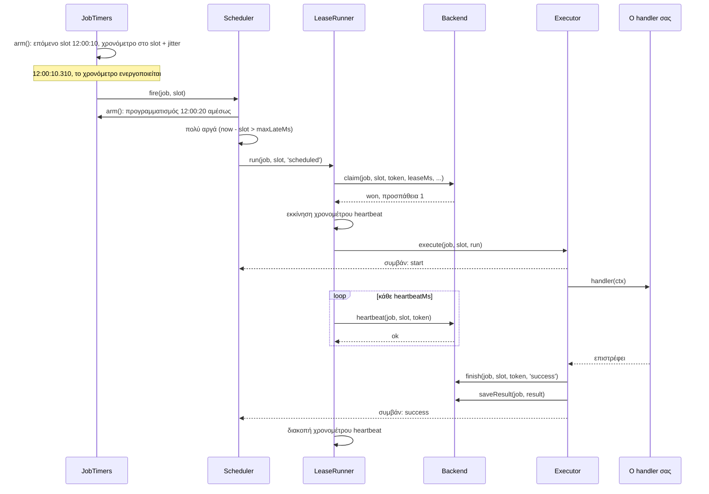
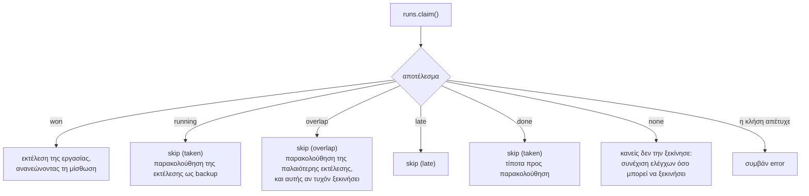
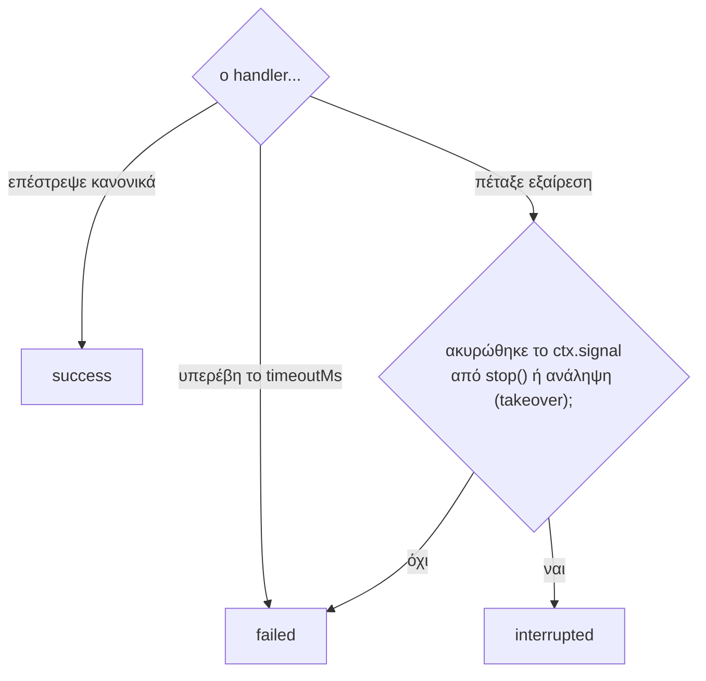
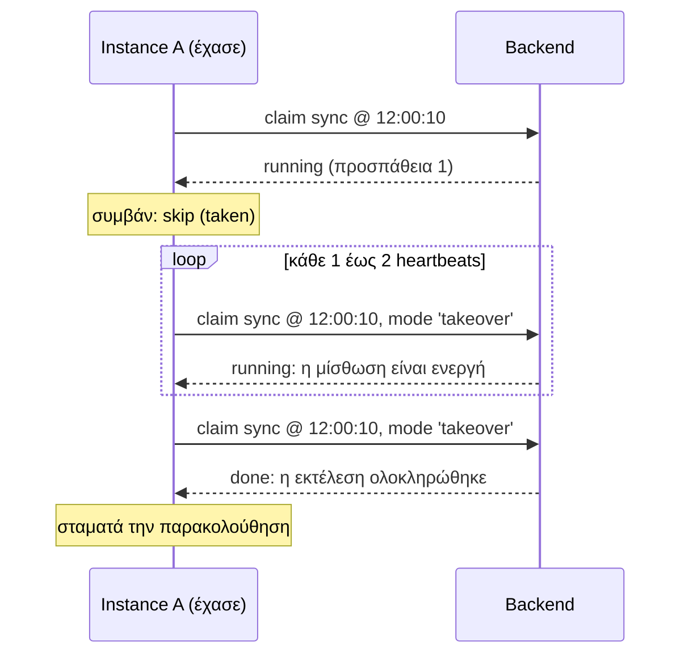
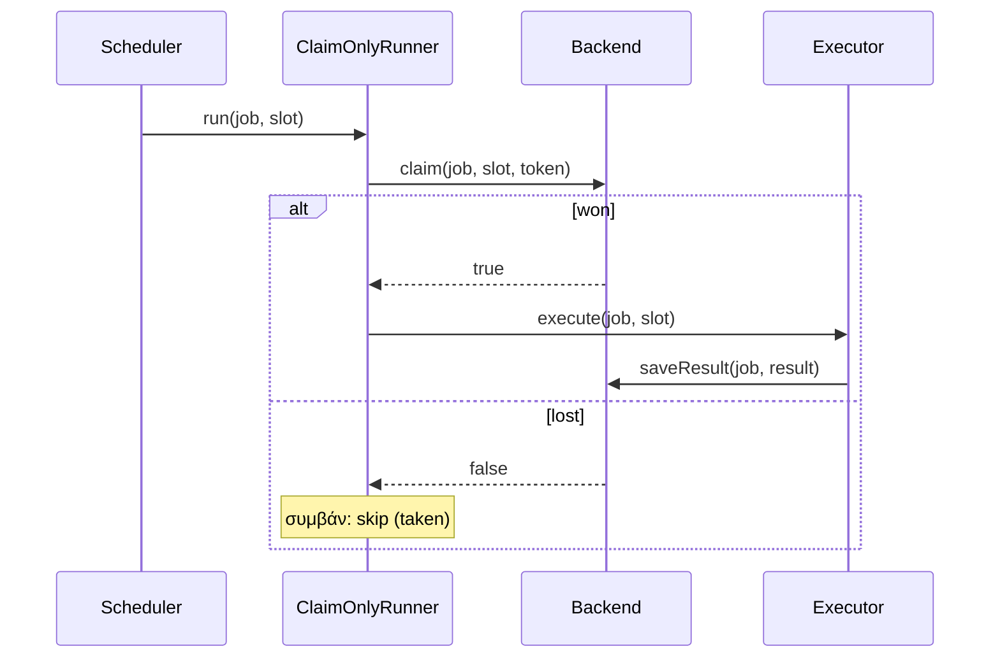
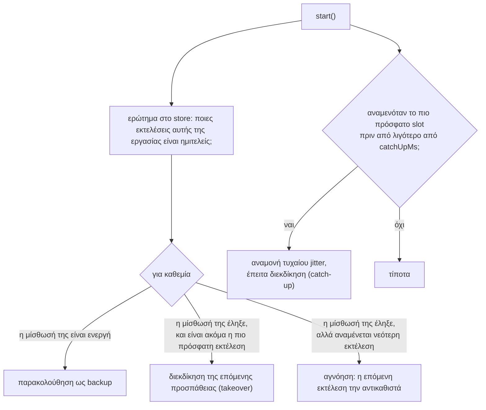

Αυτή η σελίδα παρακολουθεί μία εκτέλεση μίας εργασίας μέσα από τον κώδικα, σε ένα lease backend. Η εργασία είναι η `every('sync', '10s', handler)` και η εκτέλεση είναι εκείνη που αναμένεται στις 12:00:10.

## Ολόκληρη η διαδρομή

## Βήμα προς βήμα

### 1. Όπλιση του χρονομέτρου

Όταν ξεκινά ο scheduler, καθώς και μετά από κάθε εκτέλεση, η `JobTimers.arm()` ζητά από το πρόγραμμα της εργασίας το πρώτο slot μετά το «τώρα», και ορίζει ένα χρονόμετρο για **slot + τυχαίο jitter**.

Τα χρονόμετρα δεν ορίζονται ποτέ για διάστημα μεγαλύτερο από ένα λεπτό. Μια μεγαλύτερη αναμονή χωρίζεται σε επιμέρους διαστήματα, και το ρολόι ελέγχεται ξανά κάθε φορά. Αυτό διατηρεί το χρονόμετρο ακριβές σε βάθος ωρών και επιτρέπει στον scheduler να αντιληφθεί μια αλλαγή ρολογιού.

### 2. Το χρονόμετρο ενεργοποιείται

Η `Scheduler.fire()` κάνει τρία πράγματα:

1. **Οπλίζει πρώτα την επόμενη εκτέλεση.** Το επόμενο slot προγραμματίζεται πριν ξεκινήσει η επεξεργασία του τρέχοντος, ώστε μια χρονοβόρα εργασία να μην καθυστερεί ποτέ το πρόγραμμα.
2. **Ελέγχει τοπικά την καθυστέρηση (lateness).** Αν το instance έφτασε σε αυτή την εκτέλεση περισσότερο από `maxLateMs` μετά το slot της (λόγω παγώματος ή μπλοκαρίσματος του event loop), εκπέμπει `skip` με αιτιολογία `'late'` και σταματά εδώ.
3. **Παραδίδει την εκτέλεση στον runner.**

### 3. Η διεκδίκηση (claim)

Η `LeaseRunner.run()` κατασκευάζει τη διεκδίκηση. Εκτός από την εργασία και το slot, περιλαμβάνει ένα νέο τυχαίο **token**, τη διάρκεια της μίσθωσης (lease length), τον κανόνα αλληλεπικάλυψης (overlap) και το όριο προσπαθειών.

Το backend απαντά με ένα από έξι αποτελέσματα:

| Αποτέλεσμα | Σημασία | Τι κάνει αυτό το instance |
| --- | --- | --- |
| `won` | Αυτό το instance κατέχει αυτή την προσπάθεια | Εκτελεί τον handler |
| `running` | Ένα άλλο instance την εκτελεί, και η μίσθωσή του είναι ενεργή | Γίνεται εφεδρικός (backup) |
| `overlap` | Μια παλαιότερη εκτέλεση της εργασίας έχει ακόμα ενεργή μίσθωση | Παραλείπει (skip) και παρακολουθεί και τις δύο εκτελέσεις |
| `late` | Η διεκδίκηση έφτασε στο store υπερβολικά αργά μετά το slot, βάσει του ρολογιού του store | Παραλείπει (skip) |
| `done` | Η εκτέλεση έχει ήδη ολοκληρωθεί ή εξάντλησε τις προσπάθειές της | Τίποτα |
| `none` | Ένα backup ρώτησε για μια εκτέλεση που κανείς δεν έχει διεκδικήσει | Συνεχίζει τους ελέγχους για ένα διάστημα |

### 4. Εκτέλεση του handler

Η `executeLeased()` ξεκινά ένα χρονόμετρο που στέλνει ένα **heartbeat** κάθε `heartbeatMs`, και στη συνέχεια καλεί τον `Executor`.

Ο `Executor`:

1. Εκπέμπει `start`.
2. Καλεί τον handler σας με το context του. Το `ctx.signal` ανήκει αποκλειστικά σε αυτή την εκτέλεση.
3. Αν έχει οριστεί `timeoutMs`, θέτει σε αντιπαραβολή (race) τον handler με ένα χρονόμετρο. Όταν κερδίζει το χρονόμετρο, ακυρώνει το signal και θεωρεί την εκτέλεση αποτυχημένη (failed).

### 5. Απόφαση για το πώς ολοκληρώθηκε

Όταν ο handler επιστρέφει ή πετάει εξαίρεση (throws), ο `Executor` κατηγοριοποιεί την εκτέλεση:

Μια εξαίρεση μετά από `stop()` ή ανάληψη (takeover) καταγράφεται ως **interrupted**, όχι ως failed. Ζητήθηκε από τον handler να σταματήσει· δεν υπήρξε σφάλμα.

### 6. Καταγραφή της ολοκλήρωσης

Δύο εγγραφές, με αυτή τη σειρά:

1. **`finish`**: σηματοδοτεί τη λήξη της εκτέλεσης στην κατάσταση μίσθωσης, συνοδευόμενη από το token. Το heartbeat συνεχίζει να εκτελείται μέχρι να αποθηκευτεί αυτό: αν το store είναι στιγμιαία μη προσβάσιμο εκείνη τη στιγμή, ένα backup δεν πρέπει να επανεκτελέσει μια εργασία που έχει ήδη ολοκληρωθεί.
2. **`saveResult`**: αποθηκεύει την εγγραφή ιστορικού: κατάσταση, χρόνος έναρξης και λήξης, διάρκεια, και το μήνυμα σφάλματος αν υπήρξε.

Αν η εκτέλεση διακόπηκε από `stop()`, το πρώτο βήμα είναι ένα **release** αντί για finish: η μίσθωση λήγει αμέσως, ώστε ένα backup να μπορεί να αναλάβει (takeover) χωρίς αναμονή.

Τέλος, ο `Executor` εκπέμπει `success`, `failure` ή `interrupted`.

## Η ίδια εκτέλεση, στα instances που έχασαν

Ο έλεγχος ενός backup είναι μια διεκδίκηση σε **λειτουργία ανάληψης (takeover mode)**: «δώσε μου την επόμενη προσπάθεια αυτής της εκτέλεσης αν η μίσθωσή της έχει λήξει». Όσο η μίσθωση παραμένει ενεργή, η απάντηση είναι `running` και τίποτα δεν αλλάζει. Ο έλεγχος πραγματοποιείται σε μια τυχαία χρονική στιγμή μεταξύ ενός και δύο heartbeats, ώστε τα backups να μην ρωτούν όλα ταυτόχρονα.

## Σε ένα claim-only backend

Η διαδρομή είναι συντομότερη. Δεν υπάρχει μίσθωση, επομένως δεν υπάρχουν heartbeats ούτε backups:

## Τι προσθέτει το `start()`

Σε ένα lease backend, κάθε εργασία περνά από **ανάκαμψη (recovery)** όταν ξεκινά ο scheduler, πριν ενεργοποιηθεί το πρώτο της χρονόμετρο:

Αυτό καθιστά ασφαλή μια πλήρη επανεκκίνηση: όποιο instance επιστρέψει πρώτο αναλαμβάνει ό,τι βρισκόταν σε εξέλιξη.

## Στη συνέχεια

- [Αλγόριθμοι διεκδίκησης](../claim-algorithms/): τι συμβαίνει μέσα στο `claim()`
- [Μισθώσεις (Leases)](../leases/): heartbeats, ανάληψη και fencing λεπτομερώς
