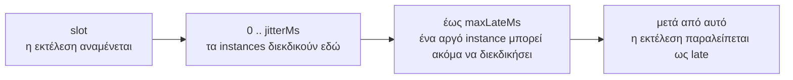
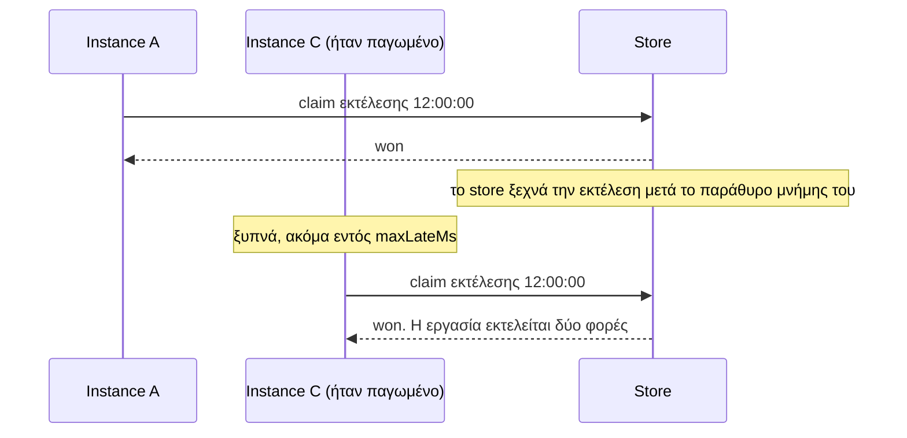
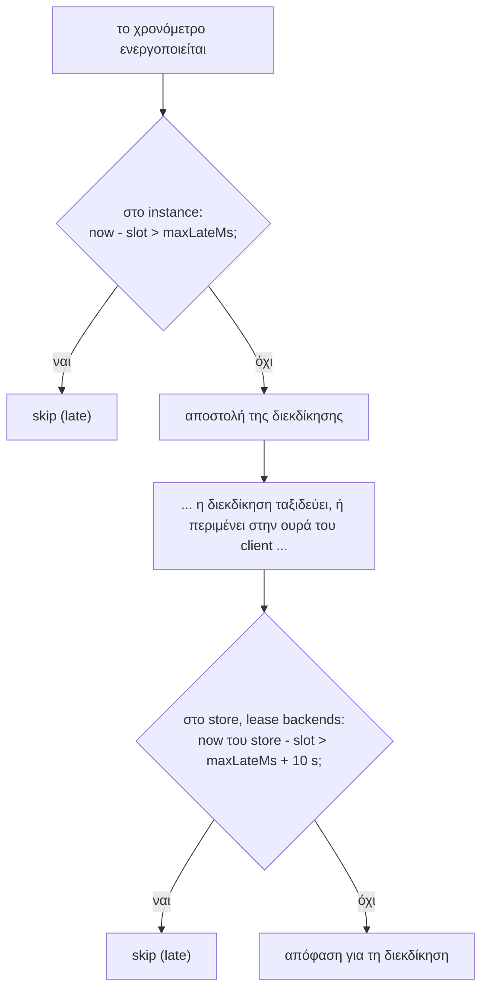

Ένας κατανεμημένος scheduler αφορά κυρίως τον χρόνο: πότε αναμένεται μια εκτέλεση, πόσο αργοπορημένο επιτρέπεται να είναι ένα instance και ποιου το ρολόι αποφασίζει. Αυτή η σελίδα συγκεντρώνει αυτούς τους κανόνες σε ένα σημείο.

## Η διάρκεια ζωής ενός slot, στον χρόνο



| Χρόνος | Προεπιλογή | Καθορίζεται από |
| --- | --- | --- |
| Το slot | | Το πρόγραμμα: το ίδιο σε κάθε instance |
| Παράθυρο jitter | 2 s (λιγότερο για μικρά διαστήματα) | `jitterMs` |
| Όριο καθυστέρησης (lateness) | 60 s | `maxLateMs` |

## Τυχαία καθυστέρηση (Jitter)

Κάθε instance επιλέγει μια νέα τυχαία καθυστέρηση μεταξύ 0 και `jitterMs` για κάθε εκτέλεση.

Χωρίς jitter, όλα τα instances θα διεκδικούσαν την ίδια ακριβώς στιγμή, και εκείνο με το ταχύτερο ρολόι και δικτυακή διαδρομή θα κέρδιζε σχεδόν κάθε φορά. Με το jitter, ο νικητής είναι σχεδόν τυχαίος, οπότε ο φόρτος κατανέμεται.

```
3 instances, jitterMs 2000, πέντε εκτελέσεις: ποιος ζήτησε πρώτος;

run 12:00:00   A +1 240   B   +310 *  C +1 870
run 12:00:10   A   +95 *  B +1 660    C   +720
run 12:00:20   A +1 900   B +1 020    C   +480 *
run 12:00:30   A   +610 * B +1 330    C +1 990
run 12:00:40   A +1 410   B   +250 *  C   +830
```

Το προεπιλεγμένο `jitterMs` είναι 2 δευτερόλεπτα, μειωμένο στο ένα τέταρτο του διαστήματος για μικρά μεσοδιαστήματα: μια εργασία που εκτελείται κάθε δευτερόλεπτο λαμβάνει 250 ms.

Το jitter σημαίνει επίσης ότι μια εκτέλεση ξεκινά έως και `jitterMs` μετά το slot της. Χρησιμοποιήστε το `ctx.scheduledAt`, όχι την τρέχουσα ώρα, όταν η εργασία χρειάζεται να γνωρίζει τον ονομαστικό της χρόνο.

## Κανόνες που επιβάλλει το anarchon

Όταν προσθέτετε μια εργασία, το anarchon ελέγχει τους χρονισμούς της μεταξύ τους και πετάει ένα `RangeError` αν ένας συνδυασμός δεν είναι ασφαλής. Είναι προτιμότερο να αποτύχει κατά την εκκίνηση παρά να εκτελεστεί μια εργασία δύο φορές στις 3 π.μ.

| Κανόνας | Γιατί |
| --- | --- |
| `jitterMs` < το μισό του χρόνου μεταξύ εκτελέσεων | Διαφορετικά τα παράθυρα jitter δύο διαδοχικών εκτελέσεων θα μπορούσαν να συναντηθούν |
| `maxLateMs` > `jitterMs` | Ένα instance που περιμένει το πλήρες jitter του δεν πρέπει να θεωρηθεί ήδη «late» |
| `jitterMs + maxLateMs` < η μνήμη του store για μια εκτέλεση | Δείτε παρακάτω |
| `heartbeatMs` < το μισό του `leaseMs` | Μια μίσθωση πρέπει να ανανεωθεί τουλάχιστον δύο φορές πριν μπορέσει να λήξει |

### Για πόσο διάστημα πρέπει να θυμάται το store

Ένα instance μπορεί να στείλει μια διεκδίκηση έως και `jitterMs + maxLateMs` μετά το slot. Αν το store έχει ήδη ξεχάσει ότι η εκτέλεση δεσμεύτηκε, αυτή η καθυστερημένη διεκδίκηση θα κέρδιζε, και η εργασία θα εκτελούνταν δύο φορές.



Επομένως, το anarchon απαιτεί η μνήμη του store να είναι μεγαλύτερη από την πιο αργοπορημένη δυνατή διεκδίκηση:

| Backend | Θυμάται μια δεσμευμένη εκτέλεση για | Ρύθμιση |
| --- | --- | --- |
| Redis `lease`, PostgreSQL, SQLite | Όσο μια καθυστερημένη διεκδίκηση θα μπορούσε να ρωτήσει, ανεξαρτήτως του `historySize` | Τίποτα προς ρύθμιση |
| Redis `stream-id` | Για πάντα | Τίποτα προς ρύθμιση |
| Redis `idmp` | 5 min, και το πολύ 1000 εκτελέσεις | `strategy.durationSec`, `strategy.maxSize` |
| Redis `script` | 5 min, και το πολύ `historySize` εκτελέσεις | `strategy.windowMs` |
| RabbitMQ | 5 λεπτά | `slotTtlMs` |
| NATS | 5 λεπτά | `duplicateWindowMs` |

Με τις προεπιλογές (2 s + 60 s) κάθε backend είναι ασφαλές. Αντιμετωπίζετε αυτόν τον κανόνα μόνο αν αυξήσετε σημαντικά το `maxLateMs` ή συρρικνώσετε κάποιο παράθυρο.

Για τα backends που περιορίζουν επίσης βάσει **πλήθους** (`idmp`, `script`), το πλήθος πολλαπλασιασμένο με το διάστημα πρέπει να καλύπτει το ίδιο εύρος: μια εργασία που εκτελείται κάθε δευτερόλεπτο με μνήμη 50 εκτελέσεων θυμάται μόνο 50 δευτερόλεπτα.

## Καθυστέρηση, ελεγμένη δύο φορές

Μια εκτέλεση μπορεί να καθυστερήσει για δύο διαφορετικούς λόγους, και καθένας ελέγχεται εκεί όπου μπορεί να παρατηρηθεί.

**Το instance καθυστέρησε.** Το χρονόμετρό του ενεργοποιήθηκε πολύ μετά το slot: η διεργασία ήταν παγωμένη ή το event loop ήταν μπλοκαρισμένο. Το instance συγκρίνει το δικό του ρολόι με το slot και παραλείπει την εκτέλεση αν βρίσκεται πάνω από `maxLateMs` πίσω.

**Η διεκδίκηση καθυστέρησε.** Το instance έστειλε τη διεκδίκηση στην ώρα του, αλλά έφτασε στο store πολύ αργότερα: το δίκτυο καθυστέρησε ή ο client έβαλε σε ουρά την εντολή κατά την επανασύνδεση. Το instance δεν μπορεί να το δει αυτό. Έτσι, στα lease backends το **store** ελέγχει ξανά, στο δικό του ρολόι, μέσα στην ατομική διεκδίκηση: μια νέα εκτέλεση της οποίας το slot βρίσκεται πάνω από `maxLateMs` συν μια ανοχή 10 δευτερολέπτων στο παρελθόν απορρίπτεται.



## Ποιο ρολόι χρησιμοποιείται πού

| Απόφαση | Ρολόι | Γιατί |
| --- | --- | --- |
| Πότε αναμένεται ένα slot σε ένα instance | Του instance | Κάθε instance ενεργοποιεί τα δικά του χρονόμετρα |
| Αν μια μίσθωση είναι ενεργή | Του store | Ένα ρολόι για όλους: μια διαφορά μεταξύ instances δεν μπορεί να κάνει μια ενεργή μίσθωση να φαίνεται ληγμένη |
| Αν μια διεκδίκηση έφτασε πολύ αργά | Του store | Το instance δεν μπορεί να γνωρίζει πόσο χρόνο βρισκόταν η διεκδίκηση υπό μεταφορά |

### Τι προκαλεί η απόκλιση ρολογιών

Η *απόκλιση ρολογιών (clock skew)* είναι η διαφορά μεταξύ των ρολογιών δύο μηχανημάτων.

- **Απόκλιση μεταξύ των instances** μετατοπίζει μόνο το *ποιος τείνει να κερδίζει*. Ένα instance του οποίου το ρολόι τρέχει 500 ms μπροστά ενεργοποιεί τα χρονόμετρά του 500 ms νωρίτερα και κερδίζει συχνότερα. Τίποτα δεν χαλάει, επειδή η διεκδίκηση εξακολουθεί να είναι ατομική.
- **Απόκλιση μεταξύ ενός instance και του store** έχει σημασία μόνο στα όρια του ελέγχου καθυστέρησης, γι' αυτό και αυτός ο έλεγχος περιλαμβάνει ανοχή 10 δευτερολέπτων.
- **Μεγάλη απόκλιση** (λεπτά) κάνει ένα instance να διεκδικεί εκτελέσεις λεπτά νωρίτερα ή αργότερα. Πέρα από το `maxLateMs`, οι εκτελέσεις του απορρίπτονται ως late.

Οι μισθώσεις είναι απρόσβλητες σε όλα αυτά, επειδή οι λήξεις των μισθώσεων καταγράφονται και συγκρίνονται αποκλειστικά από το store.

:::tip
Εκτελέστε NTP, ή τον συγχρονισμό ώρας της πλατφόρμας σας, σε κάθε μηχάνημα. Ακρίβεια υπο-δευτερολέπτου είναι υπεραρκετή.
:::

## Επιλογή χρονισμών μίσθωσης

```
νεκρός runner ── leaseMs ──► η μίσθωση λήγει ── έως 2 × heartbeatMs ──► ανάληψη
```

| | `leaseMs` | `heartbeatMs` | Ο νεκρός runner αντικαθίσταται εντός | Ένας υγιής runner επιβιώνει από παύση |
| --- | --- | --- | --- | --- |
| Προεπιλογή | 30 s | 5 s | 40 s | περίπου 25 s |
| Γρήγορο failover | 6 s | 1 s | 8 s | περίπου 5 s |
| Υπομονετικό | 120 s | 5 s | 130 s | περίπου 115 s |

Η τελευταία στήλη είναι ο συμβιβασμός (trade-off). Μια μίσθωση πρέπει να είναι μεγαλύτερη από τη μεγαλύτερη παύση που μπορεί να έχει ένας *υγιής* runner: garbage collection, αργός δίσκος, σύντομη διακοπή δικτύου. Αν δεν είναι, υγιείς εκτελέσεις αναλαμβάνονται από άλλα instances, και βλέπετε συμβάντα `lost` και διπλότυπη εργασία.

Ένα λογικό σημείο εκκίνησης: `leaseMs` τουλάχιστον τρεις φορές τη χειρότερη αναμενόμενη παύση σας, και το μεσοδιάστημα της εργασίας σαφώς μεγαλύτερο από το `leaseMs`.

## Μακροχρόνια χρονόμετρα

Τα timers του Node παρουσιάζουν ολίσθηση (drift) σε μεγάλες αναμονές, και ένα χρονόμετρο ρυθμισμένο για τον επόμενο μήνα δεν μπορεί να αντιληφθεί ότι το ρολόι του μηχανήματος διορθώθηκε. Έτσι, το anarchon δεν ρυθμίζει ποτέ χρονόμετρο για περισσότερο από ένα λεπτό. Μια μεγαλύτερη αναμονή είναι μια αλυσίδα χρονομέτρων ενός λεπτού, καθένα από τα οποία ξαναδιαβάζει το ρολόι, και η εκτέλεση ενεργοποιείται μόνο όταν το ρολόι φτάσει πράγματι στο slot + jitter.

## Στη συνέχεια

- [Μισθώσεις (Leases)](../leases/)
- [Επιλογές εργασιών](../../guides/job-options/)
