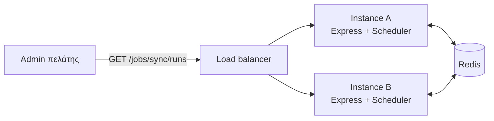

Μια συνηθισμένη διάταξη: η υπηρεσία που εξυπηρετεί HTTP εκτελεί επίσης τις προγραμματισμένες εργασίες, και εκθέτει μερικά admin endpoints για αυτές.

Μια εκτελέσιμη έκδοση αυτής της συνταγής βρίσκεται στο αποθετήριο ως [`examples/http-api.ts`](https://github.com/aristoteliss/anarchon/blob/main/examples/http-api.ts), με κάθε αίτημα στο [`examples/http-api.http`](https://github.com/aristoteliss/anarchon/blob/main/examples/http-api.http) για το VS Code REST Client.

## Η υπηρεσία

```ts
import express, { type NextFunction, type Request, type Response } from 'express';
import { Scheduler } from 'anarchon';

const PORT = Number(process.env.PORT ?? 3000);

const scheduler = new Scheduler({
  redis: process.env.REDIS_URL,
  instanceId: process.env.POD_NAME ?? `api-${PORT}`,
  timezone: 'Europe/Athens',
});

scheduler
  .every('sync', '10s', (ctx) => syncCustomers({ signal: ctx.signal }))
  .cron('digest', '0 8 * * 1-5', () => sendDigest());

scheduler.on('failure', (run) => console.error(`${run.job} failed: ${run.error}`));

const app = express();

// Εργασίες σε αυτό το instance και η επόμενη εκτέλεσή τους
app.get('/jobs', (_req, res) => {
  res.json(scheduler.jobs());
});

// Πρόσφατες εκτελέσεις από όλα τα instances
app.get('/jobs/:name/runs', async (req, res) => {
  const limit = Number(req.query.limit ?? 20);
  res.json(await scheduler.history(req.params.name, limit));
});

// Η πιο πρόσφατη εκτέλεση
app.get('/jobs/:name/last', async (req, res) => {
  res.json(await scheduler.lastRun(req.params.name));
});

// Εκτέλεση τώρα, σε αυτό το instance. Απαντά όταν ολοκληρωθεί η εργασία.
app.post('/jobs/:name/run', async (req, res) => {
  res.json(await scheduler.runNow(req.params.name));
});

// Ένα άγνωστο όνομα εργασίας ή μη έγκυρο όριο προκαλεί σφάλμα: απάντηση 400 με το μήνυμα
app.use((error: unknown, _req: Request, res: Response, _next: NextFunction) => {
  res.status(400).json({ error: error instanceof Error ? error.message : String(error) });
});

async function main() {
  await scheduler.start();
  const server = app.listen(PORT, () => console.log(`listening on ${PORT}`));

  const shutdown = async () => {
    server.close();                               // διακοπή αποδοχής αιτημάτων
    await scheduler.stop({ timeoutMs: 20_000 });  // παράδοση των τρεχουσών εργασιών (hand-over)
    process.exit(0);
  };
  process.on('SIGTERM', shutdown);
  process.on('SIGINT', shutdown);
}

main().catch((error) => {
  console.error(error);
  process.exit(1);
});
```

Το Express 5 προωθεί μια απορριφθείσα υπόσχεση (rejected promise) από έναν `async` handler στο error middleware. Στο Express 4, περιτυλίξτε τους handlers ή προσθέστε το `express-async-errors`.

## Δοκιμή

```sh
curl localhost:3000/jobs
curl "localhost:3000/jobs/sync/runs?limit=5"
curl localhost:3000/jobs/sync/last
curl -X POST localhost:3000/jobs/sync/run
```

Ξεκινήστε ένα δεύτερο instance σε άλλη θύρα, και το `/jobs/sync/runs` σε οποιοδήποτε από τα δύο παραθέτει τις εκτελέσεις και των δύο:

```sh
PORT=3001 npx tsx app.ts
```

## Πώς συνδέονται τα μέρη



- **Τα `GET` endpoints** διαβάζουν από το store, οπότε οποιοδήποτε instance δίνει την ίδια απάντηση.
- **Το `POST .../run`** εκτελεί την εργασία σε όποιο instance επέλεξε ο load balancer. Αυτό είναι μια χαρά για μια χειροκίνητη εκτέλεση· καταγράφεται με το όνομα αυτού του instance.

## Αποφάσεις σχεδιασμού

### Προστατέψτε τα endpoints

Το `POST /jobs/:name/run` εκτελεί κώδικα κατ' απαίτηση. Τοποθετήστε το πίσω από τον κανονικό μηχανισμό πιστοποίησής σας (authentication) και εξετάστε μια λίστα επιτρεπόμενων ονομάτων εργασιών (allow-list):

```ts
const RUNNABLE = new Set(['sync', 'digest']);

app.post('/jobs/:name/run', requireAdmin, async (req, res) => {
  if (!RUNNABLE.has(req.params.name)) return res.status(404).json({ error: 'not found' });
  res.json(await scheduler.runNow(req.params.name));
});
```

### Μην κρατάτε το αίτημα σε αναμονή για μακροχρόνιες εργασίες

Η μέθοδος `runNow()` επιλύεται (resolves) όταν η εργασία έχει ολοκληρωθεί. Για μια εργασία που διαρκεί λεπτά, απαντήστε αμέσως και αφήστε τον καλούντα να κάνει poll στο ιστορικό:

```ts
app.post('/jobs/:name/run', requireAdmin, (req, res) => {
  scheduler.runNow(req.params.name).catch((error) => console.error(error));
  res.status(202).json({ started: true, history: `/jobs/${req.params.name}/runs` });
});
```

### Ένα health check που αντικατοπτρίζει τις εργασίες

```ts
app.get('/health/cron', async (_req, res) => {
  const last = await scheduler.lastRun('sync');
  const ageMs = last ? Date.now() - last.startedAt.getTime() : Infinity;
  const ok = ageMs < 30_000 && last?.status !== 'failed';
  res.status(ok ? 200 : 503).json({ ok, last });
});
```

Μην το συνδέσετε στο liveness check του load balancer. Μια αποτυχημένη εργασία είναι λόγος ειδοποίησης (alert), όχι επανεκκίνησης κάθε instance.

## Με το Fastify

Ο scheduler δεν εξαρτάται από το framework. Η ίδια υπηρεσία σε Fastify:

```ts
import Fastify from 'fastify';

const app = Fastify();

app.get('/jobs', async () => scheduler.jobs());
app.get<{ Params: { name: string }; Querystring: { limit?: string } }>('/jobs/:name/runs', async (req) =>
  scheduler.history(req.params.name, Number(req.query.limit ?? 20)),
);
app.post<{ Params: { name: string } }>('/jobs/:name/run', async (req) => scheduler.runNow(req.params.name));

app.addHook('onClose', async () => {
  await scheduler.stop({ timeoutMs: 20_000 });
});

await scheduler.start();
await app.listen({ port: 3000 });

process.on('SIGTERM', () => app.close());
```

## Επόμενα βήματα

- [Μια διεργασία worker και ένα read-only API](../worker-and-api/): κρατήστε τις εργασίες έξω από τις διεργασίες web
- [Ιστορικό](../../guides/history/)
