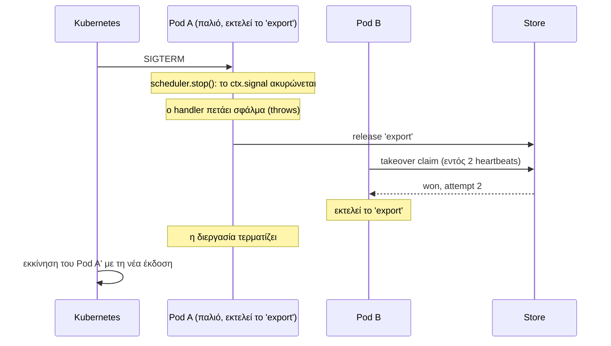

Ένα rolling deploy τερματίζει τα pods ένα-ένα καθώς ξεκινούν τα νέα. Για έναν scheduler αυτή είναι η πιο συνηθισμένη «αποτυχία», και θα πρέπει να είναι ένα μη-γεγονός: το pod που τερματίζεται παραδίδει την τρέχουσα εργασία του σε ένα άλλο pod.

## Τι θα έπρεπε να συμβεί



Τρία πράγματα το κάνουν να λειτουργεί.

## 1. Κλήση της `stop()` στο SIGTERM

Το Kubernetes στέλνει `SIGTERM`, περιμένει για `terminationGracePeriodSeconds`, και στη συνέχεια στέλνει `SIGKILL`.

```ts
const shutdown = async () => {
  server.close();                               // διακοπή αποδοχής αιτημάτων
  await scheduler.stop({ timeoutMs: 20_000 });  // παράδοση των τρεχουσών εργασιών
  process.exit(0);
};
process.on('SIGTERM', shutdown);
```

:::caution[PID 1]
Αν το container σας ξεκινά το Node μέσω του `npm start` ή ενός shell script, το σήμα μπορεί να μην φτάσει ποτέ στο Node. Ξεκινήστε το απευθείας (`CMD ["node", "dist/main.js"]`), ή χρησιμοποιήστε ένα init σύστημα όπως το `tini`.
:::

## 2. Δώστε αρκετό χρόνο

Η περίοδος χάριτος (grace period) πρέπει να είναι μεγαλύτερη από το timeout διακοπής, με επιπλέον περιθώριο:

```yaml
apiVersion: apps/v1
kind: Deployment
metadata:
  name: billing
spec:
  replicas: 3
  strategy:
    rollingUpdate:
      maxUnavailable: 1
      maxSurge: 1
  template:
    spec:
      terminationGracePeriodSeconds: 30   # > το timeout διακοπής παρακάτω (20 s)
      containers:
        - name: app
          image: billing:1.4.0
          env:
            - name: POD_NAME
              valueFrom:
                fieldRef:
                  fieldPath: metadata.name
            - name: REDIS_URL
              valueFrom:
                secretKeyRef:
                  name: billing-secrets
                  key: redis-url
```

| Ρύθμιση | Τιμή | Γιατί |
| --- | --- | --- |
| `stop({ timeoutMs })` | 20 s | Πόσο χρόνο να περιμένει για να σταματήσουν οι handlers |
| `terminationGracePeriodSeconds` | 30 s | Πρέπει να είναι μεγαλύτερο, αλλιώς το pod σκοτώνεται κατά τη διακοπή |

Αν το pod σκοτωθεί πριν ολοκληρωθεί η `stop()`, τίποτα δεν χαλάει, αλλά η εργασία δεν παραδίδεται άμεσα: ένα εφεδρικό (backup) instance την αναλαμβάνει (takeover) αφού λήξει η μίσθωση (lease), αντί για μέσα σε δύο heartbeats.

## 3. Handlers που σταματούν όταν τους ζητηθεί

Η μέθοδος `stop()` ακυρώνει το `ctx.signal`. Ένας handler που κάνει throw σε αυτό το σημείο παραδίδεται αμέσως. Ένας handler που αγνοεί το signal κρατά το pod μέχρι να εκπνεύσει το stop timeout.

```ts
scheduler.every('export', '15m', async (ctx) => {
  for (const batch of await loadBatches(ctx.slot)) {
    ctx.signal.throwIfAborted();
    await exportBatch(batch);
  }
});
```

## Ονοματοδοσία των instances σύμφωνα με τα pods

Το προεπιλεγμένο `instanceId` είναι `hostname:pid`. Μέσα σε ένα container το hostname είναι ήδη το όνομα του pod, οπότε η προεπιλογή μοιάζει με `billing-7d9f8c-x2x4q:1`. Η ρητή δήλωση του ονόματος του pod είναι πιο καθαρή:

```ts
new Scheduler({ redis: process.env.REDIS_URL, instanceId: process.env.POD_NAME });
```

Το ιστορικό δείχνει στη συνέχεια ποιο pod εκτέλεσε κάθε προσπάθεια:

```
2026-10-10T12:15:00.000Z billing-7d9f8c-k8m2p 2 success      <- ανέλαβε (took over)
2026-10-10T12:15:00.000Z billing-7d9f8c-x2x4q 1 interrupted  <- το pod που αντικαταστάθηκε
```

## Πόσα αντίγραφα (replicas)

- **Δύο ή περισσότερα.** Με ένα αντίγραφο δεν υπάρχει εφεδρικό instance όσο επανεκκινείται. Σε ένα lease backend η εκτέλεση ανακτάται όταν το pod επανέλθει, επομένως καθυστερεί, δεν χάνεται.
- **`maxUnavailable: 1`**, ώστε τα περισσότερα pods να παραμένουν ενεργά κατά το rollout και να μπορούν να αναλάβουν εκτελέσεις.

## Αλλαγή προγράμματος κατά το deploy

Κατά τη διάρκεια ενός rollout, παλιά και νέα pods τρέχουν ταυτόχρονα για λίγο. Εάν η νέα έκδοση αλλάξει το πρόγραμμα μιας εργασίας, οι δύο ομάδες υπολογίζουν διαφορετικά slots, και εκείνη τη στιγμή είναι ενεργά και τα δύο προγράμματα.

Για τις περισσότερες εργασίες αυτό είναι ακίνδυνο. Όταν δεν είναι:

- δώστε στην αλλαγμένη εργασία ένα **νέο όνομα** στη νέα έκδοση, ή
- κάντε deploy με τη στρατηγική `Recreate` για τη συγκεκριμένη αναβάθμιση.

## Αυτόματη κλιμάκωση (Autoscaling)

Η προσθήκη ή αφαίρεση pods δεν απαιτεί τίποτα ειδικό. Ένα νέο pod αρχίζει να διεκδικεί (claim) στο επόμενο slot του. Ένα pod που αφαιρείται από το autoscaler λαμβάνει το ίδιο `SIGTERM` όπως και σε ένα deploy.

## Liveness και readiness

Μην συνδέετε κανένα probe με τα αποτελέσματα των εργασιών:

- Μια **αποτυχημένη εργασία** αποτελεί ειδοποίηση (alert), όχι λόγο επανεκκίνησης των pods. Η επανεκκίνηση όλων επειδή ένα εξωτερικό API είναι εκτός λειτουργίας χειροτερεύει την κατάσταση.
- Το **Readiness** πρέπει να αντικατοπτρίζει την ικανότητα εξυπηρέτησης αιτημάτων.

Εάν θέλετε μια ένδειξη ότι ο ίδιος ο scheduler είναι λειτουργικός, εκθέστε έναν έλεγχο που επιβεβαιώνει ότι το store είναι προσβάσιμο.

## Μια λίστα ελέγχου

- [ ] Το `scheduler.stop()` εκτελείται στο `SIGTERM`
- [ ] Το Node λαμβάνει το σήμα (είναι PID 1, ή υπάρχει ένα init σύστημα)
- [ ] Το `terminationGracePeriodSeconds` είναι μεγαλύτερο από το stop timeout
- [ ] Οι handlers ελέγχουν το `ctx.signal`
- [ ] Τουλάχιστον δύο αντίγραφα (replicas)
- [ ] Το `instanceId` είναι το όνομα του pod

## Επόμενα βήματα

- [Κύκλος ζωής](../../guides/lifecycle/#ομαλός-τερματισμός)
- [Σενάρια αποτυχίας](../../internals/failure-scenarios/#5-ο-runner-σταματά-ομαλά)
