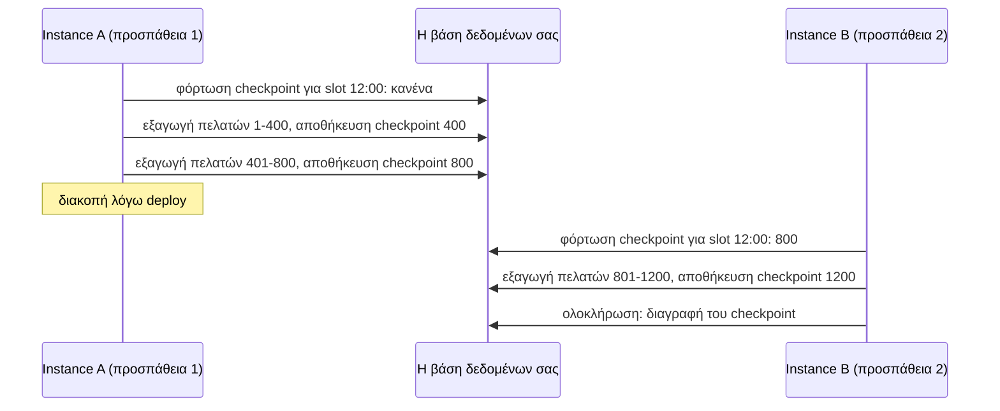

Μια εργασία που εκτελείται για μεγάλο χρονικό διάστημα είναι πιο πιθανό να διακοπεί από ένα deploy, μια κατάρρευση ή ένα timeout. Αυτή η συνταγή δείχνει πώς μια τέτοια εργασία μπορεί να σταματήσει γρήγορα, και να συνεχίσει από εκεί που σταμάτησε αντί να ξεκινά από την αρχή.

## Το σημείο εκκίνησης

```ts
scheduler.every('export', '1h', async (ctx) => {
  for (const customer of await allCustomers()) {
    await exportCustomer(customer);
  }
});
```

Προβλήματα:

1. Αγνοεί το `ctx.signal`. Ένα deploy πρέπει να περιμένει ολόκληρη την εξαγωγή ή να τη σκοτώσει (kill).
2. Εάν παγώσει (hangs), μπλοκάρει κάθε μετέπειτα εκτέλεση για πάντα.
3. Μετά από μια ανάληψη (takeover), η προσπάθεια 2 εξάγει τα πάντα ξανά.

## Βήμα 1: διακοπή όταν ζητηθεί

```ts
scheduler.every('export', '1h', async (ctx) => {
  for (const customer of await allCustomers()) {
    ctx.signal.throwIfAborted();
    await exportCustomer(customer, { signal: ctx.signal });
  }
});
```

Τώρα ένα deploy διακόπτει την εργασία μεταξύ δύο πελατών, και η εκτέλεση παραδίδεται (hand-over) σε άλλο instance.

## Βήμα 2: ένα χρονικό όριο (timeout)

Με `overlap: 'skip'`, μια εκτέλεση που δεν τελειώνει ποτέ μπλοκάρει την εργασία. Ορίστε ένα ανώτατο όριο:

```ts
scheduler.every('export', '1h', handler, { timeoutMs: 50 * 60_000 });
```

Όταν παρέλθει το χρονικό όριο, το `ctx.signal` ακυρώνεται και η εκτέλεση καταγράφεται ως αποτυχημένη. Επειδή ο handler ελέγχει το σήμα, σταματά πράγματι.

## Βήμα 3: σημεία ελέγχου (checkpoints)

Το anarchon επανεκκινεί μια διακοπείσα εκτέλεση από την αρχή του handler. Για να συνεχίσει από τη μέση, η ίδια η **εργασία** πρέπει να θυμάται την πρόοδό της. Το `ctx.slot` είναι το κλειδί: είναι το ίδιο σε κάθε προσπάθεια της ίδιας εκτέλεσης.



```ts
scheduler.every(
  'export',
  '1h',
  async (ctx) => {
    // Πρόοδος ΑΥΤΗΣ της εκτέλεσης. Η προσπάθεια 2 βρίσκει ό,τι αποθήκευσε η προσπάθεια 1.
    let after = (await checkpoints.get('export', ctx.slot)) ?? 0;

    for (;;) {
      ctx.signal.throwIfAborted();
      const batch = await customersAfter(after, 200);
      if (batch.length === 0) break;

      await exportBatch(batch, { signal: ctx.signal });

      after = batch[batch.length - 1].id;
      await checkpoints.set('export', ctx.slot, after);
    }

    await checkpoints.delete('export', ctx.slot);
  },
  { timeoutMs: 50 * 60_000 },
);
```

Ένας πίνακας checkpoints μπορεί να είναι τόσο απλός όσο αυτός:

```sql
CREATE TABLE job_checkpoints (
  job TEXT NOT NULL,
  slot BIGINT NOT NULL,
  position BIGINT NOT NULL,
  PRIMARY KEY (job, slot)
);
```

### Κάντε κάθε παρτίδα idempotent

Μια παρτίδα μπορεί να εξαχθεί και το instance να καταρρεύσει πριν αποθηκευτεί το checkpoint. Η επόμενη προσπάθεια τότε επαναλαμβάνει αυτή την παρτίδα. Επομένως, η ίδια η παρτίδα πρέπει να είναι ασφαλής για επανάληψη:

```ts
async function exportBatch(batch: Customer[]) {
  for (const customer of batch) {
    await warehouse.upsert('customers', { id: customer.id, ...customer }); // upsert, όχι insert
  }
}
```

## Βήμα 4: διάκριση των προσπαθειών

```ts
if (ctx.attempt > 1) {
  logger.warn(`export ${ctx.scheduledAt.toISOString()}: attempt ${ctx.attempt}, continuing after ${after}`);
}
```

## Χρονισμός μίσθωσης για μακροχρόνιες εργασίες

Η μίσθωση δεν έχει καμία σχέση με το πόση ώρα εκτελείται η εργασία. Μια εργασία μπορεί να εκτελείται για ώρες με μίσθωση 30 δευτερολέπτων, επειδή η μίσθωση ανανεώνεται κάθε λίγα δευτερόλεπτα όσο ο handler παραμένει ενεργός.

Αυτό που έχει σημασία είναι το event loop να συνεχίζει να περιστρέφεται. Το heartbeat είναι ένα χρονόμετρο (timer)· ένας handler που μπλοκάρει το νήμα για διάστημα μεγαλύτερο από το `leaseMs` διακόπτει τα δικά του heartbeats και χάνει την εκτέλεση.

```ts
// Μπλοκάρει το νήμα: κανένα heartbeat δεν μπορεί να σταλεί όσο εκτελείται αυτό
const result = hugeArray.map(expensiveSyncComputation);
```

Για βαριές εργασίες CPU:

- σπάστε την σε κομμάτια και παραχωρήστε έλεγχο (yield) ενδιάμεσα (`await new Promise(setImmediate)`), ή
- μεταφέρετέ την σε ένα worker thread και κάντε `await` το αποτέλεσμά της, ή
- αυξήστε το `leaseMs` πάνω από το μεγαλύτερο διάστημα μπλοκαρίσματος.

## Εργασίες με διάρκεια μεγαλύτερη από το διάστημά τους

Αν η εργασία "export" διαρκεί 90 λεπτά και εκτελείται κάθε ώρα, κάθε δεύτερη εκτέλεση παραλείπεται λόγω αλληλεπικάλυψης (overlap). Αυτό είναι σωστό, αλλά συνήθως αποτελεί ένδειξη ότι το πρόγραμμα πρέπει να αλλάξει:

| Κατάσταση | Επιλογή |
| --- | --- |
| Η εργασία περιστασιακά υπερβαίνει το χρόνο | Διατηρήστε `overlap: 'skip'`· μια περιστασιακά παραλειπόμενη εκτέλεση είναι εντάξει |
| Η εργασία υπερβαίνει πάντα το χρόνο | Επιμηκύνετε το διάστημα |
| Κάθε εκτέλεση καλύπτει το δικό της χρονικό παράθυρο και δεν πρέπει να παραλειφθεί | `overlap: 'allow'`, με κάθε εκτέλεση να λειτουργεί στο παράθυρο του `ctx.slot` |

## Επόμενα βήματα

- [Συγγραφή handlers](../../guides/writing-handlers/)
- [Μισθώσεις](../../internals/leases/)
