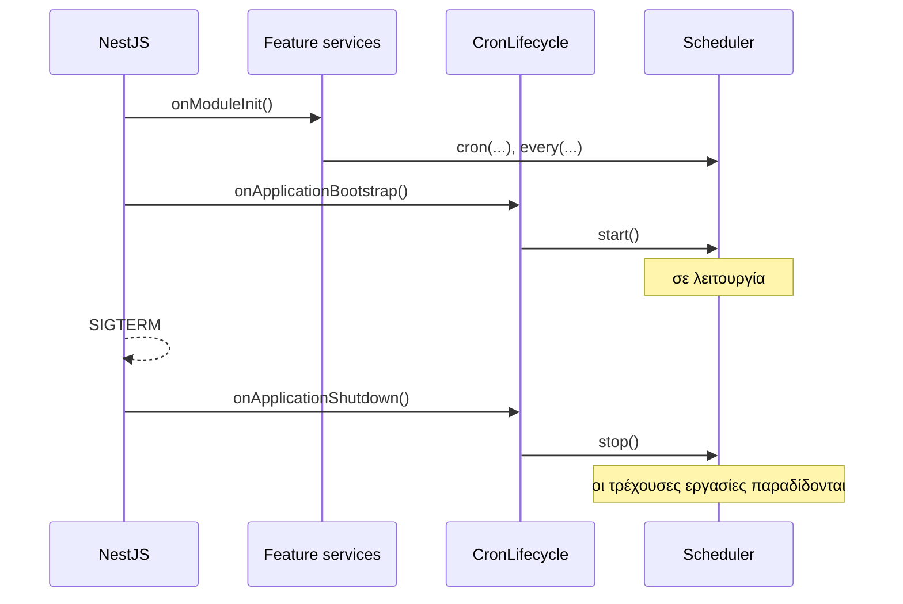

Στο NestJS ο scheduler εντάσσεται φυσικά ως provider. Ένα module τον δημιουργεί και τον συνδέει με τον κύκλο ζωής της εφαρμογής· τα feature services τον κάνουν inject και καταχωρούν τις δικές τους εργασίες.

:::note
Το `@nestjs/schedule` εκτελεί κάθε μέθοδο `@Cron()` σε **κάθε** instance. Το anarchon είναι αυτό που χρειάζεστε όταν η εφαρμογή εκτελείται σε περισσότερα από ένα instances και μια εργασία πρέπει να εκτελείται μία φορά.
:::

Μια εκτελέσιμη εφαρμογή NestJS βρίσκεται στο repository ως [`examples/nestjs`](https://github.com/aristoteliss/anarchon/tree/main/examples/nestjs), ελεγμένη σε NestJS 11 και 12. Δείτε [Δήλωση εργασιών με decorators](#δήλωση-εργασιών-με-decorators).

## Το module

```ts
// cron/cron.module.ts
import { Global, Injectable, Module, type OnApplicationBootstrap, type OnApplicationShutdown } from '@nestjs/common';
import { ConfigService } from '@nestjs/config';
import { RedisBackend, Scheduler } from 'anarchon';

/** Ξεκινά τον scheduler όταν η εφαρμογή είναι έτοιμη, και τον σταματά όταν η εφαρμογή τερματίζει. */
@Injectable()
class CronLifecycle implements OnApplicationBootstrap, OnApplicationShutdown {
  constructor(private readonly scheduler: Scheduler) {}

  async onApplicationBootstrap(): Promise<void> {
    await this.scheduler.start();
  }

  async onApplicationShutdown(): Promise<void> {
    await this.scheduler.stop({ timeoutMs: 20_000 });
  }
}

@Global()
@Module({
  providers: [
    {
      provide: Scheduler,
      inject: [ConfigService],
      useFactory: (config: ConfigService) =>
        new Scheduler({
          backend: new RedisBackend({ redis: config.getOrThrow<string>('REDIS_URL'), prefix: 'billing:cron:' }),
          instanceId: config.get<string>('POD_NAME'),
          timezone: 'Europe/Athens',
        }),
    },
    CronLifecycle,
  ],
  exports: [Scheduler],
})
export class CronModule {}
```

## Καταχώριση εργασιών σε ένα feature service

Καταχωρίστε τις εργασίες στο `onModuleInit`. Το NestJS το καλεί σε κάθε provider πριν από το `onApplicationBootstrap`, επομένως όλες οι εργασίες υπάρχουν ήδη τη στιγμή που ξεκινά ο scheduler.

```ts
// invoices/invoices.service.ts
import { Injectable, Logger, type OnModuleInit } from '@nestjs/common';
import { type JobContext, Scheduler } from 'anarchon';

@Injectable()
export class InvoicesService implements OnModuleInit {
  private readonly logger = new Logger(InvoicesService.name);

  constructor(private readonly scheduler: Scheduler) {}

  onModuleInit(): void {
    this.scheduler.cron('monthly-invoices', '0 6 1 * *', (ctx) => this.buildInvoices(ctx), {
      timeoutMs: 30 * 60_000,
      catchUpMs: 6 * 60 * 60_000,
    });
  }

  private async buildInvoices(ctx: JobContext): Promise<void> {
    this.logger.log(`building invoices for ${ctx.scheduledAt.toISOString()} (attempt ${ctx.attempt})`);
    for (const customer of await this.customers()) {
      ctx.signal.throwIfAborted();
      await this.createInvoice(customer, ctx.slot); // idempotent για (customer, slot)
    }
  }

  // ...
}
```

Χρησιμοποιήστε μια συνάρτηση-βέλος (arrow function), όπως παραπάνω, ώστε το `this` να παραμένει το service μέσα στον handler.

## Δήλωση εργασιών με decorators

Ένας provider μπορεί να δηλώσει τις εργασίες του με τους [decorators](../../guides/decorators/) του anarchon, αντί να καλεί τα `cron()` και `every()`. Κάθε εργασία καλεί τη μέθοδό της πάνω στον provider, οπότε δεν χρειάζεται συνάρτηση-βέλος.

Το NestJS κάνει compile με legacy decorators (`experimentalDecorators`). Σε αυτό το στυλ ένας decorator μεθόδου δεν μπορεί να ενεργήσει όταν δημιουργείται ο provider, οπότε ο provider φέρνει τις εργασίες του στον scheduler με έναν από δύο τρόπους.

**Με το `@Scheduled()`.** Ο provider προσθέτει τις εργασίες του όταν τον δημιουργεί το Nest, και δεν χρειάζεται να του γίνει inject ο scheduler:

```ts
// reports/reports.service.ts
import { Injectable } from '@nestjs/common';
import { Every, type JobContext, Scheduled } from 'anarchon';

@Injectable()
@Scheduled()
export class ReportsService {
  constructor(private readonly mailer: MailerService) {}

  @Every('sync-reports', '10s', { timeoutMs: 8_000 })
  async sync(ctx: JobContext): Promise<void> {
    // ...
  }
}
```

**Με το `register(this)`.** Ο provider καταχωρίζει τον εαυτό του στο `onModuleInit`:

```ts
// invoices/invoices.service.ts
import { Injectable, type OnModuleInit } from '@nestjs/common';
import { Cron, type JobContext, Scheduler } from 'anarchon';

@Injectable()
export class InvoicesService implements OnModuleInit {
  constructor(private readonly scheduler: Scheduler) {}

  onModuleInit(): void {
    this.scheduler.register(this);
  }

  @Cron('monthly-invoices', '0 6 1 * *', { timeoutMs: 30 * 60_000, catchUpMs: 6 * 60 * 60_000 })
  async buildInvoices(ctx: JobContext): Promise<void> {
    // ...
  }
}
```

| | `@Scheduled()` | `register(this)` |
| --- | --- | --- |
| Ο provider χρειάζεται inject του `Scheduler` | Όχι | Ναι |
| Ο scheduler που παίρνει τις εργασίες | Ο προεπιλεγμένος: ο πρώτος scheduler που δημιουργείται | Αυτός που κάνετε inject |
| Η κλάση που βλέπει το Nest | Μια υποκλάση με το ίδιο όνομα | Η κλάση όπως τη γράψατε |

Και οι δύο τρόποι εκτελούνται στην εφαρμογή-παράδειγμα του repository, [`examples/nestjs`](https://github.com/aristoteliss/anarchon/tree/main/examples/nestjs), και ο έλεγχός της περνά σε NestJS 11 και 12. Το anarchon δεν έχει κώδικα ειδικό για το NestJS και δεν χρειάζεται πακέτο προσαρμογής: η εφαρμογή χρησιμοποιεί μόνο το δημόσιο API. Το constructor injection λειτουργεί με το `@Scheduled()` πάνω ή κάτω από το `@Injectable()`.

| Εντολή | Τι κάνει |
| --- | --- |
| `pnpm --filter anarchon-example-nestjs start` | Εκτελεί την εφαρμογή με το εγκατεστημένο NestJS (12) |
| `pnpm --filter anarchon-example-nestjs start:nest11` | Εκτελεί τον ίδιο κώδικα με NestJS 11 |
| `pnpm --filter anarchon-example-nestjs test` | Ελέγχει την εφαρμογή και στις δύο εκδόσεις |

Τι να γνωρίζετε:

- **Η σειρά δημιουργίας δεν έχει σημασία.** Το Nest μπορεί να δημιουργήσει έναν provider πριν από τον scheduler. Οι εργασίες του προστίθενται τότε όταν ξεκινά ο scheduler, στο `onApplicationBootstrap`.
- **Αν ξεχάσετε και τα δύο, αναφέρεται.** Ένας provider χωρίς `@Scheduled()` και χωρίς `register(this)` δεν προσθέτει εργασίες, και ο scheduler προειδοποιεί όταν ξεκινά:

  ```
  [anarchon] @Every "sync-reports" on ReportsService.sync is not scheduled: with legacy decorators, add @Scheduled() to the class or call scheduler.register(object)
  ```

- **Μόνο singleton providers.** Κάθε αντικείμενο μιας κλάσης με decorators προσθέτει τις ίδιες εργασίες, οπότε ένα δεύτερο ρίχνει `Job "..." is already registered`. Μην βάζετε decorators σε request-scoped ή transient providers.
- **Εισαγάγετε τις κλάσεις που γίνονται inject ως τιμές.** Το Nest διαβάζει τους τύπους των παραμέτρων του constructor κατά τον χρόνο εκτέλεσης. Ένας κανόνας lint που μετατρέπει το `import { Scheduler }` σε `import type { Scheduler }` χαλάει το injection.

:::caution[Εισαγάγετε το `Cron` από το `anarchon`]
Το `@nestjs/schedule` εξάγει έναν decorator με το ίδιο όνομα, και εκείνος εκτελεί τη μέθοδο σε κάθε instance.
:::

## Ενεργοποίηση shutdown hooks

Το NestJS καλεί το `onApplicationShutdown` μόνο εάν είναι ενεργοποιημένα τα shutdown hooks. Χωρίς αυτή τη γραμμή, το `SIGTERM` τερματίζει τη διεργασία χωρίς παράδοση των τρεχουσών εργασιών (hand-over):

```ts
// main.ts
import { NestFactory } from '@nestjs/core';
import { AppModule } from './app.module';

async function bootstrap() {
  const app = await NestFactory.create(AppModule);
  app.enableShutdownHooks();
  await app.listen(3000);
}
bootstrap();
```

## Ο κύκλος ζωής, με τη σειρά



## Καταγραφή (logging) μέσω του Nest

```ts
import { Logger } from '@nestjs/common';

const logger = new Logger('Cron');

new Scheduler({
  backend,
  log: true,
  logger: {
    info: (message) => logger.log(message),
    warn: (message) => logger.warn(message),
    error: (message) => logger.error(message),
  },
});
```

## Συμβάντα (events) ως providers

Για ειδοποιήσεις (alerts) και μετρικές, εγγραφείτε σε ένα δικό του service:

```ts
@Injectable()
export class CronAlerts implements OnModuleInit {
  constructor(
    private readonly scheduler: Scheduler,
    private readonly alerts: AlertsService,
  ) {}

  onModuleInit(): void {
    this.scheduler.on('failure', (run) => {
      void this.alerts.send(`${run.job} failed on ${run.instanceId}: ${run.error}`);
    });
  }
}
```

## Ένας admin controller

```ts
import { Controller, Get, Param, Post, Query, UseGuards } from '@nestjs/common';
import { Scheduler } from 'anarchon';

@Controller('jobs')
@UseGuards(AdminGuard)
export class JobsController {
  constructor(private readonly scheduler: Scheduler) {}

  @Get()
  list() {
    return this.scheduler.jobs();
  }

  @Get(':name/runs')
  runs(@Param('name') name: string, @Query('limit') limit = '20') {
    return this.scheduler.history(name, Number(limit));
  }

  @Post(':name/run')
  run(@Param('name') name: string) {
    return this.scheduler.runNow(name);
  }
}
```

## Με PostgreSQL και TypeORM ή Prisma

Εάν η εφαρμογή δεν διαθέτει Redis, χρησιμοποιήστε τη βάση δεδομένων που ήδη έχει. Δώστε στο anarchon το δικό του μικρό connection pool αντί να μοιράζεστε τη σύνδεση του ORM:

```ts
import { PostgresBackend, Scheduler } from 'anarchon';

{
  provide: Scheduler,
  inject: [ConfigService],
  useFactory: (config: ConfigService) =>
    new Scheduler({
      backend: new PostgresBackend({
        connection: config.getOrThrow<string>('DATABASE_URL'),
        table: 'jobs.cron_runs',
      }),
    }),
}
```

## Επόμενα βήματα

- [Rolling deploys στο Kubernetes](../kubernetes/)
- [Συγγραφή handlers](../../guides/writing-handlers/)
