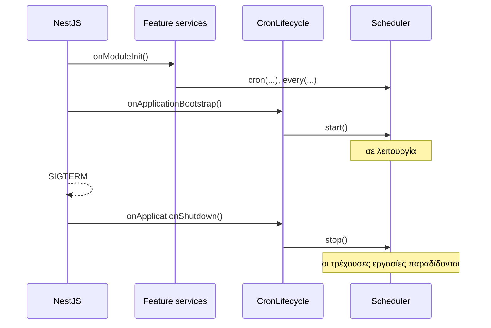

Στο NestJS ο scheduler εντάσσεται φυσικά ως provider. Ένα module τον δημιουργεί και τον συνδέει με τον κύκλο ζωής της εφαρμογής· τα feature services τον κάνουν inject και καταχωρούν τις δικές τους εργασίες.

:::note
Το `@nestjs/schedule` εκτελεί κάθε μέθοδο `@Cron()` σε **κάθε** instance. Το anarchon είναι αυτό που χρειάζεστε όταν η εφαρμογή εκτελείται σε περισσότερα από ένα instances και μια εργασία πρέπει να εκτελείται μία φορά.
:::

## Το module

```ts
// cron/cron.module.ts
import { Global, Injectable, Module, type OnApplicationBootstrap, type OnApplicationShutdown } from '@nestjs/common';
import { ConfigService } from '@nestjs/config';
import { Scheduler } from 'anarchon';

/** Ξεκινά τον scheduler όταν η εφαρμογή είναι έτοιμη, και τον σταματά όταν η εφαρμογή τερματίζει. */
@Injectable()
class CronLifecycle implements OnApplicationBootstrap, OnApplicationShutdown {
  constructor(private readonly scheduler: Scheduler) {}

  async onApplicationBootstrap(): Promise<void> {
    await this.scheduler.start();
  }

  async onApplicationShutdown(): Promise<void> {
    await this.scheduler.stop({ timeoutMs: 20_000 });
  }
}

@Global()
@Module({
  providers: [
    {
      provide: Scheduler,
      inject: [ConfigService],
      useFactory: (config: ConfigService) =>
        new Scheduler({
          redis: config.getOrThrow<string>('REDIS_URL'),
          prefix: 'billing:cron:',
          instanceId: config.get<string>('POD_NAME'),
          timezone: 'Europe/Athens',
        }),
    },
    CronLifecycle,
  ],
  exports: [Scheduler],
})
export class CronModule {}
```

## Καταχώριση εργασιών σε ένα feature service

Καταχωρίστε τις εργασίες στο `onModuleInit`. Το NestJS το καλεί σε κάθε provider πριν από το `onApplicationBootstrap`, επομένως όλες οι εργασίες υπάρχουν ήδη τη στιγμή που ξεκινά ο scheduler.

```ts
// invoices/invoices.service.ts
import { Injectable, Logger, type OnModuleInit } from '@nestjs/common';
import { type JobContext, Scheduler } from 'anarchon';

@Injectable()
export class InvoicesService implements OnModuleInit {
  private readonly logger = new Logger(InvoicesService.name);

  constructor(private readonly scheduler: Scheduler) {}

  onModuleInit(): void {
    this.scheduler.cron('monthly-invoices', '0 6 1 * *', (ctx) => this.buildInvoices(ctx), {
      timeoutMs: 30 * 60_000,
      catchUpMs: 6 * 60 * 60_000,
    });
  }

  private async buildInvoices(ctx: JobContext): Promise<void> {
    this.logger.log(`building invoices for ${ctx.scheduledAt.toISOString()} (attempt ${ctx.attempt})`);
    for (const customer of await this.customers()) {
      ctx.signal.throwIfAborted();
      await this.createInvoice(customer, ctx.slot); // idempotent για (customer, slot)
    }
  }

  // ...
}
```

Χρησιμοποιήστε μια συνάρτηση-βέλος (arrow function), όπως παραπάνω, ώστε το `this` να παραμένει το service μέσα στον handler.

## Ενεργοποίηση shutdown hooks

Το NestJS καλεί το `onApplicationShutdown` μόνο εάν είναι ενεργοποιημένα τα shutdown hooks. Χωρίς αυτή τη γραμμή, το `SIGTERM` τερματίζει τη διεργασία χωρίς παράδοση των τρεχουσών εργασιών (hand-over):

```ts
// main.ts
import { NestFactory } from '@nestjs/core';
import { AppModule } from './app.module';

async function bootstrap() {
  const app = await NestFactory.create(AppModule);
  app.enableShutdownHooks();
  await app.listen(3000);
}
bootstrap();
```

## Ο κύκλος ζωής, με τη σειρά



## Καταγραφή (logging) μέσω του Nest

```ts
import { Logger } from '@nestjs/common';

const logger = new Logger('Cron');

new Scheduler({
  redis: config.getOrThrow<string>('REDIS_URL'),
  log: true,
  logger: {
    info: (message) => logger.log(message),
    warn: (message) => logger.warn(message),
    error: (message) => logger.error(message),
  },
});
```

## Συμβάντα (events) ως providers

Για ειδοποιήσεις (alerts) και μετρικές, εγγραφείτε σε ένα δικό του service:

```ts
@Injectable()
export class CronAlerts implements OnModuleInit {
  constructor(
    private readonly scheduler: Scheduler,
    private readonly alerts: AlertsService,
  ) {}

  onModuleInit(): void {
    this.scheduler.on('failure', (run) => {
      void this.alerts.send(`${run.job} failed on ${run.instanceId}: ${run.error}`);
    });
  }
}
```

## Ένας admin controller

```ts
import { Controller, Get, Param, Post, Query, UseGuards } from '@nestjs/common';
import { Scheduler } from 'anarchon';

@Controller('jobs')
@UseGuards(AdminGuard)
export class JobsController {
  constructor(private readonly scheduler: Scheduler) {}

  @Get()
  list() {
    return this.scheduler.jobs();
  }

  @Get(':name/runs')
  runs(@Param('name') name: string, @Query('limit') limit = '20') {
    return this.scheduler.history(name, Number(limit));
  }

  @Post(':name/run')
  run(@Param('name') name: string) {
    return this.scheduler.runNow(name);
  }
}
```

## Με PostgreSQL και TypeORM ή Prisma

Εάν η εφαρμογή δεν διαθέτει Redis, χρησιμοποιήστε τη βάση δεδομένων που ήδη έχει. Δώστε στο anarchon το δικό του μικρό connection pool αντί να μοιράζεστε τη σύνδεση του ORM:

```ts
import { PostgresBackend, Scheduler } from 'anarchon';

{
  provide: Scheduler,
  inject: [ConfigService],
  useFactory: (config: ConfigService) =>
    new Scheduler({
      backend: new PostgresBackend({
        connection: config.getOrThrow<string>('DATABASE_URL'),
        table: 'jobs.cron_runs',
      }),
    }),
}
```

## Επόμενα βήματα

- [Rolling deploys στο Kubernetes](../kubernetes/)
- [Συγγραφή handlers](../../guides/writing-handlers/)
