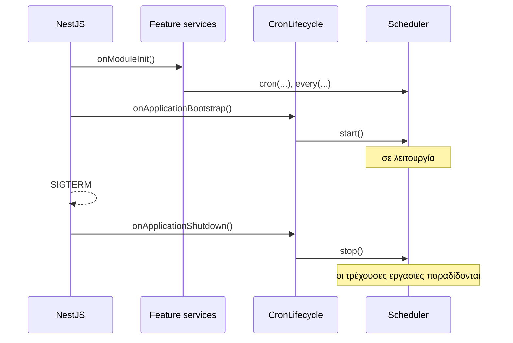

Στο NestJS ο scheduler εντάσσεται φυσικά ως provider. Ένα module τον δημιουργεί και τον συνδέει με τον κύκλο ζωής της εφαρμογής· τα feature services τον κάνουν inject και καταχωρούν τις δικές τους εργασίες.

:::note
Το `@nestjs/schedule` εκτελεί κάθε μέθοδο `@Cron()` σε **κάθε** instance. Το anarchon είναι αυτό που χρειάζεστε όταν η εφαρμογή εκτελείται σε περισσότερα από ένα instances και μια εργασία πρέπει να εκτελείται μία φορά.
:::

Μια εκτελέσιμη εφαρμογή NestJS βρίσκεται στο repository ως [`examples/nestjs`](https://github.com/aristoteliss/anarchon/tree/main/examples/nestjs), ελεγμένη σε NestJS 11 και 12. Δείτε [Δήλωση εργασιών με decorators](#δήλωση-εργασιών-με-decorators).

## Το module

```ts
// cron/cron.module.ts
import { Global, Injectable, Module, type OnApplicationBootstrap, type OnApplicationShutdown } from '@nestjs/common';
import { ConfigService } from '@nestjs/config';
import { RedisBackend, Scheduler } from 'anarchon';

/** Ξεκινά τον scheduler όταν η εφαρμογή είναι έτοιμη, και τον σταματά όταν η εφαρμογή τερματίζει. */
@Injectable()
class CronLifecycle implements OnApplicationBootstrap, OnApplicationShutdown {
  constructor(private readonly scheduler: Scheduler) {}

  async onApplicationBootstrap(): Promise<void> {
    await this.scheduler.start();
  }

  async onApplicationShutdown(): Promise<void> {
    await this.scheduler.stop({ timeoutMs: 20_000 });
  }
}

@Global()
@Module({
  providers: [
    {
      provide: Scheduler,
      inject: [ConfigService],
      useFactory: (config: ConfigService) =>
        new Scheduler({
          backend: new RedisBackend({ redis: config.getOrThrow<string>('REDIS_URL'), prefix: 'billing:cron:' }),
          instanceId: config.get<string>('POD_NAME'),
          timezone: 'Europe/Athens',
        }),
    },
    CronLifecycle,
  ],
  exports: [Scheduler],
})
export class CronModule {}
```

## Καταχώριση εργασιών σε ένα feature service

Καταχωρίστε τις εργασίες στο `onModuleInit`. Το NestJS το καλεί σε κάθε provider πριν από το `onApplicationBootstrap`, επομένως όλες οι εργασίες υπάρχουν ήδη τη στιγμή που ξεκινά ο scheduler.

```ts
// invoices/invoices.service.ts
import { Injectable, Logger, type OnModuleInit } from '@nestjs/common';
import { type JobContext, Scheduler } from 'anarchon';

@Injectable()
export class InvoicesService implements OnModuleInit {
  private readonly logger = new Logger(InvoicesService.name);

  constructor(private readonly scheduler: Scheduler) {}

  onModuleInit(): void {
    this.scheduler.cron('monthly-invoices', '0 6 1 * *', (ctx) => this.buildInvoices(ctx), {
      timeoutMs: 30 * 60_000,
      catchUpMs: 6 * 60 * 60_000,
    });
  }

  private async buildInvoices(ctx: JobContext): Promise<void> {
    this.logger.log(`building invoices for ${ctx.scheduledAt.toISOString()} (attempt ${ctx.attempt})`);
    for (const customer of await this.customers()) {
      ctx.signal.throwIfAborted();
      await this.createInvoice(customer, ctx.slot); // idempotent για (customer, slot)
    }
  }

  // ...
}
```

Χρησιμοποιήστε μια συνάρτηση-βέλος (arrow function), όπως παραπάνω, ώστε το `this` να παραμένει το service μέσα στον handler.

## Δήλωση εργασιών με decorators

Ένας provider μπορεί να δηλώσει τις εργασίες του με τους [decorators](../../guides/decorators/) του anarchon, αντί να καλεί τα `cron()` και `every()`. Κάθε εργασία καλεί τη μέθοδό της πάνω στον provider, οπότε δεν χρειάζεται συνάρτηση-βέλος.

Το NestJS κάνει compile με legacy decorators (`experimentalDecorators`). Σε αυτό το στυλ ένας decorator μεθόδου δεν μπορεί να ενεργήσει όταν δημιουργείται ο provider, οπότε ο provider φέρνει τις εργασίες του στον scheduler με έναν από δύο τρόπους.

**Με το `@Scheduled()`.** Ο provider προσθέτει τις εργασίες του όταν τον δημιουργεί το Nest, και δεν χρειάζεται να του γίνει inject ο scheduler:

```ts
// reports/reports.service.ts
import { Injectable } from '@nestjs/common';
import { Every, type JobContext, Scheduled } from 'anarchon';

@Injectable()
@Scheduled()
export class ReportsService {
  constructor(private readonly mailer: MailerService) {}

  @Every('sync-reports', '10s', { timeoutMs: 8_000 })
  async sync(ctx: JobContext): Promise<void> {
    // ...
  }
}
```

**Με το `register(this)`.** Ο provider καταχωρίζει τον εαυτό του στο `onModuleInit`:

```ts
// invoices/invoices.service.ts
import { Injectable, type OnModuleInit } from '@nestjs/common';
import { Cron, type JobContext, Scheduler } from 'anarchon';

@Injectable()
export class InvoicesService implements OnModuleInit {
  constructor(private readonly scheduler: Scheduler) {}

  onModuleInit(): void {
    this.scheduler.register(this);
  }

  @Cron('monthly-invoices', '0 6 1 * *', { timeoutMs: 30 * 60_000, catchUpMs: 6 * 60 * 60_000 })
  async buildInvoices(ctx: JobContext): Promise<void> {
    // ...
  }
}
```

| | `@Scheduled()` | `register(this)` |
| --- | --- | --- |
| Ο provider χρειάζεται inject του `Scheduler` | Όχι | Ναι |
| Ο scheduler που παίρνει τις εργασίες | Ο προεπιλεγμένος: ο πρώτος scheduler που δημιουργείται | Αυτός που κάνετε inject |
| Η κλάση που βλέπει το Nest | Μια υποκλάση με το ίδιο όνομα | Η κλάση όπως τη γράψατε |

Και οι δύο τρόποι εκτελούνται στην εφαρμογή-παράδειγμα του repository, [`examples/nestjs`](https://github.com/aristoteliss/anarchon/tree/main/examples/nestjs), και ο έλεγχός της περνά σε NestJS 11 και 12. Το anarchon δεν έχει κώδικα ειδικό για το NestJS και δεν χρειάζεται πακέτο προσαρμογής: η εφαρμογή χρησιμοποιεί μόνο το δημόσιο API. Το constructor injection λειτουργεί με το `@Scheduled()` πάνω ή κάτω από το `@Injectable()`.

| Εντολή | Τι κάνει |
| --- | --- |
| `pnpm --filter anarchon-example-nestjs start` | Εκτελεί την εφαρμογή με το εγκατεστημένο NestJS (12) |
| `pnpm --filter anarchon-example-nestjs start:nest11` | Εκτελεί τον ίδιο κώδικα με NestJS 11 |
| `pnpm --filter anarchon-example-nestjs test` | Ελέγχει την εφαρμογή και στις δύο εκδόσεις |

Τι να γνωρίζετε:

- **Η σειρά δημιουργίας δεν έχει σημασία.** Το Nest μπορεί να δημιουργήσει έναν provider πριν από τον scheduler. Οι εργασίες του προστίθενται τότε όταν ξεκινά ο scheduler, στο `onApplicationBootstrap`.
- **Αν ξεχάσετε και τα δύο, αναφέρεται.** Ένας provider χωρίς `@Scheduled()` και χωρίς `register(this)` δεν προσθέτει εργασίες, και ο scheduler προειδοποιεί όταν ξεκινά:

  ```
  [anarchon] @Every "sync-reports" on ReportsService.sync is not scheduled: with legacy decorators, add @Scheduled() to the class or call scheduler.register(object)
  ```

- **Μόνο singleton providers.** Κάθε αντικείμενο μιας κλάσης με decorators προσθέτει τις ίδιες εργασίες, οπότε ένα δεύτερο ρίχνει `Job "..." is already registered`. Μην βάζετε decorators σε request-scoped ή transient providers.
- **Εισαγάγετε τις κλάσεις που γίνονται inject ως τιμές.** Το Nest διαβάζει τους τύπους των παραμέτρων του constructor κατά τον χρόνο εκτέλεσης. Ένας κανόνας lint που μετατρέπει το `import { Scheduler }` σε `import type { Scheduler }` χαλάει το injection.

:::caution[Εισαγάγετε το `Cron` από το `anarchon`]
Το `@nestjs/schedule` εξάγει έναν decorator με το ίδιο όνομα, και εκείνος εκτελεί τη μέθοδο σε κάθε instance.
:::

## Ενεργοποίηση shutdown hooks

Το NestJS καλεί το `onApplicationShutdown` μόνο εάν είναι ενεργοποιημένα τα shutdown hooks. Χωρίς αυτή τη γραμμή, το `SIGTERM` τερματίζει τη διεργασία χωρίς παράδοση των τρεχουσών εργασιών (hand-over):

```ts
// main.ts
import { NestFactory } from '@nestjs/core';
import { AppModule } from './app.module';

async function bootstrap() {
  const app = await NestFactory.create(AppModule);
  app.enableShutdownHooks();
  await app.listen(3000);
}
bootstrap();
```

## Ο κύκλος ζωής, με τη σειρά



## Καταγραφή (logging) μέσω του Nest

```ts
import { Logger } from '@nestjs/common';

const logger = new Logger('Cron');

new Scheduler({
  backend,
  log: true,
  logger: {
    info: (message) => logger.log(message),
    warn: (message) => logger.warn(message),
    error: (message) => logger.error(message),
  },
});
```

## Συμβάντα (events) ως providers

Για ειδοποιήσεις (alerts) και μετρικές, εγγραφείτε σε ένα δικό του service:

```ts
@Injectable()
export class CronAlerts implements OnModuleInit {
  constructor(
    private readonly scheduler: Scheduler,
    private readonly alerts: AlertsService,
  ) {}

  onModuleInit(): void {
    this.scheduler.on('failure', (run) => {
      void this.alerts.send(`${run.job} failed on ${run.instanceId}: ${run.error}`);
    });
  }
}
```

## Ένας admin controller

```ts
import { Controller, Get, Param, Post, Query, UseGuards } from '@nestjs/common';
import { Scheduler } from 'anarchon';

@Controller('jobs')
@UseGuards(AdminGuard)
export class JobsController {
  constructor(private readonly scheduler: Scheduler) {}

  @Get()
  list() {
    return this.scheduler.jobs();
  }

  @Get(':name/runs')
  runs(@Param('name') name: string, @Query('limit') limit = '20') {
    return this.scheduler.history(name, Number(limit));
  }

  @Post(':name/run')
  run(@Param('name') name: string) {
    return this.scheduler.runNow(name);
  }
}
```

## Με PostgreSQL και TypeORM ή Prisma

Εάν η εφαρμογή δεν διαθέτει Redis, χρησιμοποιήστε τη βάση δεδομένων που ήδη έχει. Δώστε στο anarchon το δικό του μικρό connection pool αντί να μοιράζεστε τη σύνδεση του ORM:

```ts
import { PostgresBackend, Scheduler } from 'anarchon';

{
  provide: Scheduler,
  inject: [ConfigService],
  useFactory: (config: ConfigService) =>
    new Scheduler({
      backend: new PostgresBackend({
        connection: config.getOrThrow<string>('DATABASE_URL'),
        table: 'jobs.cron_runs',
      }),
    }),
}
```

## Σύγκριση με το @nestjs/locks

Το `@nestjs/locks` είναι το πακέτο του NestJS για κατανεμημένα locks: locks με μίσθωση και fencing tokens, εκλογή leader, και τα `@OnOneInstance()` και `@WithoutOverlapping()` για εργασίες του `@nestjs/schedule`. Λύνει ένα ευρύτερο πρόβλημα από το anarchon, με διαφορετικές σχεδιαστικές επιλογές για τις προγραμματισμένες εργασίες. Όσα λέει αυτή η ενότητα γι' αυτό ελέγχθηκαν στις **24 Οκτωβρίου 2026** με την έκδοση 0.0.4.

Το anarchon λειτουργεί με έναν από δύο τρόπους, ανάλογα με το backend. Ένα backend μίσθωσης (Redis ή Valkey με την προεπιλεγμένη στρατηγική `lease`, PostgreSQL, SQLite) ανανεώνει μια μίσθωση όσο διαρκεί μια εκτέλεση· ένα backend μόνο διεκδίκησης κάνει μία ατομική διεκδίκηση ανά εκτέλεση και τίποτα άλλο.

| Δυνατότητα | anarchon, backend μίσθωσης | anarchon, μόνο διεκδίκηση | `@nestjs/locks` |
| --- | --- | --- | --- |
| Κύριο αντικείμενο | Ένας κατανεμημένος scheduler εργασιών: `every()`, `cron()`, `at()`, `@Cron`, `@Every`, `@At` | Ο ίδιος scheduler και το ίδιο API, σε backend χωρίς μισθώσεις | Γενικά κατανεμημένα locks (`acquire()`, `withLock()`), εκλογή leader (`@LeaderElection()`) και decorators για εργασίες του `@nestjs/schedule` |
| Stores στο πακέτο | Ενσωματωμένα: Redis/Valkey με `lease` (η προεπιλογή), PostgreSQL, SQLite/libSQL· ή το δικό σας [`Backend`](../../backends/custom/) με `RunStore` | RabbitMQ, NATS, και Redis/Valkey με τη στρατηγική `stream-id`, `idmp` (Redis 8.6+) ή `script`· ή το δικό σας `Backend` χωρίς `RunStore` | 1 ενσωματωμένο: `InMemoryLockStore`. Για πολλά instances, μια κλάση `LockStore` (Redis, PostgreSQL) που αντιγράφετε στην εφαρμογή σας και συντηρείτε |
| Πώς μοιράζονται τα instances μια εργασία | Μια ατομική διεκδίκηση ανά εκτέλεση: κανένας ιδιοκτήτης, και οποιοδήποτε υγιές instance μπορεί να κερδίσει κάθε εκτέλεση | Μία ατομική εγγραφή ανά εκτέλεση επιλέγει τον νικητή: καμία μίσθωση, κανένα heartbeat, κανένας ιδιοκτήτης | Ένας σταθερός ιδιοκτήτης: το `@OnOneInstance()` κρατά το `<key>:owner` από tick σε tick, μέχρι η διεργασία του ιδιοκτήτη να σταματήσει να το ανανεώνει |
| Ο ιδιοκτήτης λειτουργεί, αλλά η εργασία πετάει σφάλμα | Τα υγιή instances κερδίζουν ακόμη εκτελέσεις, περίπου τις μισές με δύο instances. Με το [`yieldAfterFailure`](../../guides/job-options/#yieldafterfailure), κάθε εκτέλεση μετά την πρώτη αποτυχία | Τα υγιή instances κερδίζουν ακόμη εκτελέσεις, περίπου τις μισές με δύο instances. Το `yieldAfterFailure` χρειάζεται μίσθωση, οπότε απορρίπτεται | Κάθε tick αποτυγχάνει: ο άρρωστος ιδιοκτήτης κρατά τη μίσθωσή του όσο ο event loop του ζει |
| Η εργασία κολλάει (ένα promise που δεν ολοκληρώνεται ποτέ) | Το `timeoutMs` ακυρώνει το `ctx.signal`, σημειώνει την εκτέλεση ως αποτυχημένη και τερματίζει τη μίσθωσή της, οπότε οι επόμενες εκτελέσεις προχωρούν. Ο ίδιος ο handler συνεχίζει να τρέχει | Οι επόμενες εκτελέσεις προχωρούν: τίποτα δεν κρατά την εργασία. Το `timeoutMs` ακυρώνει το `ctx.signal` και σημειώνει την εκτέλεση ως αποτυχημένη· ο ίδιος ο handler συνεχίζει να τρέχει, και οι εκτελέσεις μπορεί να επικαλύπτονται | Η εργασία σταματά σε κάθε instance: το `@WithoutOverlapping()` ανανεώνει το lock της εκτέλεσης όσο αυτή διαρκεί, και δεν υπάρχει χρονικό όριο εκτέλεσης |
| Ο εκτελεστής καταρρέει στη μέση | Ένα backup ξεκινά ξανά την ίδια εκτέλεση ως προσπάθεια 2, περίπου ένα `leaseMs` αργότερα | Αυτή η εκτέλεση χάνεται· η επόμενη πηγαίνει σε όποιο instance τη διεκδικήσει | Αυτό το tick χάνεται· ένα άλλο instance αναλαμβάνει την εργασία στο πρώτο του tick μετά το `ttl` |
| Όλα τα instances ήταν εκτός λειτουργίας όταν έπρεπε να τρέξει | Το πρώτο instance που ξεκινά εκτελεί την πιο πρόσφατη χαμένη εκτέλεση (`catchUpMs`) | Χάνεται: δεν υπάρχει catch-up | Χάνεται: το `@nestjs/schedule` εκτελεί μόνο μελλοντικά ticks |
| Λειτουργία μόνο διεκδίκησης (χωρίς heartbeats) | Όχι: μια εκτέλεση κρατά μίσθωση, που ανανεώνεται με heartbeats | Ναι | Όχι: κάθε lock έχει μίσθωση και χρονόμετρο ανανέωσης |
| Ιστορικό και αποτελέσματα εκτελέσεων | Ενσωματωμένο, αποθηκευμένο στο backend: `history()`, `lastRun()` | Ενσωματωμένο: `history()`, `lastRun()`. Τα RabbitMQ και NATS περικόπτουν μόνο κατά πλήθος | Κανένα |
| Locks γενικής χρήσης στον κώδικά σας | Όχι: μόνο προγραμματισμένες και χειροκίνητες εκτελέσεις | Όχι | Ναι: `locks.acquire()`, `locks.withLock()`, `await using` |
| Εκλογή leader | Όχι: χωρίς leader εκ σχεδιασμού | Όχι | Ναι: `@LeaderElection()`, `onLeadershipAcquired()`, `onLeadershipLost()` |
| Fencing tokens | Κανένα token· τα `ctx.slot` και `ctx.attempt` προσδιορίζουν μια προσπάθεια μιας εκτέλεσης | Κανένα token· το `ctx.slot` προσδιορίζει την εκτέλεση (το `ctx.attempt` είναι πάντα 1) | Ναι: `lock.fencingToken`, από μετρητή ή sequence στο store |
| Απώλεια που εντοπίζεται χωρίς την απάντηση του store | Όχι: μια εκτέλεση θεωρείται χαμένη όταν το store αρνείται ένα heartbeat | Δεν εφαρμόζεται: δεν υπάρχει μίσθωση για να χαθεί | Ναι: ένα lock θεωρείται χαμένο όταν καμία ανανέωση δεν επιβεβαιωθεί πριν από την προθεσμία του |
| Χρονικό όριο σε κάθε κλήση του store | Όχι | Όχι | Ναι: `storeTimeout` (προεπιλογή 10 s), με αποτυχία `LockStoreTimeoutError` |
| Λειτουργεί εκτός NestJS | Ναι: απλό Node.js, Express, Fastify· NestJS 11 και 12 | Ναι, όπως το anarchon | Όχι: χρειάζεται τα `@nestjs/common` και `@nestjs/core` |
| Άδεια | AGPLv3 ή εμπορική | AGPLv3 ή εμπορική | MIT |

Το [`examples/nestjs/locks-comparison`](https://github.com/aristoteliss/anarchon/tree/main/examples/nestjs/locks-comparison) εκτελεί μία εργασία, κάθε 2 s, σε δύο instances ανά διαμόρφωση, στο ίδιο Redis με μίσθωση 2 s. Το instance A ξεκινά πρώτο και είναι υγιές στο σενάριο ελέγχου, έπειτα ελαττωματικό· το B είναι υγιές. Εκτελέσεις που πέτυχαν, από τις επόμενες πέντε:

| Σενάριο | anarchon | anarchon, `yieldAfterFailure: true` | `@nestjs/locks` |
| --- | --- | --- | --- |
| Έλεγχος: τα A και B είναι υγιή | 5 από 5 | 5 από 5 | 5 από 5, όλες στο A |
| Το A πετάει σφάλμα σε κάθε εκτέλεση | 1 έως 3 από 5: το B κερδίζει μερικές εκτελέσεις, το A αποτυγχάνει όσες διεκδικεί | 5 από 5: μετά την πρώτη αποτυχία του A, το B διεκδικεί κάθε εκτέλεση | 0 από 5: το A κρατά την εργασία, το B παραλείπει κάθε tick |
| Το A δεν τελειώνει ποτέ μια εκτέλεση | 2 έως 4 από 5: το `timeoutMs` αποτυγχάνει τις εκτελέσεις του A μετά από 1 s | 5 από 5: μετά το πρώτο timeout του A, το B διεκδικεί κάθε εκτέλεση | 0 από 5: κανένα instance δεν εκτελεί ξανά την εργασία |

Επιλέξτε το `@nestjs/locks` όταν χρειάζεστε locks ή εκλογή leader πέρα από τις προγραμματισμένες εργασίες. Επιλέξτε το anarchon όταν οι προγραμματισμένες εργασίες πρέπει να συνεχίζουν να τρέχουν ενώ ένα instance είναι άρρωστο, μετά από κατάρρευση, ή μετά από πλήρη διακοπή.

## Επόμενα βήματα

- [Rolling deploys στο Kubernetes](../kubernetes/)
- [Συγγραφή handlers](../../guides/writing-handlers/)
