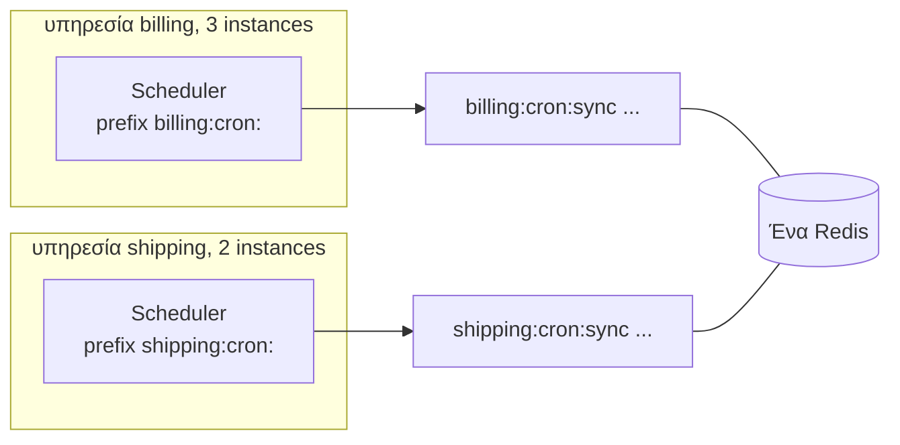

Δύο υπηρεσίες που μοιράζονται ένα Redis ή μια βάση δεδομένων δεν πρέπει να βλέπουν η μία τις εργασίες της άλλης. Εάν και οι δύο έχουν μια εργασία με όνομα `sync` κάτω από το ίδιο namespace, ανταγωνίζονται για τις ίδιες εκτελέσεις, και κάθε εκτέλεση πραγματοποιείται μόνο σε μία από τις δύο υπηρεσίες.

Η λύση είναι ένα **namespace** ανά ομάδα instances που πρέπει να μοιράζονται εργασίες.



## Η επιλογή, ανά backend

| Backend | Επιλογή | Προεπιλογή |
| --- | --- | --- |
| Redis / Valkey | `prefix` | `'cron:'` |
| PostgreSQL / SQLite | `table` | `'anarchon_runs'` |
| RabbitMQ | `prefix` | `'cron.'` |
| NATS | `prefix`, `stream` | `'cron.'`, `'CRON'` |

Ο κανόνας: τα instances που πρέπει να **μοιράζονται** εργασίες χρησιμοποιούν την ίδια τιμή, και οτιδήποτε άλλο χρησιμοποιεί διαφορετική.

## Ανά υπηρεσία

```ts
// billing
new Scheduler({ redis: process.env.REDIS_URL, prefix: 'billing:cron:' });

// shipping
new Scheduler({ redis: process.env.REDIS_URL, prefix: 'shipping:cron:' });
```

```ts
// PostgreSQL: ένας πίνακας ανά υπηρεσία, ή ένα schema
new PostgresBackend({ connection: pool, table: 'billing_cron_runs' });
new PostgresBackend({ connection: pool, table: 'shipping.cron_runs' });
```

## Ανά περιβάλλον

Το Staging και το production δεν θα πρέπει να μοιράζονται καθόλου το ίδιο store. Όταν αναγκαστικά το κάνουν (ένα κοινόχρηστο development Redis, για παράδειγμα), συμπεριλάβετε το περιβάλλον στο namespace:

```ts
new Scheduler({
  redis: process.env.REDIS_URL,
  prefix: `${process.env.APP_ENV}:billing:cron:`, // staging:billing:cron:
});
```

Χωρίς αυτό, το laptop ενός προγραμματιστή που στοχεύει στο κοινόχρηστο Redis αποσπά εκτελέσεις από το staging.

## Ανά tenant

Όταν κάθε tenant πρέπει να έχει τη δική του εκτέλεση μιας εργασίας, υπάρχουν δύο σχεδιαστικές προσεγγίσεις.

### Μία εργασία, με επανάληψη πάνω στους tenants

Η απλούστερη προσέγγιση, και επαρκής για τις περισσότερες περιπτώσεις:

```ts
scheduler.every('tenant-reports', '1h', async (ctx) => {
  for (const tenant of await tenants()) {
    ctx.signal.throwIfAborted();
    await buildReport(tenant, ctx.slot);
  }
});
```

Ένα instance χειρίζεται όλους τους tenants για τη συγκεκριμένη ώρα.

### Μία εργασία ανά tenant

Η εργασία κάθε tenant διεκδικείται (claimed) ξεχωριστά, έτσι η δουλειά κατανέμεται μεταξύ των instances και ένας αργός tenant δεν καθυστερεί τους υπόλοιπους:

```ts
for (const tenant of await tenants()) {
  scheduler.every(`report-${tenant.id}`, '1h', (ctx) => buildReport(tenant, ctx.slot));
}
```

Κάθε instance πρέπει να καταχωρεί το ίδιο σύνολο εργασιών. Όταν προστίθενται tenants κατά το run time, κάθε instance πρέπει να ενημερώνεται σχετικά: επαναφορτώνετε τη λίστα των tenants περιοδικά και καλείτε το `every()` για τους νέους και το `remove()` για τους διαγραμμένους.

```ts
async function syncTenantJobs() {
  const wanted = new Set((await tenants()).map((t) => `report-${t.id}`));
  const have = new Set(scheduler.jobs().map((j) => j.name).filter((n) => n.startsWith('report-')));

  for (const name of wanted) {
    if (!have.has(name)) scheduler.every(name, '1h', (ctx) => buildReport(name.slice('report-'.length), ctx.slot));
  }
  for (const name of have) {
    if (!wanted.has(name)) scheduler.remove(name);
  }
}

setInterval(syncTenantJobs, 60_000);
```

Κάθε εργασία έχει τα δικά της κλειδιά ή γραμμές (rows), οπότε χιλιάδες εργασίες tenants σημαίνουν χιλιάδες μικρές εγγραφές. Αυτό είναι μια χαρά στο Redis και την PostgreSQL. Με το RabbitMQ, το οποίο δημιουργεί μία ουρά ανά εκτέλεση, προτιμήστε τον σχεδιασμό με επανάληψη (looping).

## Πολλαπλοί schedulers σε μία διεργασία

Μία διεργασία μπορεί να περιέχει περισσότερους από έναν schedulers, για παράδειγμα έναν ανά store, ή έναν ανά ομάδα εργασιών με διαφορετικούς χρόνους μίσθωσης (lease timings):

```ts
const fast = new Scheduler({ redis, prefix: 'app:fast:', leaseMs: 6_000, heartbeatMs: 1_000 });
const slow = new Scheduler({ redis, prefix: 'app:slow:', leaseMs: 120_000 });

fast.every('refresh-cache', '5s', refresh);
slow.cron('rebuild-index', '0 2 * * *', rebuild, { timeoutMs: 2 * 60 * 60_000 });

await Promise.all([fast.start(), slow.start()]);
```

Δώστε τους διαφορετικά prefixes, και σταματήστε και τους δύο κατά τον τερματισμό.

## Ανάγνωση σε πολλαπλές υπηρεσίες

Ένα dashboard μπορεί να διαβάσει το ιστορικό κάθε υπηρεσίας δημιουργώντας έναν reader ανά namespace:

```ts
const readers = {
  billing: new Scheduler({ redis, prefix: 'billing:cron:' }),
  shipping: new Scheduler({ redis, prefix: 'shipping:cron:' }),
};

app.get('/:service/jobs/:name/runs', async (req, res) => {
  const reader = readers[req.params.service as keyof typeof readers];
  if (!reader) return res.status(404).end();
  res.json(await reader.history(req.params.name, 20));
});
```

## Επόμενα βήματα

- [Επισκόπηση backends](../../backends/overview/)
- [Μια διεργασία worker και ένα read-only API](../worker-and-api/)
