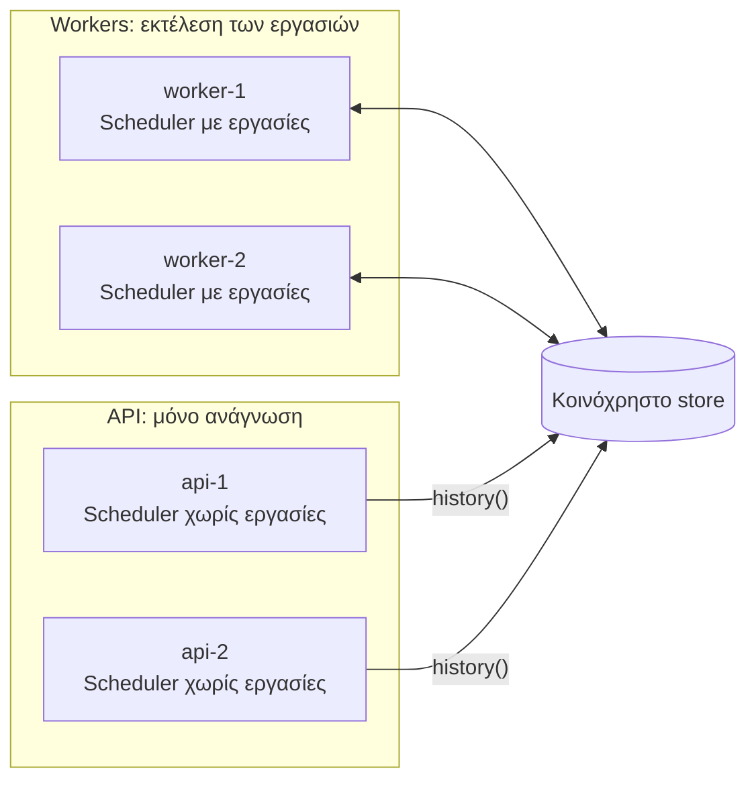

Δεν χρειάζεται να εκτελείτε εργασίες στις ίδιες διεργασίες που εξυπηρετούν αιτήματα. Ένας συνηθισμένος διαχωρισμός:

- **Workers**: καταχωρούν τις εργασίες και τις εκτελούν. Τρέξτε δύο ή περισσότερα για διαθεσιμότητα.
- **Διεργασίες API**: δεν καταχωρούν τίποτα. Διαβάζουν μόνο το ιστορικό και, αν θέλετε, ξεκινούν χειροκίνητες εκτελέσεις μέσω ενός worker.



## Γιατί να γίνει διαχωρισμός

- Μια βαριά εργασία δεν μπορεί να επιβραδύνει την εξυπηρέτηση αιτημάτων.
- Οι workers μπορούν να διαστασιολογηθούν, κλιμακωθούν και αναπτυχθούν (deployed) ανεξάρτητα.
- Οι διεργασίες web δεν χρειάζονται κώδικα εργασιών ή εξαρτήσεις εργασιών.

## Η κοινόχρηστη παραμετροποίηση

Και οι δύο πλευρές πρέπει να στοχεύουν στο ίδιο store και namespace. Διατηρήστε το σε ένα μόνο σημείο:

```ts
// cron/config.ts
import type { SchedulerOptions } from 'anarchon';

export const cronOptions: SchedulerOptions = {
  redis: process.env.REDIS_URL,
  prefix: 'billing:cron:',
  timezone: 'Europe/Athens',
};
```

## Ο worker

```ts
// worker.ts
import { Scheduler } from 'anarchon';
import { cronOptions } from './cron/config';

const scheduler = new Scheduler({ ...cronOptions, instanceId: process.env.POD_NAME, log: true });

scheduler
  .every('sync', '10s', (ctx) => syncCustomers({ signal: ctx.signal }))
  .every('export', '15m', (ctx) => exportAll(ctx), { timeoutMs: 10 * 60_000 })
  .cron('digest', '0 8 * * 1-5', () => sendDigest());

async function main() {
  await scheduler.start();
  const shutdown = async () => {
    await scheduler.stop({ timeoutMs: 25_000 });
    process.exit(0);
  };
  process.on('SIGTERM', shutdown);
  process.on('SIGINT', shutdown);
}

main().catch((error) => {
  console.error(error);
  process.exit(1);
});
```

Εκτελέστε τουλάχιστον δύο workers. Με έναν μόνο, μια κατάρρευση σημαίνει ότι κανείς δεν απομένει για να αναλάβει την εκτέλεση (takeover) μέχρι να επανεκκινήσει. Σε ένα lease backend, ο επανεκκινημένος worker εξακολουθεί να ανακτά την εκτέλεση κατά την εκκίνηση, επομένως τίποτα δεν χάνεται, μόνο καθυστερεί.

## Το API

Η διεργασία API δημιουργεί έναν scheduler **χωρίς εργασίες** και δεν καλεί ποτέ το `start()`. Οι συναρτήσεις `history()` και `lastRun()` συνδέονται αυτόνομα.

```ts
// api.ts
import express from 'express';
import { Scheduler } from 'anarchon';
import { cronOptions } from './cron/config';

const reader = new Scheduler(cronOptions);
const app = express();

app.get('/jobs/:name/runs', async (req, res) => {
  res.json(await reader.history(req.params.name, Number(req.query.limit ?? 20)));
});

app.get('/jobs/:name/last', async (req, res) => {
  res.json(await reader.lastRun(req.params.name));
});

const server = app.listen(3000);

process.on('SIGTERM', async () => {
  server.close();
  await reader.stop(); // κλείνει τη σύνδεσή του
  process.exit(0);
});
```

Τι μπορεί και τι δεν μπορεί να κάνει ένας reader:

| Μέθοδος | Σε reader χωρίς εργασίες |
| --- | --- |
| `history(name)`, `lastRun(name)` | Λειτουργεί για οποιοδήποτε όνομα εργασίας |
| `jobs()` | Άδειο: παραθέτει τις εργασίες που έχουν καταχωρηθεί σε *αυτό* το instance |
| `nextRun(name)` | Πετάει σφάλμα (throws): η εργασία δεν έχει καταχωρηθεί εδώ |
| `runNow(name)` | Πετάει σφάλμα (throws): η εργασία δεν έχει καταχωρηθεί εδώ |

## Προβολή του προγράμματος στο API

Το API δεν γνωρίζει τα χρονοδιαγράμματα, καθώς δεν καταχωρεί εργασίες. Δύο τρόποι για να τα προβάλετε:

**Κοινή χρήση των ορισμών.** Τοποθετήστε ονόματα και προγράμματα σε ένα module που κάνουν import και οι δύο πλευρές. Ο worker συνδέει handlers· το API διαβάζει μόνο τη λίστα.

```ts
// cron/definitions.ts
export const JOBS = [
  { name: 'sync', kind: 'every', schedule: '10s' },
  { name: 'export', kind: 'every', schedule: '15m' },
  { name: 'digest', kind: 'cron', schedule: '0 8 * * 1-5' },
] as const;
```

**Ή ρωτήστε έναν worker.** Δώστε στους workers ένα μικρό εσωτερικό HTTP endpoint που επιστρέφει το `scheduler.jobs()`.

## Χειροκίνητες εκτελέσεις από το API

Η μέθοδος `runNow()` εκτελείται στο instance στο οποίο καλείται, και το API δεν έχει κώδικα εργασιών. Προωθήστε το αίτημα σε έναν worker:

```ts
// στον worker: ένας μικρός εσωτερικός server
import { createServer } from 'node:http';

createServer(async (req, res) => {
  const match = /^\/run\/([\w-]+)$/.exec(req.url ?? '');
  if (req.method !== 'POST' || !match) return res.writeHead(404).end();
  try {
    const run = await scheduler.runNow(match[1]);
    res.writeHead(200, { 'content-type': 'application/json' }).end(JSON.stringify(run));
  } catch (error) {
    res.writeHead(400).end(String(error));
  }
}).listen(9100);
```

```ts
// στο API
app.post('/jobs/:name/run', requireAdmin, async (req, res) => {
  const response = await fetch(`http://cron-worker:9100/run/${req.params.name}`, { method: 'POST' });
  res.status(response.status).send(await response.text());
});
```

## Μία βάση κώδικα, δύο λειτουργίες

Αν προτιμάτε να διανέμετε μία εικόνα (image), επιλέξτε τη λειτουργία μέσω μιας μεταβλητής περιβάλλοντος:

```ts
const scheduler = new Scheduler({ ...cronOptions, instanceId: process.env.POD_NAME });

if (process.env.RUN_JOBS === 'true') {
  registerJobs(scheduler);
  await scheduler.start();
}
```

Οι διεργασίες όπου η μεταβλητή `RUN_JOBS` δεν έχει οριστεί συμπεριφέρονται ως readers.

## Επόμενα βήματα

- [Rolling deploys στο Kubernetes](../kubernetes/)
- [Ιστορικό](../../guides/history/)
