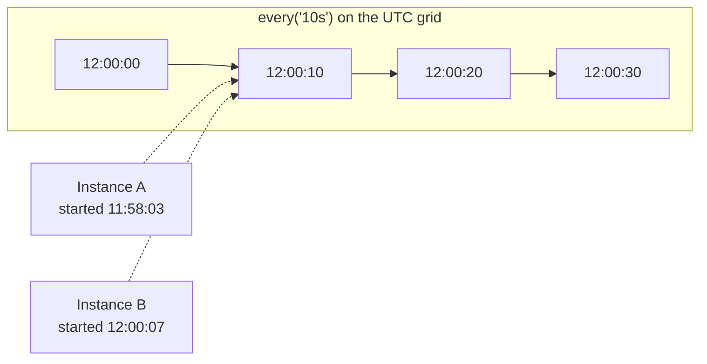
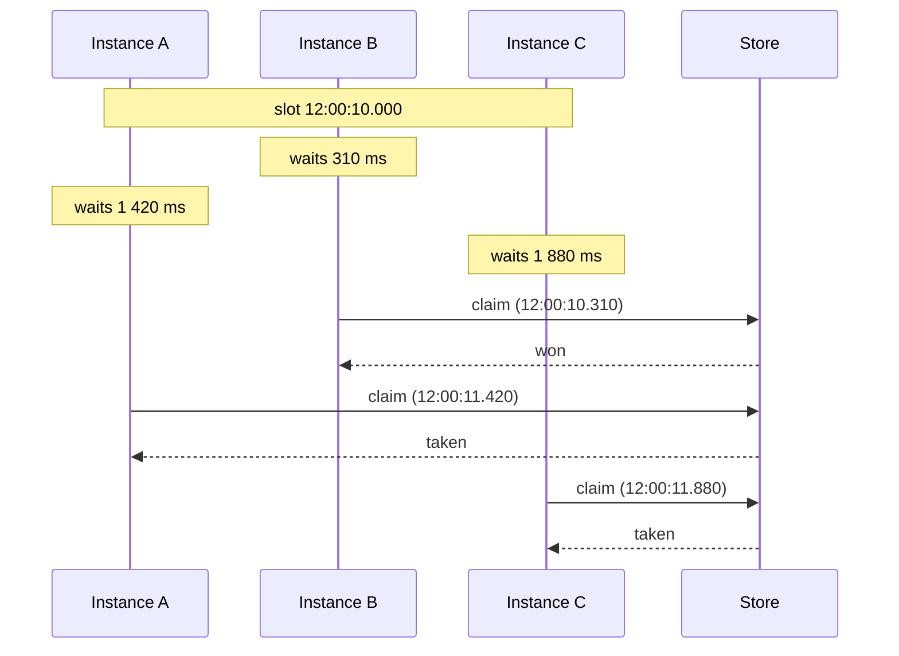
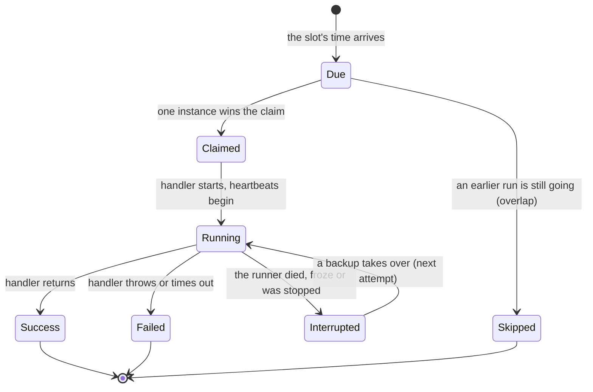

The rest of the documentation uses a small vocabulary. Each term is defined here once.

## Instance

One running copy of your service: one process. Every instance creates its own `Scheduler` with the same jobs. Each has an `instanceId`, by default `hostname:pid`, which shows up in history so you can see who ran what.

## Job

A named piece of work with a schedule and a handler:

```ts
scheduler.every('sync', '10s', async (ctx) => { /* the handler */ });
//               name   schedule
```

The **name** identifies the job in the store, so it must be the same on every instance and should not change between deploys.

## Slot

One scheduled time of a job, as milliseconds since 1970. "The 12:00:10 run of *sync*" is the slot `1791633610000`.

The slot is the heart of the design. Every instance computes the same slots from the same schedule, without talking to each other:

- `every('10s')` uses a grid counted from 1970-01-01 UTC, so the slots are :00, :10, :20 whatever time each instance started.
- `cron('0 8 * * *')` uses the cron expression in its time zone.

Because the slot is the same number everywhere, `(job name, slot)` names one run across the whole cluster. That pair is what instances compete for.



## Run and attempt

A **run** is one slot of one job. Usually a run is executed once. If the instance executing it dies, another instance starts it again: that is a second **attempt** of the same run. `ctx.attempt` is 1 for the first try, and 2 or more after a takeover.

## Claim

The request an instance sends to the store when a slot is due: "record that I am running this run, unless it is already taken". The store answers in one atomic step, so exactly one instance wins.

## Jitter

A random delay, between 0 and `jitterMs`, that each instance waits before claiming. Without it, the instance with the fastest clock would win every time. With it, a different instance tends to win each run, so work is spread.



## Backend

The adapter between anarchon and a store. `RedisBackend`, `PostgresBackend`, `SqliteBackend`, `RabbitMQBackend` and `NatsBackend` are built in. All of them guarantee one winner per run. Some also support leases.

## Lease

A promise with an expiry time, stored with the run: "instance B is running this, and it is alive until 12:00:40". While the job runs, the runner pushes that time forward every `heartbeatMs`. This is the **heartbeat**.

If the runner dies, the heartbeats stop, the lease runs out, and the run becomes available for the next attempt.

A lease is not a lock. Nobody waits on it and nobody has to release it. It only answers one question: is the runner still alive?

## Backup

An instance that lost the claim for a run. It checks the run's lease every 1 to 2 heartbeats. If the lease runs out before the run finishes, the backup claims the next attempt. This is a **takeover**.

## Token

A random value created for each attempt. The store remembers the token of the current attempt, and heartbeats and "finished" only work with that token. If a backup has taken over, the old runner's token no longer matches, so nothing it sends changes the run. This is called **fencing**.

## Putting it together



## Lease backends and claim-only backends

Not every store can hold a lease that others can check.

| | Lease backends | Claim-only backends |
| --- | --- | --- |
| Which | Redis and Valkey (`lease` strategy), PostgreSQL, SQLite, NATS (`lease` strategy) | Redis `stream-id`, `idmp` and `script` strategies, RabbitMQ, NATS (`msg-id`, the default) |
| One winner per run | Yes | Yes |
| Backups and takeover | Yes | No |
| No overlapping runs | Yes | No |
| Catch-up after downtime | Yes | No |
| Hand-over on `stop()` | Yes | No |

The guides mark features that need a lease backend.

## Next

- [Defining jobs](../../guides/defining-jobs/)
- [Architecture](../../internals/architecture/), if you want the internals first
