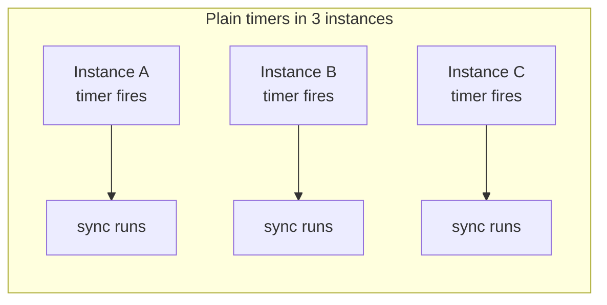
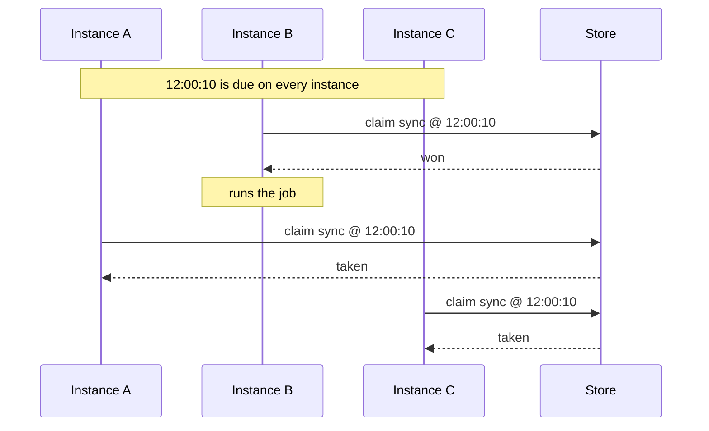

anarchon runs scheduled jobs in a service that has more than one instance, and selects **one** instance to run each scheduled time.

This page explains the problem from the beginning. If you already know why cron in a cluster is hard, skip to [Quick start](../quick-start/).

## The problem

A scheduled job is code that runs at set times: "send the digest at 08:00", "sync customers every 10 seconds".

In a single process this is easy. You set a timer, and when it fires, you run the code:

```ts
setInterval(syncCustomers, 10_000);
```

Real services rarely run as a single process. You run several copies, called *instances*, so the service survives a crash and handles more traffic. Every instance runs the same code, so every instance sets the same timer:



Now the job runs three times. For a cache refresh that is wasteful. For "charge the customer" or "send the email" it is a bug.

## The usual fixes, and their cost

| Approach | What goes wrong |
| --- | --- |
| Run the job in one special instance only | When that instance is down, the job doesn't run. Deploys need special handling. |
| Elect a leader | You need an election, and you have to handle two instances both believing they lead. |
| Take a lock before each run | A lock must be released. If the holder crashes, the lock stays until it times out; if it times out too early, two instances run. |
| Put jobs on a queue | Something still has to enqueue each run exactly once, which is the same problem again. |

## How anarchon does it

anarchon elects no leader. It relies on one fact: all your instances already share a database or a message broker, and that store can do one small thing *atomically*, meaning as a single step that can't be interleaved with anyone else's.

Three ideas make it work:

1. **Every instance computes the same run times.** "Every 10 s" means :00, :10, :20 on a fixed grid, the same on every machine. A run time is called a **slot**.
2. **Each instance tries to claim the slot.** When a slot is due, each instance asks the store: "record that I am running the 12:00:10 run of *sync*, unless someone already did."
3. **The store lets exactly one win.** Because the check and the write are one atomic step, only the first instance gets "yes". The others get "already taken" and do nothing.



Each instance waits a small random delay before claiming, so a different instance tends to win each time and the work is spread.

## What happens when things go wrong

Deciding who runs is the easy half. The harder half is what happens after:

- The winner **crashes** in the middle of the job. Who finishes it?
- The winner **freezes** for a minute (a long garbage-collection pause, a stalled virtual machine).
- You **deploy**, and the instance running the job is told to stop.
- The job takes **longer than its interval**, so the next run is due before this one ends.
- **Every instance is down** when a run is due.

On Redis, Valkey, PostgreSQL, SQLite and NATS (with `strategy: 'lease'`), anarchon handles these with a **lease**. The winner keeps telling the store "I'm still alive" every few seconds. The other instances become its *backups* and watch that lease. If it stops being renewed, one backup takes the run over.

| Situation | What anarchon does |
| --- | --- |
| The job runs longer than its interval | Runs due meanwhile are skipped; one runs at a time |
| The winner is killed mid-run | A backup takes over about one lease later, as attempt 2 |
| The winner freezes longer than its lease | A backup takes over; the frozen one is told it lost the run when it wakes |
| The winner is stopped gracefully | It hands the run over at once; a backup starts it again |
| Every instance restarts mid-run | After the restart, one instance re-runs it |
| Every instance is down when a run is due | The first one to start runs it, if it was due recently |

A takeover starts the handler again from the beginning, as a new attempt; it doesn't resume where the previous runner stopped. RabbitMQ, and NATS with its default strategy, have no lease: they only select the winner, and a run whose runner dies is lost.

[Failure scenarios](../../internals/failure-scenarios/) walks through each of these with a diagram.

## What you need

- **Node.js 20 or newer.**
- **One shared store** that all instances can reach: Redis, Valkey, PostgreSQL, SQLite (same machine), or a libSQL server. NATS works too, with all of them on its `lease` strategy; RabbitMQ works with fewer guarantees (see [Backends](../../backends/overview/)).

## What anarchon is not

- **Not a job queue.** It doesn't distribute many units of work to workers. It decides which instance runs a job at each scheduled time.
- **Not exactly-once.** A run whose runner crashed is started again by a backup, so a job can run more than once for the same slot. Write jobs so that running them twice is harmless. [Writing handlers](../../guides/writing-handlers/) shows how.

## Next

- [Installation](../installation/)
- [Quick start](../quick-start/)
- [Core concepts](../core-concepts/): the handful of words the rest of the docs use
- [Choosing anarchon](../choosing-anarchon/): when a queue, node-cron or a Kubernetes CronJob fits better
