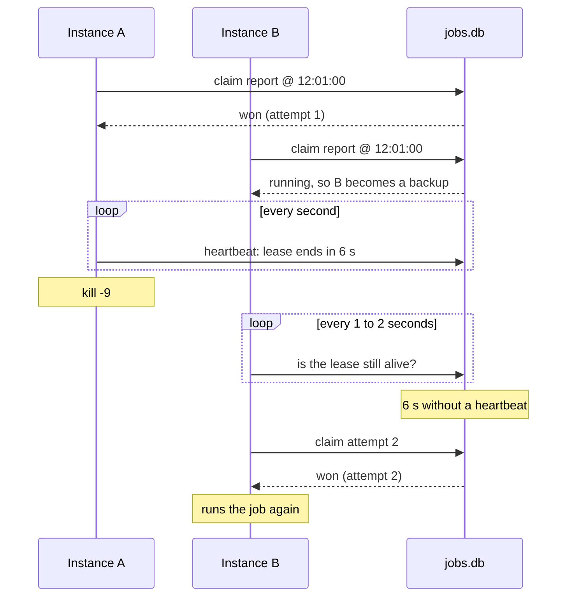

In this guide you write a small scheduler, run it as three instances, and watch each run happen once. Then you kill one instance mid-run and watch another finish its job.

It uses a SQLite file as the shared store, so there is nothing to install besides Node 22.5 or newer. Switching to Redis or PostgreSQL later is a one-line change.

## 1. Create the project

```sh
mkdir cron-demo && cd cron-demo
pnpm init
pnpm add anarchon
pnpm add -D tsx
```

## 2. Write the scheduler

Create `app.ts`:

```ts
import { Scheduler, SqliteBackend } from 'anarchon';

const sleep = (ms: number) => new Promise((resolve) => setTimeout(resolve, ms));

async function main() {
  const scheduler = new Scheduler({
    // All instances must point at the same store. Here: one file.
    backend: new SqliteBackend({ database: './jobs.db' }),
    // Short lease, so a takeover is quick to watch. The default is 30 s.
    leaseMs: 6_000,
    heartbeatMs: 1_000,
    log: true,
  });

  // A quick job, every 10 seconds
  scheduler.every('sync', '10s', async () => {
    await sleep(200);
  });

  // A slow job: 20 seconds of work, every 30 seconds
  scheduler.every('report', '30s', async (ctx) => {
    for (let second = 0; second < 20; second++) {
      ctx.signal.throwIfAborted(); // stop cleanly when asked
      await sleep(1_000);
    }
  });

  await scheduler.start();
  console.log(`started as ${scheduler.instanceId}`);

  // Stop cleanly on Ctrl+C
  process.on('SIGINT', async () => {
    await scheduler.stop();
    process.exit(0);
  });
}

main();
```

## 3. Run three instances

Open three terminals in the project folder and run the same command in each:

```sh
npx tsx app.ts
```

Each terminal prints its own name, something like `started as my-laptop:41822`.

Watch the output. Every 10 seconds, exactly **one** terminal prints that it started `sync`, and the other two print that they skipped it:

```
[anarchon] sync @ 2026-10-10T12:00:10.000Z: started on my-laptop:41822 (attempt 1, scheduled)
[anarchon] sync @ 2026-10-10T12:00:10.000Z: finished in 203 ms
```

```
[anarchon] sync @ 2026-10-10T12:00:10.000Z: skipped (taken)
```

Which terminal wins changes from run to run. That is the random delay at work.

:::note
Right after an instance starts you may see runs with `catch-up` instead of `scheduled`, and a `report` run `skipped (overlap)`. On start, anarchon runs the latest run if nobody ran it yet, and a new `report` run is skipped while the previous one is still going. Both are explained in [Leases](../../internals/leases/).
:::

## 4. Stop the runner gracefully

Wait until one terminal prints that it started `report`, then press **Ctrl+C** in that terminal.

Within a second or two, another terminal prints:

```
[anarchon] report @ 2026-10-10T12:00:30.000Z: started on my-laptop:41907 (attempt 2, takeover)
```

The stopped instance *handed the run over*. This is what happens on every rolling deploy.

## 5. Crash the runner

Start the stopped instance again. Wait for `report` to start somewhere, then kill that process hard, from a fourth terminal:

```sh
kill -9 <pid>   # the number after the colon in the instance name
```

This time nothing is handed over: the process is simply gone. About 6 seconds later (the lease you set), a backup notices the lease was not renewed and takes over:

```
[anarchon] report @ 2026-10-10T12:01:00.000Z: started on my-laptop:41822 (attempt 2, takeover)
```

## What just happened



## Switch to a real store

Change one line. Everything else stays the same.

```ts
// Redis or Valkey
const scheduler = new Scheduler({ redis: 'redis://localhost:6379' });

// PostgreSQL
import { PostgresBackend } from 'anarchon';
const scheduler = new Scheduler({
  backend: new PostgresBackend({ connection: process.env.DATABASE_URL }),
});
```

## Next

- [Core concepts](../core-concepts/): slot, claim, jitter and lease, defined
- [Defining jobs](../../guides/defining-jobs/): cron expressions, intervals and one-off jobs
- [Writing handlers](../../guides/writing-handlers/): what `ctx` holds and why `ctx.signal` matters
