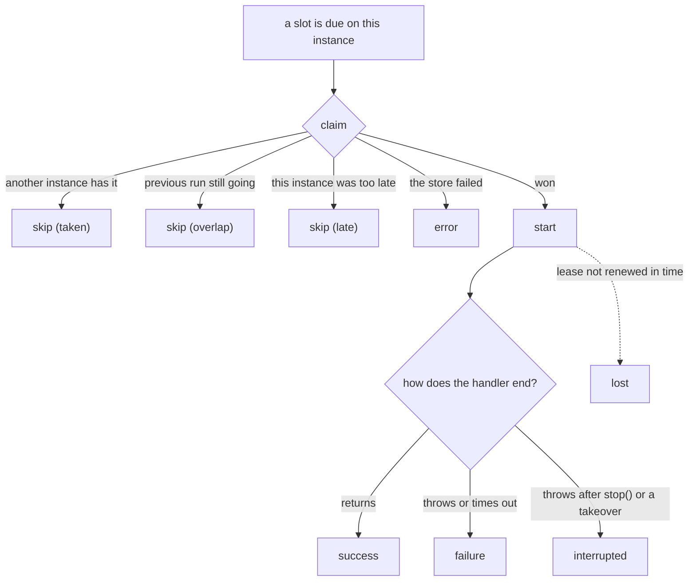

The scheduler tells you what happens on **this instance** through events. For the view across all instances, use [history](../history/).

```ts
scheduler.on('failure', (run) => {
  console.error(`${run.job} failed on ${run.instanceId}: ${run.error}`);
});
```

`on()`, `once()` and `off()` work like Node's `EventEmitter`, and are typed: the payload type follows from the event name.

## The events

| Event | When | Payload |
| --- | --- | --- |
| `start` | This instance won a run and is about to call the handler | job, slot, attempt, reason |
| `success` | The handler returned | a [run record](../history/#the-run-record) |
| `failure` | The handler threw, or `timeoutMs` passed | run record + `cause` |
| `interrupted` | `stop()` or a takeover aborted `ctx.signal`, and the handler then threw | run record + `cause`, `handedOver` |
| `skip` | A run was due and this instance didn't run it | job, slot, `reason` |
| `lost` | A backup took over a run this instance was executing | job, slot, attempt |
| `error` | A backend or setup problem | `error`, and the job and slot if known |



### `skip` is normal

With three instances, every run produces one `start` and two `skip` events with reason `'taken'`. That is the system working. The reasons:

| Reason | Meaning |
| --- | --- |
| `'taken'` | Another instance won this run |
| `'overlap'` | The previous run of this job is still going (`overlap: 'skip'`) |
| `'late'` | This instance reached the run more than `maxLateMs` after its time. `lateMs` says how late |

### `failure` and `cause`

`run.error` is the message as text, the same string that is stored in history. `run.cause` is the value the handler actually threw, so you can inspect it:

```ts
scheduler.on('failure', (run) => {
  if (run.cause instanceof RateLimitError) return; // expected, ignore
  pager.notify(`${run.job} @ ${run.scheduledAt.toISOString()} failed: ${run.error}`);
});
```

### `interrupted` is not a failure

A run that was stopped by a deploy, or taken over, didn't fail. It is reported separately so your alerts stay quiet during deploys.

```ts
scheduler.on('interrupted', (run) => {
  logger.info(`${run.job} stopped mid-run, handed over: ${run.handedOver}`);
});
```

### `lost`

This instance was running a job and found out, at a heartbeat, that a backup had taken the run over. That happens when the instance couldn't renew its lease for longer than `leaseMs`: it was frozen, or cut off from the store. Its `ctx.signal` aborts at the same moment.

A `lost` event now and then after a long pause is expected. Frequent ones mean `leaseMs` is too short for your environment.

### `error`

Problems that are not a job failing: the store is unreachable, a claim couldn't be sent, a result couldn't be saved.

```ts
scheduler.on('error', (e) => {
  logger.error({ err: e.error, job: e.job }, 'scheduler backend problem');
});
```

If nobody listens for `error`, these are written to the logger. They never crash the process.

## Metrics

Events map directly onto metrics:

```ts
scheduler.on('start', (e) => metrics.increment('cron.start', { job: e.job }));
scheduler.on('success', (run) => metrics.timing('cron.duration', run.durationMs, { job: run.job }));
scheduler.on('failure', (run) => metrics.increment('cron.failure', { job: run.job }));
scheduler.on('skip', (e) => {
  if (e.reason !== 'taken') metrics.increment('cron.skip', { job: e.job, reason: e.reason });
});
scheduler.on('lost', (e) => metrics.increment('cron.lost', { job: e.job }));
```

Remember that these count what happened on one instance. Sum them across instances for the whole service.

## Listeners can't break a run

A listener that throws, or an async listener whose promise rejects, is caught and logged. It doesn't affect the run or the other listeners.

## Built-in logging

`log: true` writes one line for each of the events above, without any code:

```ts
new Scheduler({ backend, log: true });
```

```
[anarchon] sync @ 2026-10-10T12:00:10.000Z: started on api-2 (attempt 1, scheduled)
[anarchon] sync @ 2026-10-10T12:00:10.000Z: finished in 203 ms
[anarchon] sync @ 2026-10-10T12:00:20.000Z: skipped (taken)
[anarchon] report @ 2026-10-10T12:00:00.000Z: failed after 1204 ms: Error: upstream returned 503
[anarchon] report @ 2026-10-10T12:30:00.000Z: interrupted after 8012 ms, handed over to another instance
[anarchon] export @ 2026-10-10T12:00:00.000Z: attempt 1 was taken over by a backup
```

Failures and lost runs go to `logger.warn`; the rest go to `logger.info`.

### Your own logger

Any object with `warn` and `error` methods works. `info` is optional.

```ts
import pino from 'pino';
new Scheduler({ backend, log: true, logger: pino() });
```

```ts
new Scheduler({
  backend,
  logger: {
    info: (message) => myLog('info', message),
    warn: (message) => myLog('warn', message),
    error: (message) => myLog('error', message),
  },
});
```

With `log: false` (the default) the logger is still used for `error` events nobody listens for.

## Next

- [History](../history/): the view across all instances
- [Events reference](../../reference/events/): every payload field
