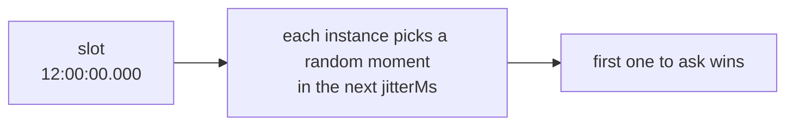

The last argument of `every()`, `cron()` and `at()` is an options object. Every option has a default, so you only set what you need.

```ts
scheduler.every('report', '35m', buildReport, {
  timeoutMs: 20 * 60_000,
  maxAttempts: 2,
});
```

## Summary

| Option | Default | Needs a lease backend | What it controls |
| --- | --- | --- | --- |
| [`jitterMs`](#jitterms) | scheduler's (2000), lowered for short intervals | no | The random delay before claiming |
| [`maxLateMs`](#maxlatems) | scheduler's (60000) | no | How late an instance may start a run |
| [`timeoutMs`](#timeoutms) | none | no | The longest a run may take |
| [`overlap`](#overlap) | `'skip'` | yes | Whether a run may start while the previous one is going |
| [`maxAttempts`](#maxattempts) | `3` | yes | How many times a run may be started when runners die |
| [`catchUpMs`](#catchupms) | `300000` (5 min) | yes | How old a missed run may be and still run on start |
| [`historySize`](#historysize-and-historyttlms) | scheduler's (1000) | no | How many runs to remember |
| [`historyTtlMs`](#historysize-and-historyttlms) | scheduler's (none) | no | How long to remember them |
| `offsetMs` | `0` | no | `every()` only: [shifts the grid](../defining-jobs/#shifting-the-grid-offsetms) |
| `timezone` | scheduler's | no | `cron()` only: [the time zone](../defining-jobs/#time-zones) |
| [`data`](../run-data/) | none | no | Data for the job's runs, read in the handler as `ctx.data` |

"Scheduler's" means the option of the same name on `new Scheduler()`. See [Scheduler options](../scheduler-options/).

## `jitterMs`

Each instance waits a random time between 0 and `jitterMs` after the slot before it claims the run.



- **Larger** jitter spreads work more evenly and makes the start time less exact.
- **`0`** means no spreading: all instances claim at the same instant, and the one with the fastest clock and connection usually wins.

It must be under half the time between runs. If you don't set it, the default is the scheduler's `jitterMs` (2 seconds), or a quarter of the interval when that is smaller. So a job that runs every second gets 250 ms.

```ts
scheduler.every('tick', '1s', tick);                       // jitter 250 ms, automatically
scheduler.cron('nightly', '0 2 * * *', run, { jitterMs: 30_000 }); // starts between 02:00:00 and 02:00:30
scheduler.every('precise', '1m', run, { jitterMs: 0 });    // starts on the dot, always the fastest instance
```

## `maxLateMs`

When an instance gets to a run more than `maxLateMs` after its slot, it skips it and emits a `skip` event with reason `'late'`.

This protects you from stale runs. A process can be frozen for minutes: a suspended laptop, a long garbage-collection pause, a stalled virtual machine. When it wakes, its timers fire for runs that were due long ago. Without this limit it would start them.

```ts
// A run that can't start within 10 s of its time isn't worth starting
scheduler.every('quote-refresh', '30s', refresh, { maxLateMs: 10_000 });
```

It must be bigger than `jitterMs`.

## `timeoutMs`

After this many milliseconds, `ctx.signal` aborts and the run is recorded as **failed**, with the error `TimeoutError: Timed out after N ms`.

```ts
scheduler.every('export', '5m', exportAll, { timeoutMs: 4 * 60_000 });
```

:::caution
The timeout doesn't kill your handler. JavaScript can't stop a running function from outside. The handler must watch `ctx.signal`, or it keeps going in the background after the run was recorded as failed. See [Writing handlers](../writing-handlers/#stopping-when-asked).
:::

Set a timeout on any job that can hang. With `overlap: 'skip'`, a hung run keeps renewing its lease and blocks every later run of that job.

## `overlap`

*Needs a lease backend.*

What happens when a run is due while the previous run of the same job is still going:

- **`'skip'`** (default): the new run is skipped, with a `skip` event of reason `'overlap'`.
- **`'allow'`**: both run.

```
A 7 s job every 3 s, overlap 'skip'

time   :00  :03  :06  :09  :12  :15  :18
run    [======= 7 s =======]
            skip skip
                           [======= 7 s =======]
                                skip skip
```

Skipped runs are not queued. The run at :03 never happens; the next run to start is the first one due after the current run ends.

```ts
// Independent work per run: let them overlap
scheduler.every('sample-metrics', '5s', sample, { overlap: 'allow' });
```

## `maxAttempts`

*Needs a lease backend.*

How many times one run may be **started** when its runner dies, counting the first try. The default is 3.

- A run is retried only when its runner stopped renewing the lease: it crashed, froze or lost the network.
- A run that **fails** (the handler throws) is **not** retried. Retries are for dead runners, not for errors. If you want to retry errors, do it inside the handler.
- A hand-over on `stop()` doesn't count against the limit.

```ts
scheduler.cron('charge-cards', '0 6 * * *', charge, { maxAttempts: 1 }); // never started twice
```

When the limit is used up, the run is marked `interrupted` and left.

## `catchUpMs`

*Needs a lease backend.*

On `start()`, an instance checks the latest slot of each job. If nobody ran it and it was due less than `catchUpMs` ago, the instance runs it now, with `ctx.reason === 'catch-up'`.

This covers a run that was due while every instance was down, for example during a full restart.

```ts
scheduler.cron('daily-report', '0 6 * * *', report, { catchUpMs: 6 * 60 * 60_000 }); // up to 6 h late
scheduler.every('refresh-cache', '5s', refresh, { catchUpMs: 0 });                    // never catch up
```

Only the **latest** run is caught up, not every run that was missed.

## `historySize` and `historyTtlMs`

`historySize` is about how many runs to keep per job, and `historyTtlMs` also drops records older than a given age.

```ts
scheduler.every('heartbeat', '5s', ping, { historySize: 100 });
scheduler.cron('audit', '0 * * * *', audit, { historyTtlMs: 30 * 24 * 60 * 60_000 }); // 30 days
```

On lease backends a small `historySize` is always safe: a run is never forgotten while a late claim could still ask for it. On claim-only backends the store's memory of claimed runs also has to cover late instances; anarchon checks this when you add the job and throws if the settings are unsafe. See [Timing and clocks](../../internals/timing-and-clocks/).

## Typical combinations

```ts
// A heavy nightly job: at most 2 h, started at most twice, never two at once
scheduler.cron('rebuild-index', '0 2 * * *', rebuild, {
  timeoutMs: 2 * 60 * 60_000,
  maxAttempts: 2,
});

// A cheap, frequent job where a missed run doesn't matter
scheduler.every('refresh-cache', '5s', refresh, { catchUpMs: 0, historySize: 50 });

// A job that must not be started twice for the same slot
scheduler.cron('send-invoices', '0 9 1 * *', send, { maxAttempts: 1, catchUpMs: 12 * 60 * 60_000 });
```

## Next

- [Scheduler options](../scheduler-options/)
- [Writing handlers](../writing-handlers/)
