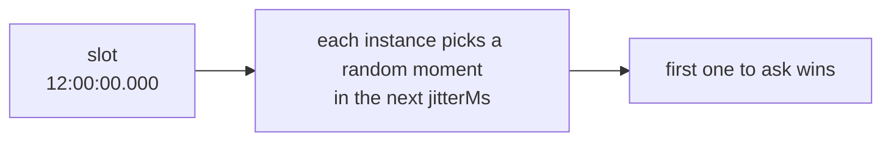

The last argument of `every()`, `cron()` and `at()` is an options object. Every option has a default, so you only set what you need.

```ts
scheduler.every('report', '35m', buildReport, {
  timeoutMs: 20 * 60_000,
  maxAttempts: 2,
});
```

## Summary

| Option | Default | Needs a lease backend | What it controls |
| --- | --- | --- | --- |
| [`jitterMs`](#jitterms) | scheduler's (2000), lowered for short intervals | no | The random delay before claiming |
| [`maxLateMs`](#maxlatems) | scheduler's (60000) | no | How late an instance may start a run |
| [`timeoutMs`](#timeoutms) | none | no | The longest a run may take |
| [`overlap`](#overlap) | `'skip'` | yes | Whether a run may start while the previous one is going |
| [`maxAttempts`](#maxattempts) | `3` | yes | How many times a run may be started when runners die |
| [`catchUpMs`](#catchupms) | `300000` (5 min) | yes | How old a missed run may be and still run on start |
| [`historySize`](#historysize-and-historyttlms) | scheduler's (1000) | no | How many runs to remember |
| [`historyTtlMs`](#historysize-and-historyttlms) | scheduler's (none) | no, but not RabbitMQ or NATS | How long to remember them |
| `offsetMs` | `0` | no | `every()` only: [shifts the grid](../defining-jobs/#shifting-the-grid-offsetms) |
| `timezone` | scheduler's | no | `cron()` only: [the time zone](../defining-jobs/#time-zones) |
| [`data`](../run-data/) | none | no | Data for the job's runs, read in the handler as `ctx.data` |

"Scheduler's" means the option of the same name on `new Scheduler()`. See [Scheduler options](../scheduler-options/).

An option that needs a lease backend isn't offered on another one. On a scheduler whose backend is RabbitMQ, NATS, or Redis/Valkey without the `lease` strategy, `every()`, `cron()` and `at()` don't accept `overlap`, `maxAttempts` or `catchUpMs`: the code doesn't compile. Decorators and plain JavaScript can't be checked that way, so the job is refused when it is added, with an error that names the option and the backend. `at()` never takes `overlap`, since a one-off job has no previous run.

```ts
const scheduler = new Scheduler({ backend: new RabbitMQBackend({ url }) });
scheduler.every('sync', '5m', sync, { timeoutMs: 60_000 });   // fine
scheduler.every('sync', '5m', sync, { overlap: 'allow' });    // type error: RabbitMQ has no leases
```

## `jitterMs`

Each instance waits a random time between 0 and `jitterMs` after the slot before it claims the run.



- **Larger** jitter spreads work more evenly and makes the start time less exact.
- **`0`** means no spreading: all instances claim at the same instant, and the one with the fastest clock and connection usually wins.

It must be under half the time between runs. If you don't set it, the default is the scheduler's `jitterMs` (2 seconds), or a quarter of the interval when that is smaller. So a job that runs every second gets 250 ms.

```ts
scheduler.every('tick', '1s', tick);                       // jitter 250 ms, automatically
scheduler.cron('nightly', '0 2 * * *', run, { jitterMs: 30_000 }); // starts between 02:00:00 and 02:00:30
scheduler.every('precise', '1m', run, { jitterMs: 0 });    // starts on the dot, always the fastest instance
```

**Works on** every backend. **Use it when:**

- **A heavy job should land on a random instance:** a larger jitter spreads the runs, so one instance doesn't do every nightly rebuild.
- **The start time matters to the second:** `jitterMs: 0`. The fastest instance then wins every time; that is the price.
- **Many instances call one dependency at the same moment:** jitter spreads the first requests over a few seconds.

```ts
scheduler.cron('rebuild-search-index', '0 3 * * *', rebuild, { jitterMs: 5 * 60_000 });           // spread over 5 min
scheduler.cron('market-open', '30 9 * * 1-5', open, { timezone: 'America/New_York', jitterMs: 0 }); // on the second
scheduler.every('poll-partner-api', '1m', poll, { jitterMs: 20_000 });                            // gentle on their rate limit
```

## `maxLateMs`

When an instance gets to a run more than `maxLateMs` after its slot, it skips it and emits a `skip` event with reason `'late'`.

This protects you from stale runs. A process can be frozen for minutes: a suspended laptop, a long garbage-collection pause, a stalled virtual machine. When it wakes, its timers fire for runs that were due long ago. Without this limit it would start them.

```ts
// A run that can't start within 10 s of its time isn't worth starting
scheduler.every('quote-refresh', '30s', refresh, { maxLateMs: 10_000 });
```

It must be bigger than `jitterMs`.

**Works on** every backend. On RabbitMQ, NATS and Redis/Valkey without `lease`, `jitterMs + maxLateMs` must also be shorter than how long the backend remembers a claimed run, or a late instance could win the same run again; anarchon checks it when the job is added. **Use it when:**

- **A stale run is worse than none:** quotes, presence, anything whose inputs age in seconds. Keep it short.
- **A late run is still useful:** a cleanup or a report can run half an hour late. Raise it.

```ts
scheduler.every('presence-sweep', '10s', sweep, { maxLateMs: 5_000 });            // 5 s late means stale presence: drop it
scheduler.cron('cleanup-temp', '0 4 * * *', cleanup, { maxLateMs: 30 * 60_000 }); // fine half an hour late

// On RabbitMQ, raise slotTtlMs (5 min by default) first, so the broker remembers runs long enough
new Scheduler({ backend: new RabbitMQBackend({ url, slotTtlMs: 20 * 60_000 }), maxLateMs: 15 * 60_000 });
```

## `timeoutMs`

After this many milliseconds, `ctx.signal` aborts and the run is recorded as **failed**, with the error `TimeoutError: Timed out after N ms`.

```ts
scheduler.every('export', '5m', exportAll, { timeoutMs: 4 * 60_000 });
```

:::caution
The timeout doesn't kill your handler. JavaScript can't stop a running function from outside. The handler must watch `ctx.signal`, or it keeps going in the background after the run was recorded as failed. See [Writing handlers](../writing-handlers/#stopping-when-asked).
:::

Set a timeout on any job that can hang. With `overlap: 'skip'`, a hung run keeps renewing its lease and blocks every later run of that job.

**Works on** every backend. **Use it when:**

- **The job calls anything over the network:** a hung connection must not hold the job forever. Pass `ctx.signal` along.
- **The job must end before its next run is due:** set it below the interval, so a slow run fails and the next one starts on time.

```ts
scheduler.every('sync-crm', '15m', (ctx) => crm.sync({ signal: ctx.signal }), { timeoutMs: 10 * 60_000 });
scheduler.cron('send-digest', '0 8 * * *', sendDigest, { timeoutMs: 30 * 60_000 }); // a stuck SMTP server can't block tomorrow
```

## `overlap`

*Needs a lease backend.*

What happens when a run is due while the previous run of the same job is still going:

- **`'skip'`** (default): the new run is skipped, with a `skip` event of reason `'overlap'`.
- **`'allow'`**: both run.

```
A 7 s job every 3 s, overlap 'skip'

time   :00  :03  :06  :09  :12  :15  :18
run    [======= 7 s =======]
            skip skip
                           [======= 7 s =======]
                                skip skip
```

Skipped runs are not queued. The run at :03 never happens; the next run to start is the first one due after the current run ends.

```ts
// Independent work per run: let them overlap
scheduler.every('sample-metrics', '5s', sample, { overlap: 'allow' });
```

**Works on** lease backends: PostgreSQL, SQLite, Redis or Valkey with `lease`. On the others, runs can always overlap; if two must not, guard inside the job (a database lock, for example). **Use it when:**

- **`'skip'`:** runs of the job write the same data: a sync, an export, a reindex. Two at once would fight.
- **`'allow'`:** each run stands alone: a ping, a metrics sample, a check whose result is only logged.

```ts
scheduler.every('reindex', '5m', reindex);                              // 'skip': two reindexes would fight
scheduler.every('ping-endpoints', '30s', ping, { overlap: 'allow' });    // each ping stands alone
```

## `maxAttempts`

*Needs a lease backend.*

How many times one run may be **started** when its runner dies, counting the first try. The default is 3.

- A run is retried only when its runner stopped renewing the lease: it crashed, froze or lost the network.
- A run that **fails** (the handler throws) is **not** retried. Retries are for dead runners, not for errors. If you want to retry errors, do it inside the handler.
- A hand-over on `stop()` doesn't count against the limit.

```ts
scheduler.cron('charge-cards', '0 6 * * *', charge, { maxAttempts: 1 }); // never started twice
```

When the limit is used up, the run is marked `interrupted` and left.

**Works on** lease backends. **Use it when:**

- **`1`:** the side effect must never happen twice and isn't idempotent: payments, messages without a deduplication key. A run that stopped halfway needs a person, not a retry.
- **`3` (the default):** the job is safe to redo, or resumes from a checkpoint.
- **More:** a long, idempotent job on infrastructure where instances come and go.

```ts
scheduler.cron('charge-cards', '0 6 * * *', charge, { maxAttempts: 1 });   // a half-done charge needs a person
scheduler.every('rebuild-cache', '1h', rebuild, { maxAttempts: 5 });        // safe to redo: keep trying elsewhere
```

## `catchUpMs`

*Needs a lease backend.*

On `start()`, an instance checks the latest slot of each job. If nobody ran it and it was due less than `catchUpMs` ago, the instance runs it now, with `ctx.reason === 'catch-up'`.

This covers a run that was due while every instance was down, for example during a full restart.

```ts
scheduler.cron('daily-report', '0 6 * * *', report, { catchUpMs: 6 * 60 * 60_000 }); // up to 6 h late
scheduler.every('refresh-cache', '5s', refresh, { catchUpMs: 0 });                    // never catch up
```

Only the **latest** run is caught up, not every run that was missed.

**Works on** lease backends. **Use it when:**

- **A daily or monthly business job must happen even after a long outage:** hours, or a day.
- **An hourly job:** up to about the interval, so a caught-up run doesn't land right before the next one.
- **A frequent job:** `0`, since the next run is moments away.

```ts
scheduler.cron('monthly-invoices', '0 6 1 * *', invoice, { catchUpMs: 24 * 60 * 60_000 }); // a whole day to recover
scheduler.every('hourly-rollup', '1h', rollup, { catchUpMs: 50 * 60_000 });                 // until the next is nearly due
scheduler.every('heartbeat', '10s', beat, { catchUpMs: 0 });                                 // never
```

## `historySize` and `historyTtlMs`

`historySize` is about how many runs to keep per job, and `historyTtlMs` also drops records older than a given age.

```ts
scheduler.every('heartbeat', '5s', ping, { historySize: 100 });
scheduler.cron('audit', '0 * * * *', audit, { historyTtlMs: 30 * 24 * 60 * 60_000 }); // 30 days
```

RabbitMQ and NATS trim history by count only, so they refuse `historyTtlMs`. NATS keeps one history size for all its jobs: the largest of the backend's `historySize` and every job's.

On lease backends a small `historySize` is always safe: a run is never forgotten while a late claim could still ask for it. On claim-only backends the store's memory of claimed runs also has to cover late instances; anarchon checks this when you add the job and throws if the settings are unsafe. See [Timing and clocks](../../internals/timing-and-clocks/).

**Works on** every backend; `historyTtlMs` not on RabbitMQ or NATS. **Use it when:**

- **A frequent job:** keep a few hundred runs at most; nobody reads more.
- **Audits or compliance:** keep a year by age, with a count large enough to hold it.

```ts
scheduler.every('heartbeat', '10s', beat, { historySize: 60 });  // the last 10 minutes
scheduler.cron('payouts', '0 7 * * *', payout, { historySize: 400, historyTtlMs: 365 * 24 * 60 * 60_000 }); // a year
```

## Values by kind of job

A starting point for common jobs. "default" means leave it unset.

| Kind of job | `jitterMs` | `maxLateMs` | `timeoutMs` | `overlap` | `maxAttempts` | `catchUpMs` | Runnable example |
| --- | --- | --- | --- | --- | --- | --- | --- |
| Payments, billing | default | default | yes | default | `1` | hours | [`billing.ts`](https://github.com/aristoteliss/anarchon/blob/main/examples/billing.ts) |
| Daily report or digest | minutes | 30 min | yes | default | default | hours | |
| Export or ETL longer than its interval | default | default | under the interval | default | default | up to the interval | [`nightly-export.ts`](https://github.com/aristoteliss/anarchon/blob/main/examples/nightly-export.ts) |
| Cache refresh every few seconds | about a third of the interval | short | short | default | default | `0` | [`cache-refresh.ts`](https://github.com/aristoteliss/anarchon/blob/main/examples/cache-refresh.ts) |
| Metrics sample, ping | `0` | short | short | `'allow'` | `1` | `0` | |
| Sending what an outbox holds | default | under the backend's memory | yes | | | | [`broker-notifications.ts`](https://github.com/aristoteliss/anarchon/blob/main/examples/broker-notifications.ts) |
| One-off migration (`at()`) | `0` | long | long | | `1` | long | |

An empty cell means the job doesn't need the option. The outbox job needs no lease option at all, so it runs on any backend, RabbitMQ and NATS included; `overlap` doesn't apply to `at()`.


```ts
// A heavy nightly job: at most 2 h, started at most twice, never two at once
scheduler.cron('rebuild-index', '0 2 * * *', rebuild, {
  timeoutMs: 2 * 60 * 60_000,
  maxAttempts: 2,
});

// A cheap, frequent job where a missed run doesn't matter
scheduler.every('refresh-cache', '5s', refresh, { catchUpMs: 0, historySize: 50 });

// A job that must not be started twice for the same slot
scheduler.cron('send-invoices', '0 9 1 * *', send, { maxAttempts: 1, catchUpMs: 12 * 60 * 60_000 });
```

## Next

- [Scheduler options](../scheduler-options/)
- [Writing handlers](../writing-handlers/)
