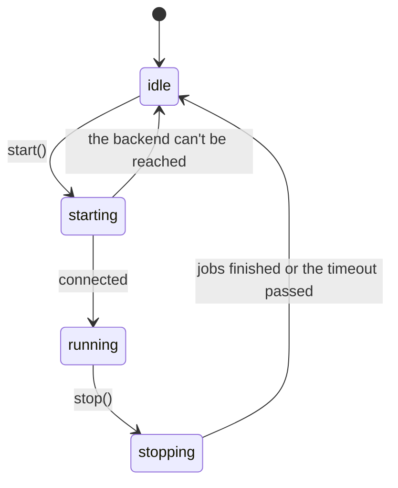
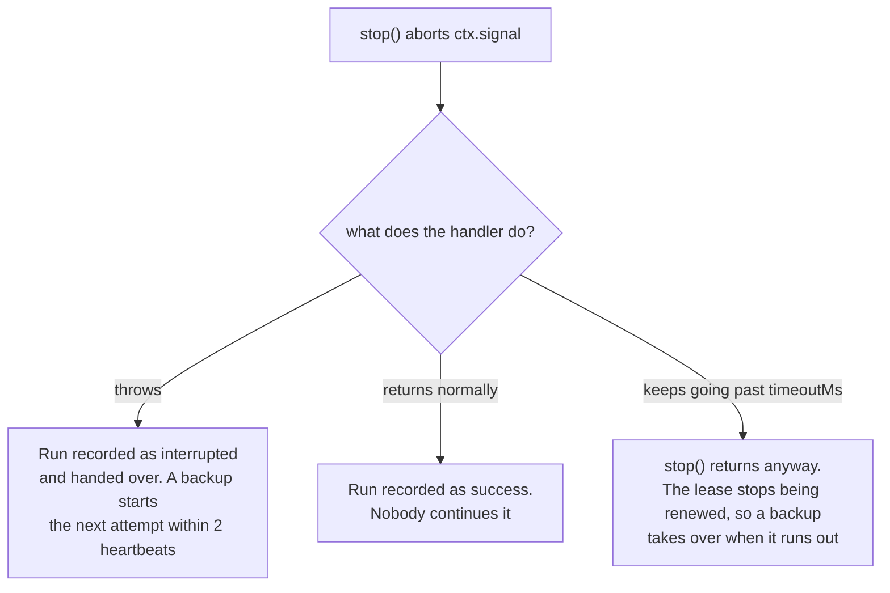

A scheduler is in one of four states.



Nothing connects and nothing runs until `start()`.

## `start()`

```ts
await scheduler.start();
```

In order, `start()`:

1. **Connects** to the backend and checks that the server is new enough.
2. **Prepares each job**: creates what the backend needs (tables, streams, queues).
3. **Sets a timer** for the next slot of each job.
4. On a lease backend, **recovers** what was left behind:
   - a run whose runner died is taken over;
   - a run that is alive on another instance gets this instance as a backup;
   - the latest run is caught up, if nobody ran it and it was due less than `catchUpMs` ago.

If the backend can't be reached, `start()` rejects and the scheduler stays idle. Handle that at boot:

```ts
try {
  await scheduler.start();
} catch (error) {
  console.error('scheduler could not start', error);
  process.exit(1);
}
```

Calling `start()` while already running does nothing. Jobs can be added before or after it.

## `stop()`

```ts
await scheduler.stop();                    // waits up to 30 s for running jobs
await scheduler.stop({ timeoutMs: 10_000 });
```

In order, `stop()`:

1. **Stops scheduling.** No new run starts on this instance.
2. **Aborts `ctx.signal`** of every job running here.
3. **Waits** for those jobs to end, and for claims still in flight, up to `timeoutMs` (default 30 seconds). A run whose claim is won after `stop()` was called doesn't start; it is recorded as `'interrupted'`.
4. **Closes the connection**, if anarchon opened it. A client you passed in stays open.

After `stop()` resolves, anarchon sends nothing more to the store. You can call `start()` again later. `history()` and `lastRun()` still work: after `stop()`, each read opens the connection for itself and closes it when it is done, so the process can exit.

### What happens to a job that was running

It depends on what the handler does once its signal aborts.



The hand-over needs a lease backend. On claim-only backends an interrupted run is simply recorded as `interrupted`.

A hand-over doesn't count against `maxAttempts`, so rolling deploys can't use up a run's retries.

## Graceful shutdown

Call `stop()` when the process is asked to end. Orchestrators send `SIGTERM`; Ctrl+C sends `SIGINT`.

```ts
async function shutdown() {
  await scheduler.stop({ timeoutMs: 20_000 });
  process.exit(0);
}
process.on('SIGTERM', shutdown);
process.on('SIGINT', shutdown);
```

Keep the stop timeout **shorter** than the time your platform allows before it kills the process. On Kubernetes that is `terminationGracePeriodSeconds`, 30 seconds by default. If the process is killed while `stop()` is still waiting, a running job isn't handed over; a backup takes it over only after the lease runs out.

With an HTTP server, stop accepting requests first, then stop the scheduler:

```ts
process.on('SIGTERM', async () => {
  server.close();
  await scheduler.stop({ timeoutMs: 20_000 });
  process.exit(0);
});
```

[Rolling deploys on Kubernetes](../../recipes/kubernetes/) covers this end to end.

## `runNow()`

```ts
const run = await scheduler.runNow('sync');
console.log(run.status, run.durationMs);
```

Runs a job immediately on this instance, whatever its schedule, and resolves with its [run record](../history/#the-run-record) when the handler has finished. If `stop()` is called before the handler starts, it resolves with status `'interrupted'` and the job doesn't run.

A manual run is different from a scheduled one:

| | Scheduled run | `runNow()` |
| --- | --- | --- |
| Deduplicated across instances | Yes | No: calling it on two instances runs it twice |
| Blocked by a run in progress | Yes, with `overlap: 'skip'` | No |
| Retried by a backup if the runner dies | Yes | No |
| In history | Yes | Yes, with `manual: true` |
| `ctx.reason` | `'scheduled'` | `'manual'` |

It throws if the job isn't registered on this instance, or if the scheduler isn't started.

A typical use is an admin endpoint:

```ts
app.post('/jobs/:name/run', async (req, res) => {
  const run = await scheduler.runNow(req.params.name);
  res.json({ status: run.status, ms: run.durationMs, error: run.error });
});
```

## `remove()`

```ts
scheduler.remove('sync'); // true if the job existed
```

Stops scheduling a job on this instance. Other instances keep running it, its history is kept, and a run in progress here finishes. See [Adding and removing jobs](../defining-jobs/#adding-and-removing-jobs-at-run-time).

## The whole life of a service

```ts
import { RedisBackend, Scheduler } from 'anarchon';

const scheduler = new Scheduler({ backend: new RedisBackend({ redis: process.env.REDIS_URL }), log: true });

scheduler
  .every('sync', '10s', (ctx) => syncCustomers({ signal: ctx.signal }))
  .cron('digest', '0 8 * * 1-5', () => sendDigest(), { timezone: 'Europe/Athens' });

scheduler.on('failure', (run) => console.error(`${run.job} failed: ${run.error}`));

async function main() {
  await scheduler.start();

  const shutdown = async () => {
    await scheduler.stop({ timeoutMs: 20_000 });
    process.exit(0);
  };
  process.on('SIGTERM', shutdown);
  process.on('SIGINT', shutdown);
}

main().catch((error) => {
  console.error(error);
  process.exit(1);
});
```

## Next

- [Events and logging](../events-and-logging/)
- [History](../history/)
