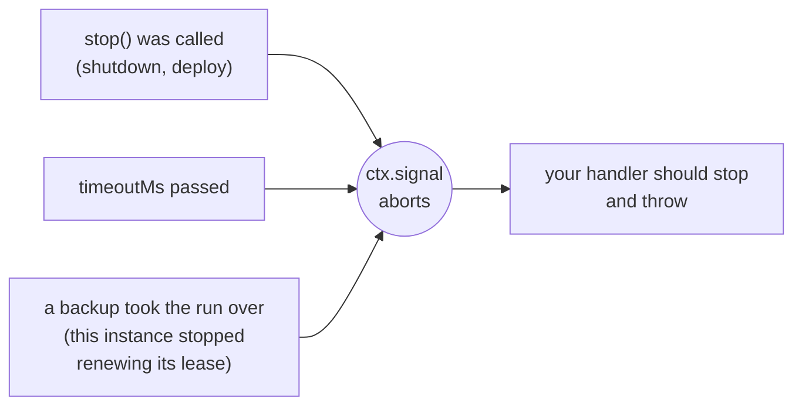

The handler is the function a job runs. It can be sync or async.

```ts
scheduler.every('sync', '10s', async (ctx) => {
  await syncCustomers();
});
```

How the handler ends decides how the run is recorded:

| The handler | The run is recorded as |
| --- | --- |
| Returns (any value) | `success` |
| Throws | `failed`, with the error message |
| Runs past `timeoutMs` | `failed`, with `TimeoutError` |
| Throws after `stop()` or a takeover aborted `ctx.signal` | `interrupted` (not a failure) |

## The context: `ctx`

Every handler receives one argument.

| Field | Type | Meaning |
| --- | --- | --- |
| `name` | `string` | The job's name |
| `slot` | `number` | The scheduled time in ms since 1970. The same on every instance and every attempt |
| `scheduledAt` | `Date` | `slot` as a Date. When the run was due, not when it started |
| `instanceId` | `string` | The instance running this (you) |
| `attempt` | `number` | `1` for the first try; `2` or more when a backup took over |
| `reason` | `string` | Why this run started: `'scheduled'`, `'manual'`, `'catch-up'` or `'takeover'` |
| `manual` | `boolean` | `true` when started with `runNow()` |
| `signal` | `AbortSignal` | Aborts when the run should stop |

## Stopping when asked

`ctx.signal` aborts in three situations:



anarchon can't stop your function from outside; JavaScript has no way to do that. The signal is a request, and the handler has to honor it.

### In a loop

Check between units of work. `throwIfAborted()` throws if the signal has aborted, and does nothing otherwise:

```ts
scheduler.every('export', '10m', async (ctx) => {
  for (const batch of await loadBatches()) {
    ctx.signal.throwIfAborted();
    await exportBatch(batch);
  }
});
```

### Passing it on

Many APIs accept a signal and stop on their own:

```ts
scheduler.every('fetch-rates', '1m', async (ctx) => {
  const response = await fetch('https://rates.example.com/latest', { signal: ctx.signal });
  await saveRates(await response.json());
});
```

### Waiting

`node:timers/promises` takes a signal too:

```ts
import { setTimeout as delay } from 'node:timers/promises';

await delay(5_000, undefined, { signal: ctx.signal }); // rejects as soon as the signal aborts
```

### Why throw, and not just return?

On a lease backend the difference matters:

- If the handler **throws** after `stop()` aborted the signal, the run is recorded as `interrupted` and **handed to another instance**, which starts it again as the next attempt.
- If the handler **returns**, the run counts as **finished**. Nobody continues it.

So: throw when the work isn't done, and return when it is.

```ts
scheduler.every('reindex', '1h', async (ctx) => {
  for (const page of pages) {
    if (ctx.signal.aborted) {
      await saveProgress(page);      // optional: leave a note for the next attempt
      ctx.signal.throwIfAborted();   // then hand the run over
    }
    await indexPage(page);
  }
});
```

## Make jobs safe to run twice

anarchon guarantees one winner per **attempt**, not one execution per run. A run can execute more than once:

- The runner crashes halfway. A backup starts the run again from the beginning.
- The runner freezes longer than its lease. A backup takes over, and when the frozen one wakes up it runs for a moment before it learns it lost the run.

The fix is to write jobs that are **idempotent**: running them twice has the same effect as running them once. `ctx.slot` is the tool for that, because it is the same number on every attempt of the same run.

### Use the slot as a key

```ts
scheduler.cron('monthly-invoices', '0 6 1 * *', async (ctx) => {
  for (const customer of await customers()) {
    // The unique key (customer, period) makes a second attempt a no-op
    await db.query(
      `INSERT INTO invoices (customer_id, period, amount) VALUES ($1, $2, $3)
       ON CONFLICT (customer_id, period) DO NOTHING`,
      [customer.id, ctx.slot, await amountFor(customer)],
    );
  }
});
```

### Use the slot as an idempotency key for other services

```ts
scheduler.every('payouts', '1h', async (ctx) => {
  await paymentProvider.createPayout(
    { amount, destination },
    { idempotencyKey: `payout-${ctx.slot}` },
  );
});
```

### Work on a time window, not on "now"

A takeover can start minutes after the slot. If the job asks "what happened in the last hour" using the current time, a late attempt covers a different hour. Use the slot:

```ts
scheduler.every('hourly-rollup', '1h', async (ctx) => {
  const to = ctx.slot;
  const from = to - 60 * 60_000;
  await rollUp({ from, to }); // the same window on every attempt
});
```

## Knowing it's a retry

`ctx.attempt` and `ctx.reason` tell you that a previous attempt started and didn't finish:

```ts
scheduler.every('import', '30m', async (ctx) => {
  if (ctx.attempt > 1) {
    logger.warn(`import ${ctx.scheduledAt.toISOString()}: attempt ${ctx.attempt} after a ${ctx.reason}`);
    await cleanUpPartialImport(ctx.slot);
  }
  await runImport(ctx.slot);
});
```

## Errors

A handler that throws is recorded as `failed`. anarchon does **not** retry failed runs: the next run is the next scheduled slot.

If you want retries for errors, do them inside the handler:

```ts
scheduler.every('sync', '1m', async (ctx) => {
  for (let tries = 1; ; tries++) {
    try {
      return await syncCustomers({ signal: ctx.signal });
    } catch (error) {
      if (tries === 3 || ctx.signal.aborted) throw error;
      await delay(1_000 * tries, undefined, { signal: ctx.signal });
    }
  }
});
```

To be told about failures, listen for the [`failure` event](../events-and-logging/).

## Long jobs

A job may run longer than its interval. With the default `overlap: 'skip'` the runs due meanwhile are skipped, so there is one at a time. For long jobs:

- Set `timeoutMs`, so a hung run can't block the job forever.
- Check `ctx.signal` often, so shutdowns are quick.
- Keep the job idempotent, because a long job is more likely to be interrupted.

[Long-running jobs](../../recipes/long-running-jobs/) has a complete example with checkpoints.

## Next

- [Lifecycle](../lifecycle/): start, stop and graceful shutdown
- [Events and logging](../events-and-logging/)
