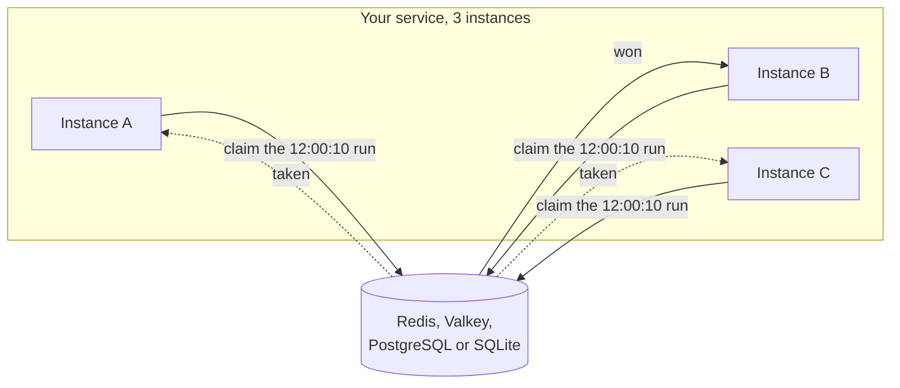

import { Card, CardGrid, LinkCard } from '@astrojs/starlight/components';

```ts
import { Scheduler } from 'anarchon';

const scheduler = new Scheduler(); // Redis on localhost:6379

scheduler
  .every('sync', '10s', async (ctx) => { /* ... */ })
  .cron('digest', '0 8 * * 1-5', async (ctx) => { /* ... */ }, { timezone: 'Europe/Athens' });

await scheduler.start();
```

Run that code in three instances, and "sync" still runs once every 10 seconds, not three times.



<CardGrid>
  <Card title="No leader, no lock" icon="random">
    Nothing is elected and nothing is held. One atomic call to the store decides who runs each time,
    and a random delay spreads the work across instances.
  </Card>
  <Card title="Survives crashes" icon="warning">
    The winner renews a lease while the job runs. If it dies or freezes, another instance takes the
    run over and finishes it.
  </Card>
  <Card title="No overlapping runs" icon="seti:clock">
    A job that takes longer than its interval doesn't pile up: the next run is skipped until the
    current one ends.
  </Card>
  <Card title="Catches up after downtime" icon="rocket">
    A run that was due while every instance was down runs when the first one comes back.
  </Card>
</CardGrid>

## Where to go next

<CardGrid>
  <LinkCard title="Introduction" description="The problem, in plain words, and how anarchon solves it." href="getting-started/introduction/" />
  <LinkCard title="Quick start" description="A working scheduler in five minutes, with no server to install." href="getting-started/quick-start/" />
  <LinkCard title="Guides" description="Every option, method and lifecycle step, with examples." href="guides/defining-jobs/" />
  <LinkCard title="How it works" description="The claim and lease algorithms, step by step, with diagrams." href="internals/architecture/" />
  <LinkCard title="Backends" description="Redis, Valkey, PostgreSQL, SQLite, RabbitMQ and NATS." href="backends/overview/" />
  <LinkCard title="Recipes" description="Express, NestJS, workers, Kubernetes, long jobs." href="recipes/express/" />
</CardGrid>
