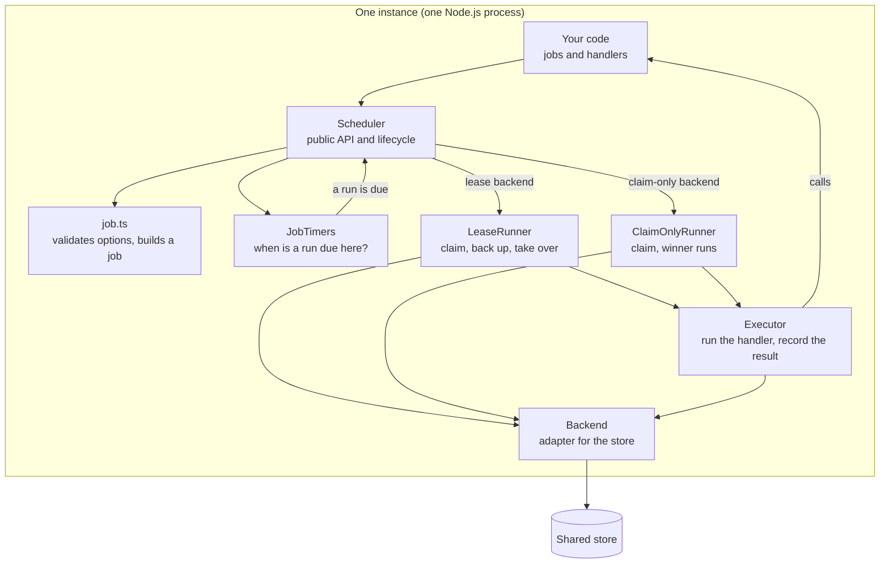
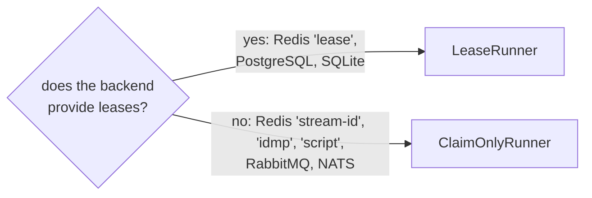

This section explains how anarchon works inside. You don't need it to use the library, but it helps when you tune timings, debug a surprising run, or write a backend.

## The design in one paragraph

Every instance computes the same run times from the same schedule. When a run time arrives, each instance waits a random moment and then asks the shared store to record that it is running that run. The store does this as one atomic step, so exactly one instance is told "won". With a lease backend the winner then keeps a lease alive while the job runs, and the other instances watch that lease so one of them can take over if it stops being renewed.

There is no leader and no election. A lease is not a lock that its holder must release: it only records that the runner is still alive. No instance knows about any other instance; they only talk to the store.

## The parts

| Part | File | Responsibility |
| --- | --- | --- |
| `Scheduler` | `src/scheduler/scheduler.ts` | The public API (`every`, `cron`, `start`, `stop`, `history`...) and the lifecycle. It owns the state and delegates the work |
| Job building | `src/scheduler/job.ts` | Checks a job's name and options against its schedule and the backend, and applies the defaults |
| Schedules | `src/schedule.ts` | Turns "now" into the next and previous run time for interval, cron and one-off jobs |
| `JobTimers` | `src/scheduler/timers.ts` | Sets the timer for each job's next run, plus the jitter |
| `LeaseRunner` | `src/scheduler/lease-runner.ts` | For lease backends: claims a run, watches runs on other instances, takes over, catches up, hands over |
| `ClaimOnlyRunner` | `src/scheduler/claim-only-runner.ts` | For claim-only backends: one claim, and the winner runs |
| `Executor` | `src/scheduler/executor.ts` | Calls your handler, applies the timeout, decides how the run ended, stores the result and emits events |
| Backends | `src/backends/` | One adapter per store. Each implements the atomic claim with what that store offers |

The parts don't reach into each other. They share one small interface (`SchedulerCore`): whether the scheduler is running, the stop signal, how to emit an event, and how to register work that `stop()` must wait for.

## Two kinds of runner

The scheduler picks a runner once, when it is created, based on the backend:

Both end by handing the run to the same `Executor`. What differs is everything around it:

| | `ClaimOnlyRunner` | `LeaseRunner` |
| --- | --- | --- |
| Claim | `backend.claim()`: true or false | `runs.claim()`: `won`, `running`, `overlap`, `done`, `none` or `late` |
| If it loses | Emits `skip`, done | Becomes a backup: checks the run every 1 to 2 heartbeats |
| While running | Nothing | Renews the lease every `heartbeatMs` |
| On `start()` | Nothing | Recovers dead runs and catches up a missed one |
| On `stop()` | Records the run as interrupted | Hands the run to a backup |

## What is stored, and where

Nothing is kept in memory that another instance needs. Everything that matters is in the store:

| Data | Purpose | Written by |
| --- | --- | --- |
| The claim of a run | Decides who runs it | The winner, in the atomic claim |
| The lease end and token | Says the runner is alive, and fences old runners out | The runner's heartbeats (lease backends) |
| The result of an attempt | Status, times, error | The runner, when the handler ends |
| The history | One record per attempt | Claims and results together |

In memory, an instance keeps only its own view: its jobs and their next timer, the runs it is executing, and the runs it is watching as a backup. If the process dies, none of that is needed to recover.

## What makes it leaderless

Three properties together remove the need for coordination between instances:

1. **Deterministic run times.** `(job, slot)` is computed, not negotiated. Two instances that have never communicated agree on it.
2. **An atomic claim.** The store is the only arbiter, and it arbitrates one claim at a time.
3. **Stateless instances.** An instance that restarts recomputes everything from its schedule and the store.

An instance can join or leave at any moment. A new one starts claiming at its next slot; one that leaves simply stops asking.

## Where to read next

| To understand | Read |
| --- | --- |
| The path of one run, from timer to history | [Run lifecycle](../run-lifecycle/) |
| How each store lets exactly one instance win | [Claim algorithms](../claim-algorithms/) |
| Heartbeats, backups, takeover and fencing | [Leases](../leases/) |
| What happens on a crash, a freeze, a deploy | [Failure scenarios](../failure-scenarios/) |
| Jitter, lateness and clock differences | [Timing and clocks](../timing-and-clocks/) |
