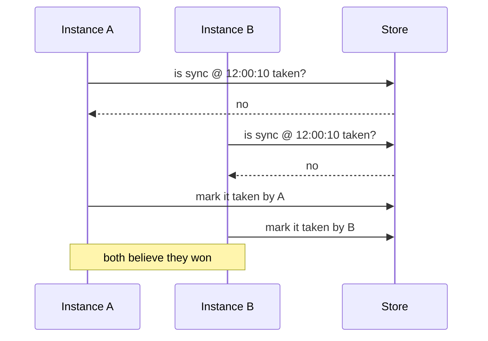
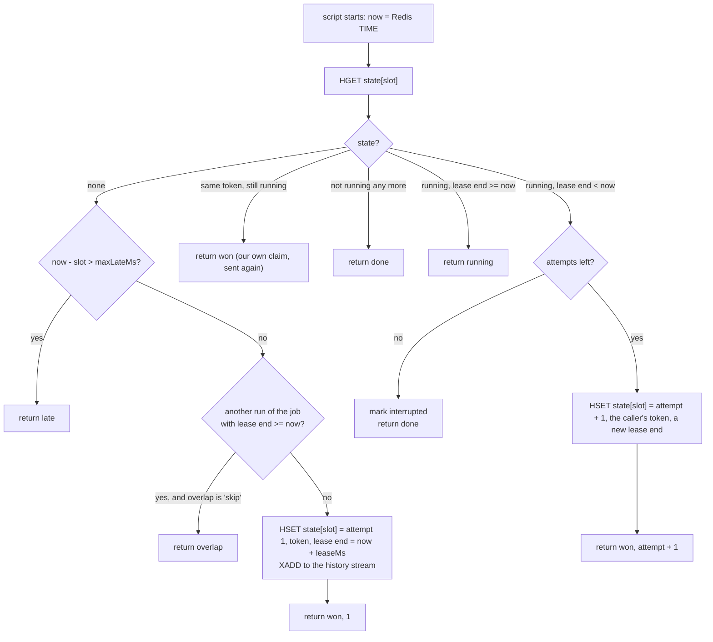
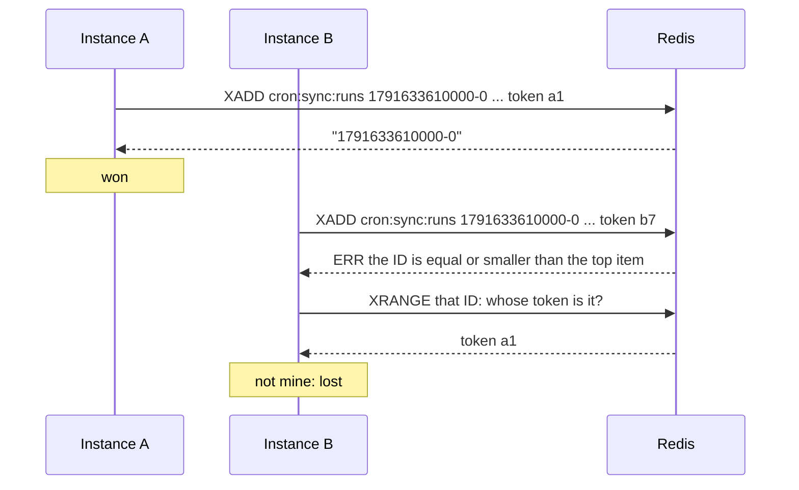
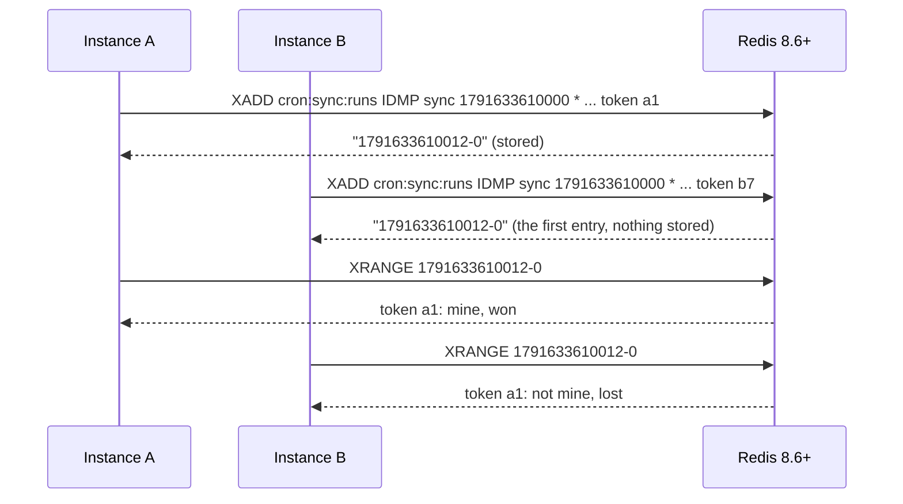
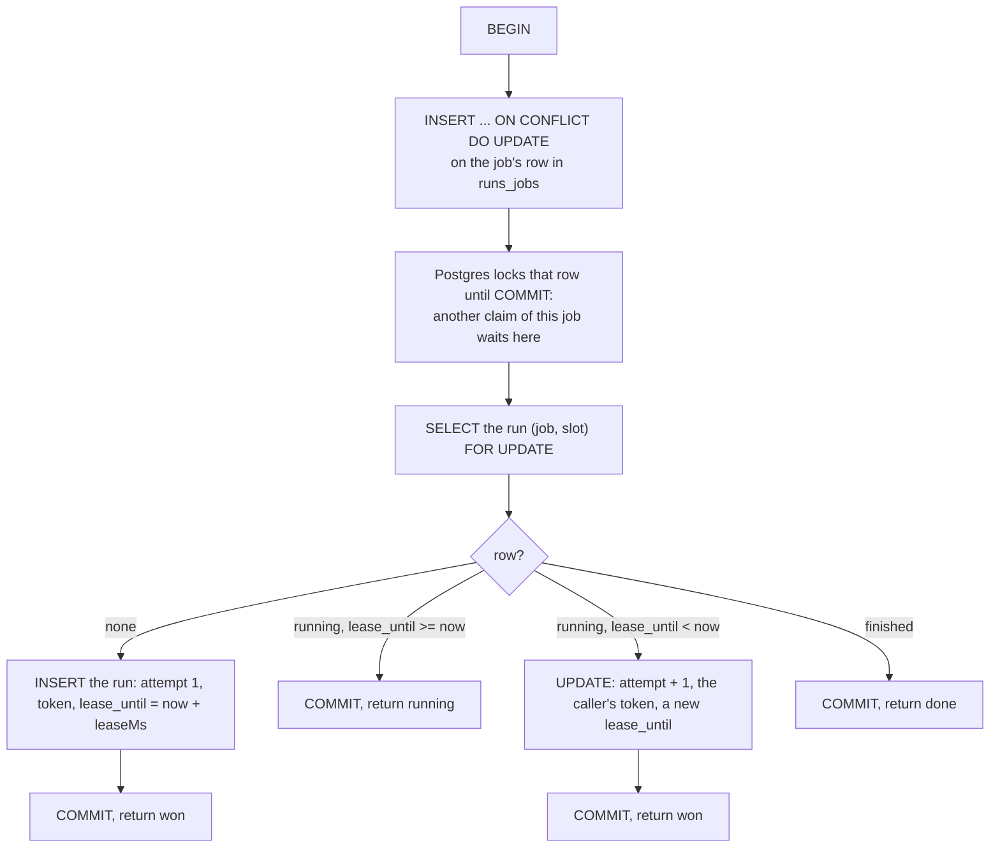
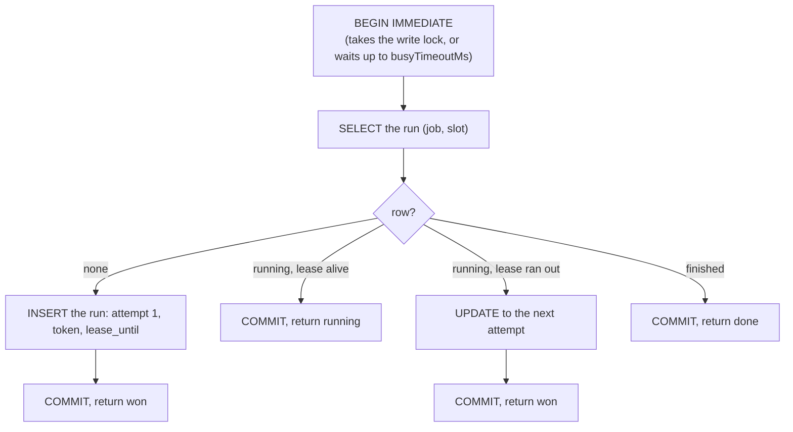
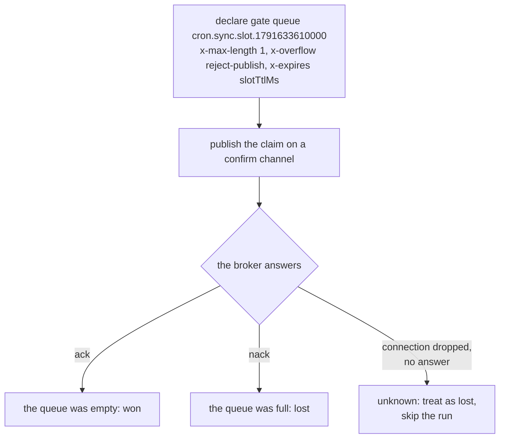
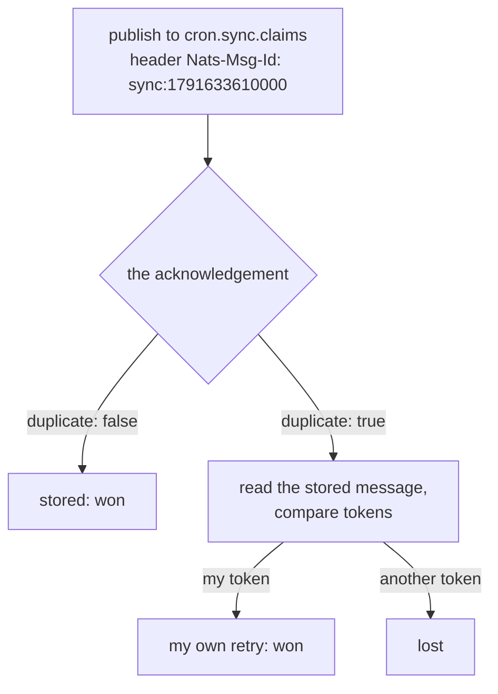

Everything anarchon guarantees rests on one operation: the **claim**. For a given job and slot, exactly one instance must be told it won.

This page shows how each backend gets that from its store.

## Why it has to be atomic

Suppose a claim were two steps: read whether the run is taken, then write that it is.

Between A's read and A's write, B read the same "no". This is a *race condition*, and no amount of care on the client fixes it. The check and the write have to happen **inside the store, as one indivisible step**. Each backend uses a different feature of its store to get that.

## The token

Every claim carries a random **token**, new for each attempt. The store keeps the token of whoever won. It has two uses:

- **Recognizing your own claim.** If a client sends a claim, loses the connection, and sends it again, the second copy finds the run already taken, by itself. Comparing tokens tells it "that was me", so it still runs the job, once.
- **Fencing**, on lease backends: after a takeover the old runner's token no longer matches, so it can no longer change the run. See [Leases](../leases/#fencing).

## Redis: `lease`

**Store feature:** Redis executes a Lua script from start to end before it does anything else.

The claim is one script. It reads the run's entry in a hash and decides:

Because nothing else runs while the script does, two instances can't both see "none" or both see "lease ran out". The first script to run writes the state; the second reads it.

Note that the script uses **Redis's own clock** (`TIME`). Instances never compare clocks with each other.

## Redis: `stream-id`

**Store feature:** a stream entry ID must be greater than the stream's last ID.

Each instance tries to add an entry whose ID *is* the slot. Redis accepts the first and refuses the rest. On a refusal, the instance reads the entry and compares tokens, in case the refusal was for its own retried command.

One command, no script. The stream doubles as the history.

## Redis: `idmp`

**Store feature:** idempotent `XADD` (Redis 8.6+). Redis keeps the first entry for an idempotency key and answers repeats with that entry's ID.

All instances use the job name as the producer ID, so for this job they act as one logical producer sending the same message. Redis remembers a key for `idmp.durationSec`.

## Redis: `script`

**Store feature:** an atomic Lua script, as with `lease`.

The script scans the stream's entries of the last `scriptWindowMs` for this slot. If it finds one, it returns that entry's token. Otherwise it appends the claim and returns the caller's token. The caller won if the token that comes back is its own.

It behaves like `idmp` on servers that don't have it (Valkey, Redis before 8.6).

## PostgreSQL

**Store feature:** a transaction, with a row lock that makes claims of one job take turns.

A run is a row with primary key `(job, slot)`.

The first statement of every claim writes the job's row in `<table>_jobs`. PostgreSQL holds a lock on that row until the transaction commits, so a second claim of the same job blocks on its first statement until the first claim is finished. It then reads the run and sees what the first wrote.

Why a separate lock row, instead of just inserting the run and catching the conflict? Because the claim also has to look at **other** runs of the job (for the overlap rule), and that decision must be consistent too. Serializing per job makes the whole decision one step.

`now` is the database's clock, read inside the transaction.

## SQLite

**Store feature:** one writer at a time for the whole database, and `BEGIN IMMEDIATE`.

The steps are the same as for PostgreSQL. What differs is the serialization: SQLite allows only one write transaction at a time, and `BEGIN IMMEDIATE` takes that lock at the start instead of at the first write. So the second claim waits at `BEGIN` and can't read anything stale.

## The read before the transaction

On PostgreSQL and SQLite, a **backup's check** on a run goes through a shortcut first: a single `SELECT` of the run. If the run is finished, or its lease is still alive, the answer is known and no transaction is opened. Only when the lease has run out does the backup open the transaction above, which checks again under the lock.

That keeps backups from taking the write lock every heartbeat just to learn "still alive".

## RabbitMQ

**Store feature:** a queue with a maximum length of one that rejects further publishes, plus publisher confirms.

The broker handles the publishes to one queue in order. The first fills the queue and is confirmed; every other is rejected. Nobody consumes the message, so the queue stays full until it expires.

The queue is the memory of the run. Its lifetime, `slotTtlMs`, is how long RabbitMQ knows the run was taken.

## NATS

**Store feature:** JetStream de-duplication by message ID.

Every instance publishes with the same message ID, because the ID is built from the job and the slot. The stream stores the first and marks the rest as duplicates, within its duplicate window.

## Side by side

| Backend | Atomic step | Who orders the claims | Remembers a run for |
| --- | --- | --- | --- |
| Redis `lease` | Lua script | Redis's single command thread | as long as a late claim could ask |
| Redis `stream-id` | `XADD` with an explicit ID | Redis | forever |
| Redis `idmp` | `XADD ... IDMP` | Redis | `idmp.durationSec` |
| Redis `script` | Lua script | Redis | `scriptWindowMs` |
| PostgreSQL | Transaction + row lock per job | The row lock | as long as a late claim could ask |
| SQLite | `BEGIN IMMEDIATE` transaction | The database write lock | as long as a late claim could ask |
| RabbitMQ | Publish to a full-or-empty queue | The queue | `slotTtlMs` |
| NATS | De-duplicated publish | The stream leader | `duplicateWindowMs` |

"Remembers a run for" matters because of late instances. [Timing and clocks](../timing-and-clocks/#how-long-the-store-must-remember) explains why.

## Next

- [Leases](../leases/): what the lease backends do after the claim
- [Writing your own backend](../../backends/custom/)
