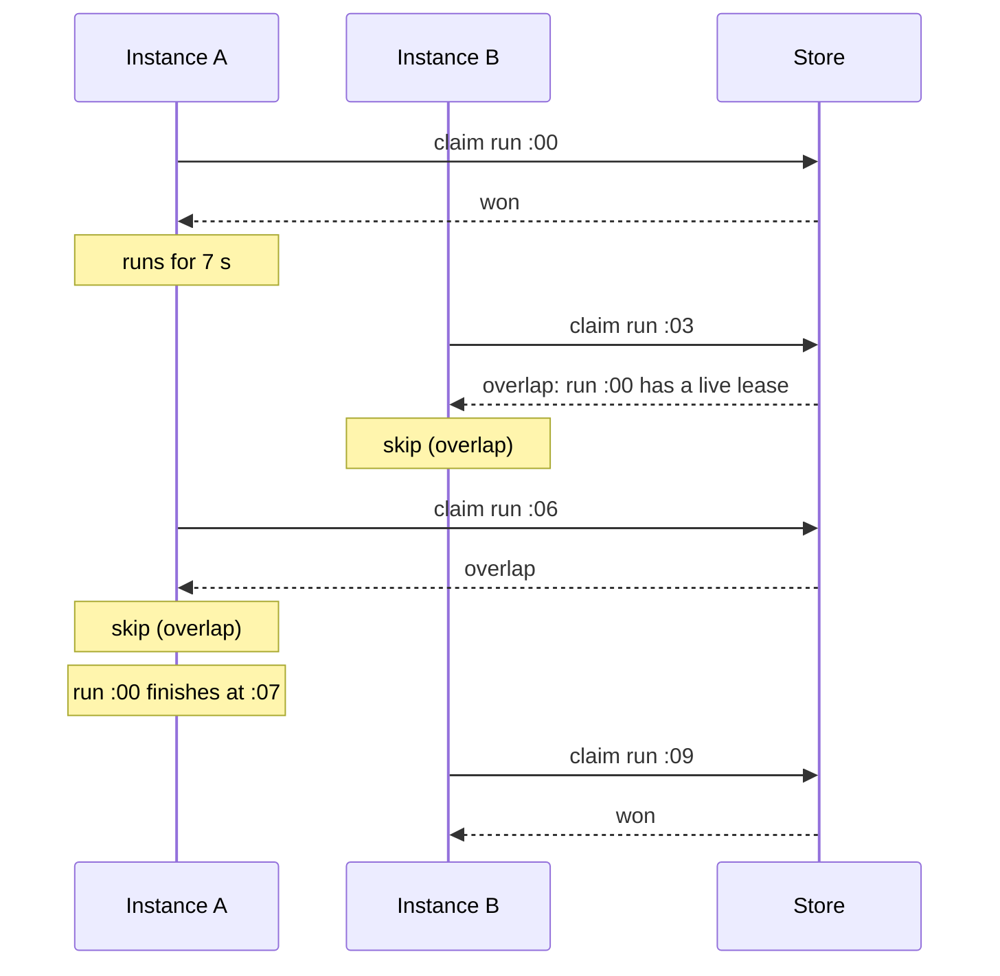
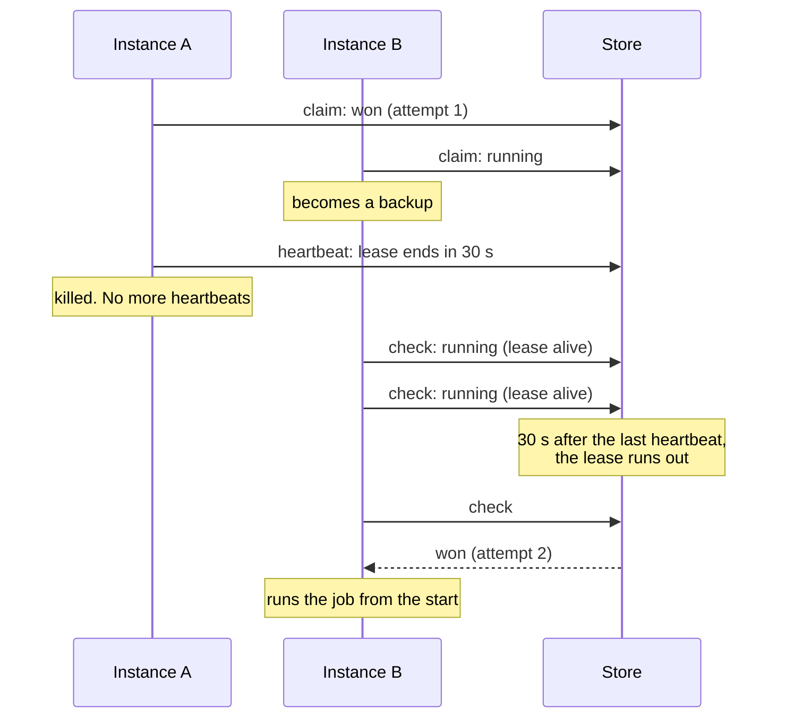
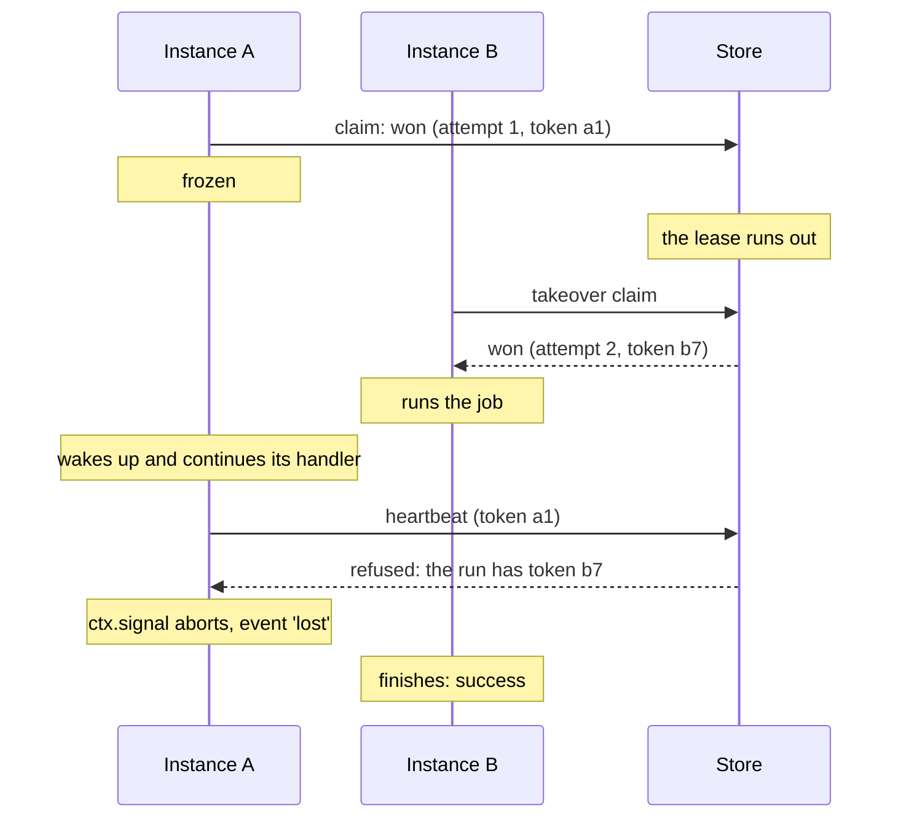
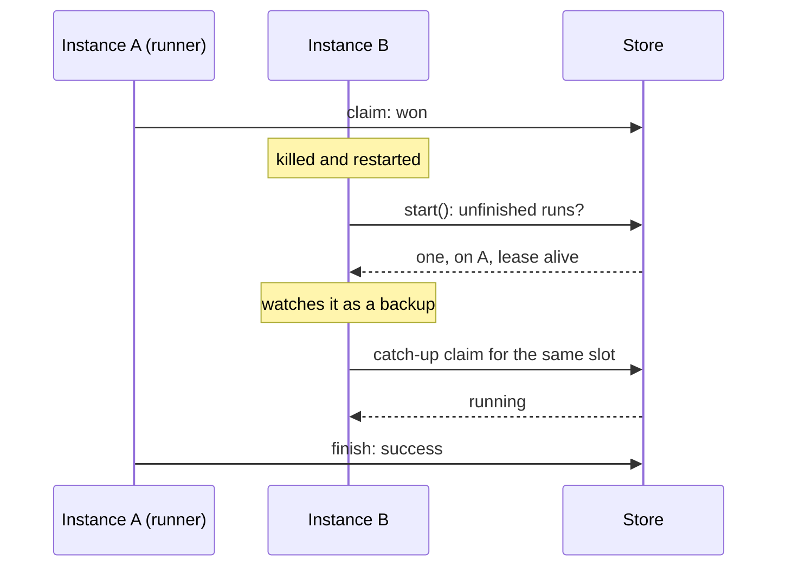
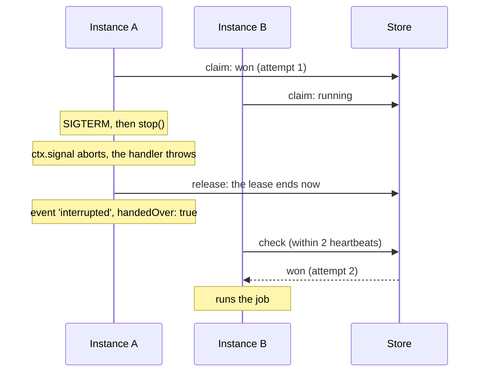
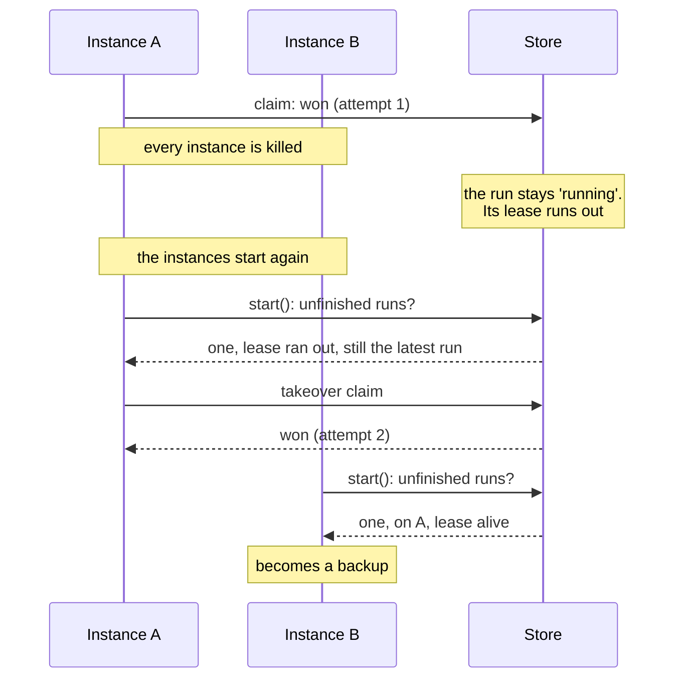
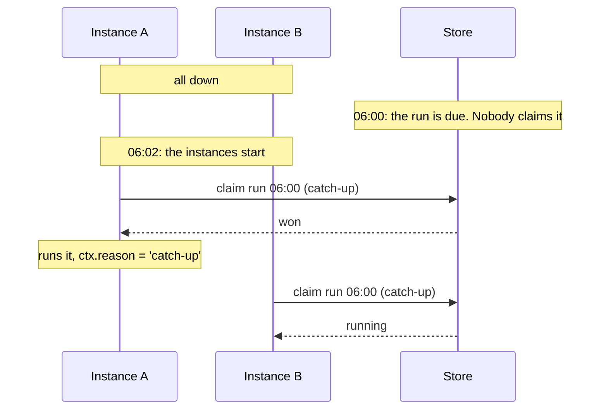

These are the situations a scheduler meets in a real cluster. Each one below shows what happens with a lease backend, and what happens with a claim-only backend for comparison.

They are not thought experiments. The repository has a test for each, run with real processes that are killed (`kill -9`), frozen (`SIGSTOP`), stopped (`SIGTERM`) and restarted, on Redis, PostgreSQL and SQLite. You can watch them side by side with:

```sh
pnpm scenarios
```

## Summary

| What happens | Claim-only backend | Lease backend |
| --- | --- | --- |
| [A job runs longer than its interval](#1-a-job-runs-longer-than-its-interval) | Several copies run at once | One at a time; runs due meanwhile are skipped |
| [The runner is killed mid-run](#2-the-runner-is-killed-mid-run) | The run is lost; history says `running` forever | A backup finishes it as attempt 2 |
| [The runner freezes longer than its lease](#3-the-runner-freezes) | No backup; the run waits | A backup takes over; the frozen one is told when it wakes |
| [Another instance restarts mid-run](#4-another-instance-restarts-mid-run) | Fine: runs once | Fine: runs once, and the restarted instance becomes a backup |
| [The runner is stopped gracefully](#5-the-runner-is-stopped-gracefully) | The run is lost; history says `interrupted` | Handed over at once; a backup finishes it |
| [Every instance restarts mid-run](#6-every-instance-restarts-mid-run) | The run is lost | One instance re-runs it after the restart |
| [Every instance is down when a run is due](#7-every-instance-is-down-when-a-run-is-due) | The run never happens | Caught up on start, if it was due recently |

The examples use three instances, A, B and C, with `leaseMs` 30 s and `heartbeatMs` 5 s.

## 1. A job runs longer than its interval

A job that takes 7 seconds, scheduled every 3 seconds.



**Lease backend:** one run at a time. The runs at :03 and :06 are skipped, not queued.

**Claim-only backend:** every slot is claimed independently, so runs :00, :03 and :06 are all in progress at :06. Three copies at once.

Set `overlap: 'allow'` if you want that behavior on a lease backend.

## 2. The runner is killed mid-run

The process running the job is killed outright: `kill -9`, an out-of-memory kill, a host that loses power.



**Lease backend:** a backup takes over about one lease after the crash, at most `leaseMs + 2 × heartbeatMs`. History shows attempt 1 as `interrupted` and attempt 2 as `success`.

**Claim-only backend:** nobody knows the runner died. The run never finishes and its history record stays `running`.

The backup starts the job **from the beginning**. anarchon doesn't know how far the first attempt got. See [Long-running jobs](../../recipes/long-running-jobs/) for checkpointing.

## 3. The runner freezes

The process isn't dead. It stops making progress for longer than its lease: a very long garbage-collection pause, a virtual machine that is paused or starved, a laptop that sleeps.



**Lease backend:** a backup takes over. When the frozen instance wakes, its next heartbeat is refused, its `ctx.signal` aborts and it emits `lost`.

**Claim-only backend:** no backup. The run simply continues when the instance wakes up.

:::caution
Between waking up and its next heartbeat, the frozen instance's handler runs alongside the backup's, for up to one heartbeat interval. The store's record is protected by the token; your side effects are protected only by your handler checking `ctx.signal` and being idempotent.
:::

## 4. Another instance restarts mid-run

An instance that is **not** running the job is killed and started again while the job runs elsewhere.



**Both kinds of backend:** the run happens once. On start, the restarted instance asks for the latest slot, finds it taken, and doesn't run it. On a lease backend it also becomes a backup again.

## 5. The runner is stopped gracefully

A rolling deploy sends `SIGTERM` to the instance running the job, and your shutdown code calls `scheduler.stop()`.



**Lease backend:** the run is handed over without waiting for the lease. A backup starts attempt 2 within two heartbeats. This doesn't count against `maxAttempts`.

**Claim-only backend:** the run is recorded as `interrupted` and nobody continues it.

The hand-over needs the handler to **throw** when its signal aborts. A handler that ignores the signal keeps running until the stop timeout; then the instance stops renewing and a backup takes over after the lease runs out. See [Lifecycle](../../guides/lifecycle/#what-happens-to-a-job-that-was-running).

## 6. Every instance restarts mid-run

All instances are killed at once while a job runs, then start again. Nobody is left to be a backup.



**Lease backend:** the state is in the store, not in the instances. Whoever starts first finds the unfinished run and takes it over, provided no newer slot is due.

If the instances come back before the old lease has run out, they see it as alive, watch it, and take over when it expires.

**Claim-only backend:** the run is lost.

## 7. Every instance is down when a run is due

A run's time passes while no instance is running: a full outage, a deploy that stops everything first.



**Lease backend:** on start, an instance runs the latest slot if nobody claimed it and it was due less than `catchUpMs` ago (default 5 minutes). Only the latest: an hour of downtime catches up one run, not sixty.

**Claim-only backend:** the run never happens.

## What stays your job

anarchon makes sure a run is **started** again when its runner is gone. Two things remain with the handler:

1. **Running twice is harmless.** Attempts 1 and 2 may both have done part of the work.
2. **Stopping when asked.** A handler that ignores `ctx.signal` turns a clean hand-over into a wait for the lease.

[Writing handlers](../../guides/writing-handlers/) covers both.

## Next

- [Leases](../leases/): the rules behind these scenarios
- [Timing and clocks](../timing-and-clocks/)
