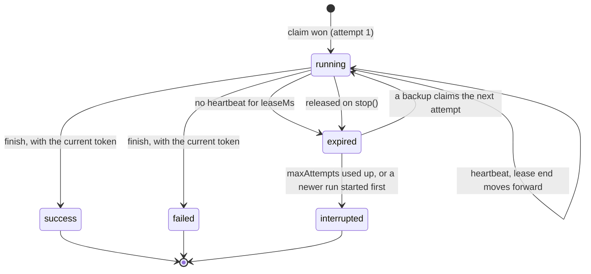
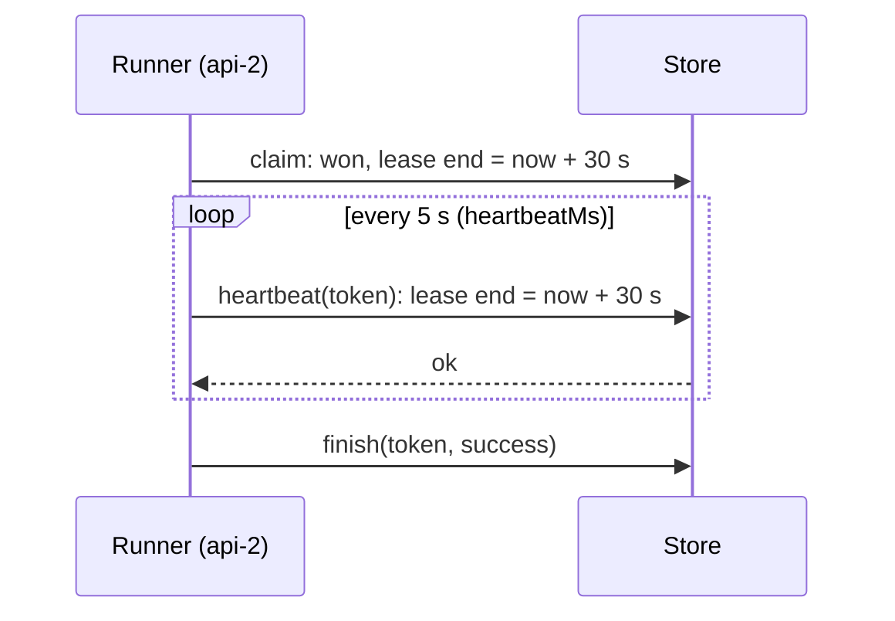
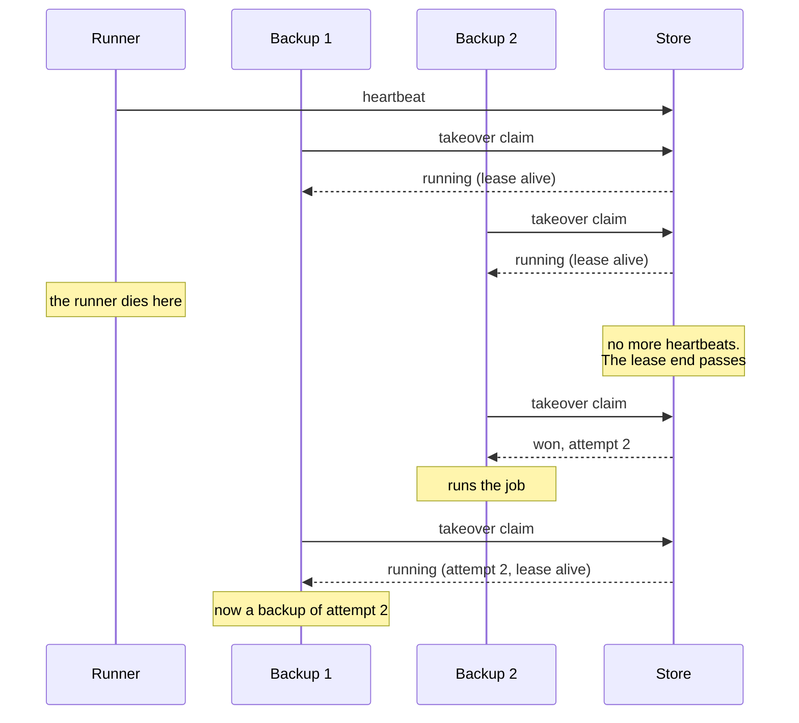
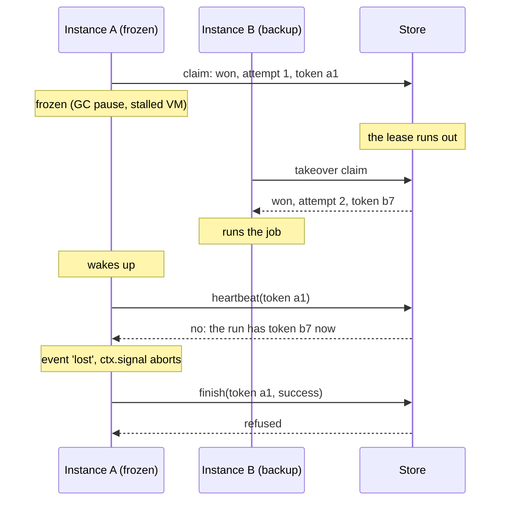
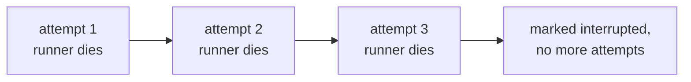
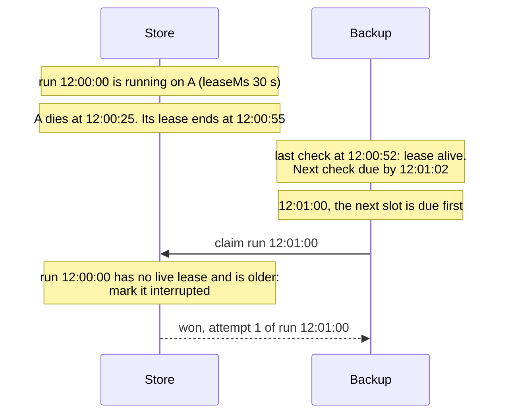
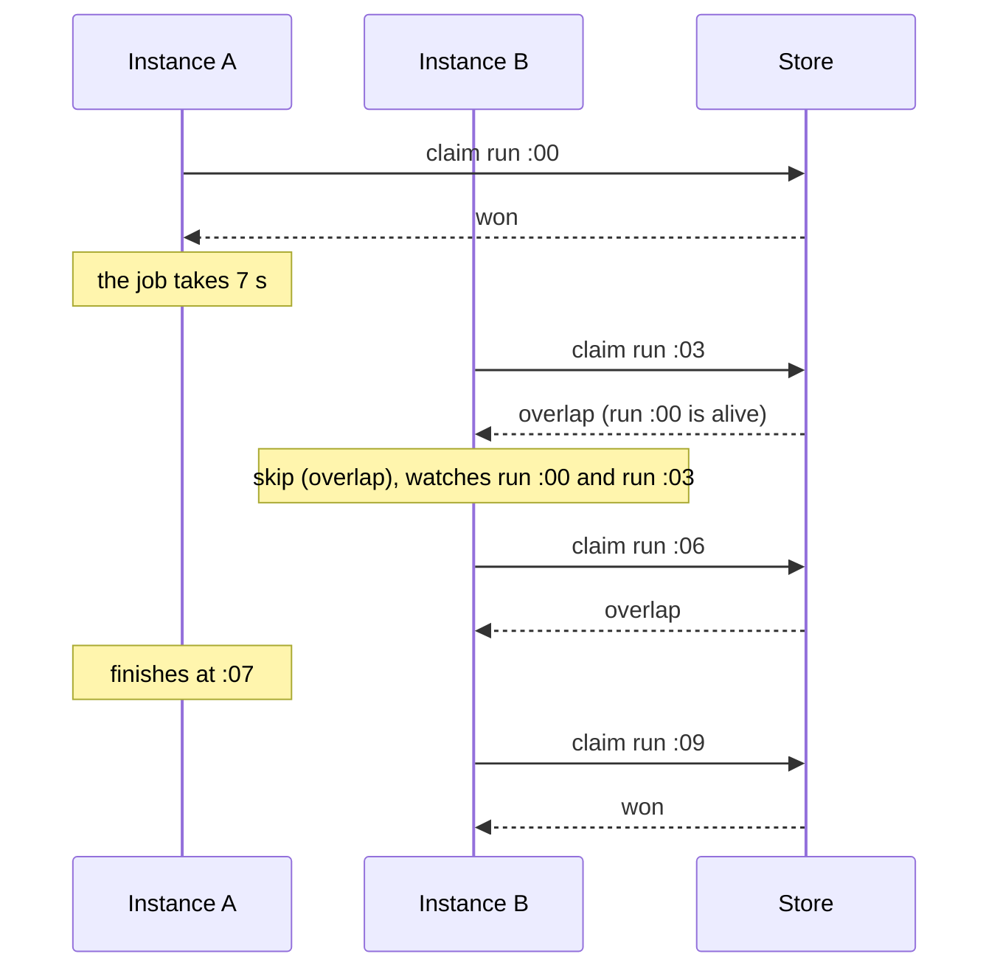
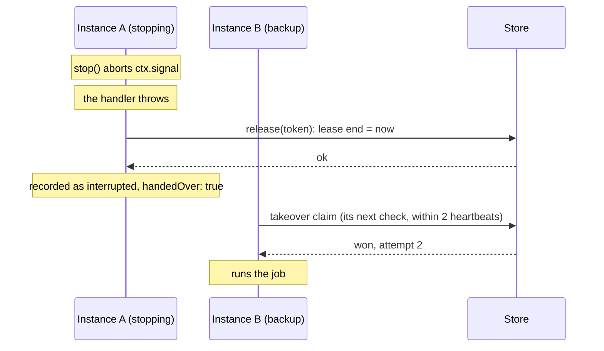
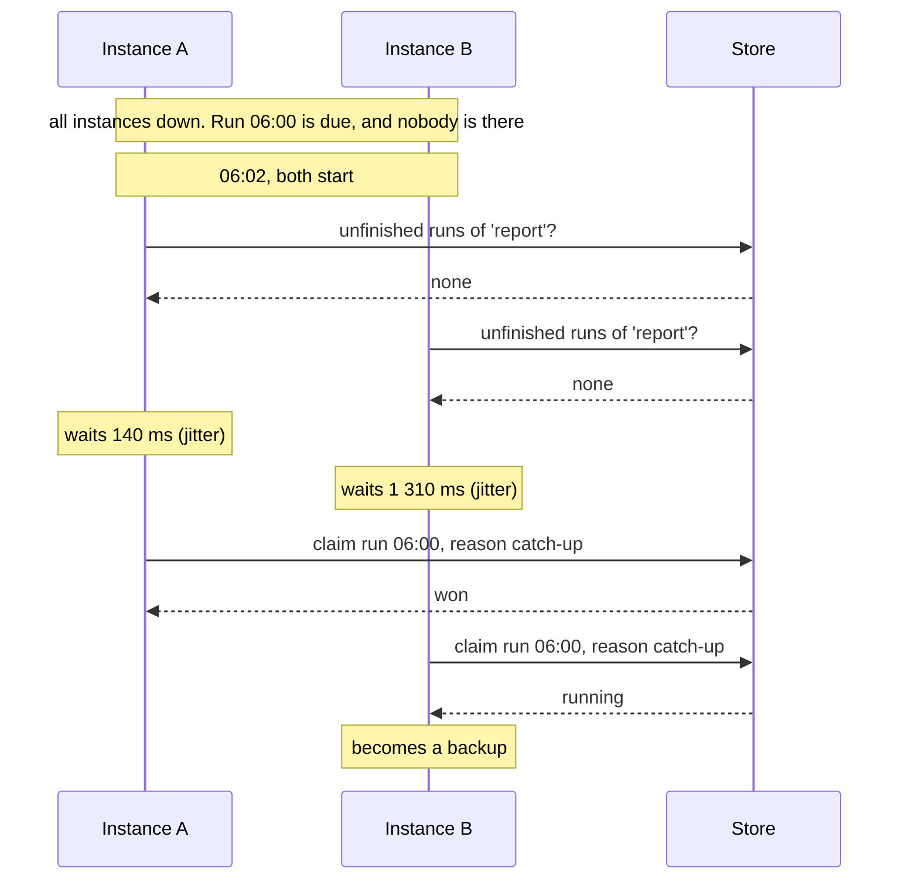

A claim decides who **starts** a run. A lease is how the cluster finds out the runner **stopped**.

This page applies to the lease backends: Redis and Valkey with the `lease` strategy, PostgreSQL and SQLite. The rules are the same on all three.

## What a lease is

When an instance wins a run, the store records, with the run:

| Field | Example | Meaning |
| --- | --- | --- |
| attempt | `1` | Which try this is |
| token | `a1f3...` | The random value of this attempt |
| runner | `api-2` | Who is running it |
| status | `running` | `running`, `success`, `failed` or `interrupted` |
| lease end | `12:00:40.310` | Until when the runner is known to be alive |

The **lease end** is a time on the store's clock. While the job runs, the runner moves it forward every `heartbeatMs`. If the runner stops, the lease end stays where it was, and once the store's clock passes it, the run is up for the next attempt.

A lease is not a lock:

- Nobody waits for it.
- Nobody has to release it for others to proceed; it runs out on its own.
- It doesn't prevent anything. It only records that the runner was alive recently.

## The states of a run



"Expired" is not stored as a status. It is what a run *is* when its status says `running` and its lease end is in the past.

## Heartbeats



A heartbeat is one small write: "if the run still has my token, set the lease end to now + `leaseMs`". With the defaults, the lease is 30 seconds and it is renewed every 5, so a runner can miss several heartbeats in a row before the lease runs out.

`heartbeatMs` must be under half of `leaseMs`. The default is 5 seconds, or `leaseMs / 6` when that is smaller.

## Backups

Every instance that asked for a run and was told `running` becomes a backup of it. A backup sets a timer and checks the run again after a random time between one and two heartbeats, and keeps doing so until the run ends.



Several backups may notice the expired lease. They all send a takeover claim, and the claim is atomic, so one wins and the others see a fresh lease.

### How long a takeover takes

```
last heartbeat ──────── leaseMs ────────► lease runs out ── up to 2 × heartbeatMs ──► takeover
```

| | Formula | Defaults |
| --- | --- | --- |
| At most | `leaseMs + 2 × heartbeatMs` after the last heartbeat | 40 s |
| Typical | about `leaseMs` after the crash | about 30 s |

Shorten `leaseMs` for faster failover; the cost is that shorter pauses of a healthy runner also cause takeovers.

## Fencing

Fencing answers this question: what if the runner wasn't dead, only slow?

A process can be frozen for a minute by a garbage-collection pause or a stalled virtual machine, and then continue as if nothing happened. Meanwhile a backup took over. Now two instances believe they are running the same run.

The **token** resolves it. Each attempt has its own token, and the store acts on a heartbeat or a finish only if the token matches the current attempt.



When A's heartbeat is refused, A:

1. aborts the run's `ctx.signal`, so a handler that watches it stops;
2. emits the `lost` event;
3. can no longer change the run in any way.

A doesn't need the store's answer to give the run up. When no heartbeat has been confirmed within `leaseMs` of being sent (the store is unreachable from A, or answers too slowly), A does the same two things on its own: by then the lease may have run out on the store, and a backup may be taking the run over. Heartbeats may overlap, so one slow answer doesn't count against the lease while later ones come back.

After the handler ends, A keeps renewing the lease while it stores how the run ended, so a short store outage doesn't make a backup re-run a job that completed. It does so for `leaseMs` at most: if the store never answers that write, A stops renewing, the lease runs out, and the job's next runs go ahead. A backup may then start the run again as the next attempt, as after a crash.

:::caution[What fencing can't do]
Fencing protects the **store's record** of the run. It can't undo what A's handler did between waking up and its next heartbeat. For up to one heartbeat interval, two attempts can be running at the same time. That is why handlers should check `ctx.signal` before side effects and be [safe to run twice](../../guides/writing-handlers/#make-jobs-safe-to-run-twice). A resource the handler writes can also [reject writes from an older attempt](../../guides/writing-handlers/#reject-writes-from-an-older-attempt).
:::

## Attempts and `maxAttempts`

Each takeover is a new attempt. `maxAttempts` (default 3) limits how many times a run is **started** when runners die.



Two rules keep this from misfiring:

- **Only dead runners count.** A handler that throws is `failed` and is not retried.
- **Hand-overs don't count.** A run released by `stop()` keeps its remaining attempts, so deploys can't use them up.

## A dead run and the next slot

What happens when a runner dies shortly before the job's next slot? It depends on which claim reaches the store first once the dead run's lease has run out.

| Order of events | Result |
| --- | --- |
| The next slot is due while the dead run's lease is **still alive** | Nobody can know yet that the runner is dead. The new run is skipped as an overlap. When the lease runs out, a backup takes over the old run |
| The lease runs out, and a **backup's check** comes first | The backup takes over the old run. If the next slot arrives while it runs, that one is skipped as an overlap |
| The lease runs out, and the **next slot's claim** comes first | The new run starts, and the dead one is marked `interrupted`. It is not retried |

The third case looks like this:



This is deliberate. Once a newer run has started, re-running the old one afterwards would execute them out of order, and for a job that runs every minute the fresher run is the one you want.

The same rule applies on start: an instance takes over a dead run only if no newer slot is due.

The window is small: between the lease running out and the first backup's check, at most two heartbeats. For a job that must not lose a run, keep the interval comfortably longer than `leaseMs`, and remember that [catch-up](#catch-up-on-start) and retries are per run, not a queue of missed work.

## Overlap

With `overlap: 'skip'` (the default), a new run is refused while an **earlier run of the same job has a live lease**. The claim returns `overlap`, and the instance emits `skip`.



The check is in the same atomic claim, so it holds across instances: no two runs of the job hold live leases at once.

An instance that skipped a run as an overlap keeps an eye on **that** run too. If the earlier run ends within the jitter window and another instance then claims the new run, the first instance is its backup like any other.

A dead earlier run doesn't block: its lease has run out, so the new run starts and the old one is marked `interrupted`.

## Hand-over on `stop()`

Waiting a whole lease for a takeover is wasteful when the runner knows it is leaving. On `stop()`:



**Release** ends the lease immediately and notes that this was a hand-over, so it doesn't count against `maxAttempts`. A backup picks the run up at its next check, within two heartbeats, not after `leaseMs`. A released lease stays released: a heartbeat that the runner sent before the release and that arrives after it does not renew it.

Three things can happen to a job that is running when `stop()` is called:

| The handler | Result |
| --- | --- |
| Throws once the signal aborts | Released: handed over at once |
| Returns normally | Finished: recorded as `success` |
| Is still running when the stop timeout passes | The instance stops renewing; a backup takes over when the lease runs out |

## Catch-up on start

When an instance starts, it recovers each job in two steps.

**1. Unfinished runs.** It asks the store which runs of the job are not finished:

- lease alive: it becomes a backup;
- lease ran out, and the run is still the latest: it claims the next attempt;
- lease ran out, but a newer slot is due: it leaves it; the next run replaces it.

**2. A missed run.** If the latest slot was due less than `catchUpMs` ago (default 5 minutes) and nobody claimed it, the instance waits a random jitter and claims it, with `reason: 'catch-up'`.



Only the latest run is caught up. If the service was down for an hour, a job that runs every minute catches up one run, not sixty.

## Late claims

A claim can arrive at the store long after it was sent: the network stalled, or the client queued commands while reconnecting. A claim that arrives minutes late must not start a stale run.

So the store checks lateness **on its own clock**, inside the atomic claim: if `now - slot` is more than `maxLateMs` plus a 10-second tolerance, the answer is `late`.

And a run's state is never deleted while a late claim could still ask for it, whatever `historySize` is. Otherwise a late claim could find no state and wrongly win a run that already happened.

## Summary of the rules

1. A claim for a run with no state wins and gets a lease.
2. A heartbeat extends the lease, only with the current token and only while the lease was not released.
3. A run whose lease ran out can be claimed as the next attempt, up to `maxAttempts`. If a newer run of the job starts first, the old one is marked `interrupted` instead.
4. Finish and release only work with the current token.
5. A new run is refused while an earlier run of the job has a live lease (`overlap: 'skip'`).
6. A new claim that arrives too late, by the store's clock, is refused.

## Next

- [Failure scenarios](../failure-scenarios/): these rules applied to real failures
- [Timing and clocks](../timing-and-clocks/)
